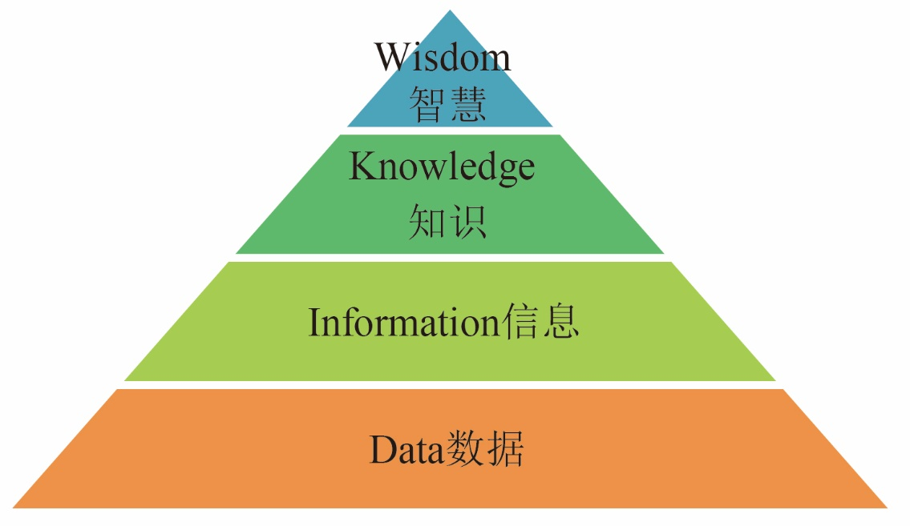
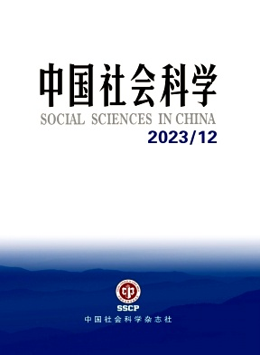
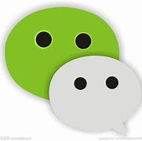
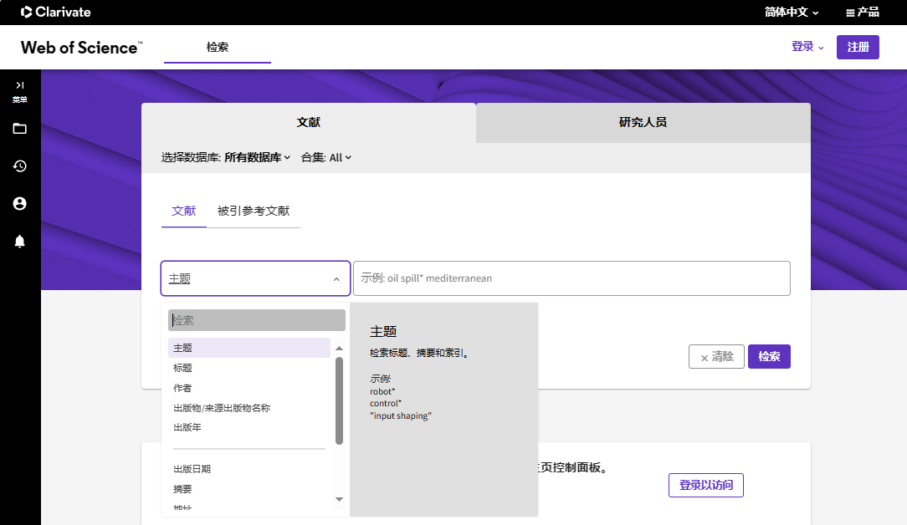
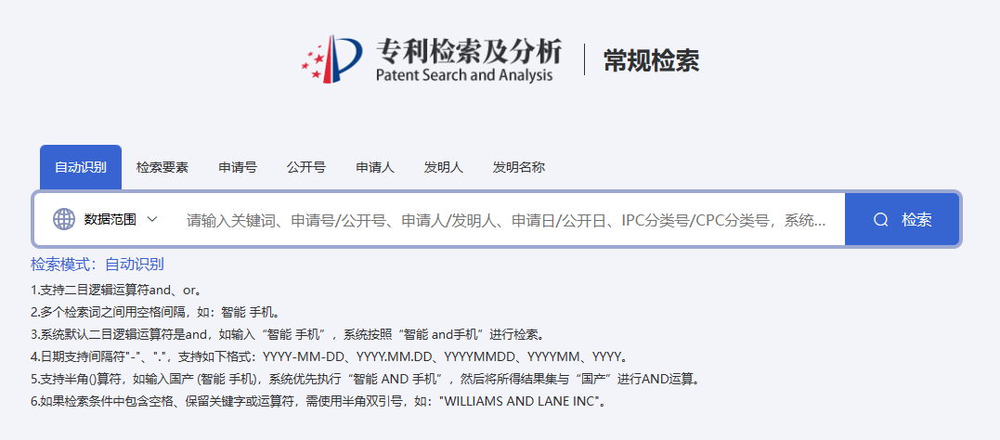

# 第一章 信息素养基础

随着ChatGPT等生成式人工智能工具进入学习、研究和工作场景，人们获取、整理和表达信息的方式正在发生变化。大模型能够快速生成看似完整的回答，却也可能出现模型幻觉、引用失实、语境遗漏和偏见放大等问题。面对数量庞大、来源复杂且生成速度不断提高的信息，我们既要会提出问题，也要能够追溯来源、判断证据、合法利用并清楚说明工具的作用边界。信息素养正是贯穿这些活动的一组知识、能力与责任，并进一步与数据素养、人工智能素养相互连接。对于处在知识体系与研究习惯形成阶段的大学生而言，良好的信息素养有助于快速、有效地获取相关且可信的信息，并在智能时代保持独立判断。本章将回答什么是信息素养、它包含哪些能力、如何表达信息需求，以及如何评价自身的信息活动，为后续的信息检索、综述写作、数据分析与学术规范奠定基础。

## 1.1 从DIKW金字塔谈起

本书主要涉及信息素养、数据素养的相关内容，那么首先我们需要弄清楚什么是信息？什么是数据？此外，我们经常在学习和工作中遇到知识和智慧这两个名词，这两个名词有何区别，它们与信息和数据存在何种关系？为了弄清楚这些问题，我们先从数据-信息-知识-智慧（Data-Information-Knowledge-Wisdom，DIKW）金字塔说起。

数据—信息—知识—智慧（DIKW）金字塔常被用来说明四类对象之间可能存在的加工与解释关系。**数据**是观察、测量或记录的结果；数据被放入具体语境并得到组织后，可以形成能够回答“谁、什么、何时、何处”等问题的**信息**；研究者对多项信息进行比较、解释和整合，可以形成可迁移的**知识**；在具体情境中综合知识、价值与后果作出审慎判断，则体现为**智慧**。

需要强调的是，DIKW是一种启发性的理解框架，而不是所有情境中都严格成立的单向流水线。数据并非天然“纯客观”：观察什么、怎样测量、如何编码和保留哪些记录，都可能包含理论假设与价值判断；信息也会受到语境、选择和表达方式影响。知识还可能反过来决定人们收集什么数据，新的证据也可能修正既有知识。因此，图1-1更适合帮助读者区分层次和提出问题，而不应被理解为数据必然自动上升为智慧。

图1-1 DIKW金字塔

什么是数据呢？简而言之，数据是单纯的事实和记录，是通过观察、测量或收集而得到的原始的、未经处理的数字和符号。例如，用体重秤测得的某人的体重、国家统计局统计的人口数量、服务器记录的某篇论文被下载的次数、NBA某场比赛的得分等等。注意，数据并不一定就是数值型数据，比如，人类早期利用结绳等方式来进行记录，现代的交通监控系统记录的视频，同样也都是一种数据。

什么是信息呢？信息是从数据中提取出来的、具有一定意义和结构的数据。也就是说，信息是一种特殊的数据，即具有数据的一些特性（如可加工性），又具有数据不具备的描述性等特征。比如根据某人的体重数据和平均体重数据，我们可以得出该人是胖/瘦（或者健康程度）的信息；根据国家每年的人口数量数据，可以得出我国人口数量出现负增长趋势的信息；根据不同论文的下载次数，我们可以得出某篇论文被高度关注的信息，等等。同样，我们并不一定只能从数值型数据中提取信息，在任何数据类型中，都可以提取一定的信息，比如古代的烽火，就传递了敌情信息。

知识尚没有一个权威的定义，我们认为知识是对信息进行理解、组织和内化后形成的结构化体系。知识是通过分析、评估和整合多种信息，从而形成更深入的洞察、规律和关联性。它是一种累积的、抽象的和广泛适用的经验。例如，通过多年对大量的人体体重数据的分析，科学家发现了人体身高体重等特征虽然具有遗传性，但总体上会回归人类平均值（这也是回归的最初含义），这一认知就是一种知识。

智慧是指识别和应用相关知识的能力，它是对知识进行综合、创新和跨领域应用的结果，帮助我们做出明智、有效的决策，所以智慧的本质就是决策。区分知识和智慧最有名的例子就是纸上谈兵的赵括，他有丰富的理论知识，但他无法在合适的场景选择适当的知识去进行决策，所以他是一个具有知识但缺乏智慧的人。

DIKW金字塔模型不仅形象描绘了数据、信息、知识和智慧之间的关系，也反映了四者在现实生活中的量级，以及获取的难易程度。从数量上看，数据是量级最大的，大数据已成为常态，各种物联网设备、智能终端使得我们身边无时无刻不在产生数据，如监控产生的实时视频数据、手机APP产生的定位数据、卫星拍摄的地球影像数据，微信支付产生的交易数据、以及各种天气监测设备产生的温度、湿度、风向、污染物指数等，这些数据为我们了解自然界和人类社会提供了最为原始的材料。但是，从数据到信息，需要一定的加工程序（比如转换、计算、统计等），也就是需要消耗一定的成本，其量级显然要小于数据；并且信息也需要有一定的载体，以便人们的获取，其中最重要的载体就是文献（第3节中我们再详细介绍文献）。知识需要对信息进行进一步加工、组织，比如把相关的信息根据逻辑关系组织到一起，因此需要消耗更多的成本。如果我们把数据比作矿石、信息就是提炼后的金属、知识就是由金属制造的零件，而智慧是真正可运用于生产的设备。我们要打造优质的设备，首先就必须要有优质的零件，这来源于优质的原材料；同样地，我们要掌握智慧决策，首先就必须具备充足的知识，这来源于坚实的信息素养和数据素养。在以前的教学中，更注重对于信息素养的培养，但在信息和数据不断暴涨的时代，特别是数据的产生如此便捷、如此接近我们生活的时代，具备数据素养，能够更好地进行数据加工，掌握自有信息，在各种竞争中取得优势。因此，本教材在兼顾信息素养教育的同时，适时加入数据素养方面的内容，以便读者能够夯实智慧的基础，更好地面对学习生活以及未来工作中的各种挑战。

## 1.2 信息素养的内涵

大卫·申克在他的《信息烟尘：如何在信息爆炸中求生存》一书中写到：“这是一桩非常神奇的事情——我指的是计算机和互联网的发展，而且不光指过去三四年的，而是历史更久远的、过去几十年的发展。信息传输越来越快，信息量越来越大，世界各地的人们都从中受益。不过除了上面这些，说到信息，人们会发现，好东西带来的后果往往无法预料。当输入达到某个程度，收益递减法则就开始起作用了：信息过剩一旦发生，信息就不再对生活质量有所帮助，反而开始制造生活压力和混乱，甚至无知：如果信息超出人类的承受能力，它就会破坏我们自我学习的能力，使作为消费者的我们更容易受到侵害，使作为共同体的我们更缺乏凝聚力。这种状况使大多数人控制生活的能力—点点削弱。”

大卫·申克提出了信息爆炸的时代容易发生信息过剩的情况，而生成式人工智能的发展，使得信息又将迎来一个更高、更快的增长期，信息过剩会对我们的生活、学习、工作带来严重的负面影响。怎样避免出现大卫·申克提到的不利情形？这就需要我们提高自身的信息素养。

信息素养（Information Literacy，IL）这一概念最早产生于美国信息产业界。Paul Zurkowski在1974年提出，能够运用信息资源和工具解决问题，是信息社会中的重要能力。此后，信息素养逐渐从信息工具使用扩展到需求识别、检索、评价、综合、创造、交流与伦理责任等方面。关于这一概念在我国早期研究中的梳理，可参见[陈维维、李艺（2002）](https://doi.org/10.13811/j.cnki.eer.2002.11.002)。

在此之后，对于信息素养产生了许多相似但各有侧重点的定义。美国图书馆协会在1989年信息素养总统委员会报告中对其下了如下定义：“作为具有信息素养能力的人，必须能够充分地认识到何时需要信息，并有能力去有效地发现、检索、评价和利用所需要的信息。”

具体来说，信息素养是信息社会中人的整体素养的一部分。图书馆是重要的信息入口，但不是唯一入口；数据库、机构网站、开放仓储和互联网平台共同构成复杂的信息环境。学习者应具备利用信息资源和技术解决问题的能力，在终身学习中掌握主动权。

在本书中，我们认为信息素养具体应包含以下几方面内容：

### 明确表达信息需求

信息素养能力首先应能明确地表达信息的需求，主要可以通过直接分析信息需求、在学习的过程中明确信息需求、在交流的过程进一步明确信息需求、学会用明确的语句来表达信息需求等途径来达到信息需求的明确表达。特别是在人工智能高速发展的今天，明确表达信息需求，能够让大模型更好地理解需求，反馈所需信息。

### 识别和选择信息源

信息源可按照不同的分类标准进行分类，按出版形式可分为正式信息源、非正式信息源；按加工程度可分为零次信息源、一次信息源、二次信息源、三次信息源；按载体类型可分为印刷型、缩微型、声像型、数字型/电子型；按信息的使用目的可分为学术信息源、非学术信息源。我们应该做到根据不同需求识别和选择合适的信息源，以便能够更加快速地获取所需信息。我们将在本章第三节中详细介绍这些内容。

### 掌握必要的信息检索技能

信息检索技能主要包含熟练选择信息源和检索途径（题名检索、关键词检索、主题词检索、分类检索、作者检索、机构检索等），掌握常用的检索功能（普通检索、多字段检索、专业检索、二次检索等），并运用相应的检索技术（布尔逻辑算符、截词符、位置算符等）编制合适的检索策略（分析检索概念，选择适当的检索词，编制适当的检索式）。虽然我们能够通过人工智能获取一些信息，但是信息的准确性仍然存疑，人工智能“一本正经胡说八道”的现象时有发生。对于科学信息，特别是新兴前沿的科学信息，仍然需要我们具备较高的检索能力在数据库中进行检索。

### 有效地获取信息源的途径

了解了需要怎样的信息源以后，还要了解通过哪些途径可以找到相应的信息源。如需要某种商品的价格信息，可以通过哪些途径获取，需要期刊资源，又可以通过哪些途径获取。掌握不同信息源的获取途径，在信息获取的过程中往往能够快人一步。

### 评价和鉴别信息

通过检索获得大量信息后，还应对所得信息进行评价和鉴别。对信息质量的评价，通常包含五项基本的评价原则：(1)信息的可靠性、(2)信息的权威性、(3)信息的时效性、(4)信息的准确性、(5)信息的完整性。这是信息素养中最为核心的一种能力，能够帮助我们获得最有价值的信息。

### 个人信息管理

信息搜集得越多，越需要有效的管理方法，否则所获得的信息就会像一团乱麻。笔记工具以及EndNote、NoteExpress、Zotero等文献管理软件，可以帮助研究者保存题录、组织全文、建立笔记并生成引文；具体工作流将在第六章展开。

### 分析和利用信息

分析和利用信息的能力是信息素养的重要组成部分。只有具备相应能力，才能从杂乱的材料中提取与问题相关的证据，并将其组织为可解释、可复核的结论。

信息分析的方法有很多，如逻辑思维分析法、专家调查法、回归分析法、引文分析法、聚类分析法、专利分析法等等。

### 合理合法利用信息

在利用信息的过程中，应遵守相应的知识产权法，不批量下载，不整本复印，不出于商业目的进行下载，不剽窃抄袭他人作品，合理引用他人观点、作品时要表明出处。

## 1.3 信息素养相关的基本概念

在信息素养的学习过程中，我们会遇到很多相关的概念，本节对这些概念作一简单介绍，以便后续章节能够更好地理解和学习。其中最为重要的概念，信息意识和信息需求，我们将在第4节中专门进行讲解，本节我们主要介绍信息源、文献、情报等概念。

### 信息源

顾名思义，信息源是指信息的来源。较为官方的定义来自联合国教科文组织1976年出版的《文献术语》：个人为满足其信息需求而获得信息的来源。一切产生、生产、贮存、加工、传播信息的源泉都可以看作是信息源。信息源是人们在科研活动、生产经营活动和其他一切活动中所产生的成果和各种原始记录，以及对这些成果和原始记录加工整理得到的成品，这些都是借以获得信息的源泉。信息源内涵丰富，它不仅包括各种信息载体，也包括各种信息机构；不仅包括传统印刷型文献资料，也包括现代电子图书报刊；不仅包括各种信息储存和信息传递机构，也包括各种信息生产机构。一本图书、一次展览会、一场讲座、一个网页、一段对话都可能为我们带来丰富的信息，成为我们的信息源。

根据信息的不同属性，可将信息源划分为多种类型。

1\. 按照信息使用的目的

按照信息使用的目的分类：可分为学术信息源和大众信息源。学术信息源是以专业学术研究为目的，主要由各学术领域专家、学者和科研人员撰写的专业性较强的学术研究信息。大众信息源主要面向社会大众，发布大众化信息、普及性知识、社会热点消息等，如大众新闻、生活资讯、娱乐时尚、产品论坛等。

2\. 按照信息发布的方式分类

按照信息发布的方式分类，可分为正式信息源和非正式信息源。正式信息源是指通过一定审查制度发布、受到知识产权保护、质量相对可靠的记录性知识，通常表现为正式出版物、网络数据库、专利文献、政府或机构官方网站等。非正式信息源一般是指不经过传统出版流程、依托非文献系统传递的信息，如论坛、博客、网络会议、即时通信工具和社交网络等。它们流动性强、更新快、互动性强，但信息质量差异较大，需要使用者具备更强的鉴别能力。

图1-2 正式信息源示例

图1-3 非正式信息源示例

3\. 按照信息源的表现形式分类

文献型信息源。文献型信息源是以文字、图形、符号形式存储于各种载体上的信息源，是目前内容最丰富、使用频率最高的信息资源。

数据型信息源。以数值数据形式存储于不同载体上的信息，如统计数据、测量数据等。

声像型信息源。以声音或图像形式出现的信息源．它比文字直观、易于理解，可以表现文献资源难以描述和表达的信息。如电影、电视、CD、VCD、DVD等。

4\. 按信息的载体形式分类

印刷型。以纸张为载体，如图书、期刊、报纸、档案、专利说明书、产品说明书等。

缩微型。以印刷为母本，采用感光材料为存储介质，通过缩微技术而产生的一种信息载体形式。如缩微胶卷、缩微平片、缩微卡片等，其特点是体积小、信息密度高、轻便、易于传递与保存，但存储、阅读均需要借助于一定的设备。

机读型：主要指以磁性材料、半导体材料、光学材料或网络服务器为载体存储的信息源，这类信息存储密度大，存取速度快，利用和检索方便、灵活，可实现资源共享与自动检索。其特点是随着技术发展变化很快，如光盘、U盘、网络服务器、云存储器等。

5\. 按信息出版形式

这是一种最常见的分类方法。包括图书、期刊、报纸、会议文献、学位论文、研究报告、标准文献、专利文献、政府出版物、产品资料等。事实上，因为所刊载的信息是经过正式出版，其上记录的信息一般是组织提炼后的信息，即知识，一般把这种记录知识的载体称为文献。我们将在下一节详细介绍文献的概念和分类。

6．按信息的加工程度分类

按信息的加工程度可分为零次信息源、一次信息源、二次信息源、三次信息源。

零次信息源是指形成一次文献之前的信息，未形成正式的文字材料，包括口头交流，草稿、手稿、实验记录、工程图纸等未公开于社会、未正式出版，不能通过公开的正式途径获得的资料。

一次信息源，也称一次文献或原始文献，指以作者本人的生产与科研工作成果为依据而创作的原始文献，是人们通过自己的生产、科研、社会活动等生产出来且经过正式公开发表的文献。一般所说的期刊论文、学位论文、科技报告、标准、专利等均属于一次信息源。一次信息是人们学习参考的最基本的文献类型，也是最主要的文献信息源，是产生二次、三次文献的基础。其参考价值大，但数量庞大、分布分散，给直接查找和利用带来一定的困难。

二次信息源也称二次文献或检索性工具，是文献工作者按照特定的目的对一次文献进行加工整理，使分散信息集中、有序后形成的信息源。如各种目录、文摘、索引、题录等。其主要功能是向用户指明信息的产生和出处，帮助人们在较少的时间内获得较多的文献信息。如图1-4、图1-5。

图1-4 国家知识产权局专利检索系统

图1-5 文摘索引平台

三次信息源也称三次文献、参考性文献，通常是根据一定的需要和目的，对一、二次信息按知识门类或专题进行综合加工的产物。如百科全书、年鉴、手册、综述等。

### 文献

在第2节中我们提到了信息最重要的载体是文献，在本节中我们重点来介绍文献的概念，文献的分类、不同文献的特点等知识。

国家标准《文献著录总则》(GB/T3792.1—1983)给出的定义为：“文献是记录有知识的一切载体。”国家标准化组织ISO在《文献情报术语国际标准》(ISO/DIS5217)给出的定义是：“为了把人类知识传播开来和继承下去，人们用文字、图形、符号、音频、视频等手段将其记录下来，或写在纸上，或晒在蓝图上，或摄制在感光片上，或录到唱片上，或存储在磁盘上。这种附着在各种载体上的记录统称为文献。”

根据文献的出版形式，文献可以分为图书、期刊、报纸、会议论文、学位论文、研究报告、标准文献、专利文献、政府出版物等。

(1)图书
在各种文献中，图书是品种多、数量大、范围广、历史最悠久的一种记录信息的形式，是比较成熟的出版物。其信息成熟、可靠性强，内容系统，论述深入，对于了解和掌握某一学科的系统知识有重要参考价值。图书的著作类型有著述、编撰、翻译和注释，包括专著、教科书、普及读物、工具书等。图书的著录形式一般如下：“潘松,
黄继业编著. EDA技术实用教程 : VHDL版\[M\].北京 : 科学出版社, 2013.”

(2)期刊
期刊是定期或不定期连续出版、通常具有固定名称和连续编号的出版物，大众性期刊也常称“杂志”。与图书相比，学术期刊通常出版周期较短，适合传播阶段性或较新的研究成果，是学术检索的重要对象。期刊可按内容和服务对象分为学术、技术、科普、动态、综述与述评等类型。期刊文献的著录形式一般如下：“王正平.西方计算机伦理学研究概述\[J\].自然辩证法研究,2000,16(10):39-43.”

(3)报纸
是以刊载新闻和评论为主的连续出版物。短期汇集大量文章、报道资料和消息，是人们在平面媒体中的主要信息来源。报纸的出版周期更短，能以较快的速度报道世界各地的新闻及科技新成果，受众面广，具有群众性和通俗性。报纸按出版周期可分为日报、双日报、周报、旬报等；按内容可分为综合性报纸、专业性报纸；按范围划分则有全国性报纸、地方性报纸、系统内报纸等。报纸文献的著录形式一般如下：“朱永新.
教育改革发展的思考与实践\[N\]. 人民日报,2014-03-01(007).”

(4)会议文献
它是指在国内外学术会议上宣读或发表的论文、报告、讲演及与会议相关的文献。其特点是内容新颖，专业学术性强，学术水平较高，往往是某一个或几个专题的集中，较能反映某一领域最新研究成果和动态，从中可及时掌握国内外科学技术的发展趋势。会议文献往往包含首次公布的学术成果，研究课题的进展等信息，成为了解新动向，获取新情报的又一重要信息源，但由于会议文献出版形式比较复杂，容易产生与其它文献内容重复的现象。会议类型大致可分为国际会议、全国性会议及地区会议等。会议和会议文献常用的主要名称有conference（大会）、meeting（小型会议）、symposium（讨论会）、proceeding（会议录）、paper（单篇论文）等。会议文献的著录形式一般如下：“张三，李四.
中国信息技术发展现状与趋势\[C\].
北京：中国科学院，2024年4月15-17日：22-30. 北京：科学出版社，2024.”

(5)学位论文
是指高等院校或科研院所的本科生、研究生为攻读各级学位资格（学士、硕士、博士），在导师的指导下撰写的科学研究、科学试验成果的书面报告等学术性较强的研究论文，是在学习和研究中参考大量文献、进行了科学研究的基础上完成的。学位论文内容较专一、系统，论证详细、深入，具有一定的独创性和参考价值。根据学位级别不同，学位论文的质量也参差不齐。一般纸本学位论文由各高校或研究机构保存，或指定单位收藏，流通范围小，为了弥补这一缺点，电子版的学位论文数据库应运而生，如CNKI中国知网硕博学位论文库，万方数据资源学位论文数据库，PQDT等。学位论文的著录形式一般如下：“张良.
职业素质本位的高职教育课程建构研究\[D\].湖南：湖南师范大学，2012.”

(6)研究报告
是科研工作者关于某一学科、专题研究进展情况的阶段报告、成果报告和总结报告，是记录科技研究成果或研究进展的正式报告文献。研究报告的著录形式一般如下：“冯西桥.
核反应堆压力管道与压力容器的LBB分析 \[R\]. 北京: 清华大学, 1997.”

(7)标准文献
是指有关机构或标准化组织对产品和工程建设的质量、规格及检验方法等所作的技术规定，经权威机构公认或主管部门批准的在特定范围内必须遵守的规范性文件，有一定的法律约束力。在使用标准文献时需要注意，技术标准是以某一阶段的技术发展水平为基础，会随着经济条件和科技水平的提高而不断补充、修订、更新，因此在参考时要选择最新标准，注意其时效性。标准文献的著录形式一般如下：“GB/T16159-1996,汉语拼音正词法基本规则
\[S\].”

(8)专利文献
专利文献是利用法律制度保护专利权人知识产权的文献产物，具体指发明人或专利权人申请专利时向专利局呈交的一份详细说明发明目的、构成及效果的书面技术文件，经专利局审查、公开出版或授权后的文献，主要形式为专利说明书。专利包括技术发明、实用新型和外观设计3种类型。专利具有内容新颖、实用可靠、报道及时、文字简练严谨的特点。专利的著录形式一般如下：“浙江省水利河口研究院．水稻适雨灌溉方法\[P\]．中国：CN201210137740.0，2012-08-15”

(9)政府出版物
是指各国政府及其设立的专门机构所颁发或出版的，由国家负担经费而面世的文献。其内容广泛，涉及科学技术和政治、经济、文化等各个领域，是了解一个国家或地区的政治形势、政策方针、科技发展等情况的重要资料。

### 情报

提到情报，人们一般会联想到“间谍”、“国安”等词，事实上，这种情报属于军事情报领域，而情报还有商业情报、科技情报等与人们的生产生活密切相关的情报。不管是从哪个领域，我们大概可以感受到情报的两方面特征，一个是机密性，一个是价值性。

如果从情报处理的流程来给其下定义，可以认为情报是被传递、整理、分析后的信息。我们前面提到，信息被整理和分析后会形成知识，所以情报本质上也是一种知识，并且是一种具有机密性的高价值知识。人们利用情报能够产生较高的收益，如获得战争的敌我动态、获得科技产品的最新研发信息等等，正是因为这些信息是别人不掌握的，我们能够利用这些情报来抢占先机，赢得主动权。此外，情报的价值还体现在传递性上，无论多高深、渊博、新奇的知识，如果不记录、不传递、不交流，都不能称为情报。

## 1.4 信息意识与信息需求

### 信息意识的内涵

所谓信息意识，是指对信息在科学研究与实践以及人们从事的各项活动中性质、地位、价值、功能的认识反映。信息意识的强弱决定了获取、判断和利用信息能力的自觉程度。一个对于信息的重要作用具有深刻认识的人，必定对信息需求非常敏锐，敏锐的信息需求必定产生强烈的信息检索行为，对通过检索所获得信息，必定会加以认真地吸收和充分地利用。信息意识的养成不是一朝一夕的事，需要一个培养和形成的过程。养成良好的信息意识，除了提高对信息重要性的认识外，还可形成一种在别人看来平淡无奇的事实面前抓住问题要害的本领。

现代社会知识和信息正以几倍、甚至几十倍的速度增长，如果一个人对此缺乏敏感，就很难跟上时代步伐；而另一方面，在信息海洋中又有许多无用信息混杂其中，严重影响我们对有用信息的检索使用，只有高效筛选、综合才能抓住有价值信息。现实中，那些科学研究和创新能力较强的学生总是具有较强的信息意识，他们留心观察事物变化，并主动寻找信息源。

唤醒学生信息意识是促进学生信息素质发展不可缺少的先决条件。学生信息意识的觉醒，意味着学生开始自觉地追求自身信息素质发展从而推动其整体素质提高。学生信息意识形成不能完全依赖自发，而需要通过积极引导、反复培养、不断强化方能逐步实现。

信息意识是社会意识在信息领域中的具体运用，是人们对信息的反应过程，是捕捉、判断信息和自己对信息运用的一种能力。信息意识是信息素养的基础，是大学生信息素养教育中非常重要的一个环节。

### 培养信息意识的重要性

“时间就是生命，信息就是金钱”。信息已被人们视为社会的宝贵财富、经济工作的生命线和科学研究的食粮。只有具有强烈的信息意识，才能在充满竞争的信息时代，在市场经济的大潮中积极吸收有价值的信息。而一旦信息融入社会活动，其使用价值与特定的生产力要素相结合，就会显示出巨大的生产力功能，从而保证生产效率达到最佳期望值。由此可见，信息意识是现代人应该具有的多种意识之一。对于大学生来说，是否具有信息意识，是能否成为“开拓型”人才的一个关键。培养大学生信息意识是社会发展的需要，也是提高创造能力的需要。

1.  培养大学生信息意识是社会发展的需要

在人类发展史中，信息一直起着积极的重大的作用，极大地推动着生产力向前发展。尤其是21世纪我们面临全新的信息时代，它不同于传统的农业时代和工业时代，它的显著特征是知识经济成为社会主导经济，信息产业成为最大产业，信息、能源和物质并列成为人类生存和发展的三大要素。信息量爆炸性增长，同时知识的分化和老化失效速度大大加快，使人们不得不面对“信息危机”。在这样的时代每个人都不能在学校教育中掌握他终身需要的全部知识，人类应用的知识还有很大部分正在被创造出来，随信息社会的不断向更高层次递进，信息不仅导致人类生产方式，生活方式和认识方式的一系列变革，还成为推动现代科技经济社会发展的强大动力。因此，在现代教育中，最重要的是教学生如何学习。“授人以鱼，不如授人以渔”。形成主动获取信息和知识的能力，培养学生收集、利用、判断、处理和创造信息能力，形成信息意识是当务之急。

2.  培养大学生信息意识是提高创造能力的需要

科学研究和技术创新，指的是一种“旨在增加科学技术知识，发展新的探索领域的创造性活动”。这种创造性活动是以创造性地继承和运用前人、他人创造的知识和信息为前提，综合的信息能力为基础。这也是事物的客观规律，只有掌握了大量信息才能了解同行过去的研究成果，分析当今研究水平，寻找到存在的问题，明确研究方向，探索未知。可见信息的综合是创造性信息生成的主要手段，综合创新是信息利用的最高层次。因为对信息进行系统综合是基于信息具有可重组性和可重复性的本质。创造性思维需要外界信息的触发，信息意识和信息能力则是创造性思维必备的基础。当大脑以它积累的知觉材料为基础，以接收外部信息刺激，形成问题空间为触发点，进而通过内部知识与外部信息的分析综合，发现事物的新关系，是构成创造性思维的关键性环节。当然作为触发点的外部信息实际上是一个广义的范畴，可以是阅读文献中所获得的启示，可以是工作、学习中所遇到的现象难题，可以是听人讲的一则消息，一个故事，也可以是再现记忆中的某一想法，某一念头等。由它们诱发人的思维，沿着某一线索或某一方向发展，不仅使思维由潜意识状态进入显意识状态，而且这种状态所构建的信息意识的质量和水平直接影响到日后的应用，而这恰恰是创造性思维的源泉。因此，创造性教育实际上是以信息意识和信息能力的培养为基础的。加强学生的信息意识的培养，必然会使学生掌握有效的学习方法和技巧，充分激发学生的学习积极性，充分发挥主体作用，促使学生自主发展。一个人的创造欲望愈强烈，他就能在学习上、工作上愈加刻苦勤奋，锲而不舍，克服困难险阻，探索未知，提高创新能力。

### 影响信息意识的因素

信息意识的影响因素有很多，诸如信息环境的变化、专业教育的局限等都可能成为影响信息意识的因素。

1.  信息环境的变化

信息是在特定环境中生成、传播的。大学生信息意识的形成与信息的环境有着非常紧密的联系。所谓的信息环境是“与信息系统的存在与演化有关的外界各种事物或各种条件的集合体。影响信息系统的环境因素主要包括：社会环境、经济与投资环境、基础设施与技术环境、政策与法规环境、文化环境、用户因素。”在这些因素中技术环境对大学生的信息意识的形成影响最大。首先，海量的信息数量。网络时代大量的信息产生使学生置身于信息的海洋中，对信息如何进行选择、甄别利用等都形成了一定困难。其次，信息的使用寿命大大缩短。信息使用寿命的缩短使得信息的价值也受到了一定程度的影响，这些都促使大学生必须要不断地提高自己的信息意识以适应环境发展的变化。最后，各种信息交流的方式发生了变化。在计算机和网络的环境之下，学生可以克服获取信息的时间和空间的障碍，在需要的时间之内获得所需要的信息，空间已经不再是一个重要的问题了。

2.  专业教育的局限

我国的高等教育是以专业教育为主的，在专业教育中主要围绕相关专业来教授基础和运用的知识。作为专任教师也是在自己的学科范围内来传授专业内容，基本上不涉及那些信息基础知识，如信息的收集、检索、利用等方面。这就导致了学生在学习和科研的过程中对相关学科的信息知识无所了解，不知道如何来发现信息，利用信息，也不知道在信息利用过程中应该遵守哪些道德规范。当学生需要从事毕业论文的撰写或者从事相关课题的研究的时候，信息意识滞后的问题就逐渐显现出来，给学生的各项科研活动造成了巨大的阻力。单纯的专业教育的结果使得大学生出现了“对信息的需求缺乏渴望，高年级学生的求知欲往往局限于本专业教科书，各年级学生往往以“专业期刊”等作为关注学科现状、动态及发展趋势的主要方式，而对于从年鉴、专利等其他文献类型中了解和关注学科现状、动态发展趋势比例较低。”的情况。

### 培养信息意识的途径

信息意识的培养有多种途径，如通过充分利用图书馆、熟练掌握检索技能、提高接受信息的兴趣等途径，都可以有效地培养信息意识。

1.  充分利用图书馆

传统的应试制度下的学生与当今社会需求的“复合型人才”、“开拓性人才”、“创造型人才”这种高素质人才大相径庭，学生应该走进图书馆，充分利用现代化的设备，丰富的信息资源。特别是现代社会交叉学科不断融合与渗透，新型学科不断涌现与发展，更需要学生积极利用图书馆，开拓视野，广泛获取信息，扩充其知识量，这样，一方面提高了学生的自学能力和掌握信息的能力，另一方面也使学生在知识的海洋中，提高了学习效果，增长了信息意识。

2.  熟练掌握检索技能

大学生掌握检索技能，有助于持续更新知识和提高研究能力。在知识与技术快速变化的环境中，大学阶段获得的具体知识不可能覆盖未来的全部问题，学习者需要具备持续发现、评价和整合新信息的能力。信息素养课程可以帮助学生形成独立获取新知识的路径，但检索技能只是手段；能否主动发现信息缺口、质疑现有结论并在需要时寻求证据，仍取决于稳定的信息意识。

3.  提高接受信息的兴趣

兴趣是一切成功的动力之一。应该激发并始终保持浓厚的学习兴趣和求知欲，愉快地获取信息。特别是信息产业的发展，正在改变着人们接受信息的手段，大学生应轻松自信地走进图书馆，运用现代化的技术设备，从电子图书、电子期刊、纸本书刊、计算机软件等信息资源中，获取自己所需的信息，激发钻研学习的兴趣。

### 信息需求的内涵和形式

信息需求是人们为解决各种问题而产生的对信息的需要感和不满足感，是激励人们开展信息活动的源泉和动力。随着微电子技术、计算机技术、网络技术、通讯技术、多媒体技术等高新技术的飞速发展和广泛应用，新的信息环境正在逐渐形成，社会的信息化和网络化改变了信息的存储、传播和交流方式，用户的信息需求和获取信息的方式及手段也随着信息环境的改变而发生巨大的变化。

大学生是社会重要的知识群体和未来发展的核心力量。大学生既是信息资源的使用者，又是新信息的创造者，是网络环境下信息利用频率最高的群体之一。大学生的信息需求，是指大学生的信息意识对某种信息的反应。它受信息环境的影响，和个人知识机构、文化水准、个人能力、兴趣、智能方面的影响。大学生信息需求主要包含：获取信息需求、发布信息需求、信息交流需求、信息咨询需求。

1.  获取信息需求

不同年级、不同专业、不同兴趣爱好的大学生，都会不同程度需要获取不同的信息。低年级的学生刚刚进入大学校门，又置身于新的环境里，充满了新鲜感和好奇感，往往对老师指定的教学参考书以及文学艺术作品容易产生浓厚的兴趣和需求；高年级学生，在大学已经过了一段时间的学习和实践，在各方面趋于成熟，能理性地处理各种问题，对信息的需求更具目的性和专业性。

2.  发布信息需求

大学生发布信息的需求，包括宣传自己、表达自己的需求和实现个人价值。

3.  信息交流需求

信息交流的需求是一种双向信息沟通的需求，即与他人或外界进行相互之间信息沟通与交流的需求。

4.  信息咨询需求

大学生是一个学知识的群体，由于在经验、阅历、知识技能等方面不够成熟，因此他们有着强烈的信息咨询的需求，诸如学习培训咨询、出国咨询、考研咨询、心理咨询、求职咨询、知识疑难咨询等。

### 大学生信息需求的特点

大学生与其他群体相比尤其特殊性，因此其信息需求也尤其自身的特点：

1.  信息意识随年级增加相对增强

低年级读者（本科一年级、二年级学生）的信息需求主要体现在：首先是教学参考书，其次是科普读物和文艺作品，最后是本专业的学术性杂志。此类读者对网络文献资源信息以及其他信息的了解很少。相比之下，高年级学生的信息需求则带有较为明确的目的性和自觉性，他们渴望通过图书馆获取大量的专业文献信息以及其他感兴趣的相关文献信息，在夯实自己基础知识的同时来拓宽自己的知识面和知识结构。可见，大学生对网络信息资源的需求意识随着年级的增加而相对增强。

2.  信息需求求新、求快

“求新、求快”是指读者希望获取最新的信息或能快速查找到自己所需的信息。无论是本专业的研究现状、最新发展态势，还是自己感兴趣的信息，读者都要求了解最前沿的信息，以便掌握最新的情况。而印刷型信息已远远不能满足信息更新快的需要，他们必须使用计算机和通信技术来快速地查找所需信息。

3.  信息需求范围、类型不再单一

就类型而言，读者的信息需求不仅仅局限于单一的文字型，而且还要求配有声音和图像等多媒体信息，即需要大量图、文、声并茂的信息。就范围而言，不再局限于专业方面的学习，读者还需要感兴趣的或与自身相关的信息，如感兴趣的其他学科、就业、各种技能考试、旅游、生活等信息。

4.  信息需求意识市场化

在当今网络环境下，作为被需要的非物质性社会资源的信息产品，已逐步被人们所认识和接纳。同其他产品一样，信息产品只有在市场中才能生存和发展，只有适应了市场的需要，需求才会增加，经济效益就会变好市场经济的成熟化以及市场机制的完善化，使大学生的信息需求意识更加市场化，进而更加认同有偿信息产品和服务。

5.  信息获取能力增强

当今各类信息浩如烟海，要快速、准确地获取自己所需信息，必须要有一定的信息获取能力。随着信息素养课的开设，大学生已能够利用字段限制等检索策略便捷地检索到所需信息，充分利用了各类电子文献资源。

### 大学生信息需求的变化趋势

大学生的信息需求往往呈现多样化、全面性、新颖性、以及获取的便捷性等变化趋势。

1.  信息需求多样化

高等院校的大学生不仅要求为其提供内容丰富、来源广泛的信息，而且要求信息的形式类型多样化。传统的印刷型馆藏文献载体已不能满足用户对信息的多元化的需求，而网络信息、直观和生动的多媒体电子文献及声像型文献在存储、检索、传递等方面的优势，越来越受到他们的青睐。

2.  信息需求全面性

在传统图书馆条件下，大学生获取文献信息主要依靠利用图书馆的馆藏目录、期刊题录等来检索所需信息，而从馆藏检索工具中检索到的相关文献一般也只限于本馆馆藏的文献，这对于大学生信息需求的检索是不全面的。而今读者对利用文献的需求已突破了地域、时间的限制，信息来源不再局限于本地区、本单位，而是扩大到国内乃至国外的信息资源；不仅需要近期的、动态的信息，而且也需要时间跨度较大的回溯性、历史性信息资源。

3.  信息内容新颖性

由于知识更新周期加快，大学生要求图书馆应有快速的反应能力，提供的信息要快、新、准，能够反映学科前沿的信息。

4.  信息获取便捷性

随着信息技术的发展，大学生对信息获取的便捷性需求更为强烈，不仅把检索馆藏书目数据和其他二次文献数据库作为获取文献信息的主要手段，更迫切需要能直接获取一次文献的全文数据库。

### 明确表达信息需求

怎样才能简明扼要又准确地达自己的信息需求呢？下面介绍几种较为常用的途径：

1.  简单的信息需求直接分析

有些信息需求的实质是显而易见的，特别是事实性信息查找，通常用户都很明确自己的需求。比如要了解“目前我国的水稻年产量是多少”，这个信息需求是：“中国”的“水稻年产量”的“最新统计数据”。

2.  在学习的过程中明确信息需求

但是，有些信息需求需要更仔细分析，以确定所需信息的学科范围、时间跨度，学术性或非学术性、信息的使用目的等特点。比如，关于“网络化教学平台的构建模式”，需要进一步明确你需要的是“网络化教学平台”的“构建模式理论”还是“技术方法”，亦或是“商业化软件运作”，以明确你需要的是学术性信息还是商业性信息。所涉及的学科范围可能是“教育学”、“计算机网络技术”或“企业与市场”，根据不同的需求，后续的信息源选择、信息检索都具有较大的差异。如撰写毕业论文时，需要较全面地查找文献，不要轻易放过综述性文献；如果是作为最新技术报道，你必须查找最新的技术文献，市场报道、企业的最新情况等信息；若是要申请专利或鉴定成果，就需要利用专利文献等特殊的信息源。如果你发现你的信息需求还比较模糊，就要从最新的文献着手，多浏览一些相关主题背景的文献，以使信息需求逐渐明朗化。明确信息需求的过程，事实上也是科学研究选题的过程，学术论文的开题、科学研究项目的选题都要经历这样的过程，需要在阅读大量文献的基础上，逐渐发现新的具有研究价值的课题，才能逐步逼近明确的信息需求。

3.  在交流的过程中明确信息需求

在明确信息需求的过程中遇到困难，切忌单打独斗，应及时与专家、导师、同行交流，在交流的过程中或许就能豁然开朗，明确自己的信息需求。

4.  学会用明确的语句表达信息需求

当你感觉你的需求已经明朗，用一段准确、简洁的文字来表达你的信息需求，或是提问的方式来确定自己的信息需求。这对于进一步组织正确的检索策略是非常重要的。后续我们会详细介绍如何利用检索策略来表达自己的信息检索需求。

## 1.5 信息素养评价标准

随着信息素养教育的发展，各国先后出台了多个信息素养的评价标准，下文将对国内外主要的评价标准作一个简单的介绍。

### 国外信息素养标准与框架

关于信息素养评价标准的研究，有资料显示最早源于美国。1987年，为了明确信息素养在学生学习、终身教育和“良好公民”塑造过程中的作用，美国图书馆协会(American Library Association,简称ALA)成立了信息素养教育委员会。该委员会的成立促成了一系列有关高校信息素养评价标准的研究项目。1990年，“国家信息素养论坛”(The National Forum on Information Literacy)成立，标志着信息素养正式成为国家层次的发展方向，该论坛也是高校信息素养评价标准的研究与实践的重要平台。

1998年，美国学校图书馆协会(AASL)与教育传播与技术协会 (AECT)
从信息素养、独立学习和社会责任3个方面共同制定了“学生学习之九个信息素养标准”：

标准一：具有信息素养的学生能够有效地和高效地获取信息。

标准二：具有信息素养的学生能够熟练地和批判地评价信息。

标准三：具有信息素养的学生能够有精确地、创造性地使用信息。

标准四：作为一个独立学习者的学生具有信息素养，并能探求与个人兴趣有关的信息。

标准五：作为一个独立学习者的学生具有信息素养，并能欣赏作品和其他对信息进行创造性表达的内容。

标准六：作为一个独立学习者的学生具有信息素养，并能力争在信息查询和知识创新中做得最好。

标准七：对学习社区和社会有积极贡献的学生具有信息素养，并能认识信息对民主化社会的重要性。

标准八：对学习社区和社会有积极贡献的学生具有信息素养，并能实行与信息和信息技术相关的符合伦理道德的行为。

标准九：对学习社区和社会有积极贡献的学生具有信息素养，并能积极参与小组的活动探求和创建信息。

1999年，英国高校与国家图书馆协会制定了由7个一级指标和17个二级指标组成的“英国高等教育信息素质能力标准”，该标准是通过英国高校图书馆的领导性联盟以文件的形式颁布，对当时的英国高校信息素质教育产生了广泛的影响。

指标1：能识别信息需求能力

指标2：有辨别信息源的能力

指标3：能制定查找信息策略的能力

指标4：检索并获取信息的能力

指标5：比较信息和评价信息的能力

指标6：能以恰当的方式组织、利用并与他人交流信息的能力

指标7：信息的整合和创新的能力

2000年，美国大学与研究型图书馆协会 (ACRL)
制定了由5大标准、22项表现指标及87项具体评价指标组成的“美国高等教育信息素养标准”，这一标准为美国以及其他国家信息素养标准的制定和使用提供了依据。

标准一有信息素养的学生应能确定所需信息的性质和范围。

1.  能清晰详细地表达信息需求。

2.  能找到多种类型和格式的信息来源。

3.  能权衡获取信息的成本和收益。

4.  能重新评估所需信息的性质和范围。

标准二能有效地获取信息。

1.  能选择最适合的研究方法或信息检索手段获取信息。

2.  能构思和实施基于有效性的信息检索策略。

3.  能运用各种的方法从网上或亲自获取信息。

4.  能调整和改进现有的检索策略。

5.  能保存有关的信息资源。

> 标准三能批判地评估信息和信息源，将新的信息整合到现有的知识体系和价值观中。

1.  能综合所收集信息的主要思想和观点。

2.  能清晰表达并运用初始标准对信息和信息源进行评估。

3.  能综合主要思想和观点，完善新概念。

4.  能比较新旧知识的差异和联系，确定新信息新增含义和特征。

5.  能确定新知识对个人价值体系是否有影响，并采取措施消除分歧。

6.  能通过与专家和他人谈论，验证对信息的理解和解释是否正确。

7.  能确定是否修正初始的检索策略。

标准四能独立或作为团队的一员高效地利用信息，实现一个确定的目标。

1.  能运用新旧信息计划或创建一个特别的成果或某项工作。

2.  能修正原先制定的工作程序。

3.  能高效地与人沟通，实现目标。

标准五能理解信息使用的经济、法律和社会问题，并能合理、合法地获取信息。

1.  能理解信息和信息技术相有关的伦理、法律和社会经济问题。

2.  能依照相关的法律法规制度合理使用信息。

3.  能对工作中使用信息的情况进行肯定和致谢。

上述2000年“能力标准”在信息素养教育史上影响广泛，但不应被视为当前唯一框架。ACRL于2016年通过的[《高等教育信息素养框架》](https://www.ala.org/acrl/standards/ilframework)不再把信息素养仅写成可以逐项勾选的技能清单，而是以六个相互关联的框架概念组织学习：权威是在情境中建构的，信息创造是一个过程，信息具有价值，研究即探究，学术即对话，检索是策略性探索。它们强调学习者要理解知识如何生产、评价和交流，并在具体情境中反思自己的判断。能力标准适合帮助设计可观察的学习任务，概念框架则更强调理解方式与持续实践；教学评价可以将二者结合，而不必把它们理解为简单替代。

2001年，在参照美国ACRL信息素养标准基础上，澳大利亚图书馆员协会 (CAUL)
制定了澳大利亚高等教育中的信息素养标准框架；2004年，澳大利亚与新西兰两国对该标准进行了修改，制定了包含6个一级指标、19个二级指标、67个三级指标的“澳大利亚与新西兰信息素养架构：原则、标准与实践”。

标准一具有信息素养的人能识别信息需求和决定所需要信息的性质和范围。

1.  能定义和描述信息需求。

2.  能理解多种信息源的目的、范围和正确性。

3.  能再评估信息需求的性质和范围。

4.  使用多种信息源做出决定。

标准二具有信息素养的人能高效地发现需要的信息。

1.  选择最合适的方法或工具来发现信息。

2.  构思和实现有效的检索策略。

3.  使用合适的方法来获取信息。

4.  不断更新信息源、信息技术、信息获取工具和研究方法。

标准三具有信息素养的人批判地评估信息和信息搜寻的过程。

1.  评估所获得信息的有用性和相关性。

2.  定义和运用标准来评估信息。

3.  反映信息搜寻的过程和适当地修订检索策略。

标准四具有信息素养的人能管理搜集和产生的信息。

1.  记录信息及其来源。

2.  组织（整理、分类、储存）信息。

标准五具有信息素养的人能将新旧信息应用到构建新概念或者知识创新中。

1.  通过对比新旧知识来判断信息是否增值，或是否前后矛盾，是否独具特色。

2.  有效地交流知识和新的见解。

> 标准六具有信息素养的人能在使用信息时，理解和遵守与信息使用有关的文化、道德、经济、法律和社会问题。

1.  遵守与信息获取和使用有关的文化、道德和社会经济问题。

2.  认为信息是被价值和信仰支持的。

3.  遵守与信息获取和使用有关的协议和礼仪。

4.  合法地获取、存储和散布文字、数据、图像或声音。

### 国内信息素养评价标准

国内关于信息素养的研究起步较国外晚，于20世纪90年代引入“信息素养”概念。以下材料反映了我国早期信息素养教育与评价体系的探索，应结合当前教育目标和数字环境理解：

1999年，《中共中央国务院关于深化教育改革全面推进素质教育的决定》中规定：“在高中阶段的学校和有条件的初中、小学普及计算机操作和信息技术教育”，并制定了培养学生信息素养的6个标准：

1.  对信息的关注。

2.  能够研究和判断可供选择的信息及观点的优劣与可行性。

3.  能够选择各种信息源，熟悉使用各种信息工具以获取信息的能力。

4.  能对某一课题找到相应的信息，进行综述及纵观其现状和发展趋势。

5.  获得继续自我教育的基础。

6.  发挥主动性和独立性。

2000年，我国《中小学信息技术课程指导纲要（试行）》对我国21世纪学生提出了6个方面的信息素养教育和培养目标：信息获取能力；信息分析能力；信息加工能力；信息创新能力；信息利用能力；信息意识和信息交流的能力。

2005年，北京市文献检索研究会制定了“北京地区高校信息素质能力指标体系”。该指标体系借鉴了ACRL能力标准中的内容，由7个维度、19项标准和61条具体指标组成，在当时是国内较为详细的信息素养评价指标体系之一。其7个维度具体为：

1.  具备信息素养的学生能够了解信息以及信息素质能力在现代社会中的作用、价值与力量。

2.  具备信息素质的学生能够确定所需信息的性质与范围。

3.  具备信息素质的学生能够有效地获取所需要的信息。

4.  具备信息素质的学生能够正确地评价信息及其信息源，并且把选择的信息融入自身的知识体系中，重构新的知识体系。

5.  具备信息素质的学生能够有效地管理、组织与交流信息。

6.  具备信息素质的学生作为个人或群体的一员能够有效地利用信息来完成一项具体的任务。

7.  具备信息素质的学生了解与信息检索利用相关的法律、伦理和社会经济问题，能够合理、合法地检索和利用信息。

同年，在对我国41所高校1036名学生的信息素养综合水平进行深入评价和分析的基础上，中国科学技术信息研究所建立了“高校学生信息素质综合水平评价指标体系”，该指标体系包含3个一级指标、15个二级指标。

1.  信息意识

- 对信息素质概念的了解

- 寻求查找信息帮助

- 参加信息素质活动情况

- 对提高信息素质方式的认识

2.  信息能力

- 计算机应用水平

- 常用信息资源

- 常用信息查找方法

- 主要信息获取渠道

- 科研活动能力

- 数据库利用

- 检索主要困难

- 需要培训的信息技能

3.  信息观念与伦理

- 引用他人论文的做法

- 对知识产权的态度

- 对信息服务适当收费的态度

2008年，我国高校图书馆工作委员会信息素质教育工作组在借鉴“北京地区高校信息素质能力指标体系”基础上，修改提出了包含6个一级指标、17个二级指标的《高校大学生信息素质指标体系
(讨论稿)》，该指标体系对高校信息素养教育的实施具有较强的指导作用，还为人才的综合素质评价提供了重要依据。

指标一：具备信息素质的学生能够了解信息以及信息素质能力在现代社会中的作用。

指标二：具备信息素质的学生能够确定所需信息的性质与范围。

指标三：具备信息素质的学生能够有效地获取所需要的信息。

指标四：具备信息素质的学生能够正确地评价信息及其信息源，并能够有效利用。

指标五：具备信息素质的学生能够有效地管理、组织与交流信息。

指标六：具备信息素质的学生能够独立或是合作完成一项具体的信息检索和利用任务。

### 信息素养评价指标的建立

通过对上述信息素养评价指标的归纳总结可以发现，各种信息素养评价标准的框架和核心内容都大致相同，可概括为信息意识、信息获取、信息评价、信息利用以及信息社会责任感等5个方面。

制定有效的信息素养评价标准是保证准确、全面、有效地进行评价的基础，也是使评价功能得以正常发挥的前提条件，在制定信息素养评价标准时，应遵循以下几个原则：

1.  导向性原则

评价指标体系的建立和使用要在信息素养教育的指导思想、指标的设定、权重分配等方面对评价对象的行为有引导作用，使评价对象的思想和行为不断地向评价标准靠拢，最终使评价对象的信息素养得到发展和提高。

2.  完备性原则

制定的信息素养评价标准指标体系应全面、系统的覆盖影响和反映信息素养的各方面的关键性因素，充分体现信息意识、信息能力、信息道德要素内涵，以保证综合评价的全面性和可信度。

3.  科学性原则

要有科学、规范、严谨的制定程序，评价因素的确定要全面正确，内涵具体明确，各评价因素权重的分配要合理，使得评价结果有较强的权威性与可比性。

4.  可操作性原则

所选择的评价指标体系数据采集的程序和方法切实可行、简便、易于操作，以充分体现实际的应用价值和运作的可行。以教育科学、系统科学的理论为指导，用明确、清晰、具体的语言对行为和结果进行描述，每一个标准项的行为指导要提供具体可测量的行为结果，具有较好的可测性。

5.  针对性的原则

评价对象的知识结构和能力的差异性，导致信息需求的多层次性，这种差异性要求评价要素的阐述、评价指标的权重等有相应的变化。因此评价指标的设定，不能用一个标准来对应不同的评价对象，应针对不同的主体和不同的信息行为进行区分，对不同的层次制定不同的评价标准，确定信息素养评价标准的适用对象，使标准的制定具有灵活性和针对性。

6.  定性与定量相结合的原则

量化是评价科学性的特征之一，用量化的标准是评价的发展方向。因此应该重视信息素养评价标准中对主观评价项目的科学采集和量化处理。当然从信息素养评价标准体系因子来看，有些指标可以量化，有些指标只能从质的方面反映，对素质评价的影响程度难以量化，只能通过定性的方式进行描述，这样就要重视评价标准中的量化因素和非量化因素，在指标体系选择上注意定性与定量的相结合。

7.  发展性的原则

随着社会科学文化和信息技术的发展，作为反映信息素养特征的指标体系因子存在着动态变化规律，不同的发展阶段将会有不同的内涵和外延，具有不可预测性。因此在制定标准指标体系时要考虑设计一些具有超前性、持续性的指标，同时留有一定余地的接口，以保证指标体系的时代性、有效性和扩展性。

## 本章小结

本章从DIKW金字塔出发，解释了数据、信息、知识和智慧之间的递进关系，进而梳理了信息素养的内涵、信息源和文献的类型、信息意识与信息需求，以及国内外信息素养评价标准。对于后续章节而言，本章提供了两个基础：一是理解信息活动并非简单的查找资料，而是从需求表达、资源选择、检索获取、评价利用到规范管理的完整过程；二是理解信息素养正在与数据素养、AI素养交汇，大学生需要在智能时代建立更加主动、审慎和可持续的学习能力。

## 思考与练习

1. 结合自己的专业学习经历，举例说明一次从“数据”上升为“信息”，再上升为“知识”的过程。
2. 选择一个近期网络热点，分别列出可能使用的正式信息源和非正式信息源，并比较其可信度。
3. 依据本章介绍的信息素养评价框架，设计一份用于自评的信息素养检查表。
