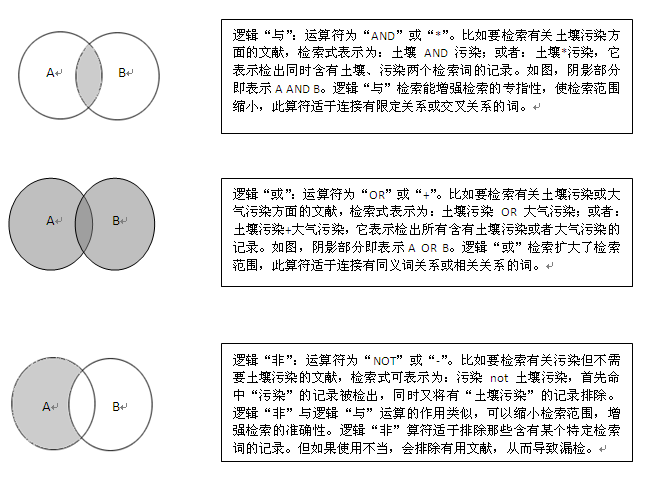
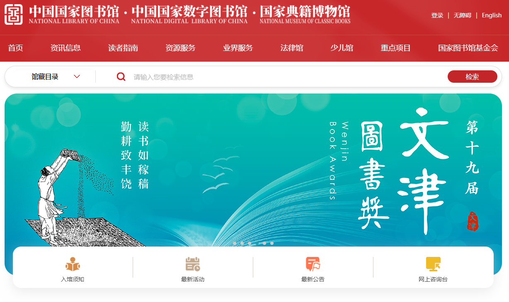
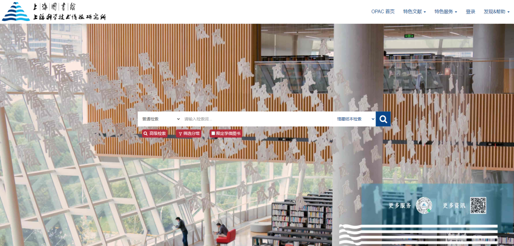
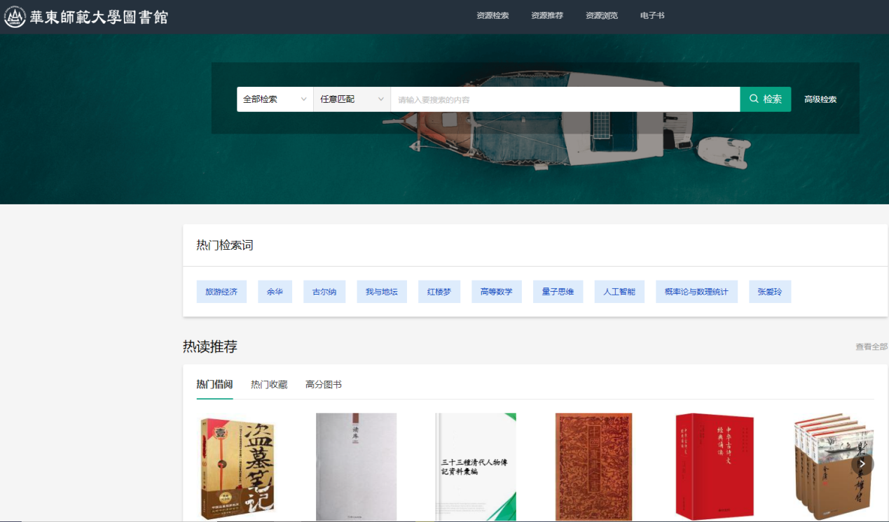
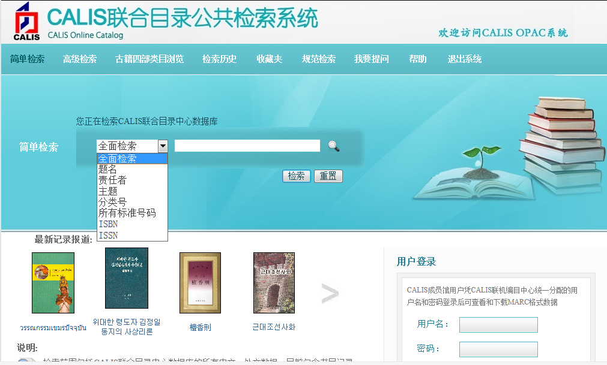

# 第二章 如何获取信息

研究者很少会因为“完全没有信息”而停下脚步，更常见的困难是：信息分散在不同载体与平台中，名称和版本并不统一，检索结果很多却难以判断取舍，题录已经找到却无法合法取得全文。有效的信息获取因此不是在一个搜索框中输入几个词，而是一条可以反复调整、能够留下记录、最终可以回到原始来源的工作链。

本章承接第一章提出的信息需求与信息源概念，重点回答三个问题：怎样把一个研究问题转化为可执行的检索方案，怎样根据文献类型选择发现与获取入口，以及怎样记录检索和全文获取过程。第三章将在这些材料基础上讨论如何筛选、综合并撰写综述；第四章则进一步讨论开放获取、版本、许可和数据共享。因而，本章谈到开放资源时只聚焦“怎样发现并合法取得可用版本”，不展开开放科学的制度与许可问题。

## 2.1 从信息需求到检索任务

### 先说明要回答什么问题

检索的第一步不是选择数据库，而是把模糊兴趣写成可以判断的信息需求。例如，“人工智能与教育”范围过大，至少还要说明研究对象、核心现象、情境和期望的证据类型。将其改写为“生成式人工智能支持是否改善高校学生的形成性反馈质量”，检索任务才开始具有边界。

同一问题可能包含不同层次的需求。想理解概念，需要词典、百科、专著或综述；想掌握研究结果，需要期刊论文、会议论文和学位论文；想了解制度，需要法律、政策、标准或机构文件；想开展再分析，则需要数据、代码和方法文档。先确定交付物，能避免用新闻回答理论问题，或用一篇论文代替系统检索。

表2-1 信息需求的结构化表达

| 要素 | 需要回答的问题 | 示例 |
| --- | --- | --- |
| 对象 | 研究涉及谁或什么 | 高校本科生 |
| 核心现象 | 关注何种行为、干预或关系 | 生成式人工智能支持、形成性反馈质量 |
| 情境 | 在何时、何地或何种任务中 | 课程写作与同伴互评 |
| 证据类型 | 需要概念、实证、政策还是数据 | 实证研究、测量工具、相关政策 |
| 时间与语言 | 是否有必要限制 | 近五年为重点，中英文文献并查 |
| 最终产出 | 检索结果将用于什么 | 撰写综述并形成研究设计 |

时间范围不是越新越好。解释概念来源时需要追溯经典文献；判断平台或政策现状时又必须查看最新版本。语言限制也会改变证据范围，不能把“只检索到中文文献”写成“国际研究尚未关注”。

### 识别合适的信息源

信息源选择应与问题类型相匹配。综合搜索引擎适合发现线索，学术数据库适合形成可筛选的题录集合，图书馆目录适合确认馆藏，专利数据库适合检索技术方案，政府与机构网站适合查找正式文件，开放仓储适合寻找作者稿、预印本、数据或代码。不同入口有交集，却不能互相完全替代。

表2-2 常见任务与优先入口

| 任务 | 优先入口 | 关键核验 |
| --- | --- | --- |
| 理解概念与理论脉络 | 专著、手册、综述、权威百科 | 作者与出版机构、版本、参考文献 |
| 查找实证研究 | 学术数据库、期刊平台、引文数据库 | 研究设计、样本、原文与撤稿状态 |
| 查找学位研究 | 学位论文数据库、机构知识库、图书馆目录 | 授予单位、学位类型、最终版本 |
| 查找图书 | 本馆目录、国家或地区图书馆目录、联合目录 | 版本、馆藏地、索书号与授权方式 |
| 查找专利 | 官方专利检索系统、专业专利数据库 | 法律状态、同族、权利要求与申请人 |
| 查找政策和标准 | 政府、标准组织或发布机构官网 | 发布主体、文号、效力与现行版本 |
| 查找开放全文 | 机构库、学科仓储、开放期刊目录、作者主页 | 版本、许可证、完整性与引用对象 |

## 2.2 把概念转化为检索策略

### 建立概念组，而不是堆砌自然语言

研究问题中的每一个核心概念都可能有同义词、近义词、缩写、旧称和中英文表达。检索前可建立“概念—候选检索词—来源”表，再把同一概念的词用“或”连接，把不同概念组用“与”连接。词表来源可以是综述的关键词、主题词表、数据库索引词、领域术语表和已经找到的种子文献。

以“生成式人工智能支持高校写作反馈”为例，可以先形成三个概念组：

- 生成式人工智能：生成式人工智能、大语言模型、ChatGPT、generative AI、large language model；
- 写作反馈：写作反馈、形成性反馈、自动反馈、writing feedback、formative feedback；
- 高等教育：大学生、本科生、高等教育、college student、undergraduate、higher education。

不要一开始就把所有条件全部相“与”。条件越多，漏检风险越高。较稳妥的做法是先组合两个核心概念观察结果，再根据题名、摘要和关键词补词，最后才决定是否增加对象、时间或文献类型限制。

### 理解布尔逻辑、字段与截词

布尔逻辑决定概念之间的关系。“与”（AND）要求记录同时包含两个概念，通常缩小结果；“或”（OR）连接同义或相近表达，通常扩大结果；“非”（NOT）排除某类记录，使用不当会把相关文献一并删去。数据库界面和语法可能不同，但这种集合关系相对稳定。

图2-1 布尔逻辑算符的集合含义。“与”取两个集合的交集，“或”取并集，“非”从一个集合中排除另一集合；实际检索时应通过结果样本验证排除条件是否过宽。

字段限制回答“词出现在哪里”。题名字段精确但容易漏检，主题或题名—摘要—关键词字段较为均衡，全文字段召回高但噪声也多。作者、机构、刊名、基金、文献类型和年份等字段适合回答特定问题，不应与主题词混为一谈。

短语检索、截词和位置算符需要查看数据库帮助。英文短语常用引号保持词序；截词符可覆盖同一词根的不同词形，例如 influenc* 可能覆盖 influence、influences 和 influencing，但也可能引入非预期词；位置算符用于限定两个词之间的距离。不同平台采用的符号并不完全相同，不能把一个数据库的检索式未经改写直接复制到另一个数据库。

表2-3 检索结果异常时的调整方向

| 现象 | 可能原因 | 优先调整 |
| --- | --- | --- |
| 结果过少 | 术语太窄、条件过多、字段过严 | 增加同义词；删除次要概念；从题名放宽到主题或摘要 |
| 结果过多 | 概念宽泛、全文噪声、缺少对象限定 | 限定核心字段；增加必要概念；使用文献类型或学科筛选 |
| 结果偏题 | 词有多义、截词过宽、缩写歧义 | 增加情境词；改用短语或主题词；谨慎排除 |
| 新词不断出现 | 词表尚不完整 | 从高相关记录提取作者关键词、索引词和术语变体 |
| 某平台完全无结果 | 语法或字段不兼容 | 查看帮助，逐段测试检索式，记录平台特有语法 |

### 用试检形成可复核方案

检索不是一次性动作。第一次试检用于认识领域：观察前20—50条高相关结果的题名、摘要、关键词、来源和参考文献，判断词表是否覆盖关键表达。第二次检索用于形成相对稳定的结果集：明确数据库、字段、检索式、日期和限制条件。后续补充检索则用于追踪种子文献的参考文献、被引文献、作者和项目。

每次调整都应记录原因。例如，“加入 academic writing 是因为初检发现 writing feedback 单独使用包含大量中小学口语教学研究”。这样的记录能解释结果为什么变化，也方便他人复查。只保存最终导出的文献而不保存检索式，会丢失最关键的方法证据。

表2-4 最小检索日志

| 日期 | 平台与数据库 | 字段和检索式 | 限制条件 | 结果数 | 调整及理由 |
| --- | --- | --- | --- | ---: | --- |
| 2026-07-16 | 某学术数据库 | 主题=(生成式人工智能 OR 大语言模型) AND 主题=(写作反馈 OR 形成性反馈) | 期刊与学位论文；不先限年份 | 记录实际数值 | 初检，用于发现术语 |
| 2026-07-16 | 同上 | 在前式加入高校 OR 大学生 | 同上 | 记录实际数值 | 结果中基础教育研究过多，增加对象限制 |

## 2.3 获取期刊论文

### 先找到题录，再确认全文

期刊论文通常由题名、作者、期刊名、年份、卷期、页码或文章号、数字对象唯一标识符（DOI）等要素识别。检索平台展示的是发现入口，全文可能位于出版社平台、数据库、机构仓储或作者依法共享的版本中。不要把“检索到题录”“页面上显示摘要”和“已经取得可引用全文”当成同一件事。

获取期刊论文可以采用以下顺序：

1. 在主题数据库或综合学术数据库中完成主题检索，保存检索式与筛选条件。
2. 阅读题名和摘要，形成待获取清单，并保存稳定标识符。
3. 通过所在图书馆的数据库导航、馆藏链接或校外访问系统确认订阅全文。
4. 无订阅时，使用DOI、完整题名和作者检索开放版本，再核对版本与正文完整性。
5. 仍无法取得时，提交馆际互借或文献传递请求，或通过公开联系方式礼貌询问作者。
6. 下载后立即按统一规则命名，并将文件与题录记录绑定。

引文数据库还支持沿引用关系扩展检索。向后追溯参考文献可以寻找理论和方法来源，向前查看被引文献可以观察后续修正与应用，查看相关记录则有助于发现关键词未覆盖的研究。不过，被引次数受学科、年份、文献类型和数据库覆盖影响，只能作为线索，不能替代对原文质量的评价。

### 核对版本、撤稿与引用对象

同一成果可能存在预印本、作者接受稿、正式出版版和更正后的版本。用于理解研究时，不同版本可能都具有价值；用于正式引用时，应优先引用与论证相符且状态明确的版本，并核对题名、作者、年份、DOI和更正或撤稿信息。预印本尚未完成期刊同行评议，不能仅因版式接近论文就将其写成“已发表研究”。

开放期刊目录可帮助发现开放获取期刊，但目录收录不是对每篇文章结论的担保。[DOAJ](https://doaj.org/)提供开放获取期刊的发现与元数据服务；研究者仍需阅读文章本身，检查期刊信息、同行评议说明、许可和文章版本。

## 2.4 获取学位论文

学位论文通常对研究问题、文献回顾、方法、工具和附录交代较完整，适合追踪量表来源、研究设计和本土语境。它也可能篇幅冗长、质量差异较大，且后续可能以期刊论文形式发表。使用时应核对授予单位、学位类型、导师、答辩年份、数据库收录状态和是否存在正式发表版本。

国内学位论文可从学校图书馆购买的数据库、授予单位的机构知识库和馆藏目录中发现；国外论文可从综合学位论文数据库、国家或机构目录以及大学仓储中查找。[ProQuest Dissertations & Theses Global](https://about.proquest.com/en/products-services/pqdtglobal/)是国际学位论文的重要发现入口之一，但机构是否订阅全文、单篇论文是否开放以及可用版本会有差异，应以所在图书馆和记录页面为准。

表2-5 学位论文的获取与核验

| 步骤 | 操作 | 需要留下的记录 |
| --- | --- | --- |
| 发现 | 用主题、作者、授予单位、导师或学科检索 | 平台、检索式、日期 |
| 识别 | 核对题名、作者、授予单位、学位、年份 | 完整题录与稳定链接 |
| 获取 | 通过订阅、机构库、馆际互借或作者授权版本取得 | 文件来源、下载日期、版本 |
| 比对 | 查看是否改写为期刊论文或有后续更正 | 相关成果及差异说明 |
| 使用 | 重点阅读概念、方法、附录和局限 | 页码、摘录与用途 |

学位论文篇幅较长，不宜只检索题名。若平台支持，可组合主题、摘要、关键词、导师和授予单位等字段。若已知一篇重要论文，也可围绕其导师、研究团队和参考文献继续扩展。引用时不要只写数据库名称，应给出能够唯一识别论文的完整题录。

## 2.5 获取图书

### 目录回答“有什么、在哪里”，全文平台回答“能否阅读”

图书适合建立概念体系、理解理论传统和学习完整方法。查找图书时要区分书目目录与电子全文平台：目录记录题名、责任者、主题、分类号、版本、出版信息和馆藏地；电子图书平台还涉及阅读权限、并发限制、借阅期限和数字版权管理。目录中“有这本书”不等于当前账号可以在线阅读全文。

检索图书时，题名、作者、国际标准书号（ISBN）、主题词和分类号各有用途。已知书名时用题名或ISBN定位最快；围绕主题浏览时，规范主题词和分类号能够把同类图书聚集起来；遇到译著或再版书，要核对原著题名、译者、版次和出版年，避免把不同版本混作同一文本。

图2-2 不同层级的书目检索入口。国家与地区图书馆目录、本校目录和联合目录分别支持出版物确认、本地馆藏定位与跨馆发现；界面会更新，但题名、作者、主题、分类、ISBN、版本和馆藏地始终是核心观察字段。

找到书目后，可按“本馆纸本—本馆电子版—同城或联盟馆藏—馆际互借—合法购买或作者开放版本”的顺序获取。记录至少包括所用版本、出版信息、馆藏地或平台、索书号或稳定链接。引用电子书时也应按作品本身著录，不以阅读平台名称代替作者、书名和出版信息。

## 2.6 获取专利与其他特种文献

### 专利检索同时涉及技术信息与法律状态

专利文献公开技术方案，也记录申请、审查、授权、转让、失效等法律事件。教育技术研究者可能用它了解学习设备、智能评测或人机交互方案；但“找到一件专利”既不表示该技术有效，也不表示专利当前有效，更不表示可以自由实施。

专利记录中的名称、摘要、申请人、发明人、申请号、公开号、优先权、分类号、权利要求、引证和法律状态承担不同功能。主题检索适合发现概念，国际专利分类或合作专利分类适合跨语言聚类，同族信息用于识别同一发明在不同法域的申请，权利要求界定要求保护的范围。若问题涉及侵权、有效性或商业决策，应由具备资质的专业人员结合现行法律和完整案卷判断。

表2-6 专利阅读的基本层次

| 层次 | 重点字段 | 能回答什么 | 不能直接推出什么 |
| --- | --- | --- | --- |
| 书目信息 | 名称、申请人、发明人、日期、分类 | 谁在何时就何种主题提出申请 | 技术一定有效或已经商业化 |
| 技术内容 | 摘要、说明书、附图、权利要求 | 方案如何描述，保护重点是什么 | 实际产品完全按此实施 |
| 关系网络 | 引证、被引、同族、关联申请 | 技术来源与不同法域布局 | 引证等同于学术认可 |
| 法律状态 | 审查、授权、年费、无效等事件 | 某一时间点的程序与权利状态 | 在所有国家或未来都保持同一状态 |

标准、政策、会议论文和研究报告也属于需要专门入口的文献。检索标准要确认标准号、发布机构、发布日期、实施日期和废止或替代关系；检索政策要确认发布机关、文号、效力范围和现行版本；检索会议论文要判断摘要、短文与正式论文的差别；检索研究报告要核对委托方、执行机构、方法附件和利益关系。搜索引擎可以帮助发现页面，正式使用时仍应回到发布机构或稳定档案。

## 2.7 获取网络与开放资源

### 搜索引擎用于发现，来源核验决定能否使用

综合搜索引擎擅长跨网站发现，但排序会受到词语匹配、链接结构、地区、个性化和商业因素影响。检索时可以使用短语、站点、文件类型和时间等限定，例如用站点限定寻找政府文件，用文件类型寻找报告；具体语法会更新，应以搜索服务的帮助说明为准。

网络页面进入研究材料前，至少要回答：谁发布、何时更新、引用了什么证据、是否存在编辑与纠错机制、页面能否稳定回访、内容是否与其他独立来源一致。百科、问答、视频和社交平台适合帮助理解术语、发现案例和追踪公众讨论，却通常不应作为关键学术主张的唯一证据。用户生成内容还可能涉及隐私、平台条款、版权和样本偏差。

### 免费访问不等于开放获取

页面能够免费阅读，只说明当前没有支付障碍；开放获取还涉及作者或权利人授予的阅读与复用条件。发现开放版本时，应优先查看期刊官网、机构知识库、学科仓储和作者公开页面，并核对题名、作者、版本、日期和许可。不要使用来源不明、绕过访问控制或明显侵犯权利的下载站点。

预印本平台能够加快研究交流，但预印本通常尚未完成期刊同行评议。以[arXiv](https://info.arxiv.org/)为例，平台有提交规范和内容审核机制，但这种审核不等同于期刊同行评议。引用时应标明其预印本状态，并继续检索是否已有正式出版、修订或撤回版本。开放获取的模式、许可证、FAIR原则和受控访问将在第四章系统讨论。

表2-7 网络与开放资源的核验清单

| 维度 | 核验问题 | 可采取的动作 |
| --- | --- | --- |
| 来源 | 作者和发布机构能否识别 | 查看关于页面、作者资料和机构域名 |
| 证据 | 结论能否回到原始数据或文献 | 追踪引用，打开原文，不只看转述 |
| 时间 | 是否有发布日期、更新日期和版本 | 保存访问日期，查找历史或存档版本 |
| 质量控制 | 是否有编辑、同行评议或纠错机制 | 阅读出版说明、更正与撤回记录 |
| 权利 | 是否允许下载、保存、分享或改编 | 查看许可与使用条款，记录版本 |
| 稳定性 | 页面是否有DOI、永久链接或馆藏记录 | 优先保存稳定标识符和本地笔记 |

## 2.8 全文不可得时的合法路径

遇到付费墙或馆藏空缺时，继续检索“可用版本”比反复点击同一页面更有效。先保存完整题录和DOI，再按以下顺序尝试：

1. 通过学校图书馆入口重新确认订阅范围和校外访问方式。
2. 用DOI或完整题名检索机构知识库、学科仓储和作者公开页面。
3. 查看同一成果是否有预印本、作者接受稿或后续正式版本，并记录差异。
4. 使用图书馆的馆际互借或文献传递服务，提交完整题录。
5. 通过公开的机构邮箱礼貌联系作者，说明研究用途并请求其可以合法分享的版本。
6. 若仍不可得，在筛选记录中注明原因，不以摘要、二手转述或人工智能生成的概括冒充原文阅读。

全文获取本身也应可复核。文件名可采用“第一作者_年份_题名短语”的规则；题录管理器中记录数据库、稳定链接、版本和下载日期；重要页面保存访问日期和必要的网页存档信息；受许可限制的文件不得上传到公共共享空间。

## 2.9 综合案例：从问题到可用证据包

假设研究问题是“生成式人工智能支持是否改善高校学生的形成性反馈质量”。一条可复核的工作链如下：

第一步，说明需求。研究对象是高校学生，核心现象是生成式人工智能支持与形成性反馈，主要证据是近年的实证研究、已有测量工具和相关教育政策。

第二步，建立概念组。分别整理人工智能、反馈和高等教育的中英文同义词，记录每个词来自综述、主题词表还是种子文献。

第三步，分层试检。先组合“人工智能＋反馈”，阅读高相关题录并补词；再加入高等教育对象限制；在中文与英文数据库中分别改写字段和语法，不直接复制同一检索式。

第四步，扩展来源。用高相关论文追溯参考文献和被引文献，检索相关学位论文以寻找量表和附录，回到高校或政府官网获取政策文本。若研究涉及具体系统，再检索专利或产品技术文件，但不把产品宣传当作效果证据。

第五步，获取并核验。通过图书馆订阅、开放仓储、文献传递等合法途径取得全文，核对正式出版版、预印本和更正状态。每篇文献记录获取来源和版本。

第六步，形成证据包。保存检索日志、导出题录、去重后的文献库、全文文件、纳入排除记录和初步阅读笔记。第三章的综述工作应从这份证据包开始，而不是从一组浏览器书签开始。

表2-8 信息获取任务的最终交付物

| 交付物 | 最低内容 | 主要用途 |
| --- | --- | --- |
| 检索日志 | 平台、数据库、日期、字段、检索式、限制与结果数 | 复查和更新检索 |
| 题录库 | 完整题录、摘要、关键词、标识符 | 去重、筛选和引用 |
| 全文库 | 文件、版本、来源、获取日期 | 阅读与证据核验 |
| 来源核验表 | 发布者、版本、质量控制、许可和稳定性 | 判断能否使用与分享 |
| 筛选记录 | 纳入、排除及理由 | 防止选择性使用材料 |
| 阅读笔记 | 研究问题、方法、结果、局限和页码 | 支持综述与研究设计 |

## 常见误区

第一，把一个平台当作全部信息空间。任何数据库都有学科、语言、文献类型和时间覆盖边界。第二，直接用完整问题句检索，不拆分概念和同义词。第三，只看结果数量，不抽样检查相关性。第四，找到题录就认为已经阅读全文，或用摘要和人工智能概括代替原文。第五，把免费访问等同于开放获取，把预印本等同于同行评议论文。第六，不核对版本、DOI、更正和撤稿状态。第七，把被引次数、搜索排序或平台推荐当作质量结论。第八，只保存PDF，不保存检索式、获取来源与筛选理由。

## 本章小结

信息获取是一条从需求表达、来源选择、概念组构建、检索式测试到全文核验和过程记录的证据链。不同文献类型需要不同入口：期刊与学位论文重在题录、版本和全文，图书重在书目与馆藏，专利重在技术内容和法律状态，网络资源重在来源、证据、时间和权利。搜索引擎、数据库、目录和开放仓储各有分工，任何单一平台都不能替代完整检索。

可靠的检索结果不仅是一组文件，还应包括检索日志、题录库、版本信息、筛选记录和阅读笔记。这些材料让第三章的综述可以复核，也为第四章讨论开放资源和后续研究设计提供基础。

## 思考与练习

1. 将“短视频影响大学生学习”改写为一个具有对象、核心现象、情境、证据类型和时间边界的信息需求。
2. 围绕上述问题建立两个或三个概念组，每组列出至少三个中文词和三个英文词，并说明词语来源。
3. 在两个学术数据库中分别执行一次试检，记录字段、语法、结果数和前20条结果中的相关记录数，解释为什么同一主题会得到不同结果。
4. 选择一篇期刊论文，追踪它的预印本、作者接受稿、正式出版版、更正或撤稿状态，说明正式写作时应引用哪一个版本。
5. 用本馆目录、一个国家或地区图书馆目录和一个联合目录检索同一本书，比较题录、版本、索书号和获取路径。
6. 选择一件与教育技术有关的专利，分别阅读摘要、权利要求、同族和法律状态，写出每部分能够支持和不能支持的判断。
7. 选择一个网络问答或视频中的知识主张，追踪到原始文献或正式机构来源，并依据表2-7完成核验。
8. 为一次小型综述建立表2-4所示的检索日志，并整理表2-8列出的最小证据包。

## 延伸阅读与工具

- [ACRL信息素养相关标准与框架](https://www.ala.org/acrl/standards/ilframework)
- [DOAJ开放获取期刊目录](https://doaj.org/)
- [arXiv帮助与政策信息](https://info.arxiv.org/)
- [ProQuest Dissertations & Theses Global产品说明](https://about.proquest.com/en/products-services/pqdtglobal/)
