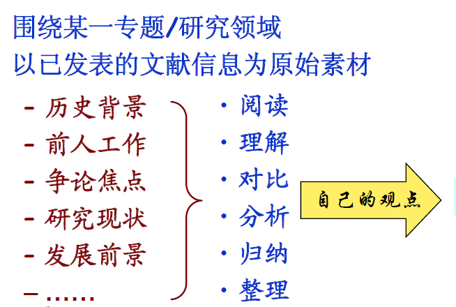
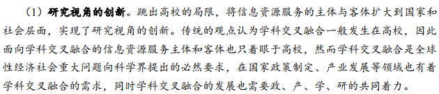
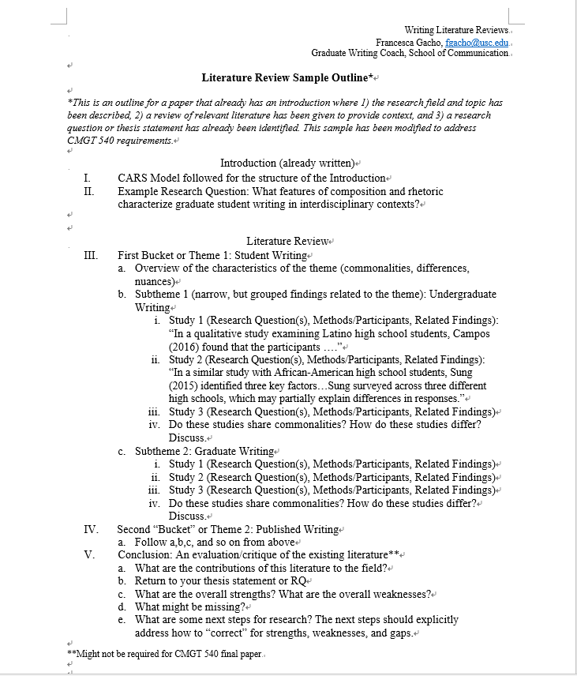

# 第三章 如何评价信息

信息评价不是在检索之后才出现的附加环节，而是贯穿选题、检索、阅读、综述和写作全过程的判断能力。学习者在数据库中找到一批文献之后，真正困难的问题往往才刚刚开始：哪些文献值得精读，哪些只是背景材料，哪些能作为理论来源，哪些只能提供案例线索，哪些看似相关却不能支持自己的论证？如果缺少评价意识，文献越多，反而越容易陷入堆砌、重复和误引。

本章把“信息评价”放在文献综述训练中展开。文献综述是评价信息能力最集中的场景：它要求研究者先广泛收集资料，再对文献的权威性、相关性、方法质量、证据强度、时效性和创新价值进行筛选，最后把分散文献组织成能够说明研究问题的知识结构。好的综述不是“把别人说过的话排成队”，而是在已有研究之间建立关系，并指出自己的研究从哪里进入学术对话。

## 从“综”与“述”理解评价

综述包含两个动作。“综”意味着收集、归纳、分类和综合，把大量文献中的概念、观点、方法和结论整理成有层次的结构；“述”意味着在综合基础上进行解释、评论和判断，说明已有研究解决了什么问题，还留下了哪些不足。只综不述，文章会变成资料摘抄；只述不综，判断又会失去证据基础。

图3-1 文献综述需要在“综合材料”和“提出判断”之间取得平衡。图示提醒读者，评价信息不是简单取舍，而是把文献放回研究问题中判断其作用。

评价信息时，首先要问这条信息承担什么功能。政策文件适合说明制度背景，统计年鉴适合提供宏观数据，学术论文适合提供理论、方法和实证证据，新闻报道可以帮助发现社会事件，社交媒体内容则更多反映公众意见和问题线索。不同信息源并非简单分为“可靠”和“不可靠”，而是有不同的证据边界。

## 好综述的评价标准

一篇高质量综述通常具有全面性、深度、更新性、清晰结构、高质量引用、原创性、可读性、明确目的、批判性和指导性。全面性要求覆盖主题的关键方面，但这并不等于无限扩大范围。好的选题往往“切口小而问题清”，能在有限范围内把关键文献说透。深度要求作者不满足于复述结论，而要比较研究对象、方法、样本、变量和解释路径。

更新性尤其重要。许多研究主题在短时间内会因政策、技术或社会事件发生变化。生成式人工智能、学习分析、数字教材、教育评价改革等主题，如果只依赖几年前的文献，就难以把握新问题。与此同时，更新并不等于只看最新文献。开创性文献、理论源头和经典方法仍然是理解领域脉络的基础。

批判性不是情绪化否定。评价文献时，应避免“前人研究都不足”这类空泛判断，更应指出不足产生在哪里：样本过窄、变量测量不足、数据来源单一、方法不能支持因果结论、忽视某类对象、缺少长期追踪，或理论解释尚不充分。批判的目的不是贬低前人，而是为自己的研究问题找到合理位置。

## 评价文献之前先提炼创新点

评价信息要有方向。若研究者不知道自己的创新点可能在哪里，就很难判断哪些文献重要。课程中把创新点概括为理论创新、方法创新、数据创新、研究对象创新、视角创新和组合创新。

理论创新可以来自新概念、新模型或对既有理论的整合；方法创新常常并非发明全新方法，而是把其他学科的方法迁移到教育研究中；数据创新可能来自新的调查数据、平台日志、文本数据、图像数据或多源数据融合；研究对象创新关注以往较少被研究的群体、场景或制度安排；视角创新则强调从宏观、微观、主体、平台、政策或技术等不同角度重新观察问题；组合创新体现知识重构，即把两个原本分离的主题放在同一问题框架中。

以“优师计划学生学习动机与自主学习能力”为例，评价文献时不能只检索“优师计划”，还要同时追踪“学习动机”“自主学习能力”及其同义词。初步检索可能发现，政策层面关于优师计划的讨论较多，而围绕学生学习品质的微观研究较少。这个差异本身就是评价结果：它说明既有研究的重心、空白和可进入方向。

## 检索权威文献与评价文献

文献评价首先建立在可靠检索之上。中文文献可从CNKI、万方、维普、CSSCI等入口获取，外文文献可根据主题选择Web of Science、Scopus、ERIC、ScienceDirect、EBSCO、SpringerLink等数据库。不同数据库覆盖范围不同，不能把单一数据库的检索结果当作全部研究图景。

评价一篇文献，可以从六个维度入手：主题相关性、来源权威性、方法可靠性、证据充分性、引用影响和可用位置。主题相关性判断它是否真正回答研究问题；来源权威性关注期刊、出版社、作者机构和学术共同体认可程度；方法可靠性要求查看样本、工具、变量和分析方法；证据充分性关注结论是否由数据或文本支持；引用影响可通过被引量、下载量和高影响文献线索辅助判断；可用位置则决定它是作为背景、理论、方法、案例还是争议文献进入综述。

图3-2 从大量检索结果进入精读文献，需要同时考虑相关性、影响力和研究问题的契合度。数量压缩不是机械删除，而是逐步提高证据密度。

被引量、下载量和期刊影响力可以帮助排序，但不能替代阅读。高被引文献可能因为经典而重要，也可能因为争议而被频繁引用；下载量可能反映教学需求或现实热度，却未必代表研究质量。对于学生论文而言，更稳妥的做法是先用指标发现候选文献，再通过摘要、方法和结论判断是否纳入。

## 从文献分类到综述结构

文献评价的结果应转化为综述结构。常见结构包括按主题分类、按理论流派分类、按研究对象分类、按方法分类、按时间演化分类和按争议问题分类。以“学习动机与自主学习能力”为例，可以把文献分为优师计划政策研究、学习动机研究、自主学习能力研究、两者关系研究以及特定群体实证研究。这样的分类能够把文献从“清单”变成“结构”。

写作时可采用“概括—证据—评价—转入”的段落方式。先概括一组研究共同观点，再列出代表文献和主要证据，随后评价其贡献与局限，最后说明这些研究如何引出下一部分或自己的研究问题。一个成熟段落通常不应只出现一篇文献，也不应把每篇文献逐条罗列。

图3-3 文献可视化工具可以辅助发现主题群和演化脉络，但聚类标签仍需通过原文阅读验证。

## AI辅助评价的边界

AI可以帮助扩展检索词、寻找同义表达、生成初步分类框架，也可以帮助检查综述段落是否逻辑清楚。但AI不能代替文献评价。它可能给出不存在的参考文献，也可能把相近概念混合在一起。使用AI时，应把它当作“候选路径生成器”，而不是“证据来源”。所有文献名称、作者、年份、DOI、结论和引用关系都必须回到数据库或原文核验。

## AI时代的信息核验工作流

AI时代的信息评价可以形成一条相对稳定的核验工作流。第一步是让AI帮助扩展检索词和可能的研究方向，但不直接接受其给出的参考文献。第二步是在权威数据库中重新检索，确认文献是否真实存在，题名、作者、期刊、年份和DOI是否准确。第三步阅读摘要、方法和结论，判断文献是否真正相关。第四步把核心文献放入文献管理软件，用标签标注其功能，如“理论来源”“方法借鉴”“关键证据”“反方观点”。第五步在写作时回到原文，而不是回到AI概括。

这一流程的价值在于把AI放在“启发”位置，而不是“证据”位置。AI可以帮助研究者更快发现同义词、相近概念和可能遗漏的方向，但评价文献质量、判断研究空白和形成综述结构，仍必须由研究者完成。尤其在教育研究中，同一概念可能因学段、制度和文化背景不同而含义变化，不能依赖模型的通用解释。

## 常见误区

第一，把综述写成文献流水账，只按“张三认为、李四认为”排列。第二，只找支持自己观点的文献，不主动寻找反例和争议。第三，过分依赖被引量，把高被引等同于高质量。第四，把AI生成的文献或概念解释直接写入论文。第五，参考文献格式混乱，缺页码、缺网址和访问日期，或中英文标点混杂。第六，过度贬低前人研究，用空泛批评代替具体评价。

## 本章小结

信息评价的核心，是判断信息与研究问题之间的关系。文献综述提供了最好的训练场景：研究者必须识别信息源，评价文献质量，提炼创新点，选择关键文献，并把阅读结果组织成清晰的学术论证。好的评价不是寻找完美文献，而是理解每条信息可以支持什么、不能支持什么。

## 思考与练习

1. 选择一个教育研究主题，列出至少5个同义或近义检索词。
2. 从检索结果中选择10篇文献，按“理论、方法、对象、证据、局限”建立评价表。
3. 写一个综述段落，要求同时包含概括、代表文献、评价和转入自己的研究问题。
