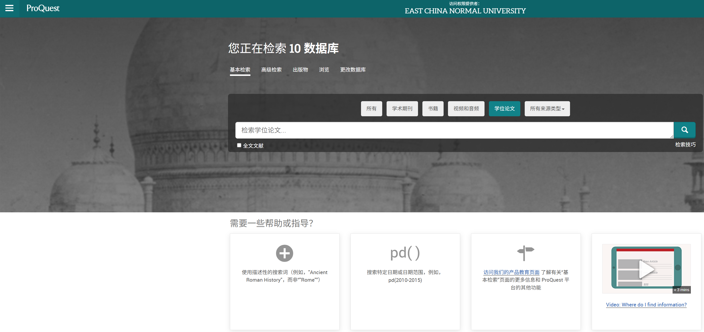
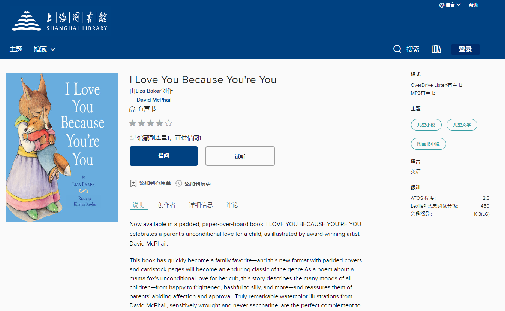
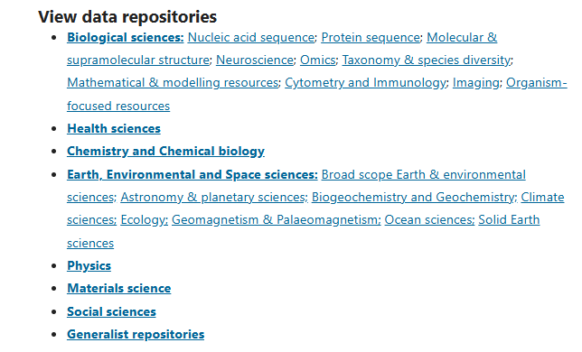
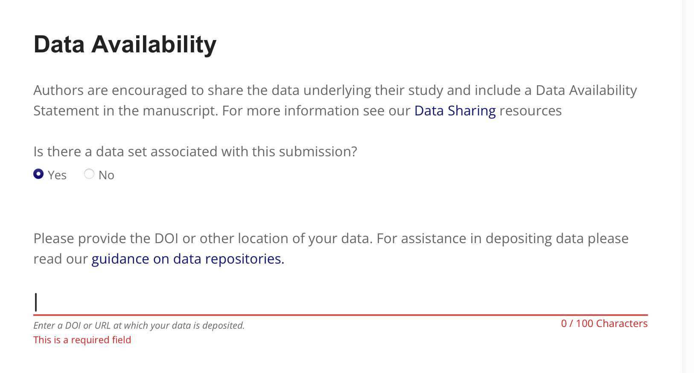
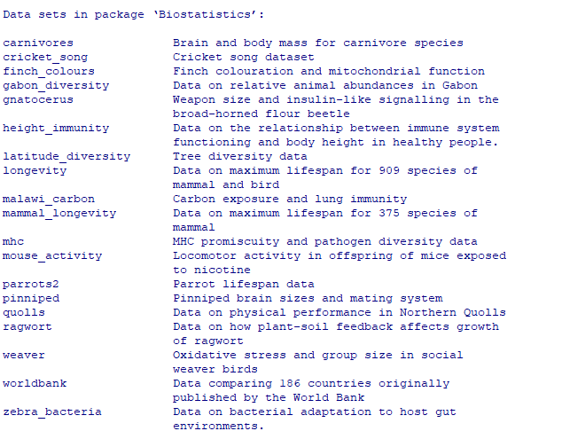
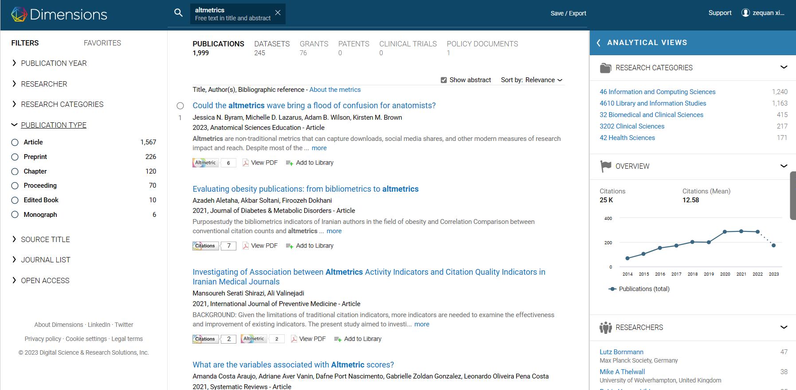
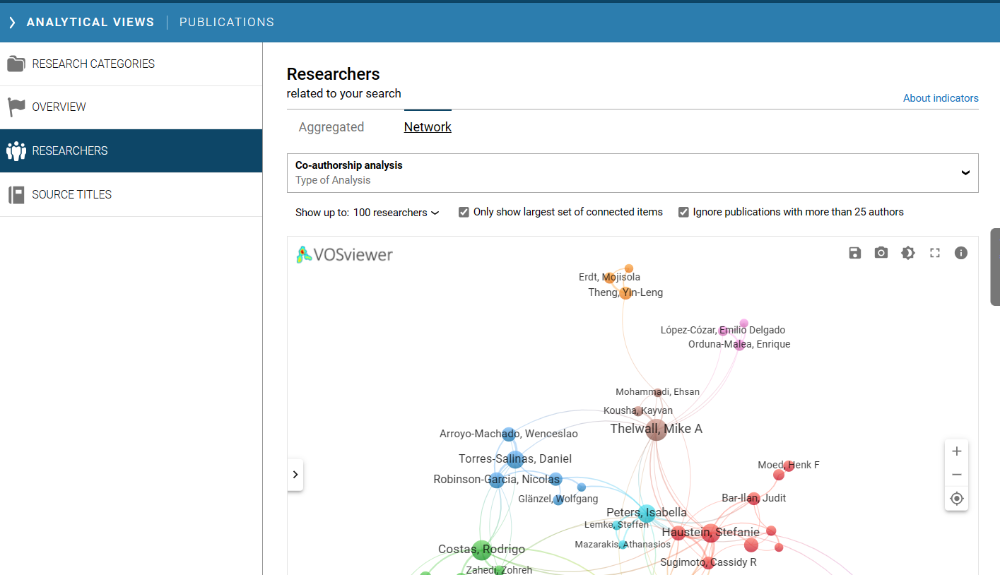
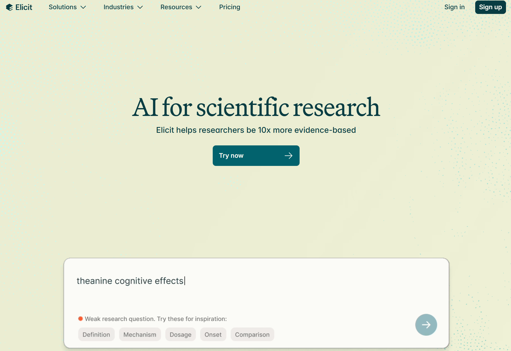
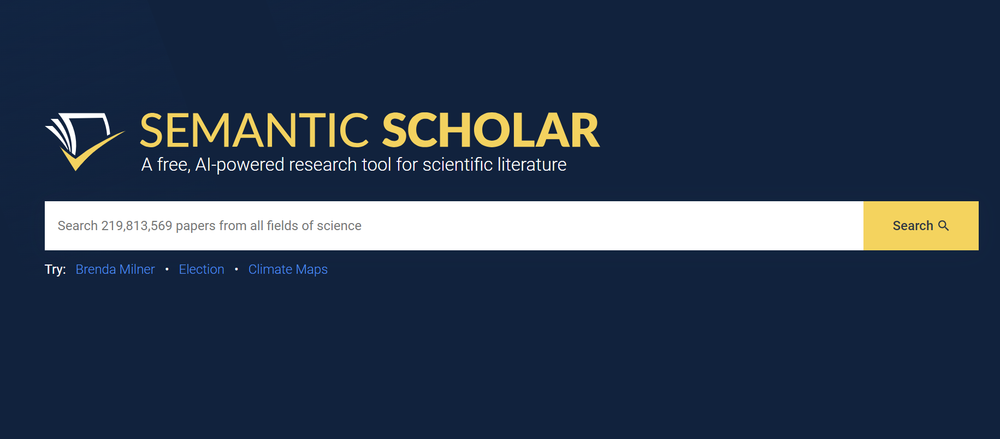

# 第四章 开放科学资源

检索到一篇论文并不意味着已经获得全文；能够打开全文也不意味着可以复制图片、翻译后发布或交给外部人工智能服务处理。类似的差异也存在于电子图书、学位论文、数据集和代码中：学校购买的数据库可以供校内用户阅读，却不一定允许对外传播；公共图书馆提供免费借阅，却不一定允许改编；网页上公开的代码可以被查看，但如果没有许可证，使用者通常没有当然的复制、修改和再发布权。

开放科学资源的核心问题因此不是“哪里可以免费下载”，而是科学知识能否被发现、获得、核验、引用和依法复用。第二章已经讨论如何获取信息，本章进一步追问资源的访问状态、版本、许可、元数据和伦理边界；第八章将讨论如何理解和分析数据，本章则聚焦数据与其他研究对象怎样被发现、保存和共享。

[联合国教科文组织《开放科学建议书》](https://www.unesco.org/en/legal-affairs/recommendation-open-science)把开放科学理解为一组使多语种科学知识向所有人开放、可访问和可复用的实践，同时强调合作、社会参与和知识对话。开放科学知识不仅包括论文，还包括研究数据、元数据、开放教育资源、软件、源代码和硬件。本章以这些对象为主线，帮助读者从“资源消费者”逐步成为能够负责任地记录、复用和共享研究资源的参与者。

## 4.1 开放科学资源不是“能下载就能随意用”

### 先区分五种访问状态

资源页面出现“PDF”“Download”或“免费”字样，只说明某种访问行为可能发生，不能自动说明开放许可。判断资源时，至少应区分订购授权、免费阅读、开放获取、公共领域和受控访问。

表4-1 常见资源访问状态及其权利边界

| 状态 | 谁可以访问 | 是否免费 | 是否允许复用 | 典型情境 | 使用时要核对什么 |
| --- | --- | --- | --- | --- | --- |
| 机构订购或借阅 | 通过校园网、CARSI、VPN或读者证认证的用户 | 使用者通常不单独付费 | 由数据库或借阅协议决定，通常禁止批量下载和对外传播 | 商业期刊库、电子书库、公共图书馆数字借阅 | 用户身份、并发限制、下载范围、校外访问和传播规则 |
| 免费阅读（free to read） | 任何能够打开网页的人 | 是 | 未必；若无明确许可，通常仍受默认版权保护 | 出版商临时开放、作者个人网页、公益阅读平台 | 页面是否长期有效、版权声明、是否允许复制和改编 |
| 开放获取或开放许可 | 任何人 | 通常免费访问 | 按CC或其他开放许可证允许一定范围的复制、传播或改编 | 开放期刊、机构知识库、开放图书、开放教育资源 | 具体许可证、版本、署名方法和第三方材料例外 |
| 公共领域或CC0 | 任何人 | 通常是 | 可以广泛复用，但仍应遵守署名、人格权和数据库来源规范 | 版权期满作品、权利人使用CC0开放的数据 | 是否确属公共领域、所在法域、第三方内容和数据伦理 |
| 受控访问 | 经审批、签署协议或在安全环境中的特定用户 | 可能免费，也可能收费 | 只能在批准目的和环境中使用 | 含个人信息的教育数据、临床数据、受限制访谈材料 | 申请条件、用途限制、输出审查、保存期限和销毁要求 |

开放科学强调的是“尽可能开放”，而不是“所有文件都公开”。开放论文可以公开全文，匿名化数据可以开放下载，敏感原始数据则可能只开放元数据、变量字典、分析代码和申请流程。只要限制理由正当、范围适度且过程透明，受控访问同样可以服务于科学核验。



图4-1 “能够找到或免费使用”与“开放许可”不是一回事。第一幅图是学位论文文摘库，用户可能只能获得摘要、预览或机构订购的全文；第二幅图是公共图书馆的电子书借阅页面，读者可凭证借阅或试听。两类服务都能扩大知识可及性，但全文状态、借阅期限、下载范围和再发布权仍由各自协议决定。

### 用六个问题判断一项资源

面对任何论文、图书、数据或代码，可以依次询问：

1. **对象是什么**：论文全文、元数据、数据、代码、教材还是网页介绍？
2. **访问依据是什么**：机构订购、公共服务、作者授权、开放许可还是公共领域？
3. **版本是什么**：预印本、作者接受稿、正式出版版，还是更新后的数据与代码版本？
4. **允许做什么**：只读、下载、复制、改编、再发布、商业使用，还是仅限批准项目？
5. **怎样追溯**：是否有作者、机构、发布日期、版本、DOI、仓储记录和引用建议？
6. **是否应当开放**：是否涉及个人信息、保密承诺、第三方版权、未公开成果或安全风险？

六个问题把“找到资源”转化为“判断资源”。其中任何一项不清楚，都不应急于把文件纳入分析或公开分享。

## 4.2 从研究生命周期理解资源谱系

开放科学不是论文发表后的附加动作，而是贯穿研究问题、设计、采集、分析、报告和长期保存的工作方式。不同阶段会产生不同研究对象，也需要不同的开放策略。

表4-2 研究生命周期中的开放科学资源

| 研究阶段 | 可能产生或使用的对象 | 适合的开放方式 | 关键记录 |
| --- | --- | --- | --- |
| 选题与检索 | 论文、图书、学位论文、综述、检索式 | 开放索引、开放期刊、机构库、开放图书 | 数据库、检索式、日期、版本和纳入标准 |
| 研究设计 | 研究方案、问卷、访谈提纲、实验材料、预分析计划 | 预注册、开放材料或延迟公开 | 时间戳、版本、作者、许可和禁公开部分 |
| 数据采集 | 原始数据、日志、录音录像、知情同意文件 | 分级权限、受控共享、元数据公开 | 数据来源、同意范围、身份风险和保留期限 |
| 数据处理 | 数据字典、清洗规则、派生变量、匿名化记录 | 开放说明、清洗代码、可共享的处理后数据 | 原始值与处理值、规则、软件和责任人 |
| 分析 | 脚本、软件环境、模型、运行日志、中间结果 | 开源代码、计算环境、容器或可执行笔记 | 包版本、随机种子、参数和输入输出对应关系 |
| 报告与发表 | 论文、图表、补充材料、数据可用性声明 | 开放期刊、作者接受稿、机构库、开放附件 | 正式版本、DOI、许可证、资助和关联对象 |
| 保存与复用 | 数据、代码、材料、协议和说明文档 | 学科仓储或综合仓储、受控档案 | 持久标识符、版本、保存政策和引用格式 |

资源之间还应形成可追踪关系。论文应指向数据和代码，数据记录应指向产生它的项目和论文，代码版本应说明对应哪一版数据，预注册应连接最终报告。单个文件开放而关系断裂，读者仍然难以复现研究。

## 4.3 开放论文：找到合法版本并辨认版本

### 开放获取是一组实现路径

[布达佩斯开放获取倡议](https://www.budapestopenaccessinitiative.org/read/)强调移除在线访问障碍，并提出开放期刊与自存档两条互补路径。今天的开放获取模式更加多样，但基本判断仍然是：读者能否及时免费获得作品，权利人是否通过开放许可证明确授予合法复用权。

表4-3 常见开放获取路径

| 路径 | 资源出现在哪里 | 费用可能由谁承担 | 优点 | 需要警惕 |
| --- | --- | --- | --- | --- |
| 金色开放获取 | 开放期刊或出版社开放平台 | 机构、资助者、学会、作者或其他模式 | 正式出版版直接开放 | “金色”不等于作者一定付费，也不自动代表期刊质量 |
| 钻石开放获取 | 读者和作者均不直接付费的开放期刊或平台 | 高校、学会、政府、图书馆联盟或资助项目 | 降低阅读与发表两端的费用障碍 | 仍需考察治理、编辑流程与长期可持续性 |
| 混合开放获取 | 订阅期刊中的单篇开放论文 | 常由作者、机构或资助者支付开放费用 | 可在既有期刊中开放单篇文章 | 同一期刊内开放与付费内容并存，必须逐篇判断许可 |
| 绿色开放获取 | 机构库、学科仓储或作者存档 | 仓储机构承担基础设施，作者通常不付开放费用 | 可开放预印本或作者接受稿 | 允许版本、禁运期和许可由期刊政策决定 |
| 预印本共享 | 预印本平台或研究项目仓储 | 平台、学科共同体或资助者 | 传播快，可在正式评议前交流 | 尚未完成正式同行评议，后续版本可能显著变化 |
| 免费阅读但无开放许可 | 出版商网页、个人网站或临时开放页面 | 不确定 | 可以解决当下阅读问题 | 不能因“免费”推定可改编、再发布或批量机器处理 |

这些名称描述传播路径，不是论文等级。开放期刊可以严谨，也可能管理薄弱；订阅期刊可以高质量，也可能不适合具体研究问题。评价文献仍要回到研究设计、证据、同行评议与学术规范。

### 同一研究成果可能有多个版本

一篇论文从初稿到发表后更新，可能出现多个具有独立页面或标识符的版本。[Crossref的版本说明](https://www.crossref.org/documentation/principles-practices/best-practices/versioning/)区分预印本、作者接受稿和正式出版版等阶段。版本差异会影响页码、图表、结论甚至作者名单，引用时必须辨认。

表4-4 论文常见版本及使用原则

| 版本 | 是否经过同行评议 | 排版状态 | 适合用途 | 引用与核验要点 |
| --- | --- | --- | --- | --- |
| 预印本（preprint） | 通常尚未完成期刊同行评议 | 作者排版 | 追踪新研究、开放讨论、快速传播 | 明确标注预印本，查看是否已有正式版本、更新或撤回 |
| 作者接受稿（AAM） | 已通过同行评议 | 尚未由出版社最终排版 | 绿色开放获取、核对正式论文内容 | 可能没有正式页码；引用时优先连接正式出版信息 |
| 正式出版版（VoR） | 已完成期刊流程 | 出版社正式排版 | 作为稳定引用和最终核验版本 | 检查更正、撤稿和后续更新 |
| 更新、勘误或撤回后的记录 | 视原始对象而定 | 有版本或通知页面 | 了解学术记录变化 | 不要只保存旧PDF，应检查Crossmark、期刊通知或仓储版本历史 |

如果只有开放的作者接受稿，也可以阅读其内容，但应保存正式出版论文的题录和DOI；直接引语若依赖页码，应核对正式版或说明所引版本。引用预印本时，应在提交作业或论文前再次检查是否已有正式发表版本。

### 从一个题录寻找合法全文

较稳妥的全文获取顺序是：

1. 用DOI、完整题名或作者信息确认文献身份，避免下载同名或早期版本。
2. 查看出版社页面的开放状态、许可和版本更新。
3. 检查学校图书馆馆藏；机构订购是合法访问，但不能对外传播账号或文件。
4. 在[OpenAlex](https://explore.openalex.org/)等开放索引中查看是否链接开放版本。
5. 在机构知识库、学科仓储或[OpenDOAR](https://v2.sherpa.ac.uk/opendoar/index.html)收录的仓储中检索作者接受稿、学位论文或报告。
6. 查阅作者自存档政策，判断允许的版本、禁运期和署名条件。
7. 若没有开放或馆藏全文，使用馆际互借、文献传递或向作者提出合理请求。
8. 记录最终使用的版本、来源、许可证和访问日期。

文献传递和馆际互借扩大了合法获取范围，却不改变作品版权状态。获得一个供个人研究使用的副本，不等于可以上传到公共网盘或作为数据集批量提供。

### 开放期刊也要评价可信度

[DOAJ](https://doaj.org/about)收录符合其基本开放获取与透明度要求的同行评议期刊，可作为发现开放期刊和检查基本信息的入口，但任何目录都不能替代研究者的判断。可以从六个方面评价期刊或平台：出版机构和联系方式是否真实；编辑与同行评议流程是否公开；费用、版权和许可是否清楚；文章是否有稳定链接与保存机制；更正和撤稿政策是否可见；期刊名称和网站是否故意模仿知名出版物。

面对陌生期刊，不应只问“是否收录”或“影响因子多少”，还要检查最近论文的研究质量、审稿承诺是否不切实际、收费是否在投稿前透明。开放获取减少阅读壁垒，不会自动消除低质量出版和欺骗性出版风险。

## 4.4 开放图书、学位论文与开放教育资源

### 电子图书免费借阅不等于开放图书

电子图书至少有三种常见情形。第一种是学校订购，读者通过机构认证阅读或分章下载；第二种是公共图书馆凭读者证借阅，可能有借期、并发数和数字版权管理限制；第三种是开放获取图书，任何人无需注册即可阅读，并依据开放许可证复用。三者都能支持学习，但权利边界不同。

[Directory of Open Access Books（DOAB）](https://doabooks.org/en/doab/purpose-of-doab)用于发现经过同行评议并开放获取的学术图书，[OAPEN Library](https://www.oapen.org/)则提供开放学术图书的收藏、传播与保存服务。使用开放图书时仍需查看整本书与单章是否采用同一许可，封面、插图、照片和档案材料是否有单独权利声明。

受版权保护的馆藏电子书不能借“开放科学”之名整本复制或传播。如果馆藏不足，可以使用图书馆荐购、馆际互借或文献传递；在许多服务中，受版权限制的图书只能提供合理章节而非整本复制，具体规则以当期服务说明为准。

### 学位论文要同时检查公开状态与版本

学位论文通常由高校或研究机构保存，可能在机构库公开全文，也可能只公开摘要，或因专利、出版、隐私和保密原因延迟开放。聚合数据库的“检索结果”只能证明题录被发现，不能证明全文开放。

寻找学位论文时，可以先用题名、作者、授予机构和年份确认记录，再进入授予机构的知识库核对全文状态；若机构库没有开放，可查开放仓储目录、馆藏和文献传递。引用学位论文要记录学位层次、授予机构、年份、仓储或数据库，并区分最终提交版与作者后来发表的期刊论文。

学位论文开放还涉及第三方内容。论文作者可能拥有正文版权，却未必有权重新开放其中受限量表、照片、学生作品、地图或已发表论文全文。复用某一图表时，应检查该部分的权利说明，而不是只看整篇论文能否下载。

### 开放教育资源的关键是允许改编

[UNESCO对开放教育资源的定义](https://www.unesco.org/en/open-educational-resources/mandate)强调：资源应处于公共领域或使用开放许可证，使他人能够免费访问、再利用、重新设定用途、改编和再传播。因此，免费网课、公开视频和可下载讲义不一定是开放教育资源；如果许可证禁止改编，通常也不符合这一定义中的开放性要求。

表4-5 普通在线学习资源与开放教育资源的区别

| 判断维度 | 免费在线资源 | 机构授权课程 | 开放教育资源（OER） |
| --- | --- | --- | --- |
| 访问 | 公众可免费打开 | 仅本校或注册学习者 | 公众无偿访问 |
| 复制与保存 | 取决于网站条款 | 受平台和机构协议限制 | 开放许可证通常明确允许 |
| 翻译与改编 | 未必允许 | 通常需另行许可 | 应允许一定范围的改编 |
| 再发布 | 未必允许 | 通常禁止对外发布 | 按许可证条件允许 |
| 典型证据 | 网页免费但无开放声明 | 登录、借阅或课程协议 | 公共领域标记或明确开放许可证 |

在教育研究中，OER可以是开放教材、教学设计、题库、实验方案、课件、模拟数据或教师培训材料。复用时应说明哪些部分来自原作、做了哪些改动、采用什么新许可；若作品要求相同方式共享，改编版本也要遵守兼容的许可条件。

## 4.5 开放数据：从“有文件”到FAIR与可复用

### 数据来源不同，证据功能不同

研究数据可以来自自行调查或实验、政府和国际组织数据库、论文补充材料、数据期刊、学科仓储、综合仓储、商业数据库和软件内置数据集。开放数据只是其中一部分。政府公开表格适合宏观描述，论文附带数据适合复核特定研究，数据仓储适合跨项目复用，软件内置数据更适合教学演示。来源不同，采样机制、更新周期、变量口径和许可也不同。

数据论文通常把数据集的形成过程、采集方法、质量控制和潜在用途作为主要贡献；论文补充数据则服务于一项研究；仓储中的独立数据集可能关联多篇论文。使用者不能只下载CSV，还要同时保存数据字典、方法说明、许可、版本和关联论文。


图4-2 数据仓储目录示例。页面先列出生命科学、健康、化学、地球与空间科学、物理、材料、社会科学等学科入口，再提供综合仓储。选择仓储时宜优先考察本学科是否已有通行标准和专门仓储；没有合适学科仓储时，再选择治理透明、能够提供持久标识符的综合仓储。

### FAIR不等于全部公开

[FAIR原则](https://www.nature.com/articles/sdata201618)要求研究对象可发现（Findable）、可访问（Accessible）、可互操作（Interoperable）和可复用（Reusable）。它关注人和机器能否找到、理解并在清楚条件下使用数字对象，并不要求所有原始数据都匿名公开下载。

表4-6 把FAIR原则转化为数据检查项

| 原则 | 实际问题 | 合格证据示例 | 常见误解 |
| --- | --- | --- | --- |
| 可发现 | 数据能否被搜索和唯一识别 | DOI或其他持久标识符，完整题名、作者、关键词和关联论文 | 把文件放在个人网盘就算可发现 |
| 可访问 | 标识符能否解析，访问规则是否清楚 | 稳定落地页、下载链接或受控申请流程 | 可访问必须等于无条件公开 |
| 可互操作 | 格式和字段能否被其他系统理解 | CSV、JSON等适当格式，标准编码、变量字典和机器可读元数据 | 任何CSV天然可互操作 |
| 可复用 | 别人能否判断数据是否适合新问题 | 采样、清洗、缺失值、许可、版本和来源说明 | 有许可证就一定适合复用 |

例如，学生成绩原始数据不宜公开下载，但可以在公开落地页提供数据集题名、研究范围、变量概述、访问条件和申请联系人。获批者在安全环境中访问，仍然符合“可发现”和“有明确条件的可访问”。

### 怎样选择数据仓储

选择仓储时，可以按“学科专门仓储优先、可信综合仓储兜底”的顺序，检查以下事项：是否由稳定机构治理；是否提供DOI等持久标识符；是否支持版本和关联论文；是否能够展示许可证和数据字典；是否提供开放、禁运或受控访问；是否有长期保存、备份和退出安排；是否允许导出元数据；是否符合资助者、期刊和伦理审查要求。

综合仓储并不等于把所有文件公开。例如，[Zenodo](https://zenodo.org/)可以为上传对象分配DOI、管理版本，也支持限制访问；[OSF](https://osf.io/)可组织项目、材料、数据和预注册。具体容量、费用和功能会变化，使用时应阅读当期帮助页面，不要照搬旧截图中的数字。

### 数据可用性声明把论文和数据连接起来


图4-3 数据可用性声明的填写示例。页面要求作者说明研究是否有关联数据，并填写数据所在位置的DOI或网址。真正完整的声明还应说明开放、受控、禁运或无法共享的状态及理由，使读者知道数据在哪里、怎样申请以及哪些内容不能提供。

“数据可按要求提供”往往信息不足。更可核验的写法应明确：数据集名称和版本；仓储与DOI；开放许可证；受控申请条件；不能公开的具体原因；可提供的替代材料。例如：“去标识化汇总数据和分析代码已存入仓储X；含学生身份与访谈原文的数据因知情同意范围限制不公开，可在伦理审批和数据使用协议下申请受控访问。”

数据本身也需要引用。基本要素包括创建者、数据集题名、年份、版本、仓储和DOI。只引用使用数据的论文而不引用数据集，会使具体版本和数据贡献者难以识别。

### 软件内置数据也要阅读说明


图4-4 R程序包示例数据清单。界面列出数据集名称及其主题，例如物种体重、树木多样性、碳暴露和World Bank国家数据。清单只能帮助发现对象，正式使用前仍要打开帮助文档，核对变量、单位、样本、来源和适用范围，并引用原始数据或程序包。

内置数据适合学习统计方法，却不应因为“软件自带”就脱离研究背景。教学示例中的数据可能经过抽样、删减或格式调整，不一定能支持真实政策推断。复用到论文时，要追溯原始出处和处理过程。

### 教育数据必须先保护参与者

教育研究常见的学生成绩、家庭背景、平台日志、课堂录像、访谈文本和教师评价可能包含直接或间接身份线索。删除姓名并不一定完成匿名化：学校、年级、罕见经历和时间戳组合仍可能识别个人。

开放前应核对知情同意是否覆盖二次共享，评估重识别风险，并采用分层策略：公开元数据和变量字典；公开模拟数据或聚合数据；对去标识化个体数据设置申请；将高敏感原始资料保存在受控环境；公开可在模拟数据上运行的分析代码。[UNESCO开放科学建议书](https://www.unesco.org/en/legal-affairs/recommendation-open-science)明确允许为隐私、保密、人类研究参与者和知识产权等正当理由设置适度限制。

## 4.6 开放代码、研究材料与预注册

### 公共代码仓库不自动等于开源

GitHub、GitLab和Gitee等平台可以保存代码、记录版本并支持协作，但“仓库公开”只解决可见性。[GitHub的许可说明](https://docs.github.com/en/repositories/managing-your-repositorys-settings-and-features/customizing-your-repository/licensing-a-repository)指出，没有许可证时默认版权规则仍然适用，他人不能当然地复制、分发或创建衍生作品。代码要真正可复用，必须添加适当的软件许可证。

一个可复现的代码项目至少应包含：
```text
project/
  README.md          研究问题、运行顺序和文件说明
  LICENSE            软件或材料许可证
  CITATION.cff       推荐引用方式
  data_raw/          原始数据，只读保存或提供获取说明
  data_clean/        可共享的清洗后数据
  scripts/           清洗、分析和绘图脚本
  environment/       包版本与运行环境
  outputs/           可由脚本重新生成的表格和图形
  docs/              数据字典、协议、变更记录和声明
```

README应说明从哪个脚本开始、输入文件放在哪里、怎样安装依赖以及预期生成什么结果。R项目可保存`renv.lock`或`sessionInfo()`，Python项目可保存`requirements.txt`、`pyproject.toml`或环境文件。涉及随机过程时还应记录随机种子；需要外部API时，应说明接口版本和获取日期，不要把密钥写入公开仓库。

Git平台适合持续开发，研究仓储更适合发布稳定版本。完成一个分析版本后，可以创建带版本号的release，再存入Zenodo等仓储获得DOI。引用具体结果时使用具体版本标识符；讨论持续演化的软件时，可以使用代表整个版本序列的概念标识符。

### 研究材料也需要许可和说明

问卷、量表、访谈提纲、实验刺激、教学方案和编码手册都是研究材料。开放这些材料可以帮助复现，但作者必须拥有开放权利。经许可使用的商业量表、学生作品和第三方图片不能被一起重新授权。可以公开自编题项和操作说明，同时列出受限材料的名称、来源和获取方式。

### 预注册开放的是时间戳与研究意图

预注册是在数据采集或分析前，把研究问题、假设、样本、变量、排除规则和分析计划形成带时间戳、通常只读的记录。[OSF预注册说明](https://help.osf.io/article/330-welcome-to-registrations)也提供适用于一般研究、系统综述、定性研究和二次数据分析的不同模板。

预注册不是保证研究正确，也不是禁止合理调整。它的价值在于区分事前计划与事后探索。发生偏离时，应保留原计划，并在论文中说明变更、原因和时间。盲审、专利或敏感问题可以采用禁运或匿名查看链接，而不必立即向所有人公开。

## 4.7 用许可证把“可以怎样复用”写清楚

### Creative Commons许可证适合内容，不是软件

Creative Commons（CC）许可证通过BY、SA、NC、ND四类条件组合，向公众授予标准化的内容使用权限。[Creative Commons许可证说明](https://creativecommons.org/share-your-work/cclicenses/)还提醒，授权者必须拥有相应权利，许可证一旦授予通常不可撤销。

表4-7 常见CC工具与条件

| 标记 | 核心含义 | 是否允许改编 | 是否允许商业使用 | 适合情境与注意事项 |
| --- | --- | --- | --- | --- |
| CC BY | 使用时署名 | 是 | 是 | 开放论文、教材、图表和一般内容；需保留作者、来源和许可 |
| CC BY-SA | 署名，改编作品以相同或兼容许可共享 | 是 | 是 | 希望衍生成果继续开放；改编许可不能任意更换 |
| CC BY-NC | 署名，限非商业使用 | 是 | 否 | 对商业复用设限；“教育用途”并不自动等于非商业 |
| CC BY-ND | 署名，不允许发布改编版 | 否 | 是 | 可原样传播但不能翻译、节选重组后发布；通常不符合强调可改编的OER定义 |
| CC BY-NC-SA / NC-ND | 组合非商业、相同方式共享或禁止改编 | 视组合而定 | 否 | 权限较窄，复用前逐项判断 |
| CC0 | 权利人在法律允许范围内放弃版权及相关权利 | 是 | 是 | 常用于开放数据和元数据；仍应进行学术引用和伦理审查 |

许可判断不能只看页面底部的一个图标。文章中的第三方照片、量表、地图或转载图可能被排除在整篇CC许可之外，图注通常会另行说明。把多个来源改编为新作品时，还要检查许可证是否相容。

### 数据、代码和内容不应使用同一套默认许可

论文、图片和教材常用CC许可证；数据常见CC BY或CC0，但应依据数据库权利、机构政策和伦理条件选择；软件则宜使用MIT、Apache-2.0、GPL等标准开源软件许可证，而不是直接套用CC内容许可证。[Creative Commons许可选择器](https://creativecommons.org/chooser/)也明确建议软件采用标准自由软件许可。

复用时可以用“题名—作者—来源—许可证—改动”五项记录法：写出资源题名和作者，链接原始来源与具体许可证，并说明翻译、裁剪、重新编码或合并等改动。只有“网络图片”“开源数据”或“参考GitHub”都不足以构成清楚署名。

## 4.8 开放发现工具与人工智能：索引不是许可证明

开放索引把论文、作者、机构、数据、项目和引用关系连接起来，帮助研究者发现原本分散的资源。它们解决的是“在哪里可能有资源”，仓储解决的是“资源保存在哪里”，许可证解决的是“资源可以怎样使用”。三者不能相互替代。



图4-5 开放发现工具中的多对象关联。第一幅图把论文、数据集、基金、专利、临床试验和政策文件放在同一检索环境，并提供文献类型和开放获取筛选；第二幅图把检索结果中的研究者关系可视化。此类工具适合发现资源和关系，但结果页中的“View PDF”仍需进入落地页核对具体版本、许可和文件来源。

OpenAlex提供开放的学术作品、作者、机构、来源和主题元数据；DOAJ聚焦开放期刊；OpenDOAR聚焦开放仓储；Semantic Scholar等工具则通过语义检索和引用关系辅助发现论文。不同索引的覆盖、去重和开放状态判断会变化，不应把“某平台没有找到开放版本”解释为该文献一定没有合法开放版本。



图4-6 人工智能或语义检索工具的发现入口。Elicit尝试把自然语言问题转化为文献检索与证据整理任务，Semantic Scholar提供跨学科论文检索。两者可以缩短发现路径，但可能只处理题录和摘要，也可能混合开放论文、版权论文与预印本；生成的总结和链接都不能代替全文核验与许可判断。

使用AI辅助开放资源发现时，至少完成四次回查：回到原始落地页确认作者、题名和DOI；确认AI处理的是摘要还是全文；确认文献版本及同行评议状态；确认文件许可是否允许下载、批量处理或上传外部服务。尤其是未发表论文、受控数据和机构订购全文，不应未经授权上传到第三方AI平台。

## 4.9 贯穿案例：建立“生成式人工智能与教师反馈”开放资源包

假设研究者准备分析生成式人工智能如何支持教师反馈。与其只下载若干PDF，不如建立一个由论文、学位论文、教材、数据、代码和研究材料构成的资源包。

表4-8 开放资源包的对象与选择证据

| 对象 | 发现入口 | 纳入时记录 | 使用前检查 | 在项目中的作用 |
| --- | --- | --- | --- | --- |
| 开放论文 | DOAJ、OpenAlex、机构库、期刊网页 | DOI、版本、来源、许可 | 是否正式发表，图表是否有第三方权利 | 构建理论与研究现状 |
| 学位论文 | 授予机构知识库、开放仓储目录、馆藏 | 作者、机构、学位、年份、全文状态 | 最终提交版、禁运、隐私和附录权利 | 发现详细方法和未充分发表的研究 |
| 开放图书或OER | DOAB、OAPEN、开放教育平台 | ISBN、章节、许可、版本 | 是否允许翻译和改编 | 学习基础理论，设计培训材料 |
| 开放或受控数据 | 学科仓储、综合仓储、论文数据链接 | 创建者、版本、DOI、变量与访问状态 | 样本、同意、许可、缺失与再识别风险 | 复核结果或开展二次分析 |
| 代码与材料 | 论文链接、Git仓库、研究仓储、OSF | release、提交版本、环境、许可证 | 能否运行，依赖是否完整，量表是否受限 | 重建分析与教学活动 |
| 预注册 | OSF等注册平台 | 时间戳、版本、公开或禁运状态 | 最终研究是否说明偏离 | 区分事前计划与事后探索 |

完整操作可以分为十步。

1. 明确主题边界，区分生成式人工智能反馈、自动评分、一般智能辅导与教师数字素养。
2. 设计中英文检索词，在图书馆数据库和开放索引中同步检索，保存检索日期与检索式。
3. 对每条核心论文记录正式出版信息，再寻找可合法获取的开放版本或馆藏全文。
4. 比较预印本、作者接受稿和正式出版版，保留版本关系和更正状态。
5. 用DOAB或OAPEN寻找开放学术图书，用开放教育平台寻找可改编的教师培训资源。
6. 从论文的数据可用性声明进入数据仓储，阅读变量字典、采样、许可和访问条件。
7. 从论文或数据记录进入代码仓库，检查README、LICENSE、版本和运行环境。
8. 对含教师或学生信息的数据只记录元数据和申请条件，不绕过受控访问。
9. 建立资源清单，逐条记录题名、作者、对象类型、版本、持久标识符、许可、访问状态和用途。
10. 为自己的分析创建README、代码环境和数据可用性说明，并只共享有权开放的内容。

表4-9 单条开放资源记录模板

| 字段 | 示例性问题 |
| --- | --- |
| 资源身份 | 题名、作者或机构、年份、对象类型是什么？ |
| 持久标识 | 是否有DOI、ISBN、ORCID关联或稳定仓储标识？ |
| 版本 | 预印本、接受稿、正式版、数据版本或软件release是什么？ |
| 访问状态 | 开放下载、免费阅读、机构订购、受控申请还是仅有题录？ |
| 许可 | 采用哪种CC、软件许可证或数据使用协议？是否有例外材料？ |
| 内容说明 | 数据怎样产生，代码怎样运行，教材适合谁，论文是否经同行评议？ |
| 伦理限制 | 是否包含个人信息、保密材料、第三方版权或外部AI使用限制？ |
| 研究用途 | 用于背景阅读、方法复现、二次分析、教学改编还是结果核验？ |
| 引用方式 | 推荐引用、版本号、仓储、DOI和访问日期怎样记录？ |

这个资源包可以与第六章的文献管理库连接，但不应把所有对象都压缩成“附件”。文献管理软件负责组织题录和阅读，仓储负责保存稳定研究对象，Git平台负责版本协作，资源清单则负责跨平台记录权利与用途。

## 4.10 从使用开放资源到开放自己的研究

开放自己的研究不应从“把整个项目文件夹上传”开始，而应先确定对象、权利和风险。

第一步，列出项目产物及责任人：论文、数据、代码、问卷、图表和教学材料分别由谁创建，是否含合作者和第三方内容。第二步，依据知情同意、伦理审批、合同和期刊政策，把对象分为开放、禁运、受控和不共享四类。第三步，为可共享对象准备说明文档、元数据和稳定格式。第四步，选择学科或综合仓储，设置版本、许可证和关联标识符。第五步，在论文中写明数据、代码与材料的可用状态。第六步，发布后保存仓储记录并维护更正与新版本。

表4-10 开放发布前的检查清单

| 检查项 | 通过标准 |
| --- | --- |
| 权利 | 团队拥有开放权利，第三方材料已排除或取得许可 |
| 伦理 | 知情同意和伦理审批允许相应共享方式，重识别风险已评估 |
| 内容 | 文件可打开，敏感信息、密钥和临时文件已清除 |
| 说明 | README、数据字典、方法、运行顺序和限制完整 |
| 许可 | 内容、数据和代码分别采用适合的明确许可 |
| 版本 | 版本号、日期、变更记录及与论文的对应关系明确 |
| 标识 | 使用DOI或其他持久标识符，作者和机构身份可识别 |
| 关联 | 论文、数据、代码、材料和预注册之间相互链接 |
| 引用 | 提供机器和人工可读的推荐引用方式 |
| 保存 | 仓储治理、备份、长期访问和撤回/更正机制清楚 |

开放发布后仍需维护。如果数据发现错误，应创建新版本并说明变更，而不是悄悄替换；如果论文被更正或撤回，应让数据和代码记录反映这一变化；如果访问风险因技术或政策变化而增加，也可以调整受控条件。开放科学要求透明，不要求错误永远不发生。

## 常见误区

第一，把“能免费下载”当作开放许可。第二，把学校订购或公共图书馆借阅资源上传给他人。第三，引用预印本却不检查正式发表、更新和撤回状态。第四，只保存数据文件，不保存变量字典、方法和许可证。第五，认为FAIR必然等于原始数据无条件公开。第六，在公开Git仓库中没有添加许可证，却要求他人复用代码。第七，用同一种CC许可证覆盖论文、数据、代码和无权授权的第三方材料。第八，把含学生身份线索的数据简单删除姓名后公开。第九，把开放索引或AI工具给出的PDF链接当作权利证明。第十，只发布最终图表，没有脚本、环境和版本，导致结果无法重建。

## 本章小结

开放科学资源包括论文、图书、学位论文、开放教育资源、数据、代码、研究材料、预注册和相应的开放基础设施。判断一项资源时，要把访问状态、版本、许可、元数据、持久标识符、可复用性和伦理限制放在一起，而不能只看是否出现下载按钮。

开放获取使论文更容易获得，开放许可证使权利更清楚，FAIR原则使数据更容易被发现、访问、理解和复用，开放代码与预注册使研究过程更可核验。与此同时，机构订购、公共借阅、馆际互借和受控数据访问也是合法知识服务的重要部分，只是它们不等同于开放许可。负责任的开放科学可以概括为：尽可能开放，必要时保护；能够追溯，允许核验；权利清楚，版本明确；开放对象，也开放说明。

## 思考与练习

1. 分别找出一项机构订购资源、免费阅读资源、开放许可资源和受控访问资源，比较它们的访问者、下载范围和复用权。
2. 选择一篇同时存在预印本和正式出版版的论文，比较题名、作者、摘要、图表和结论，并说明最终应引用哪一版本。
3. 在DOAJ中查找一本课程相关的开放期刊，再检查其出版机构、同行评议、费用、版权和许可证是否透明。
4. 使用OpenDOAR或高校机构库查找一篇学位论文，记录全文状态、版本、授予机构和可能的版权限制。
5. 在DOAB或OAPEN中选择一本开放图书，检查整本书、单章和插图的许可证是否一致。
6. 选择一个数据集，按FAIR四项原则评价其DOI、元数据、访问方式、格式、数据字典、许可和版本。
7. 找到一个公开GitHub项目，检查README、LICENSE、CITATION和环境文件；说明“公开可见”与“开源可复用”的差别。
8. 为一个含学生问卷数据的研究设计分级共享方案，分别列出可以开放、需要受控和不得共享的材料。
9. 围绕自己的研究主题建立不少于10条的开放资源清单，至少包括论文、图书或OER、数据、代码与研究材料。
10. 按表4-10为自己的课程研究设计一个最小开放发布包，并撰写100—200字的数据与材料可用性声明。
