# 第五章 如何探索学科前沿热点

在日常的学习和工作中，经常会听到媒体关于当前研究前沿或者研究热点的报道，如中科院每年联合科瑞唯安发布的《研究前沿报告》和《研究前沿热度指数报告》，报告中会分学科展示热点前沿和新兴前沿。在论文开题时，导师也经常对学生谆谆教诲，研究选题要把握前沿热点，符合时代的需求。在宏观层面，国家对于科技发展的方向也有类似的要求，如在《国家中长期科学和技术发展规划纲要（2006—2020）》中，就明确提出“要超前部署一批前沿技术，发挥科技引领未来发展的先导作用，提高我国高技术的研究开发能力和产业的国际竞争力”。那么，到底什么是前沿？什么是热点？如何把握和追踪前沿热点呢？本章就来带领大家回答这些问题。

## 前沿热点的理论基础

### 前沿和热点的概念

让我们先来思考一下，在日常生活中，如果提到前沿我们会想到什么？也许不同的人联想到了不同的内容，有的人会从学术的角度进行联想，更多人会从生活的角度进行联想，比如有的人会联想到巴黎时装周，因为巴黎时装周代表着时尚前沿。时尚前沿给了我们最直观的视觉冲击，通过在搜索引擎中以“时尚前沿”为关键词进行图片搜索，我们会发现如图5-1所示的图片。

图5-1以“时尚前沿”为关键词进行图片搜索的结果

大家看到这些图片会有什么样的直观感受呢？“时尚前沿”似乎是颠覆平常，独立特行，又在一定程度上代表了时尚的走向，会有很多追随者来模仿；但有时候又是很概念化的内容，这些内容有的尚没有成型的实物，或者有实物但尚未走向普及。比如时装设计师们经常会提出一个新奇的设计理念，这个设计理念未来会不会成为主流我们当前并不知晓。

生活中的热点又是什么呢？利用日常化的搜索引擎来理解生活中的时尚前沿给了我们很好的启发，我们也可以利用搜索引擎来搜索“热点”这个词，帮助我们理解何为热点。我们发现，日常中所说的热点就是大家都在搜索什么，大家都在讨论什么？

图5-2以“热点”为关键词进行网页搜索的结果

回到学术界，科学领域的前沿也是一些独立特行的研究，刚出现的时候，同类的研究很少，但这些研究引领了学科的发展方向，众多后续研究跟随这个前沿，慢慢形成了一系列相同主题的研究。当研究这一主题的人越来越多，新兴前沿逐渐变成了热点前沿，然后随着研究的深入逐渐走向成熟和衰退。所以，研究前沿和研究热点的产生是科学知识动态发展的结果。说到科学的动态发展，很难不让人想起在Nature创刊150年时推出的关于科学网络的视频[^1]。这个视频通过引文网络的演化，显示了学科从无到有，从寥寥无几到枝繁叶茂的漫长过程，让我们对科学的前沿和热点有了更加直观的认识。

对于研究前沿（也被称为科学前沿、科技前沿），目前虽然没有统一的定义，但是多数学者比较认可这样一个描述，即在科学研究中具有的前瞻性、先导性、探索性及潜在颠覆性的主题或者方向。也有学者将其描述成最新的、最先进的、最有发展潜力的主题或方向。研究热点则反映了某个领域内受到学者们给予广泛关注、深入探讨分析的主题。

特别要注意的是，虽然在两者的定义中没有提及，但是对于研究前沿和研究热点都暗含了一个要点，即两者均具有很强的时效性。研究前沿一定是某段时间的前沿，研究热点也是某段时间的热点。正如前文所述，科学是动态发展的，2023年的研究前沿在2024或者2025年就不一定是研究前沿了。我们来思考一下，当下的研究前沿和研究热点是什么呢？不同时间，不同学科领域的学者可能会给出不一样的回答，在2023年的时候，多数人肯定会想到元宇宙和ChatGPT。这两个主题算是前沿还是热点呢？感觉两者都是。而在2025年，各种大模型百花齐放，元宇宙已经称不上热点，但是各种大模型仍然占据了前沿和热点。事实上，我们发现在很多时候，前沿和热点是重叠的。

但是，绝不能将前沿和热点等同视之。首先，热点不一定是前沿，因为热点的产生有很多种可能原因，有可能是科学知识动态发展的结果，也有可能是时事政治方面的原因、突发性重大问题的原因、人为推动的原因等，比如思政教育是我国当前的研究热点，但并不属于科学前沿。其次，前沿也并不一定是热点，陈仕吉曾经这样给研究前沿定义，他认为*研究前沿代表特定时期内的一组研究选题，这些选题被认为具有重要的学术价值，但相关研究却尚未完全展开，有待进一步挖掘，在未来时段，具有学术价值的“前沿选题”有“较大概**率”转化为新时段的“热点选题”*[^2]。这里有两个词比较重要，一个是“较大概率”，说明前沿选题也有较小的概率不会转为热点选题；第二个是“被认为”具有重要的价值，是被谁认为呢？我们后面再来细说，先来讲一讲前沿主题到热门主题的转化问题，很多时候前沿主题能够迅速转化为热点主题，因为主题所涉及的技术带来的效应立竿见影，比如AIGC，确实让人觉得人工智能突然就进入了一个新的阶段。而有的前沿主题未必能立马就转化为热点主题，比如前段时间热播的电影《奥本海默》，量子物理当时在美国并没有成为热点，研究的人很少，但奥本捕捉到了这一前沿领域，毅然前往德国学习，成为美国接触量子物理最早的一批学者之一。还有一些研究前沿，甚至要几十年之后才成为热点，
这样的一些现象被称之为”睡美人现象“，这种现象在物理学、化学、生物等领域较为突出。

### 探索前沿和热点的意义

从国家层面来说，探索科技前沿是一项非常重要的情报工作，准确把握科技前沿是各国科技发展战略的重点。首先，为了让国家在科技、军事、经济等方面更有竞争力，必须要对更先进、更前沿的领域进行投入，才能让国家在国际竞争中抢占先机。为此，欧美等国家都设置了相关的部门，制定了针对性的政策。如2007年美国国家基金会成立研究和创新前沿探测办公室，重点资助研究前沿项目；2009年加拿大创新基金会设立创新研究前沿基金，专项支持前沿性研究；2016年日本《第五期科学技术基础计划（2016-2020）》强调要以研究前沿为重要研究任务；欧盟Horizon2020计划、美国纳米计划等等都明确地指向了特定的前沿领域。

对于我们这样一个发展中国家，探索科技前沿热点就更加重要了。因为我国各方面资源有限，必须要把好钢用在刀刃上，《国家中长期科学和技术发展规划纲要（2006—2020）》就明确要求要超前部署一批前沿技术，发挥科技引领未来发展的先导作用，提高我国高技术的研究开发能力和产业的国际竞争力。因此，在当前科技创新竞争加剧的国际大环境下，如何高效利用情报研究方法来提前识别科技创新中的各学科领域研究前沿，预测科技未来发展趋势，具有重要现实意义。

对于科学工作者个人，准确识别科技前沿也是一项十分重要并且必要的工作。很多人都喜欢追星，在科研领域大家也喜欢追“新”，因为科技前沿指引了一个学科的发展方向，多数研究者都会选择前沿领域作为自己的研究方向。如果研究一个已经过时，或者已经很成熟的主题，不仅难以发表，而且也缺乏现实意义。另外，研究者也可以利用通用型的前沿技术赋能自己的现有研究，比如当前人工智能技术是一种通用型的前沿技术，包括生物医学领域在内的众多学科，都开始尝试利用人工智能技术推动本学科的发展。

### 前沿内涵的演化

前面我们介绍了前沿的定义，但是它的内涵，或者说它的表征形式却是在不断变化的，最早由Price提出前沿这一概念时，他将前沿定义为“近期经常被引用的一些文献”，即高被引文献的集合，而后有学者将前沿定义为高被引文献集合或共被引文献集合，这一段时间虽然内涵有所变化，但都是用文献集来表征研究前沿。到2000年后，一些学者提出了用词突变的方式来探测前沿，他们认为一个创新的、颠覆性的主题出现时，势必引起新的词语突增或者词义的突然变化，监测这些突变就能发现前沿主题，代表性人物就包括Citespace的开发者陈超美。最近十几年，随着人们对交叉学科和学科交叉的不断研究，发现主题的学科交叉性与其前沿性很相关，许多前沿主题都出现在学科交叉领域，因此有一些学者开始在学科交叉领域探索前沿主题。

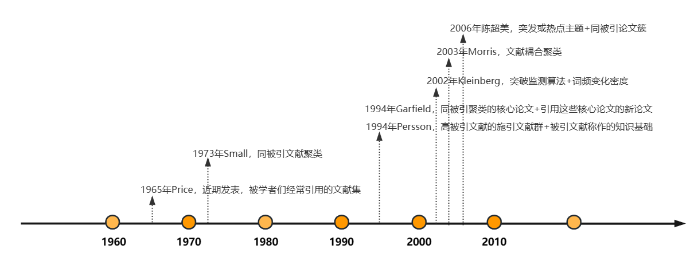

图5-3 研究前沿相关概念的发展时间线[^3]

从研究前沿相关概念的发展来看，研究前沿的内涵经历了①高被引文献集合→②施引文献集合→③共被引文献集合→④突发词或热点主题→⑤交叉领域的热点主题等阶段，其表现形式逐渐向语义化方向发展，即从文献集过渡到词语、主题。在此过程中，前沿与热点两个概念也出现了重叠和交叉，在科瑞唯安的研究前沿报告中，为了进行区分，前沿分为热点前沿和新兴前沿两种类别。

内涵的变化也引起前沿识别方法的变化。不管是高被引文献集合、施引文献集合、还是共被引文献集合，主要都是通过引文分析法进行。在引文网络中，引用关系可在一定程度上反映技术主题的相关性，而利用引文聚类可以将有相互关系的文献聚在一起，并通过分析引文聚类随时间的变化可以很清晰的发现技术的演化轨迹。因此，一些研究学者利用引文聚类分析法识别前沿热点技术。突发词以及交叉领域的热点主题进行识别主要属于主题词分析法，基于主题词来识别前沿已成为当前的主流方法（图5-4、图5-5）。

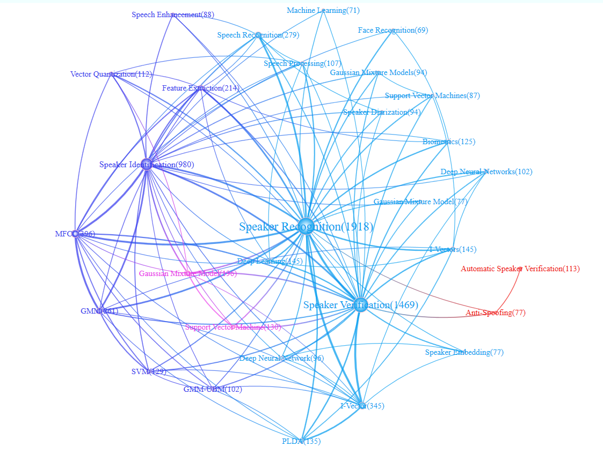

图5-4 通过关键词共现识别前沿热点主题

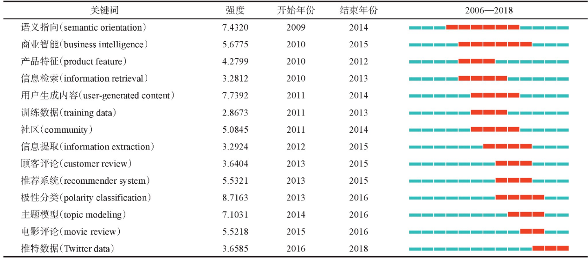

图5-5 基于关键词突变识别前沿热点主题[^4]

这些传统的研究方法是否存在问题呢？从方法所用的数据出发，至少存在两方面的问题。

首先是单一数据库的问题。不同的数据库收录的文献集各有侧重点，比如Web of Science数据库侧重收录期刊论文，如果用Web of Science数据库来探测计算机科学领域的前沿是否合适呢？以学科排名著称的*US news*曾经就犯过这样一个错误，在2017年*US news*
首次发布世界最强计算机科学院系排名，但是其结果与真实情况大相径庭，因此这个排名受到了美国计算机研究会的强烈抗议。为什么在学科排名上有着丰富经验的*US news*这次却犯了如此大的错误呢？原来*US news*按照以前进行学科排名的经验，采用Web of Science数据库作为排名计算的数据来源。但是以计算机学科为代表的新工科有其特殊性，其前沿技术更新迭代如此之快，所以很多计算机学科的研究者都选择以更加快速的会议论文将最新成果进行发表。而Web of Science数据库中包含的会议论文非常少，所以导致其获得的计算机排名偏差如此之大。

其次是单一文献类型的问题。目前大多数单一数据库仅包括一种或几种论文类型，但是某些领域的成果并不单单以论文的形式进行发表。如医学领域，很多研究成果为了后续能够投入市场进行商业化，往往会先进行专利申请；有些医药如要投入市场，往往需要先将临床实验数据提交特定的数据库；而有的研究者为了避免在审稿过程中其研究成果被抢发，往往也会将其成果提交预印本数据库。所以，如果要分析诸如基因治疗技术前沿，不能仅采用单一的数据库，而需要结合论文、专利、临床实验等多个数据库进行数据的整合再进行分析。如何进行数据整合？后续章节我们再进行详细说明。

上述文献数据，其实是根据信息的载体来进行分类的（详见第一章相关内容）。基于不同的文献数据类型，我们识别出的前沿可能会具有差异，基于论文数据识别出的是科学研究前沿，基于专利数据识别出的是技术前沿。但是哪种文献数据获得的前沿更具前瞻性呢？一般会认为专利数据更有前瞻性，老师在教专利检索的时候，也会告诉学生，先申请专利把技术保护起来，然后再提交论文发表，从这个角度看，专利先于论文公开，专利似乎更有前瞻性。但是如果考虑技术产生的流程，我们会发现，一般是理论先行，概念先提出来，然后应用研究者基于理论进行应用研究。但是理论是无法申请专利的，从这个角度看，似乎是论文数据更有前瞻性。因此，哪种文献数据获得的前沿更有前瞻性，需要根据具体分析的主题来进行判断和选择。

但是，无论是专利还是论文，都需要有一个审查和出版的过程，这就容易造成通过专利论文获得的前沿存在一个滞后性问题——探索获得的前沿不再前沿，因此前沿探测工作需要更有“预见性”，这就需要从数据和方法上进行更多的改进。下一节我们首先从数据的角度来进行讨论。

## 探索前沿热点的数据源

2023年，美国西北大学王大顺团队曾在*Nature Human Behavior*期刊上发表过一篇名为Data, measurement and empirical methods in the science of science的论文，系统性地介绍了科学学常用的数据、指标和方法。其中常用的数据如图5-6所示：

图5-6 科学学常用数据[^5]

科学学是一门研究科学和科学活动的发展规律及其社会功能的综合性新兴学科，对于科学前沿热点的探测也属于其中的一个重要领域。因此，本节也借用了图5-6中的数据分类，对前沿热点探测中的可用数据进行详细介绍。主要的数据包括①论文数据（含预印本）、②专利数据、③基金项目数据、④科技规划文本数据、⑤国家发展战略数据、⑥临床试验和药物数据、⑦媒体数据，等等。其中基金项目数据、科技规划文本数据、国家发展战略数据均具有较高的前瞻性，是进行前沿热点监测的重要数据。接下来我们对这些数据逐一进行介绍。

### 论文数据

论文数据是指从发表的论文中提取的数据以及在使用论文的过程中产生的衍生数据，包括发文数据、引用数据、使用数据和替代计量数据[^6]。常用的进行前沿和热点探测的数据源包括Web of Science、Scopus、Google Scholar、EI、ArXiv、PubMed、Cnki、Dimensions等。

Web of Science普遍被认为是全球最为权威的引文数据库，目前收录了 1900
年以后在世界各地出版的具有高质量和高影响力的期刊，关联自然科学、社会科学、艺术和人文学科领域众多期刊、数据和会议论文集的研究成果。其中对探索前沿和热点最有帮助的是其引文数据，目前包含了超过17亿条被引文献和1.59亿条引文记录[^7]，字段数据非常丰富，并且绝大多数文献分析软件都能兼容Web of Science的导出文件格式，成为科学学和科学计量学等学科进行数据分析的首选数据源。

Scopus是爱思唯尔于2004年推出的，其历史远远晚于Web of Science，但是目前已发展为全球最大的同行评议学术论文摘要和引文数据库，截止至2023年末，共收录期刊43400本，图书292000本，在数量上超越了Web of Science，但也由于数量的巨大，也会存在一些质量难以保证的期刊，在对文献全面性有较高的要求时，采用Scopus作为数据源是一个较好的选择。

Google Scholar基于Google的爬虫，对全球的学术出版物资源进行了索引，并提供了一种可供用户搜索学术文献的简单途径。用户可以在一个搜索框搜索多个学科和资料来源，包括学术出版商、专业协会、在线资料库、大学和其他网站的文章、论文、书籍、摘要和法庭文书等。由于是爬虫爬取，数据量十分巨大，但数据的质量上也可能存在较大的问题。一个是重复性问题，存在不同网站上的同一篇文章，可能没有进行归并，被计算成了两篇不同的论文；另外容易产生造假论文，爬虫无法识别论文的真实性，挂在个人网站上的一篇“胡说八道”的文章，也有可能被爬虫识别为学术论文，从而也容易导致其引文数据的失真。

EI数据库是老牌的工程领域索引数据库。EI公司始建于1884年，作为世界领先的应用科学和工程学在线信息服务提供者，一直致力于为科学研究者和工程技术人员提供专业化、实用化的在线数据信息服务。1995年以来EI公司开发了称为"Village"的一系列产品，Engineering Village 2就是其中的主要产品之一，包括: Ei Compendex
、Inspec、GEOBASE、GeoRef等数据库。Compendex
内容由期刊、会议论文集、学位论文、标准、书籍和最新预印本组成，来自全球数千家出版商，包括
IEEE、ASME、SAE 和 ACM 等主要工程协会，Inspec 数据库由英国工程技术学会
(IET) 创建，包含超过 2,200
万条记录，涵盖物理、电气工程和电子、计算机和控制、信息技术等领域[^8]。因此，对于研究工程领域的前沿，EI数据库是一个很好的选择。但是，EI数据库只有索引信息，没有引文信息，这是EI数据库最大的一个不足之处。

ArXiv是世界上最大的预印本网站，包含了物理学、数学、计算机科学、定量生物学、定量金融学、统计学、电子工程与系统科学以及经济学领域近
240
万篇学术文章，这些文章的作者为了防止自己的idea在论文被收录前被别人剽窃，将预稿上传到Arvix作为预收录，以证明论文原创性。因此，ArXiv上的最新论文时滞性低，但由于没有经过同行评议，一些论文质量存在问题，可能后续无法正式发表。

PubMed是由美国国立卫生院（NIH）下属的国立医学图书馆（NLM）的国家生物信息中心（NCBI）研发及维护的文摘数据库，因此其收录的论文也主要以生物、医学领域为主，收录年限最早可追溯至1865年。

Cnki是最大的中文文献数据库，对于研究中国国内研究前沿和热点是一个非常好的数据源。在第二章中，已对Cnki数据库有较为详细的介绍。

Dimensions 数据平台是在2009年首次问世的，由总部位于伦敦的技术公司Digital Science（自然出版集团的姊妹公司）创建。其官方网站为<https://www.dimensions.ai/>，其检索网址为https://app.dimensions.ai/，其下载限制为免费用户500条/次，订购用户为5000条/次，并且可提供API供用户进行大量数据的访问。其最大的特点是将论文与基金、专利、政策文件等数据建立了联接[^9]，对于数据分析者来说能够进行更多层面的分析，如科研成果转化问题、科学基金资助的成效问题等。比如，在图5-7中，显示了论文*Multiplex Genome Engineering Using* *CRISPR/Cas Systems*
被专利和政策文件的引用情况（该文来自美国艺术与科学院院士、美国国家科学院院士、美国国家发明家科学院院士、美国国家医学院院士张锋的关于基因编辑技术CRISPR的一篇论文）。

图5-7 Dimensions数据库中某论文被专利和政策文件的引用情况

**发文数据**自论文发表之日就已经确定，无特殊情况不会变化。发文数据中一般可用于前沿热点分析的字段主要包括作者、作者机构、机构地址、出版日期、标题、摘要、关键词、正文主体、致谢、参考文献等。其中标题、摘要、关键词以及正文主体能够反映前沿热点的具体内容；作者、机构、地址等反映研究前沿热点的代表主体；参考文献反映这些前沿热点主体的知识基础和延续性。表5-2对上述发文数据中的字段含义进行了简要介绍。

表5-2 发文数据中不同字段的含义

|  |  |
|:--:|:--:|
| **数据** | **简介** |
| **作者** | 文献的创作者，主题思想的提出者（通讯作者），以人名的形式出现，可以是一位或者多位。 |
| **作者机构** | 文献作者所从属的机构，机构可以是高等院校、研究院所、实验室、企业和政府部门。除独立作者外，作者一般都有所属的机构信息。 |
| **机构地址** | 作者所属机构的地域信息，即机构的空间地理位置、包括国家/地区，各级行政区和街道地址。 |
| **出版日期** | 出版日期即文献出版的时间，期刊文献的出版日期可能还包括期刊编辑部收稿日期。 |
| **标题** | 文章标题是标明文章内容的简短语句，最直接地传达出全文的主题。 |
| **摘要** | 摘要是全文的内容提要，简明扼要且不加议论地直述文章内容，以简略性语言介绍文章的研究背景、问题、目的、方法等内容。 |
| **关键词** | 关键词是科学文献的索引词汇，简洁准确地反映出文章探讨的主题，方便人们进行检索。 |
| **正文主体** | 正文主体即文献的主体部分，包括文章的引言、数据方法、结果和结论等最重要的部分。 |
| **致谢** | 致谢部分用来表达作者对其文章提供帮助的人、机构、基金项目的谢意。 |
| **参考文献** | 参考文献列表是为了列举出对文章思想产生影响的文献。 |

**引用数据**是对科学文献之间的引用状况进行统计后得出的数据,统计的对象是发文数据的参考文献数据,因而引用数据本身便是诞生于对发文数据的深层次的、联想性的挖掘。引用数据包含施引文献数据和被引文献数据，施引文献数据是对某篇先发表的文献实施引用行为的后发表文献的作者、标题、来源、日期、施引次数、施引位置、施引情感等数据；被引文献数据是被某篇后发表的文献所引用的先发表文献的作者、标题、来源、发表日期、被引次数等数据。

**使用数据**是业已发表的科学文献被各种方法使用之后产生的数据。主要的使用数据包括浏览数据和下载数据。浏览数据包含Html网页浏览行为和浏览结果。浏览行为是指用户在何时、何地（IP地址）发生了浏览哪篇文献的行为动作；浏览结果是指一篇文献的被浏览次数，浏览次数即文献的摘要或全文通过各种形式被浏览的次数。下载数据包含下载行为和下载结果，下载行为是指用户在何时何地发生了下载哪篇文献的行为动作；下载结果是指一篇文献的被下载次数。文献下载次数即文献全文通过各种形式被浏览的次数，下载的格式包括PDF、XML等。利用使用数据分析研究者的即时文献使用内容，能够对当前的研究热点和前沿有更加实时的掌握，目前很多学术出版社和期刊都提供论文级别的文献使用数据，其中表5-3列出了部分出版社/期刊及对应的网址。

表5-3 部分提供文章级别使用数据的出版社/期刊

|                             |                              |
|:----------------------------|:-----------------------------|
| **出版社或期刊**            | **网址**                     |
| Plos                        | https://plos.org/            |
| Nature                      | https://www.nature.com/      |
| Science                     | https://www.science.org/     |
| PNAS                        | https://www.pnas.org/        |
| IEEE Xplore Digital Library | https://ieeexplore.ieee.org/ |
| ACM Digital Library         | https://dl.acm.org/          |
| Taylor & Frances            | https://www.tandfonline.com/ |
| Frontiers                   | https://www.frontiersin.org/ |
| Peer J                      | https://peerj.com/           |

**替代计量数据**主要是指基于社交网络数据的文献计量指标，包括大众社交媒体传播数据、传统主流媒体传播数据、学术社交媒体传播数据、网络博客传播数据等。大众社交媒体传播数据即文献在大众社交新媒体上被传播讨论的情况，包括
Facebook、Twitter、Google +
、新浪微博等。传播的形式根据新媒体特点的差异而各有不同，如 Twitter的
retweets 和 comments、Facebook 的 likes和 shares、Google + 的 +
1、新浪微博的转发评论等。传统主流媒体传播数据即文献在传统主流媒体上被报道传播的情况，传统主流媒体包括主流的报纸、杂志、互联网门户等。学术性社交媒体工具传播数据即文献在学术型社交媒体工具上被阅读收藏的情况，目前主流的学术型社交媒体工具有
Mendeley、Researchgate、CiteULike 等。网络博客传播数据即文献在博客( Blog) 上被传播讨论的情况，其数据来源既包括科学博客也包括非科学博客。

上述论文数据中的四种数据类型各有特点，发文数据属于奠基性的原始数据，引用数据则重新发掘了发文数据的参考文献信息，以之为基础建立了论文间的关联网络，并且由于引用行为的目的性特点而成为了科研评价和热点探测的主力军。使用数据和替代计量数据则是源于人们为了弥补引用数据滞后性和片面性等不足而依靠信息计量技术进行的探索。在进行具体分析时需根据实际情况进行选择使用，当前也有研究者利用多种数据融合进行更加全面的分析。后续小节我们会详细介绍关于数据融合的相关内容。

### 专利数据

专利数据在前沿热点方面具有一些论文数据不具备的优势，比如在技术领域的前瞻性、技术的价值度等指标。在第二章中介绍了几个常用的国内外专利数据库，那些数据库对于查找专利全文非常有用，但是在进行前沿技术探测时，一些综合了全球多国专利数据的数据库是更好的选择。这里主要简单介绍一下LENS数据库。

LENS是一款世界性的、免费的、开放的专利与学术检索、下载及分析平台，由独立的非营利性机构Cambia和昆士兰理工大学联合开发，网址是https://www.lens.org/。LENS的数据资源类型非常丰富，包括专利、学术数据、生物序列、文档链接。LENS的专利数据已包括1.49亿条专利记录，超过2.6亿条学术数据，超过Web of Science、Elsevier等国际知名论文数据库。并且，LENS基于丰富海量的数据资源，进行专利和论文学术关联，这一功能一经出现立刻得到广大学者的关注，为理解学术研究对创新的影响带来了新的思路。例如，图5-8就显示了某篇Nature发表的论文被专利、基金和政策文件的引用情况。

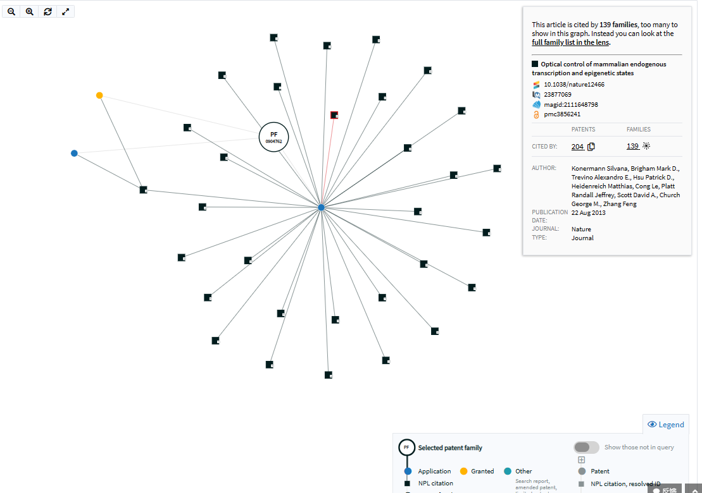

图5-8 LENS数据库中某论文被专利、基金和政策文件的引用情况

### 基金项目数据

国家和各级政府资助的基金项目数据具有重要的科学研究前沿判断价值。从科研发展过程来看，一部分高质量的期刊论文来源于基金项目的资助，这部分论文往往代表着学科发展过程的研究前沿、热点、能在一定程度上引领学科发展。资助这些论文的基金项目从时间上看比论文数据更加前沿一步，从中识别出的研究前沿在一定程度上比通过论文识别出的研究前沿更有前瞻性。

国家自然科学基金重大研究计划是现阶段国家自然基金中层次最高、资助力度最大、权威性最强的项目类别，主要围绕国家重大战略需求和重大科学前沿，凝练科学目标，凝聚优势力量，形成具有相对统一目标或方向的项目集群，提升中国基础研究的原始创新能力，为国民经济、社会发展和国家安全提供科学支撑。

分析国内研究前沿热点，最适合的基金项目数据库来自国家自然科学基金委的官方数据库（https://kd.nsfc.gov.cn/）。也有商业机构基于国家自然科学基金委的数据进行了加工处理，在数据下载的便利性上有着独特的优势。比如MedPeer国自然基金数据分析系统（https://nsfc.medpeer.cn/）、MedSci全球基金项目数据库（https://www.medsci.cn/sci/nsfc.do）。如图5-9所示，在MedPeer中检索G0403科技管理与政策类别下的国家自然科学基金，发现其提供的数据较全，未结题、已结题和研究成果都能查询，同时能够下载结题报告，对检索结果有非常多维度的统计，方便研究者进行深入的挖掘。

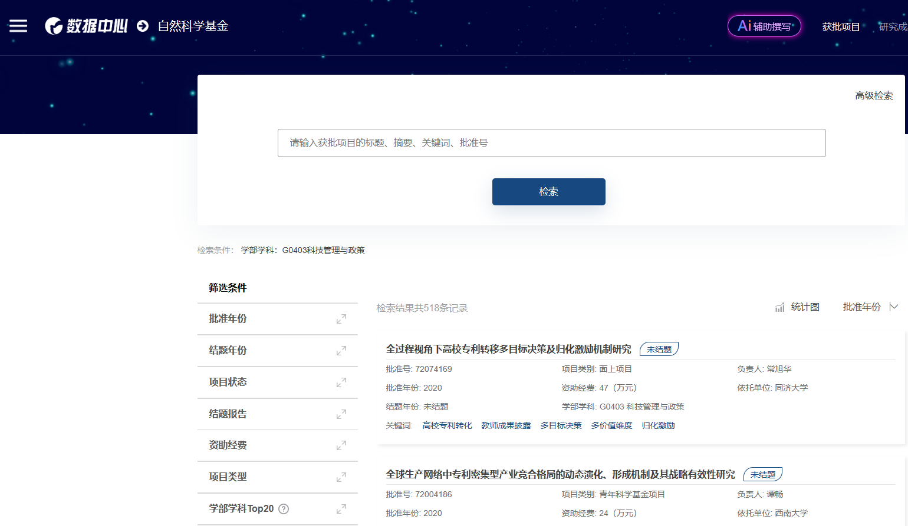

图5-9 MedPeer的基金检索结果页面

分析国外发达国家的研究前沿和热点，最适合的基金项目数据库有美国国家科学基金会（https://www.nsf.gov/）、美国国立卫生研究院（https://reporter.nih.gov/）、欧洲科学基金会（https://www.esf.org/）等组织的官方数据库。图5-10显示了美国国家科学基金会的高级检索页面（<https://www.nsf.gov/awardsearch/advancedSearch.jsp>），可按项目关键词、PI相关信息、项目所属计划（program）、项目编号等字段来检索。同时还可选择只检索在研项目（active award）或已完成项目（expired award）。检索到的项目信息包括：项目起始时间、资助经费、PI、摘要等详细情况，如需项目标书全文，可以向PI索取。检索结果可以导出到excel进行进一步分析。此外，还可以点击Download Awards链接，直接下载历年数据的压缩包（图5-11）。

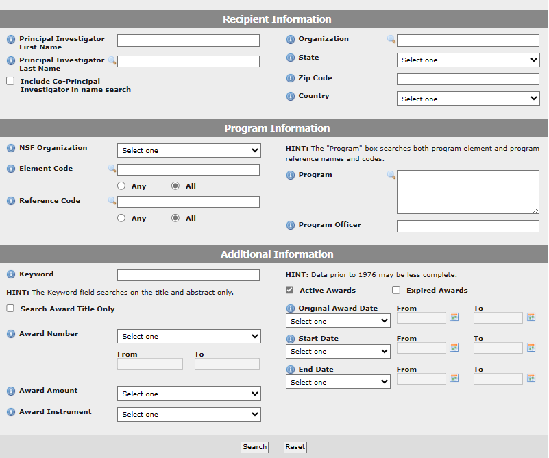

图5-10 美国国家科学基金会的高级检索页面

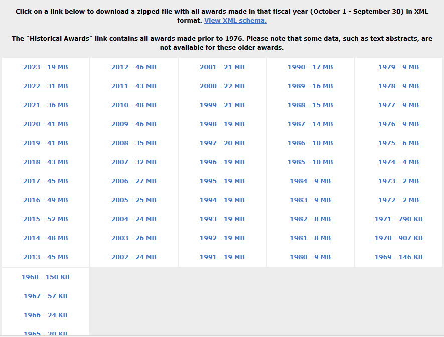

图5-11 直接下载美国国家科学基金会历年数据压缩包

### 科学规划数据

科学规划数据主要由各国政府部门及相关学科协会组织发布，主要涉及关系国家发展大势、国际研究前沿热点和科技瓶颈等内容。按时间长短，可分为短期（1-2年）、中期（3-5年）和长期规划（\>5年）。按科技规划目的，可分为战略规划、行动规划和作业规划。

科学规划数据是非常有效的探索科学前沿的数据，因为科技规划数据具有如下特点：

1.  科学性：科学规划是由政府主导，专家参与制定的，在制定时，会进行周密预测和科学分析。

2.  目的性：科学规划总体都以争取科学技术突破，促进科技、经济、社会发展为目标。

3.  全面性：包含科技研究领域各方面的内容。

4.  前瞻性：规划者会进行多方面预测，如基础研究预测、市场需求预测等。

5.  权威性：科学规划都是由政府直接或间接指导。

例如，在《中华人民共和国国民经济和社会发展第十四个五年规划和2035年远景目标纲要》中，就明确提出了7个科技前沿领域，包括新一代人工智能、量子信息、集成电路、脑科学和类脑研究、基因与生物技术、临床医学与健康、深空深地深海和极地探测，并对每个领域下的一些重点主题进行了介绍。

此外，不同部委又有更加细致的科学规划文件。比如科技部、生态环境部等部位联合印发的《“十四五”生态环节领域科技创新专项规划》，国家能源局印发的《“十四五”现代能源体系规划》，中国民用航空局等部位印发的《“十四五”民用航空发展规划》，国家发改委印发的《“十四五”生物经济发展规划》等。

如何去找这样一些规划文件呢？一方面可以利用搜索引擎到各部委官网进行搜索，另一方面也可以利用国务院政策文件库进行检索。国务院政策文件库网址为<https://www.gov.cn/zhengce/zhengcewenjianku/index.htm>。例如，在搜索框中输入“十四五发展规划”，就能搜到多个部委印发的相关规划文件。

图5-12 国务院政策文件库的检索结果页面

### 关于数据的几个悖论

上文介绍了几类探索前沿热点的常用数据，但是，有了数据就一定能够得出正确的结论吗？从数据到正确的结论，其实还有一个漫长的过程，不同的研究者利用同样的数据集，有可能得出不同的，甚至完全相反的结论。本小节主要介绍两个经典的数据悖论，以便读者对于数据集的选择对结论的影响有一个初步的了解，迈出深入理解数据素养的第一步。

1.  辛普森悖论

辛普森悖论描述的是局部数据的结论与整体数据的结论完全相反的现象。最早由英国统计学家E.H.辛普森在1951年提出。简单来说，当我们在分析两个或多个子集的数据时，可能会发现每个子集内部的数据趋势或结论与将这些子集合并后的整体数据趋势或结论存在矛盾。这就是因为当我们只关注子集数据时，可能忽略了子集之间的某些关键差异或关联性，而这些差异或关联性在合并数据时变得显著，从而改变了整体的结论。

举一个例子，假设我们有50岁以上和50岁以下两组患者，在收集了他们的每周运动小时数和病发风险后，我们得到了如图5-13所示的有关运动和病情恶化几率关系的两张图表，两者都显示每周运动得越久，患者病情恶化的可能性就更低，即运动时间与病情恶化概率成反比。

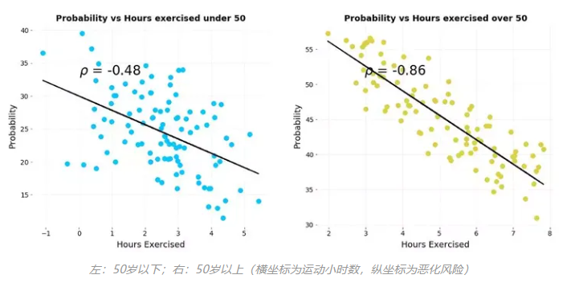

图5-13 分组显示运动时间与病情恶化概率成反比

但是，如果把两组数据结合在一起时，我们发现了截然不同的结论，即运动时间与病情恶化概率成正比（图5-14）。

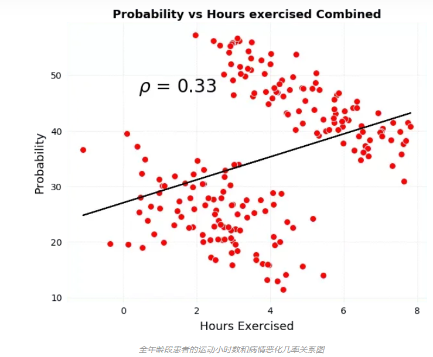

图5-14 数据总体显示运动时间与病情恶化概率成正比

我们究竟应该相信分组数据的结果还是总体数据的结果？回答这个问题，我们需要先考虑因果关系：数据是怎么产生的？影响结果的因素有哪些？其中有哪些是我们没有呈现的？以运动和病情恶化的分析为例，很明显运动肯定不是影响病情加重的唯一因素，饮食、环境、遗传等因素都可能发生作用。但在图5-14中，我们只看到了恶化几率和运动时长之间的关系，在没有控制变量的情况下，这相当于假设恶化只是由运动引起的，显然不合理。如果考虑原数据中被忽略的年龄因素，就会发现无论是50岁以下还是50岁以上，患者年龄与病情恶化几率都显示出强烈正相关。这意味着随着患者年龄增加，即便每周运动量相同，老年患者也比年轻患者更容易病情恶化。在这种情况下，分组讨论数据是规避辛普森悖论的一种方式。

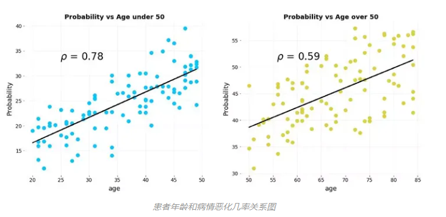

图5-15 分组显示年龄与病情恶化概率成正比

在科学计量学领域，忽略一些关键变量的影响也容易产生辛普森悖论。如忽略国别的发文量差异、忽略文献随时间增长的趋势、忽略性别的差异、忽略学科的差异等。为了避免辛普森悖论带来的误导，我们在分析数据时应当谨慎对待总体数据和子集数据之间的关系，充分考虑到可能存在的各种影响因素，以及这些因素如何影响我们的结论。只有这样，我们才能得出更准确、更有意义的结论。

2.  幸存者偏差

幸存者偏差也称为“生存者偏差”、“存活者偏差”等，指的是一种常见的逻辑谬误，是只用“部分幸存者”的数据去研究整体数据，由此得出来的结论和发现是“片面的”甚至是“截然相反”的。这一悖论来源于二战期间的一个故事。

1941年，第二次世界大战中，空军是最重要的兵种之一，盟军的战机在多次空战中损失严重，无数次被纳粹炮火击落，盟军总部秘密邀请了一些物理学家、数学家以及统计学家组成了一个小组，专门研究“如何减少空军被击落概率”的问题。当时军方的高层统计了所有返回的飞机的中弹情况——发现飞机的机翼部分中弹较为密集，而机身和机尾部分则中弹较为稀疏，于是当时的盟军高层的建议是：加强机翼部分的防护。但这一建议被小组中的一位来自哥伦比亚大学的统计学教授——沃德（Abraham Wald）驳回了，沃德教授提出了完全相反的观点——加强机身和机尾部分的防护。那么这位统计学家是如何得出这一看似不够符合常识的结论的呢？

沃德教授的基本出发点基于三个事实是：（1）统计的样本只是平安返回的战机；（2）被多次击中机翼的飞机，似乎还是能够安全返航；（3）而在机身机尾的位置，很少发现弹孔的原因并非真的不会中弹，而是一旦中弹，其安全返航的机率极小，即返回的飞机是幸存者，仅仅依靠幸存者做出判断是不科学的，那些被忽视了的非幸存者才是关键，他们根本没有回来！军方采用了教授的建议，加强了机尾和机身的防护，并且后来证实该决策是无比正确的，盟军战机的击落率大大降低，这就是“幸存者偏差”故事的来源。

这种偏差在多个领域都有所体现。比如，在金融领域，投资者可能只关注那些成功的企业或投资策略，而忽略了那些失败的企业或策略，从而做出不准确的判断。在医学领域，研究者可能只研究那些幸存下来的病例，而忽略了那些因病情严重而未能幸存下来的病例，导致研究结果存在偏差。在科学计量学领域，我们以诺贝尔奖获得者为研究样本研究科学家的成长规律，也可能导致幸存者偏差。

幸存者偏差的核心问题在于忽略了筛选的过程和未被观察到的信息，仅基于幸存者的信息做出判断。为了避免这种偏差，我们需要更全面地收集和分析数据，尽量考虑到所有可能的情况和因素，以得出更准确、更全面的结论。

### 多源异构数据的融合

新兴技术形成与发展的信息以不同形式表征在各种媒介中，构成多源异构数据，如文献数据、专利数据、网络新闻、社会媒体数据、商业评论数据、政策文本数据等。不同数据源的数据可提供技术形成与发展不同层面的信息，综合利用不同数据源能更全面展现新兴技术的发展态势与趋势。因此，在前沿热点探测领域，如何有效地进行多源异构数据的融合已成为研究的热点之一。

对于多源异构数据融合，不同领域有着不同的定义。科学计量学中的多源异构数据融合是指通过特定的方法对不同类型信息来源或关系数据进行综合分析，最终可以利用所有信息共同揭示研究对象的特征，弥补单一数据类型与单一关系类型在揭示研究领域实体间关联的不足，以获取更全面、客观的计量结果[^10]。

数据融合按照在研究中的时间不同，可以分为前期融合、中期融合和后期融合。

前期融合也叫数据源融合，是将不同的数据源融入同一分析目标，包括字段映射、字段拆分、数据记录滤重等。例如，在图5-16中有3个不同数据源，左边Derwent数据的唯一标识符保存在UT字段，而中间的Wos1数据的唯一标识符保存在DI字段。我们可以采用XML语言建立过滤器，利用字段映射将唯一标识符全部统一在\<ID\>\</ID\>标签中；其他不同字段也可采取同样的处理办法，实现不同来源数据的融合。

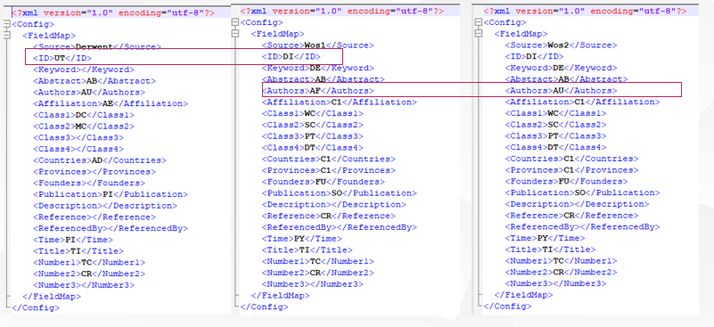

图5-16 利用字段映射实现数据源融合

中期融合也叫数据关系融合，是将不同数据关系有效融合成一个新关系数据来表征实体之间的关联特征。比如，论文之间的关系存在共现关系、引用关系、合著关系，通过以论文为实体进行不同关系的融合，可形成论文之间的多元关系图，从而展现知识之间更为深层次的关联（图5-17）。

图5-17 数据关系融合示意图

在前沿热点分析中，我们也经常利用机构合作关系和主题共现关系进行关系融合，呈现更加丰富的主题-机构信息（图5-18）。

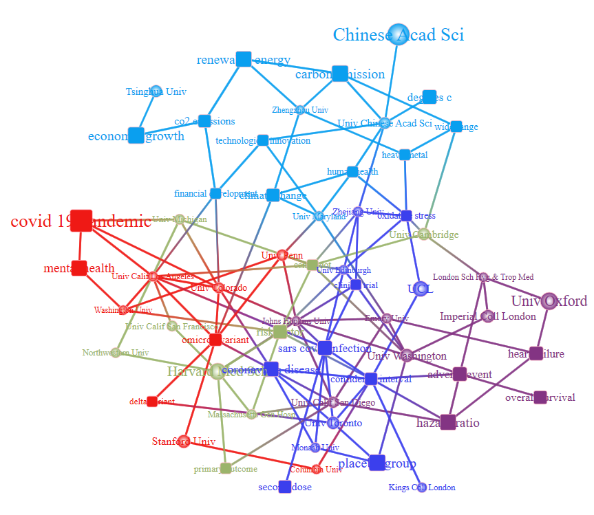

图5-18 机构合作关系和主题关系融合

后期融合也叫结果融合，是将不同数据源/算法等得到的聚类结果利用一定的方法进行融合，有的论文也称“聚类融合”。图5-19展示了基金项目前沿主题、论文前沿主题、专利前沿主题的结果进行融合之后所获得的更为全面、共有前沿更为突出的结果。

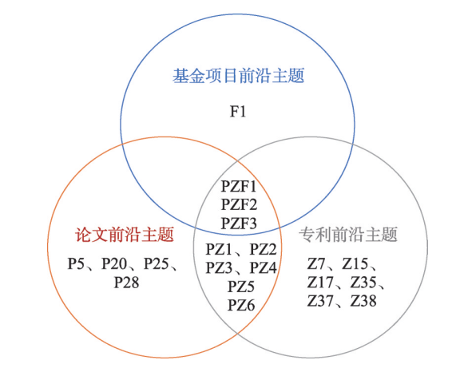

图5-19 结果融合示意图

## 探索前沿热点的方法与工具

随着大语言模型的飞速发展，利用生成式人工智能来探索学科前沿热点也成为图书情报领域的研究热点。但是，就目前的大语言模型而言，要替代原有的前沿热点探测方法，还存在三个尚未解决的问题。第一，大语言模型的“幻觉”问题。虽然最新的一些研究可以基于检索增强技术（Retrieval-Augmented Generation，RAG）减少“幻觉”的产生，但是无法从根本上消除幻觉现象。因为从大语言模型的原理上来说，就是预测文本模型中下一个词的概率。。。第二，大语言模型缺乏稳定性（可重复性）、可解释性和透明度。第三，就是大语言模型进行探测所利用的仍

[^1]: 见https://www.nature.com/immersive/d42859-019-00121-0/index.html

[^2]: 陈仕吉.科学研究前沿探测方法综述\[J\].现代图书情报技术,2009(09):28-33.

[^3]: 白如江. 未来新兴科学研究前沿识别研究\[M\]. 人民出版社，2021

[^4]: 周建,刘炎宝,刘佳佳.情感分析研究的知识结构及热点前沿探析\[J\].情报学报,2020,39(01):111-124.

[^5]: Liu, L., Jones, B.F., Uzzi, B. *et al.* Data, measurement and empirical methods in the science of science. *Nat Hum Behav, 2023,* **7**, 1046–1058

[^6]: 王贤文,方志超,胡志刚.科学论文的科学计量分析:数据、方法与用途的整合框架\[J\].图书情报工作,2015,59(16):74-82

[^7]: https://clarivate.com.cn/solutions/web-of-science/

[^8]: https://www.elsevier.com/zh-cn/products/engineering-village/databases

[^9]: https://www.nature.com/articles/d41586-018-00688-0

[^10]: 许海云, 董坤, 隗玲, 王超, 岳增慧.
    科学计量中多源数据融合方法研究述评\[J\]. 情报学报, 2018, 37(03):
    318-328.
