# 第五章 如何探索学科前沿热点

研究者经常用“热点”“趋势”“前沿”描述一个正在受到关注的主题，但三者并不是同义词。论文数量多、新闻曝光高，说明一个主题“热”，却不必然说明它正在改变知识边界；一项真正具有突破潜力的研究，在早期也可能只有少数团队参与，尚未形成可观的引用和讨论。探索前沿热点的核心任务，因而不是从数据库中找出几个高频词，而是依据明确的时间窗口和问题边界，综合多类信号，判断某个主题为何值得持续跟踪。

本章承接第三章的文献检索与综述方法，并利用第四章介绍的开放资源、版本与许可判断扩展证据来源，同时为第七章的文献计量分析建立应用情境。第五章关注“怎样综合多源信号发现并跟踪前沿”，第七章则重点解释计量数据、指标和网络方法的原理。内容依次回答五个问题：什么是学科前沿和研究热点；哪些可观察信号能够表征它们；应该从哪些数据源获取证据；怎样选择分析方法和工具；如何把一次检索转化为可核验、可更新的前沿监测流程。

## 5.1 前沿、热点与趋势

### 从日常用语进入学术语境

在日常语言中，“时尚前沿”常指尚未广泛普及、却可能引领下一阶段风格的设计；“热点”则常与热搜、热门事件和集中讨论联系在一起。两种图像所表现的差别很直观：前沿强调“领先于多数人的探索”，热点强调“许多人正在关注”。当某项前沿探索获得快速扩散时，它可以成为热点；热点持续积累理论、方法或证据，也可能推动新的前沿形成。但二者并不天然重合。

图5-1 日常语境中的“前沿”与“热点”。第一幅图以新颖、尚未普及的设计表现“领先”，第二幅图以热度聚集表现“广泛关注”；将这种差别带入学术研究，有助于避免把高关注度直接等同于知识突破。

在学术语境中，可以作如下操作性区分：

- **研究热点**是特定时期内研究活动或注意力明显集中的主题，通常表现为发文、引用、下载、讨论、项目投入或会议活动的增加。
- **研究前沿**是一个领域正在拓展知识边界的位置，可能涉及新问题、新解释、新方法、新数据、新技术，或不同学科知识的重新组合。
- **研究趋势**是某一指标随时间呈现的方向性变化，例如持续增长、短期突增、趋于稳定或逐渐衰退。趋势是一种变化形态，不自动说明主题是否重要。
- **新兴前沿**通常兼具较强的新近性和较快的发展速度，但其未来影响仍有较大不确定性。
- **成熟主题**可能规模很大、引用很多，却已形成相对稳定的问题和方法框架，不能仅凭总量继续称为“新兴”。

表5-1 前沿、热点、趋势与成熟主题的区别

| 概念 | 核心问题 | 常见信号 | 主要误判 |
| --- | --- | --- | --- |
| 研究热点 | 目前哪些主题受到集中研究或关注 | 发文量高、下载或讨论多、会议密集 | 把短期舆论事件当作稳定研究方向 |
| 研究前沿 | 哪些探索正在扩展知识边界 | 新问题、新方法、新组合、结构转折、代表性成果 | 把“新名词”当作实质创新 |
| 新兴前沿 | 哪些较新的探索正在快速形成 | 近期核心成果、增长加速、突现词、新团队进入 | 用很小的基数制造夸张增长率 |
| 研究趋势 | 某项活动正在怎样变化 | 时间序列的增长、波动、稳定或衰退 | 只看起点和终点，忽略中间结构变化 |
| 成熟主题 | 哪些主题已经形成稳定知识与共同体 | 大规模、持续产出、概念和方法相对稳定 | 因总量高而误判为“最新前沿” |

### 时间窗口决定判断

前沿热点具有强烈的时间相对性。“最近”可能指过去一年、三年或十年，选择不同窗口会得到不同结果。快速迭代的人工智能、生物医学和信息技术领域，较短窗口有助于观察新动向；教育史、哲学等积累周期较长的领域，过短窗口可能把正常波动误作突变。检索时还要处理“不完整年度”：若在年中统计当年发文量，直接与完整年份比较，往往会低估当年活动。

空间和对象边界同样重要。一个主题可能在国际范围内已经成熟，在国内仍处于引入阶段；也可能在基础研究中刚刚出现，却已在产业专利中快速扩散。因此，“某主题是前沿”是一句缺少条件的判断。较完整的表达应是：“在2022—2025年的国际教育技术研究中，该主题表现出新近性和增长信号，但其在基础教育场景中的有效性证据仍不足。”

### 前沿不一定已经成为热点

早期前沿常面临样本少、术语不统一和引用尚未积累的问题。如果只使用总发文量、总被引频次等滞后指标，最容易识别的是已经获得广泛承认的主题，而不是刚刚出现的方向。反过来，重大公共事件可能使一个主题在短期内迅速升温，但热度来自情境冲击，并不等于已经形成新的理论或方法。

因此，前沿探测不是“找最大值”，而是比较新近性、增长、知识结构变化和实质内容。任何单一指标都只能提供线索，不能独立完成判断。

## 5.2 从知识网络到可观察信号

### 科学知识不是孤立文献的集合

论文通过参考文献、共同主题、作者合作和方法借用相互连接。随着时间推移，有些连接会形成稳定的研究共同体，有些分支会从原有主题中分化出来，也有一些短暂聚集最终消失。Nature在创刊150周年时发布了一幅共被引网络图：每个点代表一篇论文，颜色表示学科，若后续论文同时引用两篇文献，两点之间便形成联系。图中不同颜色相互交织，说明知识发展既有学科内部的累积，也有跨学科的连接。[Nature 150周年专题](https://www.nature.com/collections/dgabdjddji)

图5-2 科学知识的网络结构。图中大量彩色节点代表不同学科的论文，连线表示论文被共同引用；局部密集区域可理解为关系紧密的知识群，连接不同区域的节点则可能提示跨领域传播或新的知识组合。网络图展示的是关系证据，仍需回到文献内容解释每个群体为何形成。

这一视角改变了前沿探测的基本单位。早期做法常从“高被引文献集合”出发，随后关注引用这些核心成果的新文献，再通过共被引关系识别研究群体。随着题录数据和全文处理能力提高，分析单位扩展到关键词、摘要语义、主题模型、专利与基金项目，前沿表征也从“文献集合”逐渐走向“问题—方法—证据—应用”的组合。

### 六类互补信号

一个候选主题是否值得称为前沿，可以从六个维度收集信号。

表5-2 前沿热点的六类判断信号

| 信号 | 可以观察什么 | 可能支持的判断 | 必须检查的限制 |
| --- | --- | --- | --- |
| 新近性 | 核心成果、术语或方法出现的年份 | 主题可能刚刚形成 | 新术语可能只是旧概念改名 |
| 增长性 | 发文、项目、专利或参与团队随时间增加 | 研究活动正在扩张 | 小基数会放大增长率；数据库收录也会变化 |
| 注意力 | 引用、下载、收藏、新闻、社交讨论 | 主题受到学术或社会关注 | 注意力可由争议、营销或突发事件驱动 |
| 结构性 | 聚类形成、网络分化、桥接节点、突现词 | 知识结构可能发生转折或重组 | 参数不同会改变聚类和网络外观 |
| 跨域性 | 不同学科、机构、行业或数据类型发生连接 | 新组合可能形成 | 跨学科不自动等于高质量或高影响 |
| 转化性 | 论文连接专利、临床试验、标准、政策或产品 | 知识可能进入应用与治理环节 | 不同领域转化周期差异很大，关系未必具有因果性 |

六类信号之间并非越多越好，而要与问题相配。例如，研究基础理论前沿时，近期核心文献、共被引结构和专家判断更重要；分析教育政策热点时，政策文本、基金项目、实践报告和学术论文需要结合；观察技术应用前沿时，专利、开源项目、临床试验或标准文件可能早于正式论文显示变化。

### 共现、聚类与突现图如何阅读

关键词共现分析把“在同一篇文献中出现”视为词语之间的联系。频繁共同出现的词可能属于同一问题框架；聚类算法进一步将联系紧密的词归入若干主题群；突现分析则关注某个词在短时间内使用频次快速上升的现象。三者分别回答“哪些概念有关”“这些关系可分成哪些主题”“哪些概念在何时突然增强”。

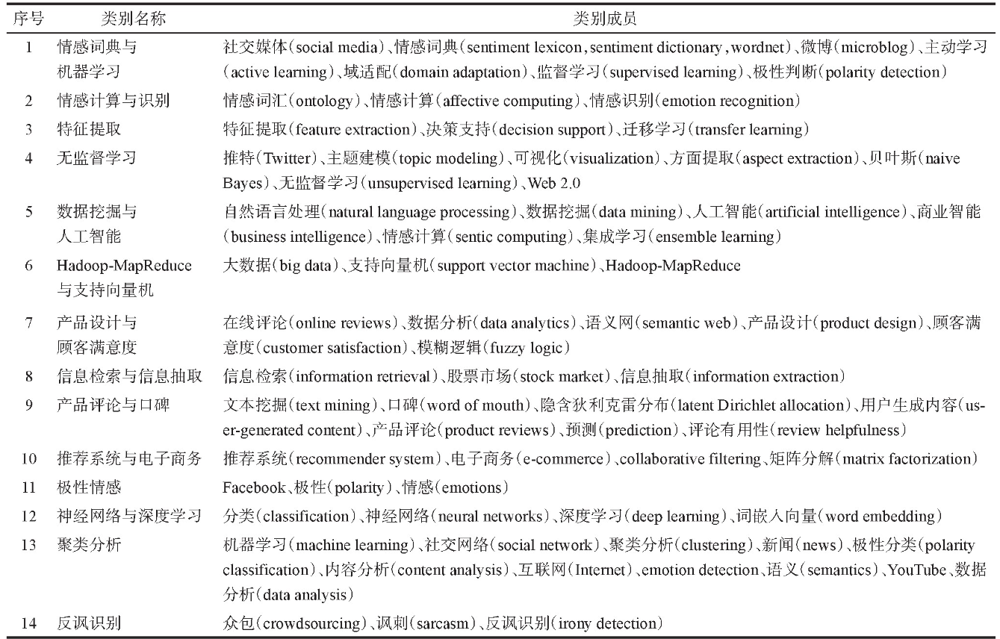
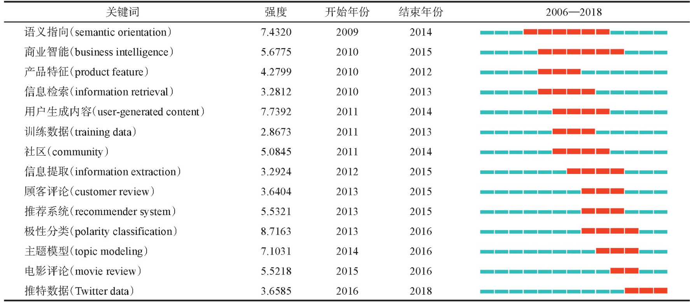
图5-3 三类关键词图谱的观察重点。第一幅图用节点和连线表现概念的共同出现，第二幅图用颜色或区域把关系紧密的词分组，第三幅图用时间条标出某些词活跃度快速增强的阶段。节点大不等于“前沿”，聚类标签也不是研究结论；必须检查原始词、同义词处理、时间切片和代表文献。

关键词图谱常有三类失真。第一，作者关键词不统一，同义词、缩写和中英文变体会把同一主题拆开；第二，高频通用词可能占据网络中心，却缺少区分力；第三，软件自动生成的聚类标签有时来自少量词或标题，语言通顺并不保证语义准确。分析前应建立同义词表、停用词表和术语保留规则，分析后应抽读每个主题的代表文献。

## 5.3 前沿探测的数据源

### 数据源应覆盖研究活动的不同阶段

科学研究从问题提出、资源投入、知识生产，到技术转化和社会应用，会留下不同的数据痕迹。科学学研究常把这些痕迹组织为人物与机构、论文与引用、基金、专利、临床试验、数据集、政策文件以及媒体注意力等相互连接的对象。Liu等人的综述强调，大规模数据扩大了理解科学活动的能力，同时也带来覆盖范围、测量有效性和因果解释等问题。[Liu等，2023](https://www.nature.com/articles/s41562-023-01562-4)

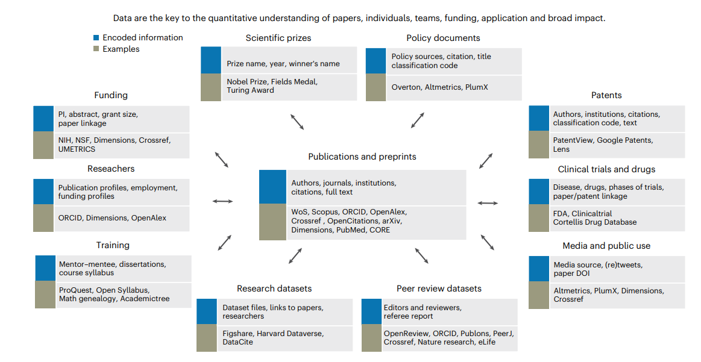
图5-4 前沿探测的数据生态。图中不同节点表示论文、研究者、机构、基金、专利等对象，连线表示作者隶属、资助、引用、合作或转化等关系。它提示我们：论文只是研究活动留下的一类痕迹，多源数据可以扩大观察范围，但每条连线都需要明确关系定义和数据来源。

表5-3 主要数据源、早期信号与局限

| 数据源 | 典型字段 | 更可能显示的信号 | 主要局限 |
| --- | --- | --- | --- |
| 学术论文与预印本 | 题名、摘要、关键词、作者、机构、参考文献、日期 | 知识生产、主题变化、学术联系 | 出版与引用滞后；不同数据库覆盖不同 |
| 专利 | 申请人、发明人、分类号、权利要求、引证、法律状态 | 技术布局、应用方向、科学—技术连接 | 公开有时滞；企业策略会影响申请行为 |
| 基金项目 | 项目题名、摘要、负责人、机构、金额、起止时间、项目类别 | 资源投入、政策优先方向、潜在研究活动 | 获批不等于产生结果；不同资助机构字段不一致 |
| 规划、路线图与政策 | 发布机构、发布日期、目标、任务、重点领域 | 国家或机构关注、治理需求、未来部署 | 政策优先级不等同于学术前沿 |
| 临床试验、标准与药物数据 | 试验阶段、干预、适应证、状态、标准编号 | 转化进程、规范化与应用成熟度 | 适用领域有限；失败和终止记录需单独解释 |
| 使用与社会注意力数据 | 阅读、下载、收藏、新闻、博客、社交平台提及 | 早期注意力、跨界传播 | 易受平台用户、宣传和异常流量影响 |
| 学术会议、专家主页与开源社区 | 议题、报告、团队成员、版本、提交记录 | 尚未正式发表的动态、共同体形成 | 信息分散，选择性强，质量控制不一 |

### 论文数据：区分发表、引用、使用与社会注意力

论文数据库是最常用的数据源，但“论文数据”内部至少包含四个层次。

**发表数据**描述成果本身，包括题名、摘要、关键词、作者、机构、期刊、文献类型、出版时间和学科分类。它适合测量规模、增长、主题和合作。**引用数据**记录文献之间的知识关联，适合分析知识基础、影响扩散、共被引和文献耦合。**使用数据**记录浏览、下载、保存或导出等行为，可能早于引用显示读者兴趣。**替代计量或社会注意力数据**汇集新闻、博客、政策、社交平台等提及，用于观察研究如何进入更广泛的公共空间。

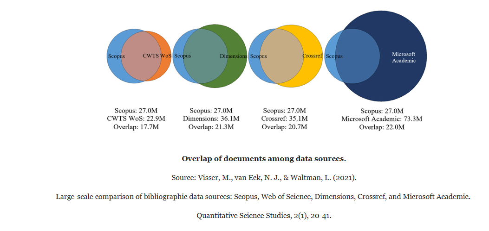
图5-5 文献数据库的覆盖差异。图表从收录范围、引文关系、学科覆盖和检索能力等维度比较若干数据库，传达的重点不是确定“唯一最好”的平台，而是提醒读者：同一检索式在不同数据库中会得到不同语料，分析报告必须写明数据库、索引范围、检索字段、检索日期和导出规则。

选择论文数据源时，应由任务决定。Web of Science和Scopus适合结构化引文分析；PubMed面向生物医学与生命科学；EI Compendex偏重工程技术；CNKI等中文数据库有助于观察中文研究和本土议题；Google Scholar覆盖广，但数据清理和批量复现较困难；arXiv等预印本平台能够提供较早信号，但预印本不等同于经过同行评议的正式成果。不要在未说明覆盖范围的情况下合并各平台记录，也不要把数据库给出的学科标签当作天然正确的研究边界。

使用和注意力数据的优势是“早”，弱点也是“早”：读者可能因为标题新奇、公共事件或媒体报道而点击，尚未形成深入使用。下载时间曲线和实时下载指标展示了一种早期预警思路——将近期下载活动与历史基线比较，寻找异常升高的论文或主题。该方法适合生成候选清单，不足以证明学术价值。

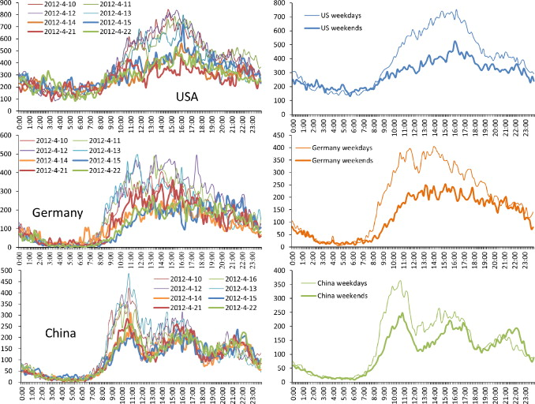
图5-6 使用数据作为早期信号。曲线表现论文发布后的下载活动如何随时间变化；短期峰值可能意味着新成果受到关注，也可能来自课程推荐、新闻传播或集中宣传。判断前沿时应把下载与引用、主题内容和后续研究结合，而不能把点击量直接解释为知识突破。

### 专利数据：观察从知识到技术的连接

专利的题名、摘要、分类号、申请人、发明人、权利要求、引证和法律状态，可以用来分析技术主题、主体布局、知识来源与技术扩散。专利分类号比自由关键词更稳定，但一个新兴主题可能尚未形成清晰分类；专利引证能够显示论文与技术之间的联系，但其产生机制同时受审查制度和申请策略影响，不能简单等同于“论文导致了专利”。

Dimensions将基金、论文、数据集、临床试验、专利和政策文件置于关联研究信息环境中；Lens则提供学术成果与专利的双向连接，可从论文查看引用它的专利，也可从专利回溯相关科学文献。这类平台有助于提出“哪些科学成果进入了技术文本”的问题，而不是只统计专利数量。[Dimensions简介](https://help.dimensions.ai/en/articles/11454529) [Lens简介](https://about.lens.org/)

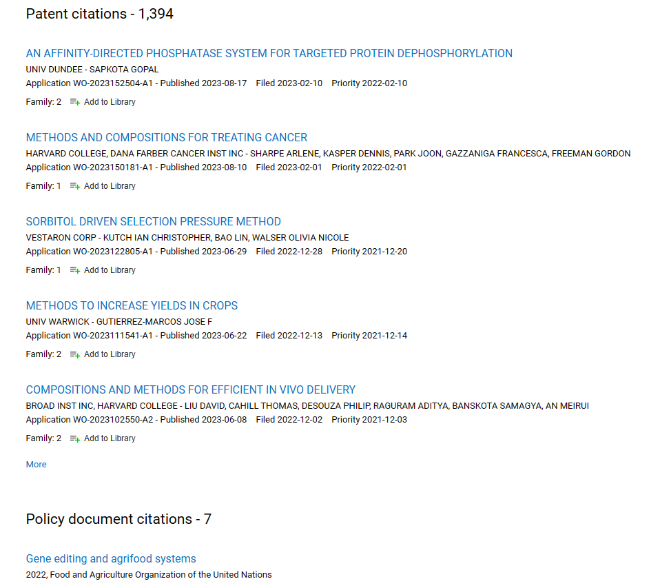

图5-7 从论文走向技术与政策的关联线索。第一幅界面显示一篇论文与专利、政策文件等对象的链接，第二幅界面展示Lens对论文与专利引证关系的组织。界面和记录数量会更新，稳定的观察方法是核对链接类型、引证方向、日期与原始文件，而不是只读取平台给出的汇总数字。

### 基金项目：观察资源投入和潜在方向

基金项目往往早于论文发表，项目题名、摘要、负责人、资助机构、起止时间和金额可以反映资源正在流向何处。美国国家科学基金会Award Search提供自1989年以来获资助项目的检索，并支持按项目、机构、计划和日期等字段筛选及导出；NIH RePORTER可检索生命健康领域的项目和相关成果。国内可通过国家自然科学基金等官方平台检索获资助项目。由于平台接口和开放范围会调整，教材不固定记录条数，而要求读者在使用时注明查询日期与下载方式。[NSF Award Search](https://www.nsf.gov/funding/award-search) [NIH RePORTER](https://reporter.nih.gov/)

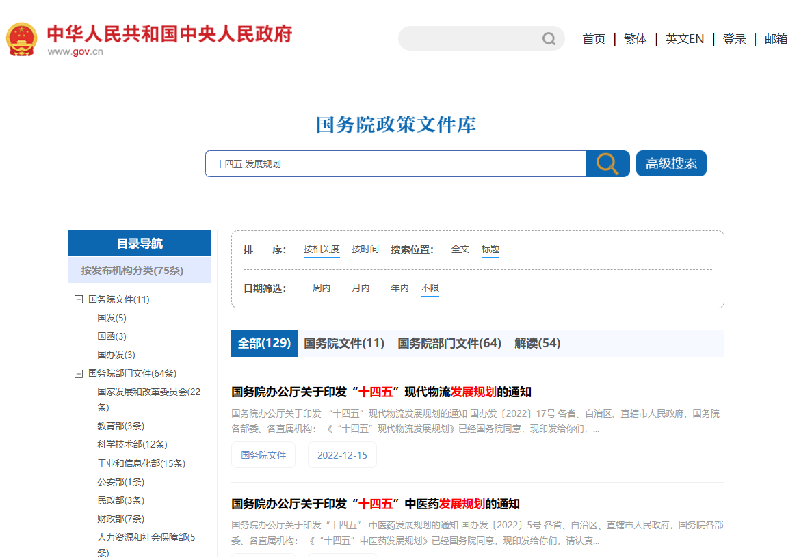
图5-8 项目投入与政策规划的检索入口。前两幅图展示基金项目可按主题、项目、负责人和时间等字段检索，第三幅图展示政策文件按关键词与发布日期检索。基金反映“已经承诺的研究投入”，政策反映“公开表达的治理重点”；二者都可以领先于论文，却都不能替代成果质量评价。

基金数据至少有三点需要谨慎。第一，项目获批表示计划获得支持，不表示计划一定完成；第二，资助金额在不同项目类型和学科之间不可直接比较；第三，项目摘要常使用政策化、概括化语言，需要与最终论文、数据或专利成果建立链接。更可靠的分析是追踪“投入—产出—转化”的链条，而不是仅用立项数量排名。

### 规划、路线图与持续性信息源

国家战略、科技规划、学科路线图、标准制定计划和机构发展报告能够揭示问题需求和资源配置方向。它们尤其适合回答“政策希望推动什么”“哪些关键技术被列为优先任务”，但不适合单独回答“学术界已经突破了什么”。正式规划还应与征求意见稿、媒体解读和二次转载区分，尽量回到发布机构的原始文件。

会议议程、实验室主页、研究者个人主页、期刊预警、预印本与开源仓库更新则构成持续性信息源。这些来源传播快、主题细，却更容易受到选择偏差影响。使用时应记录来源角色：它是正式成果、研究计划、会议报告、代码版本，还是尚未核验的自我介绍。

## 5.4 多源数据不是简单相加

### 为什么需要多源互证

论文体现知识表达，基金体现资源投入，专利体现技术主张，政策体现治理需求，下载和媒体体现注意力。若几类来源在相近时间指向同一问题，候选主题的可信度通常高于单一平台上的词频上升。但“同时出现”仍不等于彼此因果，更不代表所有来源权重相同。

多源分析可以分为三个层次：

1. **前期融合**：在分析前通过DOI、项目编号、机构标识符、作者标识符、专利引证或标准化主题字段，把不同来源记录对齐。
2. **中期融合**：分别建立论文引用网络、机构合作网络、关键词网络等关系，再把共享节点或主题投影到同一分析框架。
3. **后期融合**：各数据源先独立得到主题、聚类或排名，再比较其重叠、先后和差异，形成综合判断。

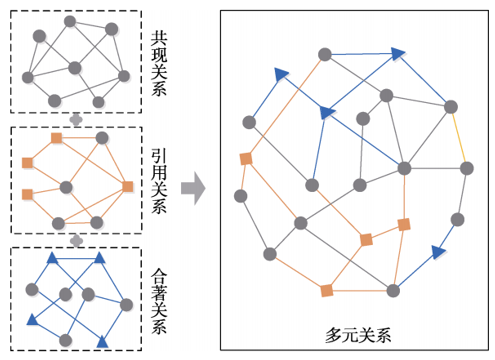

图5-9 多源数据融合的三个层次。第一幅图强调先统一字段和标识，第二、三幅图强调在关系网络中寻找共同节点，第四幅图强调比较各来源独立得到的主题。图示的共同信息是：融合必须说明“什么与什么依据何种规则连接”，否则只是把不同表格放在一起。

### 融合前先处理可比性

同一机构可能有多种中英文名称，同一作者可能重名或改换单位，同一主题在论文和专利中也可能使用不同术语。数据融合前应建立标准化规则，并保留原始值、清洗值和修改日志。对无法可靠匹配的记录，应标记不确定性，不能为了提高关联率强行连接。

不同数据源还有不同时间机制：基金从立项到论文发表需要时间，专利通常在申请后延迟公开，引用需要积累，媒体注意力却可能当天出现。因此，跨源比较不应机械地使用同一年份。更合理的方式是依据研究流程设置滞后窗口，并进行敏感性分析，例如比较“同年”“滞后一年”和“滞后三年”的关系是否稳定。

### 三类常见偏差

原始数据再大，也不代表观察完整。前沿探测尤其要检查三类偏差。

- **覆盖偏差**：数据库对学科、语言、地区和文献类型的收录不同。只用英文期刊可能遗漏本土政策与实践，只用中文数据库又可能忽略国际理论源流。
- **聚合偏差**：总体增长可能由某个大规模子领域驱动；分学科、地区或文献类型后，其他组的趋势可能完全不同。第八章讨论的辛普森悖论说明，聚合结果有时会掩盖甚至反转分组关系。
- **可见性偏差**：成功发表、获得高引用或进入数据库的成果更容易被看见，失败试验、未获资助方案和没有公开的企业研究则不易进入样本。由“可见记录”推断整个创新过程时，需要承认遗漏。

前沿探测不能消除这些偏差，但可以通过多库检索、分组比较、记录覆盖范围、核查负面或终止记录以及报告不确定性来降低误导。

## 5.5 探索前沿热点的方法

### 定性、定量与混合判断

定性方法包括专家访谈、德尔菲法、路线图研判和内容分析，优势是能够理解概念意义、技术可行性和情境变化，弱点是受专家构成和判断框架影响。定量方法利用论文、引用、词语、专利或项目数据识别规模、关系和变化，优势是可处理大规模材料并提供可复核指标，弱点是容易把测量对象简化为数据字段。混合方法先用定量分析发现候选主题，再由领域专家阅读核心成果、核验主题名称和评估突破性，通常更适合前沿研判。

Clarivate与中国科学院发布的年度Research Fronts报告就是一种混合思路：主要依据共被引关系识别研究前沿，再结合新近性、活跃度和专家分析区分热点前沿与新兴前沿。2025年报告识别了110个热点前沿和18个新兴前沿；这个数字是特定数据库、时间范围和选择规则的产物，不是全世界前沿数量的客观总数。[Research Fronts 2025](https://discover.clarivate.com/Research_Fronts_2025_EN)

### 引文关系：三种网络回答不同问题

**直接引用**是文献A在参考文献中引用文献B。它具有方向和时间顺序，适合追踪知识从前作流向后作的路径。**共被引**是后来的文献同时引用A和B；共同引用次数越多，通常说明二者在后续研究者眼中具有较强的知识联系。共被引关系会随新文献出现而变化，适合观察一个领域的知识基础。**文献耦合**是A和B共同引用了若干相同参考文献；一旦两篇文献的参考文献表确定，二者的耦合强度便相对稳定，常用于识别当前研究方向。

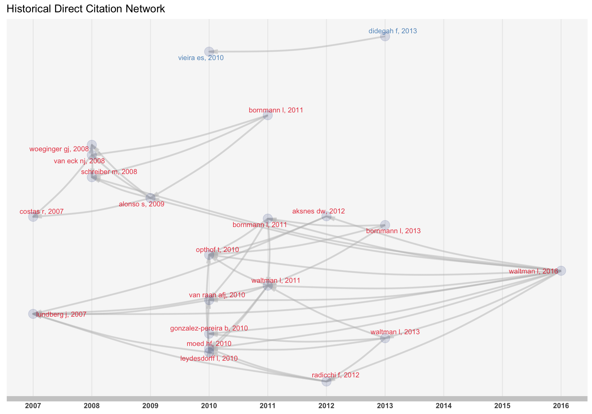

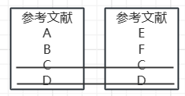
图5-10 三种引文关系。第一幅图中的箭头表现文献之间的直接引用；第二幅图中，后来的文献把两篇早期文献连接为共被引关系；第三幅图中，两篇当前文献因共享参考文献而形成耦合。三种网络不能互相替代：共被引偏向既有知识基础，耦合更接近当前研究相似性，直接引用适合追踪具体传播路径。

引用并不只表示赞同，也可能用于背景说明、方法借用或批评。高被引还受发表时间、学科规模、期刊可见度和自引影响。因此，引文网络用于发现结构，代表文献阅读用于解释结构；二者缺一不可。

### 文本关系：从词频到语义主题

文本分析可依次从简单到复杂展开。词频回答“哪些词出现较多”；共现回答“哪些词经常一起出现”；突现回答“哪些词在某个时间段快速增强”；主题模型尝试依据词语共现概率推断潜在主题；语义嵌入和聚类则依据上下文相似性组织文档或片段。

潜在狄利克雷分配（LDA）等主题模型假定一篇文档可由多个主题混合生成，每个主题又由一组具有不同概率的词构成。模型可以帮助处理大规模文本，却不会自动知道“正确主题数”，也不会保证自动标签符合学科含义。研究者应比较多个参数方案，报告预处理、主题数和随机种子，并用代表文档检验主题的一致性。

表5-4 常用方法、适用问题与主要限制

| 方法 | 适合回答的问题 | 关键输入 | 主要限制 |
| --- | --- | --- | --- |
| 发文与增长分析 | 哪些主题规模扩大、速度加快 | 年份、主题或分类字段 | 受基数、收录变化和不完整年份影响 |
| 直接引文分析 | 知识沿哪些路径传播 | 完整参考文献 | 引文缺失和错误会断开路径 |
| 共被引分析 | 哪些经典或核心成果构成知识基础 | 被引参考文献及共同引用 | 对很新的文献不敏感 |
| 文献耦合 | 当前文献共享哪些知识来源 | 文献的参考文献表 | 共享参考文献不保证研究问题相同 |
| 关键词共现与聚类 | 领域有哪些主题群及相互关系 | 标准化关键词、标题或摘要 | 同义词、高频通用词和算法参数影响结果 |
| 突现分析 | 哪些词或文献在某阶段快速增强 | 带时间戳的频次或引文数据 | 突增可能短暂，阈值影响显著 |
| 主题模型与语义聚类 | 大规模文本中有哪些潜在主题 | 清洗后的标题、摘要或全文 | 可解释性依赖参数与人工命名 |
| 专家研判 | 候选主题是否具有实质创新和可行性 | 核心文献、路线图、领域知识 | 专家选择和共识过程可能产生偏差 |

### 生成式人工智能的适当角色

生成式人工智能可以辅助扩展检索词、归并同义词、翻译术语、概括聚类中的代表文献、生成候选标签和比较多组结果。它最适合承担“提出候选”和“压缩材料”的工作，不适合在没有可核验语料的情况下直接宣告某个领域的前沿。

原因有三。第一，模型可能生成不存在的文献、工具或指标；第二，相同提问在不同时间或不同设置下可能得到不一致答案；第三，模型无法自动说明训练数据覆盖到何时、哪些来源被遗漏。使用时应把提示词、模型与日期记入分析日志，要求输出关联到已检索文献，并由研究者核对题名、DOI、数据和原文含义。人工智能给出的流畅主题名称只能是待验证标签，不能替代证据。

## 5.6 如何选择分析工具

工具选择应晚于问题和数据设计。先问“要回答什么、拥有什么字段、是否需要复现”，再决定软件，而不是先打开可视化工具，再从生成的图中寻找故事。

表5-5 常用工具的适用场景（核对至2026年7月）

| 工具 | 主要优势 | 适合任务 | 使用时需注意 |
| --- | --- | --- | --- |
| CiteSpace | 时间切片、共被引、突现、聚类和演化视图较完整 | 识别突现词、知识基础与阶段变化 | 记录版本、切片、阈值和剪枝参数；自动标签需人工核验 |
| VOSviewer | 构建和展示共著、引用、共被引、耦合、词语共现网络，交互清晰 | 关系网络、密度图和主题结构 | 网络位置是布局算法结果，不是地理或因果距离 |
| bibliometrix / Biblioshiny | 基于R，覆盖数据转换、描述统计、科学知识图谱和主题演化；Biblioshiny提供图形界面 | 可复现的完整计量流程或无代码分析 | 保存原始文件、R版本、包版本和脚本/参数 |
| SciVal | 基于Scopus数据进行机构、学科、合作和Topic分析 | 机构研究表现、主题组合与战略分析 | 属于平台化分析，指标定义、订阅权限和数据覆盖需说明 |
| ITGInsight等领域工具 | 可把多源数据、算法和可视分析整合为工作流 | 教学演示或特定机构的前沿分析 | 先核对支持的数据格式、算法透明度和结果导出能力 |
| Python / R自编流程 | 清洗、建模和复现最灵活 | 多源融合、定制指标、批量更新 | 需要编程与测试；应公开代码、环境和参数 |

CiteSpace官方网站强调其突现、时间线、聚类和结构变异等功能；VOSviewer可构建引用、文献耦合、共被引、共著及文本共现网络；bibliometrix提供R环境中的科学计量与知识图谱流程，Biblioshiny则提供图形界面；SciVal用于基于Scopus数据的研究表现和主题分析。软件功能会更新，访问工具主页和版本说明比教材中固定的按钮位置更可靠。[CiteSpace](https://citespace.podia.com/) [VOSviewer](https://www.vosviewer.com/) [bibliometrix](https://www.bibliometrix.org/) [SciVal](https://www.elsevier.com/products/scival)

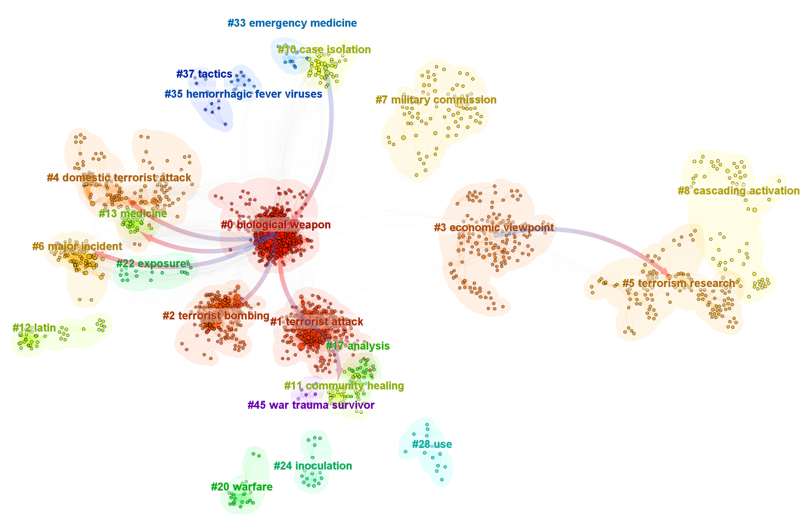
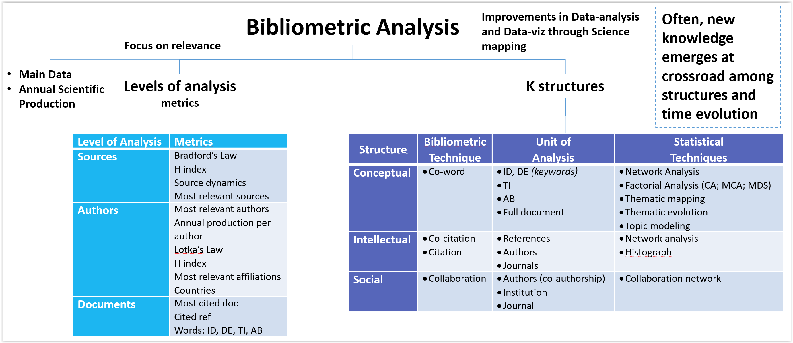
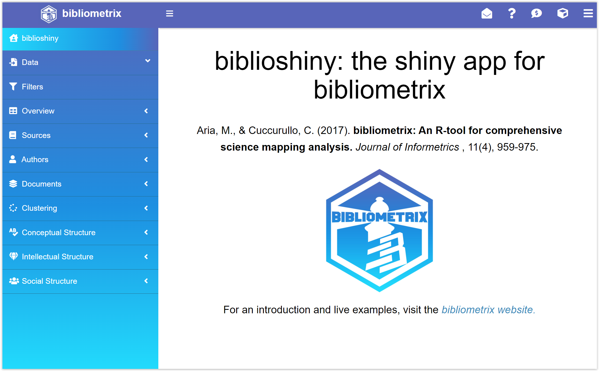
图5-11 不同工具的输出形态。第一幅图以网络和聚类呈现知识结构，第二幅图展示计量分析中的统计或主题结果，第三幅图展示图形化工作界面。图形更精美不代表结论更可靠；读图前应先找到数据来源、节点定义、连线定义、时间范围和参数设置。

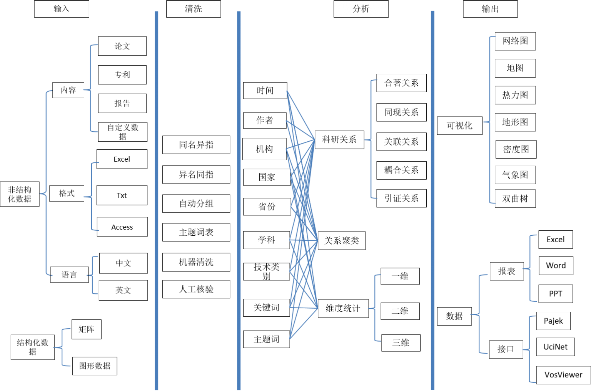
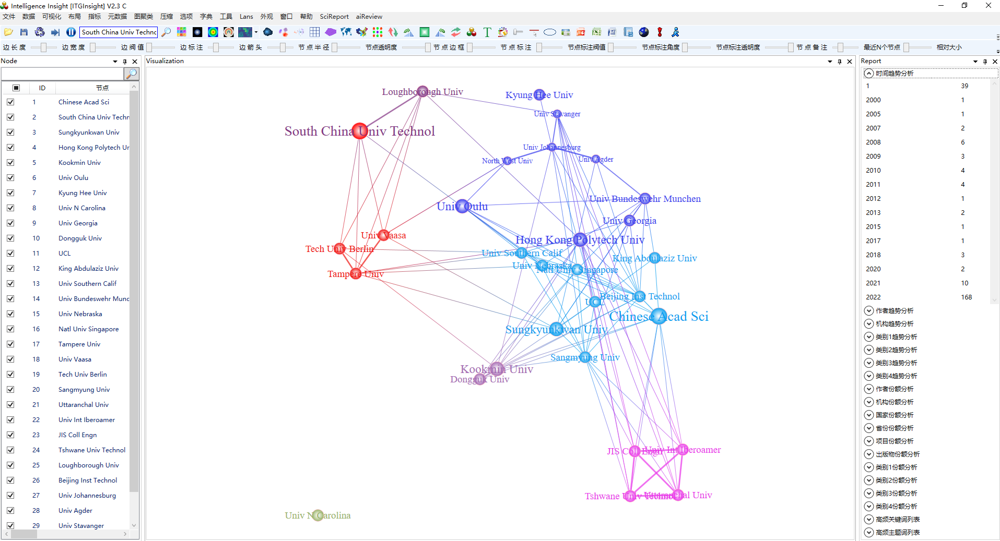
图5-12 从数据到判断的工具链。第一幅图把数据获取、清洗、关系构建、算法分析和结果展示组织成流程，第二幅图给出网络分析界面示例。界面只是流程的一个环节；若缺少检索式、清洗规则和内容核验，最终网络无法被独立复现。

### 工具输出的四项最低记录

任何工具生成的图表都应同时保存四类信息：一是原始数据及导出日期；二是检索式、数据库和筛选规则；三是清洗、去重、同义词合并和缺失值处理；四是软件版本、分析参数与导出文件。若使用在线平台不能导出完整算法参数，应在局限部分明确说明，并保留操作截图和结果下载文件。

## 5.7 实作：以“生物学教育”为例

下面以“Biology Education”为例说明从数据库检索到突现分析的流程。这里不把旧版界面的点击位置写成固定教程，而是提炼为能够迁移到其他数据库和主题的八个步骤。

### 第一步：把宽泛兴趣改写为监测问题

“生物学教育的前沿是什么”范围过大。可以改写为：“2019—2025年国际中学与本科生物学教育研究中，哪些教学方法、数字技术和学习评价主题出现了持续增长或突现，它们分别建立在什么证据上？”这一问题明确了对象、主题维度、时间和需要判断的信号。

### 第二步：建立术语表，而不是只输入一个词

先用领域词表、综述、代表论文和专家建议收集同义词及上下位词。例如核心概念可以包括“biology education”“biological science education”“life science education”，教育场景还可能包括secondary、undergraduate、laboratory、teacher education等限定词。生成式人工智能可以帮助提出候选词，但每个词必须在数据库索引、标题摘要和代表文献中核对。

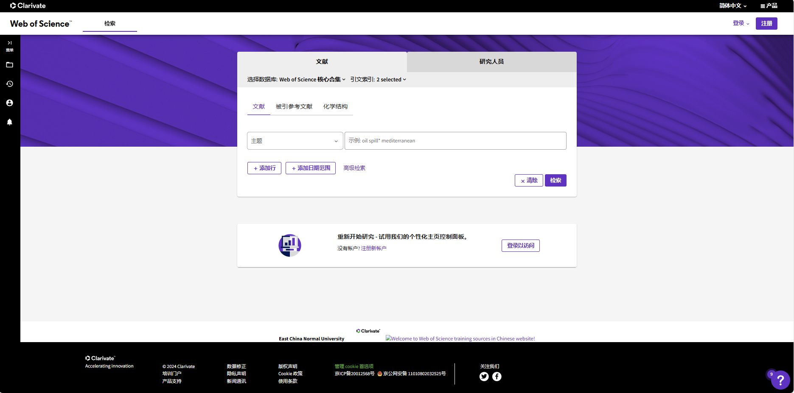
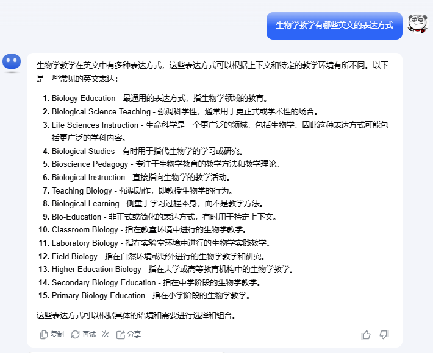
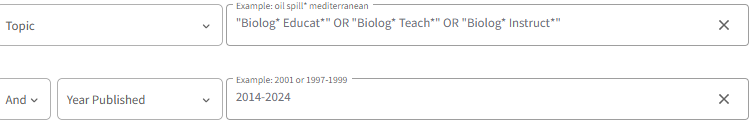
图5-13 从研究问题到检索式。第一幅图提示先选择数据库和检索字段，第二幅图展示人工智能可用于扩展术语，第三幅图把术语用布尔逻辑连接。关键决策不是复制界面中的字符串，而是说明每组词代表哪个概念、为何使用OR连接、哪些限定条件会排除无关记录。

检索式可采用“核心概念组 AND 场景组”的结构。若研究目的在于绘制整个领域，不宜过早加入方法词，以免漏掉尚未预见的新方法；若初检噪声过高，再通过标题字段、学科类别、文献类型或人工筛选缩小范围。

### 第三步：固定数据库、索引和检索日期

记录使用的数据库、具体索引、检索字段、时间跨度、文献类型、语言和检索日期。若使用多个数据库，先分别保存原始结果，不要直接把记录混在一起。数据库持续更新，同一检索式隔一段时间运行得到的记录数可能不同，这正是前沿监测需要保存版本的原因。

### 第四步：检查召回与准确性

从结果中抽取一批记录，判断是否覆盖已知代表文献，是否出现生物信息学训练、患者教育等不属于研究边界的记录。缺少代表文献时扩展同义词或字段；噪声过高时增加场景限定或排除词。检索式调整应留下版本记录，避免只保留“最后一次看起来不错”的表达式。

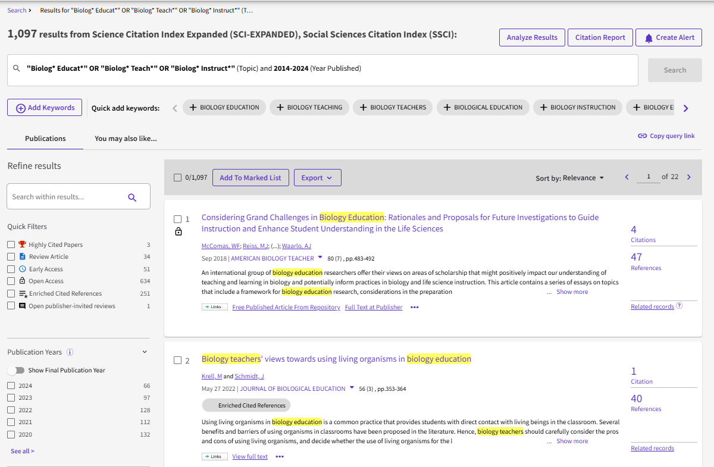
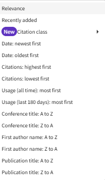
图5-14 检索结果不是最终语料。主界面显示命中记录和可精炼字段，侧栏显示学科、类型或年份等筛选入口。筛选会改变研究对象，报告中应把它写成纳入规则，而不是隐藏在操作过程里。

### 第五步：导出足够且一致的字段

前沿分析通常需要题名、摘要、作者关键词、数据库关键词、作者、机构、年份、来源、DOI、被引频次和完整参考文献。仅导出题名和作者，无法进行共被引或文献耦合。分批导出时，应确保字段与格式一致，并保存每批记录的编号范围。若数据库限制导出数量，应明确分批规则。

### 第六步：清洗、去重与标准化

用DOI、题名和作者年份组合识别重复记录；统一机构和作者名称；合并单复数、连字符、缩写和同义词；建立停用词表；核查异常年份和缺失参考文献。自动清洗后应抽样检查，尤其避免把同形异义词错误合并。

### 第七步：用多种方法生成候选主题

先看年度规模和文献类型，再运行关键词共现、聚类和突现分析；若数据质量允许，可补充文献耦合、共被引或主题模型。不同方法得到相近主题时，证据更稳；结果冲突时，不应选择最“漂亮”的一张图，而要回查算法、参数和语料差异。

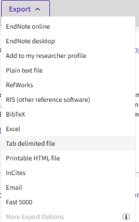
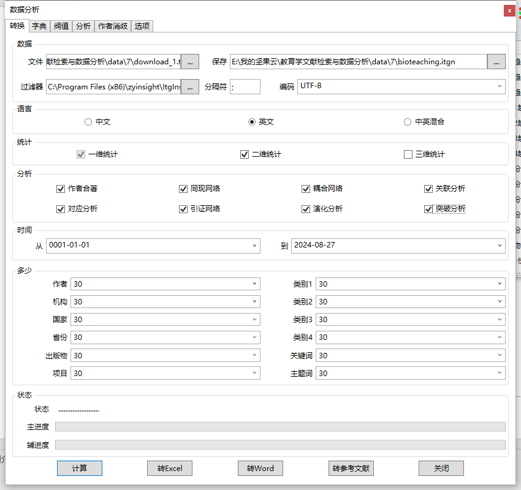
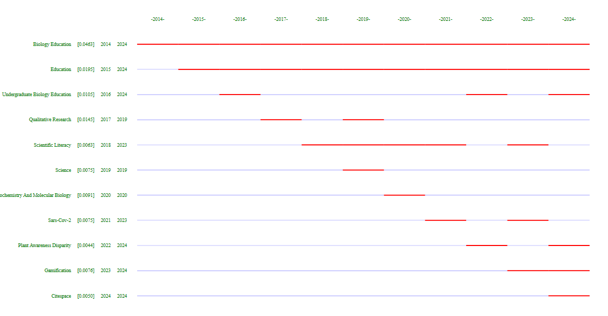
图5-15 从题录导出到突现结果。第一幅图展示导出记录与字段选择，第二幅图展示数据文件进入分析工具，第三幅图以时间条呈现突现词及其活跃阶段。完整证据链应能从突现词回到对应文献，再解释该词为何在特定时期增强。

### 第八步：阅读核心文献并形成判断

为每个候选主题选取最早文献、近期高关联文献、突现文献和方法代表作，至少核对以下内容：研究问题是否真的新；新意来自理论、方法、数据还是应用；证据质量如何；是否存在相反结果；主题在不同国家、学段和对象中是否一致；增长是否只是术语替换。

最终可以形成“候选主题证据卡”，而不是只给一张排名表。

表5-6 候选前沿主题证据卡

| 项目 | 记录内容 |
| --- | --- |
| 主题名称及同义词 | 说明人工命名依据，列出主要术语变体 |
| 研究边界 | 学科、对象、地区、时间和文献类型 |
| 早期信号 | 首批核心文献、基金、专利、会议或政策记录 |
| 增长与结构信号 | 发文变化、突现阶段、聚类位置、跨学科连接 |
| 代表证据 | 关键论文及其研究设计、样本和主要发现 |
| 反证与局限 | 不一致结果、数据库覆盖、时间滞后和参数敏感性 |
| 当前判断 | 热点、前沿、新兴前沿、成熟主题或证据不足 |
| 下次更新 | 监测周期、提醒来源和需核查事件 |

另一条常用路径是将Scopus检索结果导入SciVal，再观察Topics和机构表现。该路径适合机构层面的研究战略分析，但结论受Scopus覆盖和SciVal主题模型影响。它与本地软件流程不是“谁更正确”的关系：平台化工具便于比较和持续更新，本地工具更便于定制与复现。选择时应回到研究问题和可获得权限。

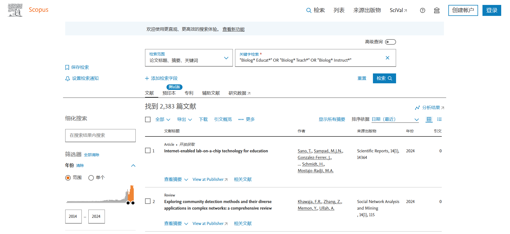
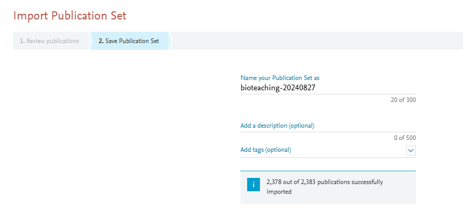
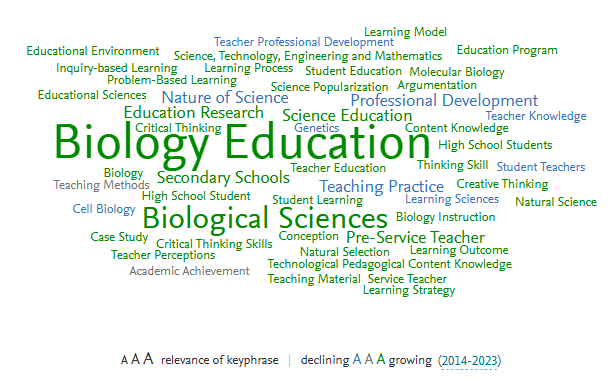
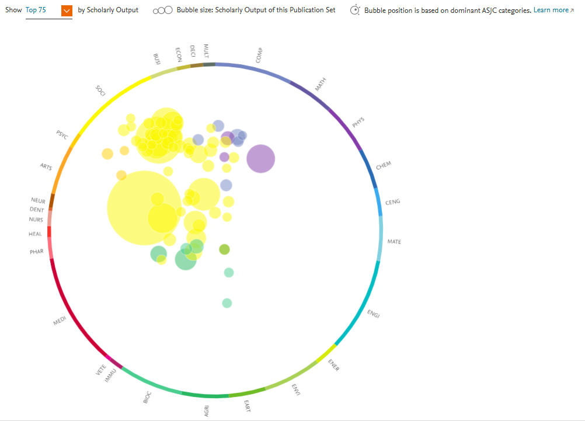
图5-16 Scopus—SciVal分析路径。图像依次展示从检索语料进入主题分析、查看主题组合和比较研究表现。平台输出可用于生成候选方向，但读者仍需核对Topic定义、时间窗口、机构归属和底层文献，不能把平台标签直接写成学科事实。

## 5.8 如何核验并表述结论

### 前沿探测是推断，不是预言

分析得到的是基于现有数据的早期判断。它不能保证某主题未来一定成功，也不能证明某项资助或政策造成了后续增长。较严谨的结论应同时写出证据、边界和不确定性，例如：

> 在所检索的2019—2025年英文期刊与会议论文中，主题A的发文和参与机构持续增加，2023年后出现关键词突现，并与主题B形成新的耦合群。对核心文献的阅读显示，新意主要来自方法迁移而非理论突破。由于未纳入中文文献和项目数据，目前将其判断为“快速增长的候选前沿”，尚不能断言其已形成稳定范式。

这种表述比“主题A是未来最重要的研究前沿”更有信息量，也更容易接受后续证据修正。

### 五步核验法

1. **复查语料**：随机抽样和定向检查核心记录，确认纳入文献真正属于研究边界。
2. **比较方法**：用至少两种信号交叉核验，例如突现词与文献耦合、基金增长与论文主题。
3. **测试参数**：调整时间切片、阈值、聚类分辨率或主题数，观察结论是否稳定。
4. **回到原文**：阅读代表论文的研究问题、方法、结果和局限，避免从标题推断贡献。
5. **引入领域判断**：请熟悉该主题的研究者核对术语、关键成果和“新颖性”解释，同时记录分歧。

专家判断也需要透明。应说明专家如何选择、提供了哪些材料、如何汇总意见，以及是否存在利益关系。专家不是替代数据，而是帮助解释数据无法表达的内容。

## 5.9 从一次分析到持续监测

前沿会移动，一次性报告很快过时。持续监测可以建立四类提醒：核心检索式的数据库邮件提醒；关键期刊的目录或RSS提醒；核心团队、实验室和专家主页的更新；重要会议、基金指南、政策与标准的发布。综合性高影响期刊可以帮助发现跨学科议题，但不能替代本领域期刊和专业会议。

监测频率应与领域速度匹配。快速变化主题可按月更新候选记录，较稳定领域可按季度或半年复查。每次更新不必重新写整份报告，而应记录新增文献、主题状态变化、术语变化和原判断是否被支持。

表5-7 前沿监测日志模板

| 日期 | 来源与检索式 | 新增信号 | 对原判断的影响 | 待核查事项 |
| --- | --- | --- | --- | --- |
| 2026-07-15 | 数据库提醒、目标期刊、会议或项目平台 | 新论文、项目、专利、政策或会议主题 | 增强、削弱、改变边界或无实质影响 | 原文、数据、方法或专家意见 |

持续监测的价值不在于每天追逐新词，而在于区分“新出现的信息”和“足以改变判断的证据”。当一个候选主题从术语突现发展为稳定聚类，并得到高质量研究、资源投入和应用记录的共同支持时，判断可以增强；若热度消退、核心结果不能重复或概念只是重新命名，也应下调其前沿状态。

## 本章小结

学科前沿与研究热点相互关联但并不等同。热点强调特定时期的活动或注意力集中，前沿强调知识边界的拓展，新兴前沿则强调新近性和发展速度。判断前沿需要明确学科、对象、地域与时间边界，并综合新近性、增长性、注意力、结构性、跨域性和转化性等信号。

论文、专利、基金、规划、临床试验、使用数据和会议信息观察的是研究活动的不同阶段。多源数据能够互证，也会带来名称匹配、时间滞后、覆盖偏差和聚合偏差。直接引用、共被引、文献耦合、关键词共现、突现和主题模型各自回答不同问题；工具只能执行分析，不能代替语料设计、参数报告、原文阅读和领域判断。一个可靠的前沿结论应能回溯到检索式、记录、方法和核心文献，并随着新证据持续更新。

## 思考与练习

1. 选择一个你熟悉的教育学主题，分别写出“热点”“前沿”“新兴前沿”和“成熟主题”的可操作判断标准。哪些指标可以共用，哪些不能？
2. 同一主题分别在中文数据库和一个外文数据库中检索，记录数据库、字段、时间范围、文献类型和检索日期。比较两组语料在规模、关键词和代表文献上的差异，并解释可能的覆盖偏差。
3. 为一个候选前沿设计多源证据表，至少包括论文、基金和政策或专利三类来源。说明不同来源的时间滞后，以及你将如何设置比较窗口。
4. 使用CiteSpace、VOSviewer或Biblioshiny中的一种工具生成关键词共现或突现结果。提交原始数据说明、清洗规则、软件版本、参数和一段代表文献核验记录。
5. 从工具生成的一个聚类中抽取五篇代表文献，判断聚类标签是否准确。若不准确，请重新命名，并说明新标签如何由文献内容支持。
6. 请生成式人工智能为某主题扩展检索词，然后逐条在数据库中核查。将结果分为“保留、修改、删除”三类，并记录每项决定的证据。
7. 建立一个为期四周的前沿监测日志。比较“新出现的信息”与“改变原判断的证据”，在结尾说明你的候选主题状态是否发生变化。
