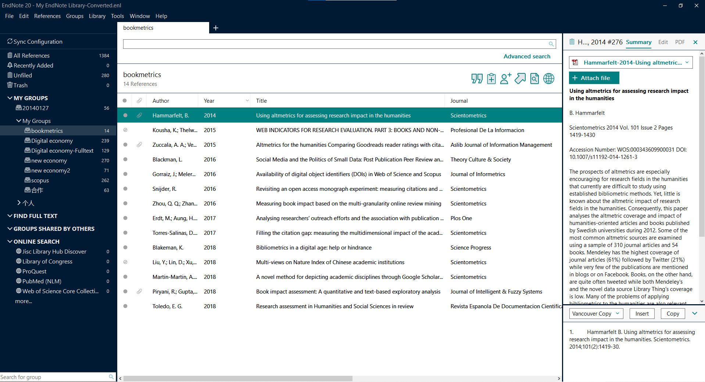
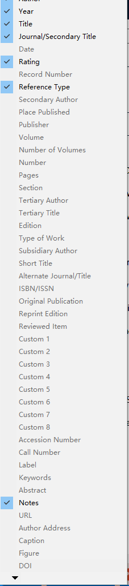
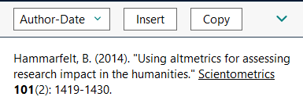

# 第六章 如何高效管理个人信息

当文献只有几篇时，文件夹和文件名似乎已经足够；当资料增长到几十篇、上百篇，并且同时包含PDF、网页、题录、阅读笔记、数据表、图片和写作草稿时，个人信息管理就会成为研究效率的关键。管理的目标不是把资料“存起来”，而是让资料能够被再次找到、再次理解、再次引用和长期迁移。

## 为什么需要文献管理软件

传统文件夹分类的最大问题，是它只能表达一种分类逻辑。例如，一篇论文既属于“学习分析”，又属于“数据伦理”，还可能是“方法参考”和“待精读文献”。如果只放进一个文件夹，其他关系就会丢失。文献管理软件通过题录、标签、分组、附件、笔记和引用样式，把文献从普通文件转化为结构化信息。

图6-1 文献管理软件的核心价值在于把作者、题名、来源、年份、摘要、关键词、附件和笔记统一管理，使文献能够被检索、分组和引用。

文献管理软件通常支持文献收集、题录组织、PDF附件管理、全文搜索、阅读笔记、引用插入、参考文献格式输出和云同步。它不只是“自动生成参考文献”的工具，更是文献阅读和写作的工作台。

## EndNote的基本对象

EndNote把文献库保存为Library文件，常见扩展名包括`.enl`及其配套数据文件夹。使用时应把库文件和Data文件夹作为一个整体备份和迁移。Filter用于把不同数据库导出的题录转换成EndNote可识别的格式；Style用于控制文内引用和文后参考文献的输出样式；Group用于管理文献集合，既可以手动建立普通分组，也可以通过检索条件建立智能分组。

这些概念看似软件细节，实际关系到长期管理。若只移动PDF而不移动题录库，引用关系会断裂；若只保存Word文档而不保存文献库，后期修改参考文献格式会非常困难；若不理解Style，论文投稿或学位论文格式调整就会变成大量手工劳动。

## 建立文献库

建立文献库时，应先考虑项目边界。课程作业可以建立项目库，毕业论文可以建立专题库，长期研究方向则适合建立总库并用分组管理。命名应清楚，路径应稳定，避免把库文件放在容易被误删或同步冲突的位置。

文献导入有四种常见方式。第一，手动输入，适合少量特殊文献，如报告、网页、标准或未被数据库收录的资料。第二，从PDF导入，适合带有可识别DOI的英文论文，但导入后必须校对题录。第三，从数据库导入，如Web of Science、CNKI、ScienceDirect、Springer等。第四，在线检索或浏览器插件抓取，适合快速收集候选文献。

PDF自动导入并非万能。只有当PDF包含可读DOI、网络能够访问Crossref等元数据服务、且数据库记录完整时，软件才可能正确识别题录。导入失败或字段错误时，应回到数据库重新导出，或手动修改作者、题名、期刊、年份、卷期、页码和DOI。

## 数据库导入与字段校对

从数据库导出题录时，应选择合适格式，如RIS、EndNote、BibTeX或数据库专用格式。不同平台导出的字段完整性不同，中文数据库还可能出现作者分隔、期刊名称、页码和文献类型不规范的问题。导入完成后，不能马上写作引用，而应先进行字段校对。

图6-2 从数据库导入题录后，应检查字段完整性和附件链接。导入只是开始，校对才决定引用质量。

校对重点包括作者顺序是否正确，中文姓名是否被错误拆分，期刊名是否完整，年份、卷、期、页码是否缺失，会议论文和学位论文类型是否识别正确，DOI和URL是否保留。文献管理软件输出的参考文献只是题录字段的“镜像”，题录错，参考文献一定错。

## 分组、标签与阅读笔记

分组适合表达项目结构，标签适合表达主题和阅读状态。一个比较实用的标签系统可以包括“理论基础”“方法参考”“核心文献”“待精读”“已引用”“可视化案例”“争议文献”等。标签不宜过多，否则会增加维护成本；也不宜过泛，否则失去区分作用。

阅读笔记应区分三类内容：原文观点、自己的理解、可用于写作的位置。直接摘录必须标明页码，转述要保留来源，自己的评价要明确写成评价。这样做可以降低无意剽窃风险，也能让后续写作更顺畅。

## 引用输出与GB/T 7714

参考文献格式是学术追踪机制。中文学位论文和课程论文常用GB/T 7714样式，外文期刊可能要求APA、Chicago、Vancouver等格式。文献管理软件可以在不同样式间切换，但前提是题录字段完整。若文献类型错误，软件无法正确输出[J]、[M]、[D]、[C]等标识。

图6-3 文献管理软件与Word连接后，可在写作过程中插入引文并自动生成参考文献表。插入前仍要确认题录准确。

写作中应避免两种做法：一是先手工输入参考文献，最后再让软件管理；二是在软件生成后直接手工修改大量条目。前者会破坏自动化优势，后者会在刷新引文时被覆盖。正确做法是在文献库中修改题录和样式，再重新生成。

## 备份、同步与迁移

个人信息管理必须考虑长期可用。文献库、PDF附件、笔记和Word文档应定期备份。使用云同步时，要避免多个设备同时打开同一数据库文件，以免产生冲突。迁移电脑时，应同时迁移文献库文件、附件文件夹、输出样式、过滤器和Word插件环境。

## 从阅读到写作的闭环

个人信息管理最终要服务写作。一个有效闭环可以分为“收集—校对—分组—精读—摘录—写作—回查”。收集阶段保证文献进入库；校对阶段保证题录准确；分组阶段把文献放入研究结构；精读阶段理解观点、方法和证据；摘录阶段区分原文、转述和自己的评价；写作阶段把文献嵌入论证；回查阶段确认引文与原文一致。

很多学生写作困难，并不是因为文献太少，而是因为阅读时没有建立可调用的笔记。建议每篇精读文献至少记录四项内容：研究问题、方法与数据、主要结论、可为自己论文服务的位置。这样在写综述时，就能按主题和证据调用文献，而不是重新打开PDF从头寻找。

## 常见误区

第一，把PDF文件夹当作文献管理系统。第二，导入题录后不校对，导致参考文献错误。第三，标签体系过于随意，后期无法检索。第四，阅读笔记只摘录不评价。第五，只保存Word论文，不保存文献库。第六，误以为软件生成的格式一定符合学校要求。

## 本章小结

高效个人信息管理的关键，是把文献、附件、笔记、标签和引用关系组织成可检索、可解释、可迁移的系统。工具选择因人而异，但基本原则一致：题录准确，附件稳定，分组清晰，笔记可追溯，引用可校对，数据可备份。

## 思考与练习

1. 建立一个课程论文文献库，导入至少20条题录并完成字段校对。
2. 为同一批文献设计5个标签，并说明每个标签的用途。
3. 用文献管理软件在Word中插入3条引用并输出参考文献表。
