# 第六章 文献管理软件

检索解决的是“怎样找到文献”，综述解决的是“怎样理解和组织已有研究”，而文献管理软件连接了二者：它把分散的题录、全文、笔记和引用关系组织成可以持续维护的研究资料库。当文献只有几篇时，建立几个文件夹似乎已经足够；当资料增长到几十篇、几百篇，并且需要反复检索、比较、引用和改投时，文件夹就难以承担全部任务。

例如，研究者记得几篇文章都提到“未来学习中心”，但忘记了最早出处。若PDF只按下载日期或期刊名称存放，只能逐个打开查找；若题录、全文和笔记已经进入文献库，则可以同时检索题名、摘要、关键词、全文和笔记，并按年份排序。文献管理的目标不是把文件“收进去”，而是让每项材料能够被再次找到、准确理解、规范引用、可靠备份和长期迁移。

本章首先说明文献管理软件的功能与选择原则，再以EndNote为主要示例讲解建库、导入、校对、分组、全文管理、输出样式、Word写作和备份同步，同时比较NoteExpress与Zotero的特点。具体界面会随版本变化，但“收集—校对—组织—阅读—引用—备份”的方法可以迁移到不同软件。

## 6.1 为什么需要文献管理软件

### 文件夹只能保存位置，难以保存关系

传统文件夹管理通常按照课程、项目、年份或主题建立层级，再把PDF放入其中。这种方法直观，也适合作为原始文件归档，但它只能突出一种位置关系。一篇关于生成式人工智能反馈的论文，可能同时属于“教育技术”“学习评价”“实验研究”“待精读”和“论文第二节”，如果把同一文件复制到多个文件夹，会产生版本重复；如果只放在一个文件夹，其他用途又无法表达。

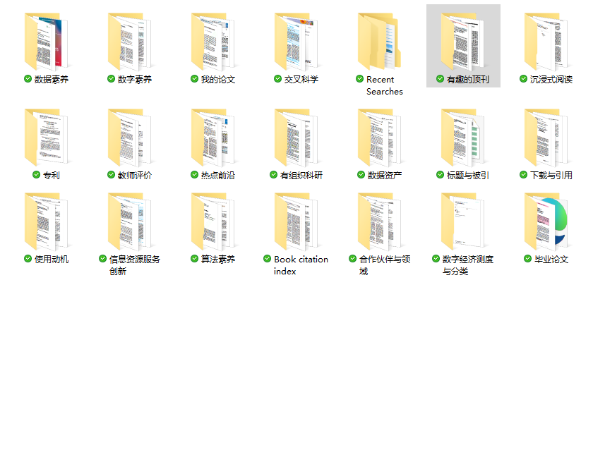
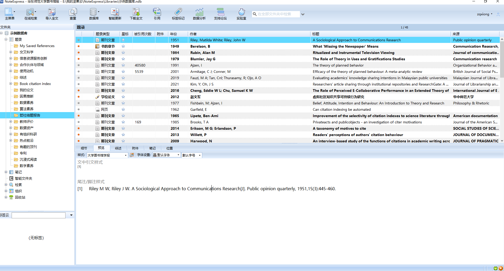
图6-1 从文件位置管理到结构化文献管理。第一幅图显示大量按主题或来源排列的文件夹，能够保存文件，却难以同时表达一篇文献的多个用途；第二幅图以表格呈现作者、题名、年份等字段，使同一条记录可以被检索、排序、分组和引用。文献管理软件并不取消文件夹，而是在文件之上增加可计算的题录与关系层。

文件夹管理还容易出现五类问题：文件名不一致导致搜索困难；同一论文保存多个版本却无法判断哪份最新；PDF与阅读笔记分离；数据库导出的作者、卷期和DOI没有被保留；写作时需要重新手工录入参考文献。文献管理软件的价值，就在于把“一个PDF文件”扩展为“一个带有元数据、附件、标签、笔记和引用状态的文献对象”。

### 文献管理贯穿研究全过程

文献管理不是论文完成前整理参考文献表的最后一步。它从检索阶段就开始：数据库导出的题录进入文献库，初筛结果形成项目分组，精读时产生批注与笔记，写作时插入动态引文，修改题录后文中引文和文后表可以同步更新，项目结束后再对文献库和论文进行归档。若前期题录混乱，后期自动引用只会更快地生成错误结果。

因此，评价文献管理效果不应只看“库里有多少条记录”，而应看以下问题能否得到肯定回答：能否在一分钟内找到某篇文献及其全文；能否说明它属于哪些研究主题；能否回到原文页码核对摘录；能否按目标期刊格式重新生成引文；电脑损坏后能否恢复文献库；换用其他软件时能否导出通用格式。

## 6.2 文献管理软件能做什么，怎样选择

### 八项核心功能

文献管理软件通常提供八类能力。

表6-1 文献管理软件的核心功能

| 功能 | 管理对象 | 研究用途 | 使用边界 |
| --- | --- | --- | --- |
| 收集 | 数据库题录、网页、图书、报告、PDF | 快速建立项目语料 | 自动抓取后仍需核对字段 |
| 组织 | 分组、标签、智能检索、关系 | 表达主题、项目与阅读状态 | 分类过细会增加维护成本 |
| 检索 | 题名、作者、摘要、关键词、全文、笔记 | 从大量材料中重新定位证据 | OCR缺失时扫描PDF可能无法全文检索 |
| 阅读 | PDF、高亮、批注、附件 | 保留阅读痕迹并回到原文 | 批注存储位置因软件而异 |
| 笔记 | 摘录、概括、评价、写作线索 | 把阅读材料转化为可调用知识 | 直接摘录必须记录页码和来源 |
| 引用 | 文内引文、脚注、文后参考文献 | 在写作中动态插入与更新 | 格式正确依赖题录和样式正确 |
| 协作 | 共享库、共享组、权限 | 团队共同维护资料 | 需约定命名、去重和修改权限 |
| 同步与迁移 | 本地库、云端数据、附件、通用格式 | 多设备使用、备份与换工具 | 同步不是历史版本备份 |

一款工具功能很多，并不意味着适合所有人。课程论文可能更重视快速抓取和Word引用，系统综述更重视批量导入、去重和可追溯筛选，实验室团队更重视共享和权限，长期学术积累则更重视数据控制、备份和开放格式。

### 选择工具的六个问题

选择前可以依次询问：是否支持自己的操作系统和写作软件；常用数据库能否稳定导入；中文姓名和中文数据库字段能否正确处理；是否需要团队共享；是否愿意使用订阅或机构授权；未来能否导出RIS、BibTeX、CSL JSON或其他通用格式。插件数量和界面美观可以考虑，但不应超过数据可迁移性与引用准确性。

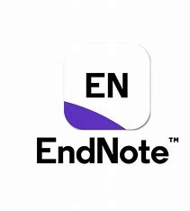
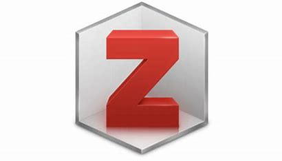
图6-2 三类常见文献管理软件。NoteExpress常用于中文学术环境，EndNote具有成熟的桌面文献库与Cite While You Write工作流，Zotero强调免费、开源、网页采集和开放扩展。标识只能帮助识别产品，真正的选择依据应是数据来源、写作环境、协作方式和迁移需求。

表6-2 EndNote、NoteExpress与Zotero的适用特点

| 软件 | 较突出的特点 | 适合情境 | 需要核对的事项 |
| --- | --- | --- | --- |
| EndNote | 文献库、输出样式、数据库导入和Word动态引用流程成熟 | 已有个人或机构授权，需要处理大量期刊样式 | 授权版本、系统兼容性、库文件备份与同步规则 |
| NoteExpress | 中文界面和中文数据库使用经验较多，可结合机构版本 | 以中文文献为主、学校提供集团版 | 机构下载入口、当前版本、输出样式与数据库过滤器 |
| Zotero | 免费、开源，浏览器采集、PDF阅读、笔记、群组与CSL样式生态完整 | 跨平台学习、开放工作流、网页和多类型资源收集 | 文件同步容量、第三方插件兼容性与隐私权限 |

本章以EndNote演示主要流程，不表示它在任何情境下都优于其他工具。同样的管理原则可以在NoteExpress、Zotero或其他文献管理软件中实现。

## 6.3 先理解文献库的基本对象

### Library、Filter、Style与Group

EndNote当前官方产品为EndNote 2025，旧版EndNote 20、21中的许多基本概念仍然延续，但按钮位置和新增功能可能不同。[EndNote官方网站](https://endnote.com/)将其能力概括为组织文献、获取全文、引用写作、共享协作和跨端使用。学习时不必记住所有菜单，先理解四个基本对象。

**Library（文献库）**保存题录、附件、分组和相关管理信息。在Windows环境中，一个库通常由同名的`.enl`文件和`.Data`文件夹共同构成；迁移或备份时不能只复制其中一个。压缩库`.enlx`可把库及附件打包为单一文件，适合备份和传递。不同系统或版本还可能使用包形式，操作时应参考当前版本说明。

**Filter（导入过滤器）**规定外部文件中的字段怎样映射到EndNote字段。数据库专用格式需要匹配过滤器；RIS等标准交换格式通常可直接识别。过滤器选错，会把作者、题名或期刊等数据放入错误字段。

**Style（输出样式）**规定文内引文和文后参考文献怎样排列、使用何种标点、显示哪些字段。它相当于一套格式规则，不会修正错误题录。**Group（分组）**用于组织文献，普通组由用户手动添加，智能组依据检索条件自动更新，组合组可表达多个组之间的逻辑关系。

图6-3 文件规则与文献库界面的关系。前两幅图显示过滤器和输出样式以独立文件保存，第三幅图显示文献库中的分组区、记录列表和题录详情。过滤器决定“外部数据怎样进入”，样式决定“库内数据怎样输出”，文献库则承担长期保存与组织。

表6-3 EndNote中的常见对象及其迁移意义

| 对象 | 常见形式 | 主要作用 | 迁移或备份要点 |
| --- | --- | --- | --- |
| 文献库 | `.enl`与配套`.Data`，或压缩库`.enlx` | 保存题录、附件和分组 | 工作库文件必须成套；压缩库适合备份 |
| 导入过滤器 | `.enf` | 将外部字段映射到库内字段 | 自定义过滤器需要另行备份 |
| 输出样式 | `.ens` | 生成文内引文和参考文献表 | 修改后使用新名称保存并备份 |
| 交换文件 | RIS、EndNote XML、BibTeX等 | 在数据库和软件之间迁移题录 | 交换文件不是完整文献库备份 |
| 普通组 | 用户指定的记录集合 | 管理项目或主题 | 同一记录可服务多个研究用途 |
| 智能组 | 保存的检索条件 | 自动收集符合条件的新记录 | 依赖题录字段的一致性 |

### 主界面的阅读顺序

文献管理软件的主界面通常由三部分组成：左侧是文献库、分组和检索入口，中间是记录列表，右侧或下方是题录详情、预览、全文和笔记。记录列表中的作者、年份、题名和来源适合快速浏览，详情窗格用于校对，预览窗格用于检查当前输出样式。看到回形针或附件图标，只能说明记录关联了文件，不能证明全文版本正确或可以公开传播。

## 6.4 建立文献库与导入文献

### 建库之前先确定边界和存储方案

建立文献库前，应决定使用“一个总库＋多个分组”还是“多个项目库”。总库便于跨项目复用和去重，适合长期研究方向；项目库边界清楚、便于归档，适合短期合作或需要单独交付的任务。无论采用哪种方式，都应使用稳定、可识别的文件名，避免“新建库1”“最终库最新版”等无法长期解释的名称。

EndNote工作库不宜直接放在由通用网盘实时同步的文件夹中，因为数据库由多个协同文件组成，边写边同步可能产生冲突。官方文档建议使用软件自身的同步功能，并另存压缩库作为历史备份。Zotero同样不建议把活动数据目录直接置于第三方云盘同步目录。存储设计将在6.9节进一步说明。

### 手工录入：少量特殊资源的必要方法

手工录入适合标准、政策、未收录报告、档案和特殊网页，也用于修正自动导入失败的记录。第一步是选择正确的Reference Type，因为期刊论文、图书章节、学位论文、会议论文和网页需要不同字段。作者通常应按软件规定逐人录入，不能把所有作者作为一个长字符串；团体作者也要使用当前软件要求的写法，避免被错误拆分。

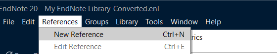
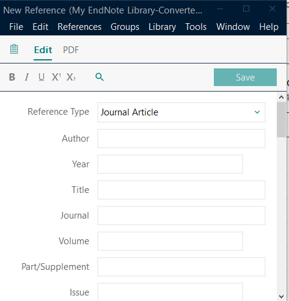
图6-4 手工录入的关键不是“把页面填满”，而是让字段具有明确语义。第一幅图展示新建记录入口，第二幅图展示作者、年份、题名等字段。选择正确文献类型、按规则分隔作者并保留DOI或稳定URL，决定了后续样式能否正确输出。

手工录入后应进行一次预览测试：切换到目标引用样式，观察作者、题名、年份和来源是否出现在正确位置。若输出异常，先检查题录字段，而不是直接修改预览文字。

### 从PDF导入：全文不等于题录

已有PDF可以单篇或按文件夹导入，软件会尝试利用PDF中的DOI或其他元数据建立题录。识别成功取决于标识符是否存在且可读取、网络与元数据服务是否可用，以及文档是否为规范的出版版本。扫描件、作者自存稿、排版异常文件或缺少标识符的报告，常常只能作为附件导入，题录仍需手工补全。

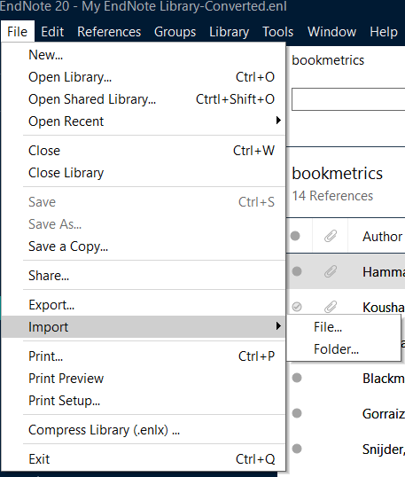
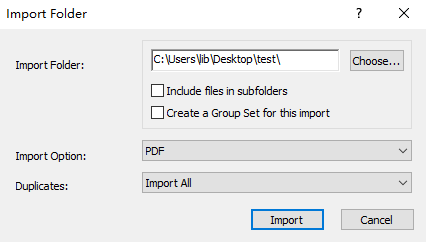
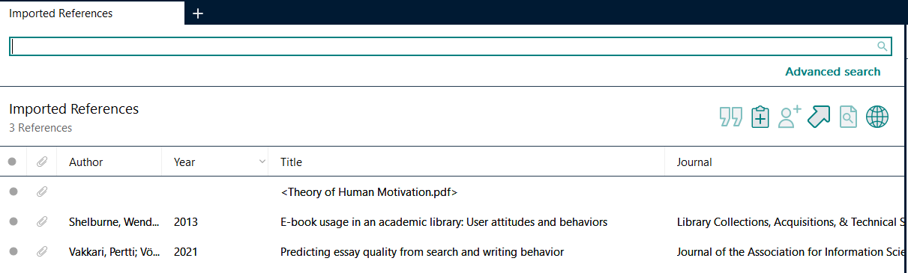
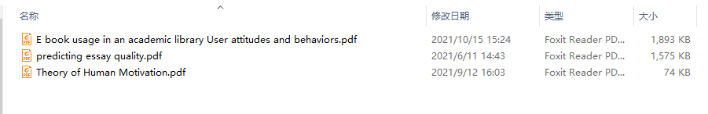
图6-5 PDF导入的成功与失败。前两幅图展示选择PDF及导入选项，第三幅图显示元数据未被正确识别时只得到不完整记录，第四幅图显示出版物页面中的标识信息。导入完成后必须核对题名、作者、来源、年份和DOI，不能因为附件能够打开就认为题录正确。

### 从数据库导入：优先使用结构化题录

从Web of Science、Scopus、PubMed、ScienceDirect、Springer、Wiley、CNKI、万方或维普等数据库导入时，应优先选择能够保留完整题录的格式。常见选项包括RIS、EndNote格式、BibTeX或数据库专用文本格式。选择时要考虑后续任务：普通写作至少需要作者、题名、来源、年份、卷期页码、DOI和摘要；若还要进行文献计量分析，则可能需要关键词、机构和完整参考文献。

跨数据库导入可以概括为四步：在数据库中筛选并选择记录；选择导出格式与字段；保留原始导出文件；在文献管理软件中选择匹配的导入选项并检查结果。数据库常设置单次导出上限，分批下载时应统一字段并记录批次范围，避免遗漏或重复。

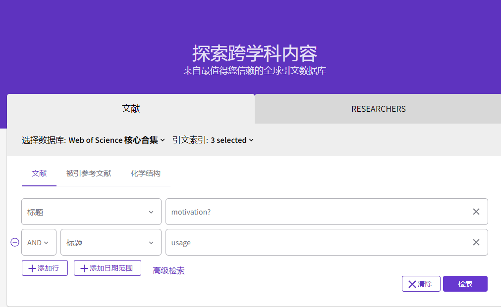
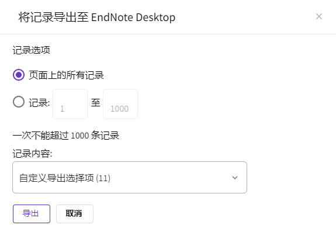
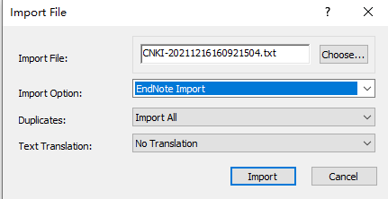
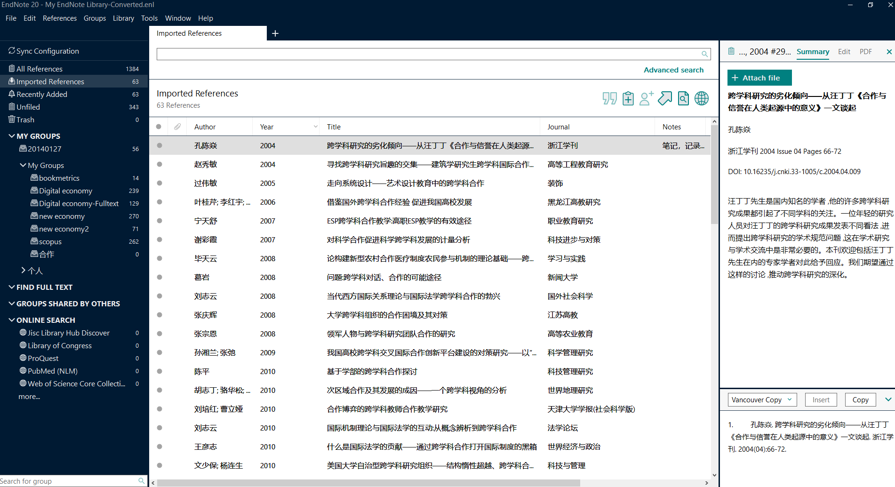
图6-6 从数据库到文献库的四个决策点。图像依次表现选择记录、确定导出格式、匹配导入过滤器和检查导入结果。界面名称可能改变，但必须保留“来源—格式—过滤器—结果”这一证据链，才能解释字段错误从何产生。

RIS具有较好的跨软件兼容性，但不同数据库对标签的使用并不完全一致；BibTeX适合LaTeX工作流，却可能在复杂中文姓名和期刊字段上需要清理；数据库专用格式通常保留字段较完整，却依赖对应过滤器。不要把某一种格式理解为所有场景下的唯一正确选择。

### 在线检索与浏览器采集

部分文献管理软件可以直接连接数据库进行在线检索，或通过浏览器扩展从网页抓取题录。在线检索适合快速补充少量记录；复杂检索仍宜在专业数据库中完成，因为数据库原生界面通常提供更完整的字段、筛选和检索历史。浏览器采集方便，但网页元数据质量参差不齐，新闻、机构网页和图书页面尤其需要检查作者、日期和资源类型。

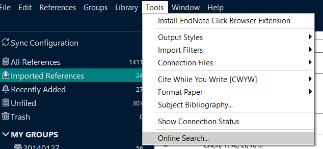
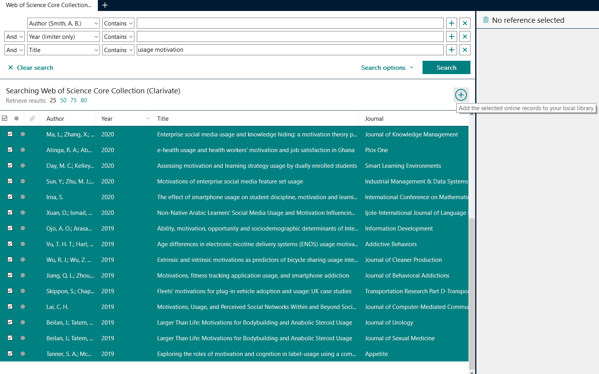
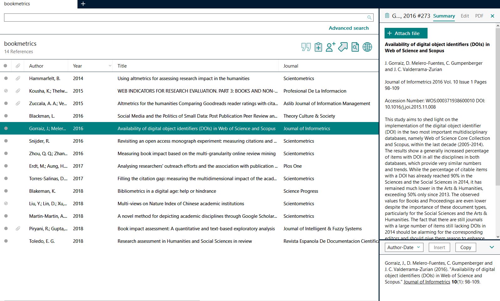
图6-7 在线检索和全文查找。第一幅图展示数据库连接入口，第二幅图显示在线结果列表，第三幅图显示从题录记录请求查找全文。在线检索得到的是候选题录，全文查找则依赖开放获取状态、机构订阅和认证环境；软件不会绕过版权与访问权限。

## 6.5 导入之后：字段校对与全文管理

### 自动导入只是建立初稿

文献管理软件输出的参考文献，本质上是题录字段按照样式规则重新排列。作者字段少一个逗号，可能导致姓名颠倒；文献类型错误，可能使期刊卷期或学位授予机构消失；题名大小写、页码、DOI和出版日期错误，也会原样进入论文。因此，导入后应先完成字段校对，再分组和引用。

表6-4 题录校对清单

| 字段 | 校对要点 | 常见错误 | 优先核对来源 |
| --- | --- | --- | --- |
| 文献类型 | 期刊、图书章节、学位论文、报告、网页等是否正确 | 把所有记录都识别为Journal Article | 出版物原文或数据库记录 |
| 作者 | 顺序、姓名拆分、团体作者是否正确 | 中文姓名被拆分；团体名被当作个人名 | 原文署名页 |
| 题名 | 拼写、副题名、大小写和特殊符号 | PDF解析丢字；英文题名全大写 | 出版商页面或正式PDF |
| 来源 | 期刊名、图书名、会议名是否在正确字段 | 期刊简称与全称混用 | 出版商或数据库 |
| 日期与卷期页码 | 年、卷、期、页码或文章号是否完整 | 把在线发表日期和正式卷期混为一谈 | 正式出版记录 |
| 标识符 | DOI、ISBN、报告号、标准号、稳定URL | DOI带多余前缀或缺失 | DOI落地页或原始文件 |
| 摘要与关键词 | 是否完整，语言和分隔是否一致 | HTML残留、关键词粘连 | 数据库或原文 |
| 附件 | 是否为正确版本，链接是否有效 | 附件与题录不对应；绝对路径失效 | 打开文件并核对首页 |

可以先抽查一批记录，确定某数据库的典型问题，再进行批量修正；但涉及作者、题名和文献类型的修改应保守，批量替换前先备份。对同一记录存在多个来源时，优先使用正式出版物和权威数据库的信息，并保留必要的获取日期。

### 全文查找、链接与自动导入

“Find Full Text”会根据题录信息查找可访问全文，成功率受开放获取、机构订阅、代理认证和出版社页面结构影响。找到文件后仍要确认是否为正式版本、作者接受稿或补充材料。对无法自动获取的文献，可以通过图书馆馆藏、文献传递或开放获取渠道依法获得，不应使用来历不明的文件替代正式记录。

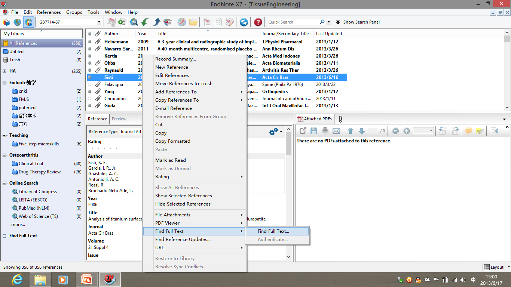
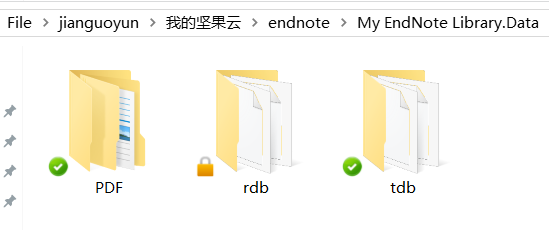
图6-8 题录与附件的连接。第一幅图显示全文查找后记录旁出现附件或查找状态，第二幅图显示PDF实际保存在文献库配套数据目录中。附件与题录之间存在软件维护的相对链接，直接在`.Data`目录中随意改名或移动文件可能破坏连接。

EndNote可以设置PDF自动导入文件夹，监测新文件并尝试生成记录；Zotero浏览器连接器也可在保存题录时附加可获得的PDF。自动化适合减少重复操作，但应设置“待校对”分组或标签，避免未经检查的记录直接进入正式写作库。

## 6.6 组织、去重与阅读

### 分组表达项目，标签表达属性

分组适合表达研究结构，如“理论基础—研究现状—方法—案例”或“初筛—待精读—已纳入—排除”。标签适合表达一篇文献可以同时具有的属性，如“核心文献”“量化研究”“教师样本”“存在争议”“已用于第二节”。同一记录可以进入多个分组或拥有多个标签，而不必复制题录和附件。

智能分组或保存检索会根据条件自动更新。例如，条件可以设为“年份大于等于2024且关键词包含generative AI”，新导入记录只要字段满足条件，就会自动出现。智能分组依赖字段规范；若年份缺失或同义词没有统一，自动分类就会漏项。

### 去重不是简单删除一条

同一文献从多个数据库导入后可能形成重复记录。判断重复可综合DOI、题名、作者、年份和来源，不能只凭题名相似。两个记录各自可能携带不同的标签、笔记和附件，合并前要决定保留哪些字段。Zotero官方文档建议使用合并而非直接删除，以保留集合、标签并维持Word引文链接；EndNote导入文献库时也可根据设定识别重复记录。

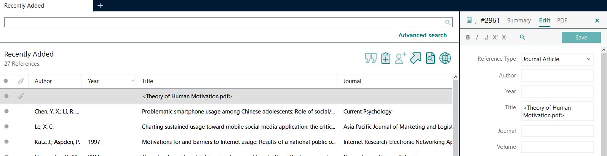
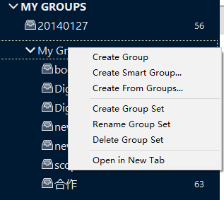
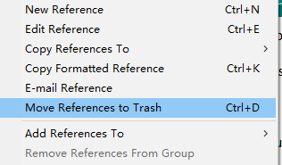
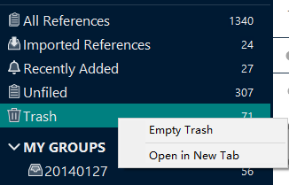
图6-9 文献库管理的四类操作。第一幅图强调回到题录字段修改，第二幅图展示不同分组方式，第三、四幅图展示删除和清空回收站。分组不会复制底层记录，删除则可能影响引用和同步；清空回收站前应确认记录、附件和写作文档不再需要。

误删记录通常可以在回收站未清空前恢复。若已经同步并清空，删除操作可能传播到其他设备，因此重要批量操作前应建立可回滚备份。

### 笔记要能回到证据

高质量阅读笔记至少区分四类内容：原文摘录、准确转述、方法与证据概括、研究者自己的评价。原文摘录应保留页码或段落位置；转述不能只改几个词；评价要说明依据。建议为每篇精读文献记录研究问题、理论框架、对象与样本、方法、主要发现、限制以及“可用于自己哪一部分论证”。

Zotero内置PDF阅读器可以把批注加入笔记，并保留返回PDF页码的链接；EndNote和NoteExpress也提供全文标注或笔记功能。无论使用哪种工具，都要确认批注是写入PDF本身、软件数据库还是单独笔记文件，因为这决定了迁移和备份方式。[Zotero PDF阅读与笔记说明](https://www.zotero.org/support/pdf_reader)

## 6.7 引用样式与GB/T 7714—2025

### 区分“引用内容正确”和“格式正确”

文献管理软件主要帮助管理引文标注和著录格式，不能判断一项观点是否被准确转述，也不能替代研究者核对原文。引用正确至少包含两层：内容层面，所引用的文献确实支持当前论断；格式层面，文内标注与文后参考文献符合目标规范。两层缺一不可。

引用样式通常由两个部分组成：Citation规定文中数字、作者—年份或脚注怎样显示；Bibliography规定文后条目怎样排序、显示哪些字段、使用何种标点和字体格式。文中标注和文后著录是一套联动规则，不能只修改其中一处。

### 现行国家标准已经更新

截至2026年7月，现行国家标准为**GB/T 7714—2025《信息与文献 参考文献著录规则》**，发布日期为2025年12月2日，自2026年7月1日起实施；GB/T 7714—2015已废止。[全国标准信息公共服务平台](https://openstd.samr.gov.cn/bzgk/std/newGbInfo?hcno=C6CE52E55AC09B9C79A20AEA77CEDD14)

标准更新并不意味着学校、期刊和软件样式会在同一天全部完成切换。实际写作时应按以下优先级判断：首先查看学校学位论文规范或目标期刊最新投稿指南；其次确认其明确要求GB/T 7714—2025、其他标准或期刊自有样式；最后在软件中选择对应且近期更新的样式，用代表性条目逐项测试。若机构暂时明确要求旧版格式，应按其提交规则执行，同时记录所用版本。

表6-5 选择和核验引用样式的步骤

| 步骤 | 要做什么 | 不能省略的核验 |
| --- | --- | --- |
| 1. 确认规范 | 查学校或期刊最新要求 | 标准名称、版本、文内体系、语言要求 |
| 2. 获取样式 | 从软件官方样式库、机构或期刊获取 | 样式名称相同不代表规则完全相同 |
| 3. 建立测试集 | 准备期刊、图书、章节、学位论文、网页、数据集等记录 | 每类记录题录字段必须完整 |
| 4. 预览比较 | 对照官方规则或投稿示例 | 作者、题名、日期、标识符、标点和排序 |
| 5. 修改副本 | 在副本上调整Citation和Bibliography | 不直接覆盖内置样式；保留修改说明 |
| 6. 文档验证 | 在Word中插入、增删和切换样式 | 文中编号和文后表能否自动联动 |

### Output Style的修改原则

EndNote的`.ens`文件、Zotero使用的CSL文件以及NoteExpress的样式文件，都是“规则代码”。当现有样式与目标要求不一致时，应先确认题录字段无误，再检查是否有更新样式；只有确实需要时才修改样式副本。以数字顺序制为例，文内上标、方括号、连续编号压缩、作者数量、省略规则、电子资源日期和DOI显示，都可能由不同设置控制。

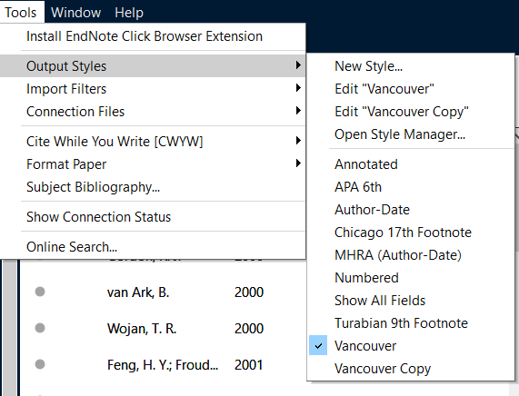
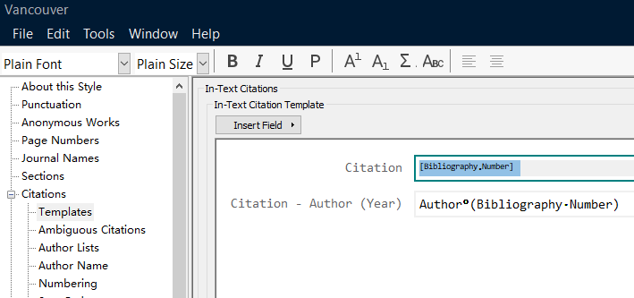
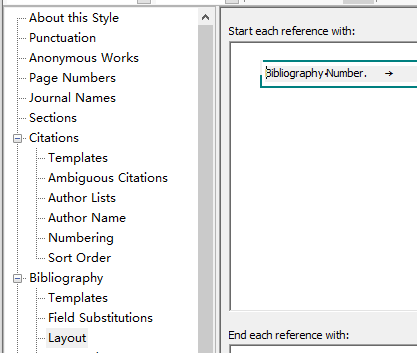
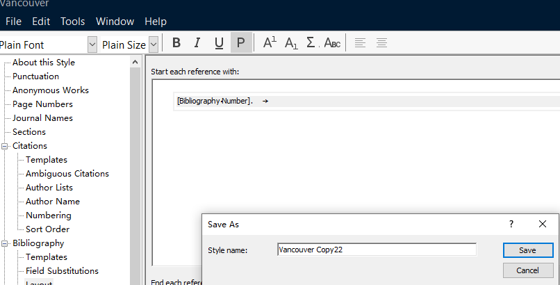
图6-10 输出样式修改的基本逻辑。第一幅图用于选择或复制样式，第二幅图控制文内标注，第三幅图用字段和标点定义文后条目，第四幅图把修改结果另存为新样式。图中的旧版界面和示例代码只用于理解结构，不能直接当作GB/T 7714—2025模板。

样式修改后应使用测试集验证，不能只看一条期刊论文。对Vancouver、APA或某个期刊样式的局部改动，也应另存为带有机构、期刊或日期的名称，并记录修改了哪些规则。Zotero官方样式库采用Citation Style Language，样式可以安装、预览和编辑；若官方样式有误，宜先更新软件和样式，再向维护者报告，而不是在每篇论文中手工修补。[Zotero引用样式说明](https://www.zotero.org/support/styles)

## 6.8 在Word中边写边引

### 动态引文的工作原理

EndNote的Cite While You Write、Zotero和NoteExpress的Word插件都遵循相似逻辑：在文献库中选择记录，把引文插入光标位置，软件在文档中保存与题录记录的关联，并依据当前样式动态生成文内标注和文后参考文献表。新增、删除或移动一条引文后，编号和文后条目可以自动更新。

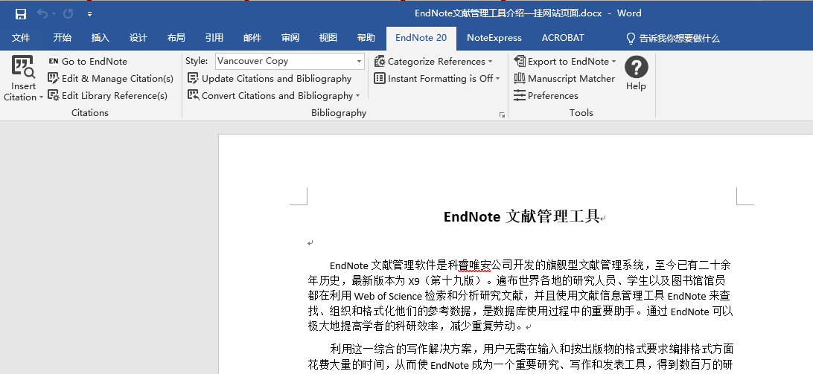
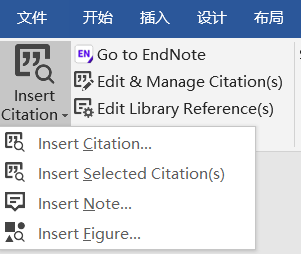
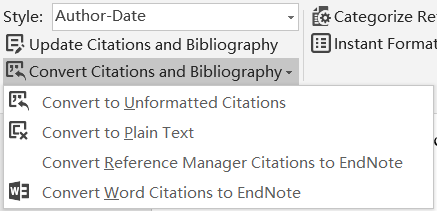
图6-11 Word插件的三个功能区。第一幅图展示插件在Word功能区中的位置，第二幅图集中显示查找、插入和管理引文，第三幅图用于选择样式、更新引文以及转换文档。版本不同会改变名称和布局，但“插入—管理—更新—转换”四类功能基本稳定。

### 插入一条引文

完整操作可以概括为五步：先打开正确的文献库与写作文档；把光标放在需要证据支持的句子之后；从Word中检索文献或返回文献库选择记录；插入引文；核查文内标注、文后条目和原文支持关系。一次插入多篇文献时，还应检查排序、分隔符和连续编号压缩是否符合规范。

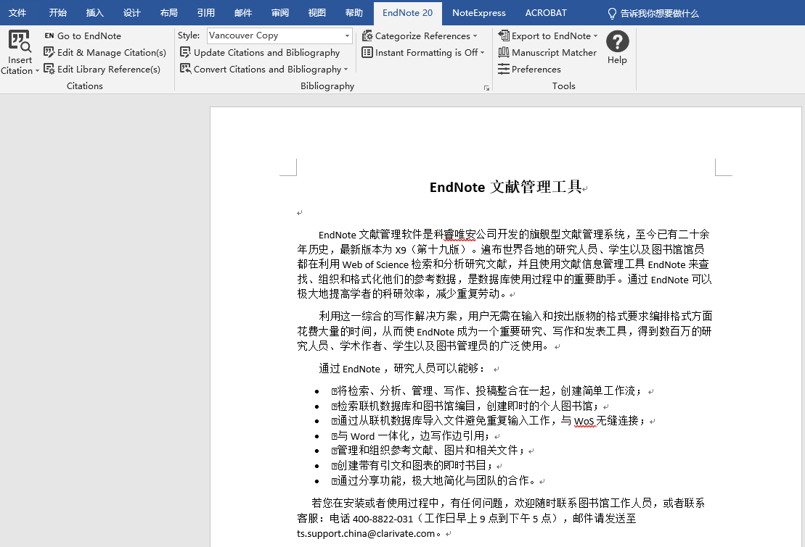

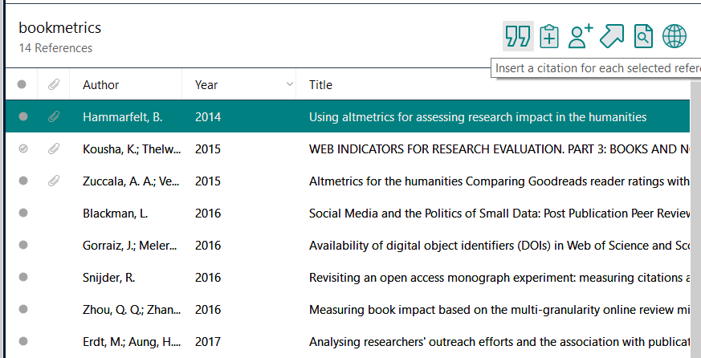
图6-12 从论断到文献记录。第一、二幅图强调引文应放在能够明确对应论断的位置，第三幅图展示从文献库选择记录。操作正确不等于引用合理；插入前仍要确认文献确实支持该句，而不是因为关键词相似就引用。

### 编辑和删除必须通过插件

对动态引文直接在Word正文中删除字符，可能留下不完整字段或在下次更新时恢复。需要删除、增加页码、修改前后缀、调整同一位置的多篇引文顺序时，应使用Edit & Manage Citations或相应管理功能。题名、作者或年份错误，则应回到文献库修改，再刷新文档。

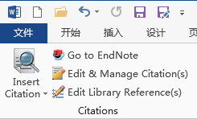
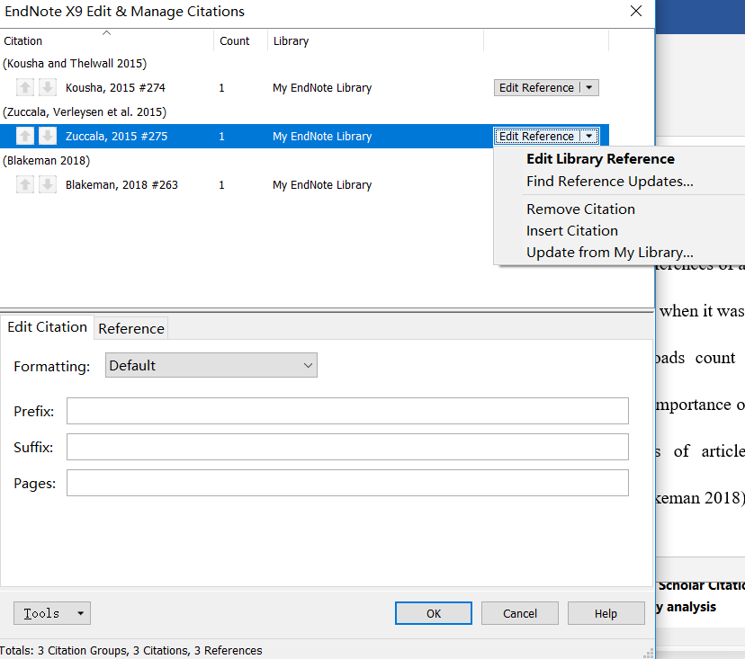
图6-13 动态引文的集中管理。第一幅图显示进入编辑与管理引文的命令，第二幅图列出文档中已插入的记录及操作项。通过插件删除后，后续编号和文后参考文献表会重新计算；手工改数字则会破坏这种联动。

### 动态原稿与纯文本投稿副本

文献管理插件通过域代码或类似嵌入数据维持文档与文献库的联系。域代码使文档能够更新样式和编号，但某些投稿系统、排版软件或合作者可能要求普通文本。此时可以使用Convert to Plain Text等功能生成不含动态字段的新文档。

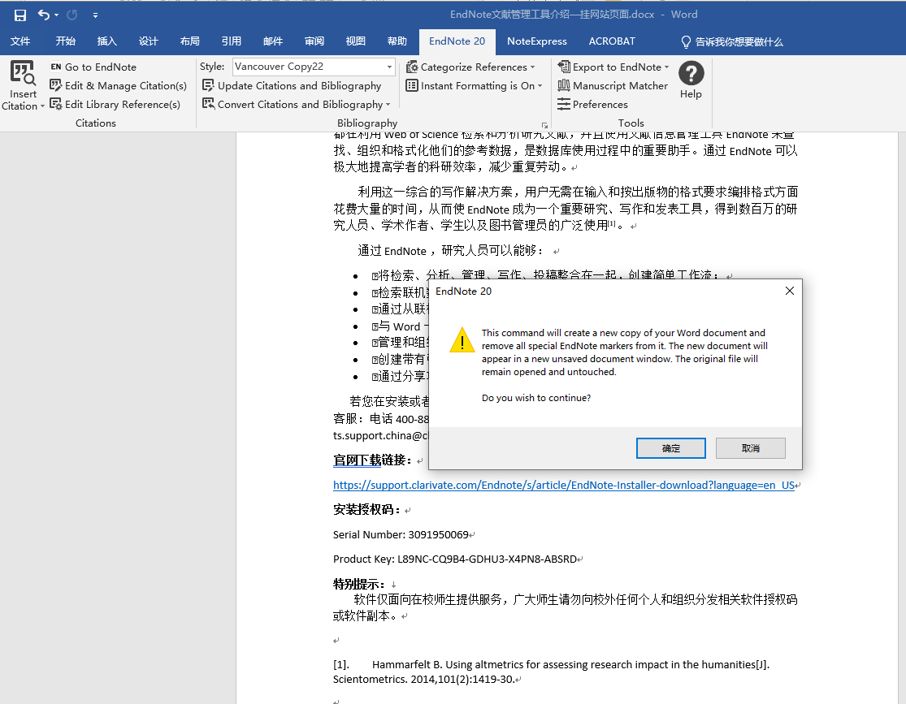
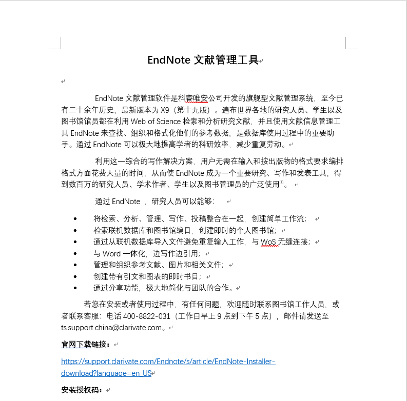
图6-14 从动态稿生成投稿副本。第一幅图展示转换为普通文本的入口，第二幅图显示软件生成一个新的Word文档。转换前必须保存并保留含动态字段的原稿；纯文本副本适合投稿和终稿检查，却不再适合作为继续大规模增删引文的唯一版本。

建议采用明确的文件命名，例如`论文_动态引文_20260715.docx`与`论文_投稿纯文本_20260715.docx`，避免覆盖。提交前还应逐条核对文中引文与文后表、交叉引用、脚注和最终页码。

## 6.9 同步、备份与迁移

### 同步解决多端一致，备份解决历史恢复

同步把一台设备上的新增、修改和删除传播到其他设备；备份保存某个时间点的独立副本。若误删记录后立即同步，删除也会传播，因此同步不能替代具有历史版本的备份。重要文献库应同时具备本地工作副本、软件同步和定期离线或异地备份。

EndNote官方说明中，`.enl`及配套`.Data`共同保存文献库，压缩库`.enlx`可以包含题录和附件；简单导出文本不是完整备份。工作库不宜直接放在通用云盘中实时打开，而压缩后的单文件备份可以在关闭库后复制到云端。[EndNote备份说明](https://docs.endnote.com/docs/endnote/2025/v1/windows/en/content/appendices/important_filestobackup.htm)

Zotero把大部分题录、笔记和标签保存在`zotero.sqlite`数据库中，把存储型附件放在`storage`目录。数据同步与文件同步是两个部分：题录数据可以同步而附件未必全部同步。官方同样警告，不应把活动数据目录直接置于第三方云盘同步文件夹；备份时应关闭Zotero并复制整个数据目录，最好使用能够保留多个历史版本的系统备份。[Zotero数据目录与备份](https://www.zotero.org/support/zotero_data?s=export)

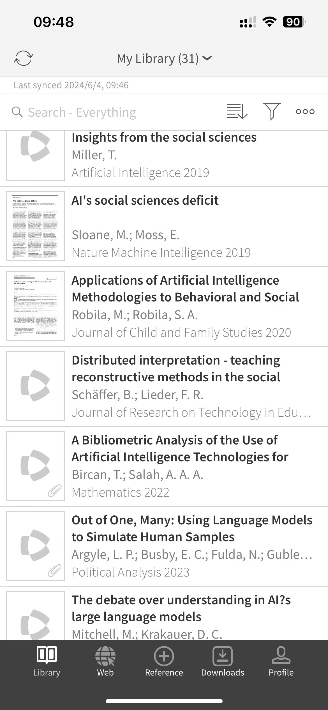
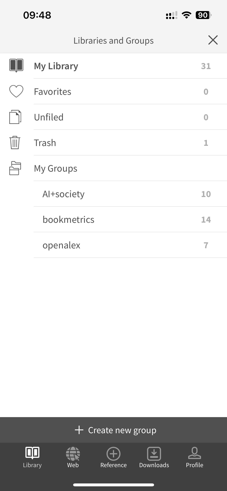
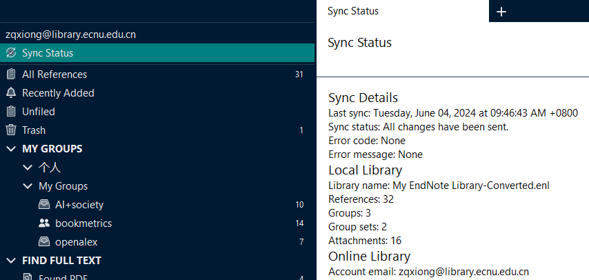
图6-15 文献库的多端访问与同步。移动端适合查阅、标注和临时收集，桌面端更适合批量管理与写作。同步设置决定哪些题录和附件在设备间传播；开启前应先完成一次独立备份，并确认使用的是同一账户和正确文献库。

表6-6 文献库的三层保护

| 层次 | 主要目的 | 建议做法 | 不能替代什么 |
| --- | --- | --- | --- |
| 日常同步 | 多设备保持当前状态一致 | 使用软件官方同步，观察冲突提示 | 不能恢复很久以前被同步删除的内容 |
| 周期备份 | 恢复误删、损坏或错误修改 | 定期生成EndNote压缩库或关闭Zotero后备份完整数据目录 | 不能只靠一次旧备份维持最新工作 |
| 项目归档 | 保留可重建的最终研究包 | 保存文献库、附件、样式、原始导出文件、动态稿和投稿副本 | 不能只导出参考文献文本 |

迁移到新电脑或新软件前，应先验证备份能否打开，再导出一份通用交换格式。RIS或BibTeX便于迁移题录，但通常不能完整保存所有分组、笔记、批注和Word动态链接。迁移不是“导出成功”就结束，还要抽查作者、中文字符、附件、标签和引用文档。

## 6.10 NoteExpress、Zotero与扩展生态

### NoteExpress：关注中文数据与机构环境

NoteExpress提供题录导入、分类、全文、笔记和Word引用等功能，在中文数据库和国内机构环境中较常见。若学校图书馆提供集团版，应从机构或官方入口下载安装，并使用与当前版本匹配的过滤器和样式。不要使用来历不明的安装包或把学校授权说明当作永久规则，因为授权范围和下载地址会变化。

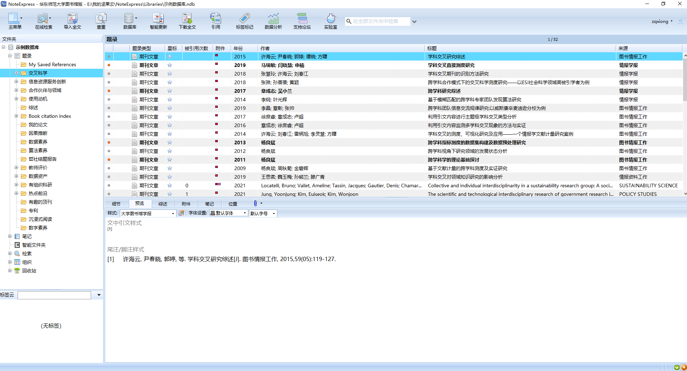
图6-16 NoteExpress的记录列表与分类界面。界面采用左侧分类、中间题录列表和右侧详情的结构，与其他文献管理软件的基本对象相似。学习时应把注意力放在题录字段、分类、附件和输出样式，而不是记忆某个版本的按钮位置。

### Zotero：开放采集、阅读和引用工作流

Zotero是一款免费、开源、跨平台的文献管理工具，支持从网页收集题录，使用集合、标签和保存检索组织材料，通过内置PDF阅读器建立批注与笔记，并在Word、LibreOffice和Google Docs中生成动态引文。[Zotero官方介绍](https://www.zotero.org/) 一个条目可以同时进入多个集合而不复制底层记录，这种“播放列表式”组织有助于同一文献服务多个项目。

Zotero的第三方插件可以扩展翻译、笔记、LaTeX或其他工作流，但插件并非越多越好。安装前应检查来源、维护时间、兼容版本、所需权限和数据去向；升级软件前应确认关键插件兼容，并建立备份。带有生成式人工智能或在线翻译能力的插件可能把题名、笔记甚至全文发送到外部服务，使用涉及未发表论文、敏感研究或受版权限制材料时，需要先评估隐私、保密与许可。

### 工具可以替换，管理原则应保持稳定

无论选择哪款软件，都应保留五种可迁移资产：原始数据库导出文件、经过校对的题录、合法获得的全文、可以追溯到页码的笔记、明确记录版本的引用样式。软件是工作流的实现，资料结构和质量控制才是长期资产。

## 6.11 从检索到写作的完整练习

下面以“生成式人工智能与教师反馈”为课程论文主题，建立一个可复核的小型文献库。

1. **确定边界**：记录研究主题、数据库、检索式、检索日期和文献类型。
2. **导出题录**：从一个中文数据库和一个外文数据库分别导出结果，保留原始文件及批次说明。
3. **建立项目库**：新建清晰命名的文献库或项目集合，把两批题录分别导入临时分组。
4. **去重校对**：合并重复记录，抽查作者、题名、来源、年份、卷期页码、DOI和附件。
5. **组织阅读**：建立“理论”“教师研究”“自动反馈”“风险与伦理”“待精读”等分组或标签。
6. **建立笔记**：对五篇核心文献记录研究问题、样本、方法、发现、限制和可引用页码。
7. **动态写作**：在Word中写一段不少于300字的比较性综述，插入至少五条引文并自动生成文后表。
8. **样式测试**：按当前任务要求选择样式，并用至少三种文献类型检查输出；不要把旧版GB/T 7714样式默认为现行标准。
9. **生成投稿副本**：保留动态引文原稿，再生成普通文本副本，比较两者的用途。
10. **备份归档**：保存文献库、附件、样式、原始导出、动态稿和纯文本副本，并验证备份可以打开。

表6-7 文献管理工作流验收表

| 环节 | 合格证据 | 常见失败 |
| --- | --- | --- |
| 收集 | 原始导出文件、检索日期与来源完整 | 只有PDF，没有题录来源 |
| 校对 | 抽查记录与原文一致 | 导入后直接引用 |
| 组织 | 分组和标签能回答具体研究问题 | 按下载顺序堆放 |
| 阅读 | 摘录有页码，评价与原文分开 | 只有高亮，没有说明 |
| 引用 | 文中引文与文后表动态联动 | 手工改编号或直接删域代码 |
| 样式 | 标准或投稿指南版本明确，测试集通过 | 只凭样式名称判断正确 |
| 备份 | 独立副本可恢复，动态稿与投稿副本均保存 | 把同步当作唯一备份 |

## 常见误区

第一，把PDF文件夹等同于文献库，忽略题录、关系和笔记。第二，自动导入后不核对字段，却相信软件输出一定正确。第三，建立大量含义重叠的分组和标签，最终无人维护。第四，直接删除重复记录，丢失其中的附件、笔记或引用链接。第五，在Word中手工修改动态编号，破坏自动更新。第六，把旧版GB/T 7714样式继续当作现行标准，或只看样式名称不做测试。第七，把工作数据库直接放在通用云盘中实时同步。第八，把同步当作备份。第九，安装过多第三方插件，却不检查兼容性、权限和数据外传风险。

## 本章小结

文献管理软件把题录、全文、分组、标签、笔记和引用关系连接成研究资料库。可靠工作流从建立清晰边界开始，经过结构化导入、字段校对、去重组织和证据化笔记，再进入Word动态写作、样式核验与项目归档。EndNote、NoteExpress和Zotero在授权、中文数据、开放生态和协作方式上各有特点，但管理原则相同：题录准确、全文对应、笔记可追溯、引文可更新、样式有版本、数据可恢复、格式可迁移。

## 思考与练习

1. 比较文件夹管理与文献管理软件，说明一篇文献同时属于三个研究主题时，两种方法如何处理。
2. 从一个中文数据库和一个外文数据库各导入不少于10条题录，记录导出格式、导入选项及最常见的三类字段错误。
3. 选择一个带DOI的PDF和一个扫描PDF进行导入，比较自动识别结果，并说明失败后如何补救。
4. 建立普通组、智能组和标签各一组，说明三种组织方式分别适合表达什么关系。
5. 查找学校或目标期刊当前的参考文献要求，判断其使用GB/T 7714—2025、其他标准还是自有样式，并用三种文献类型验证软件输出。
6. 在Word中插入、删除和移动引文，观察编号及文后表如何变化；随后生成纯文本副本，并说明为何必须保留动态原稿。
7. 为自己的文献库设计“同步—周期备份—项目归档”三层方案，列出每一层保存的文件、频率和恢复步骤。
8. 安装并试用Zotero，导入文献、建立集合和标签、生成一段参考文献表；若安装第三方插件，另写一份版本、权限与数据去向检查记录。
