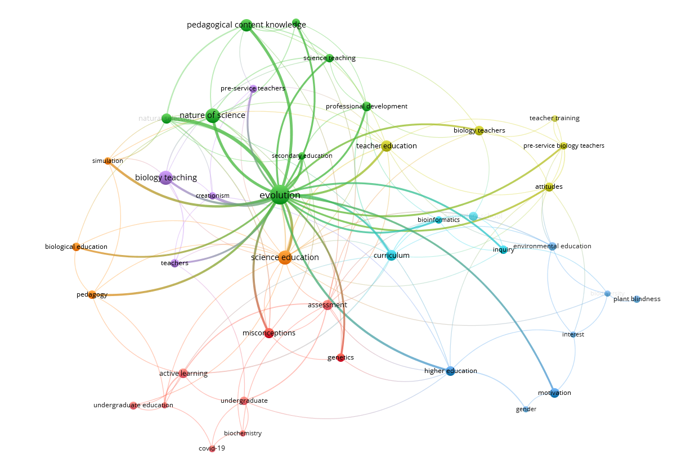
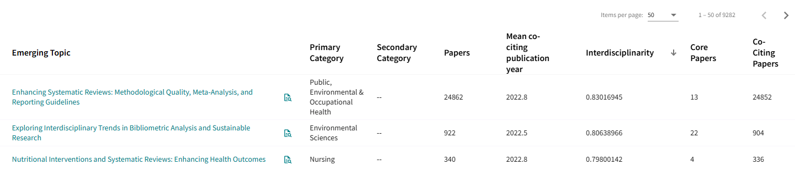

# 第七章 信息计量理论与工具

文献计量看起来像是一组软件操作：导入数据、设置参数、生成网络图、导出图片。但如果只把它理解为“会用CiteSpace或VOSviewer画图”，就很容易走向误用。真正的文献计量分析首先是一种研究视角：把文献看作可以被测度、比较和解释的数据对象，通过论文、作者、机构、关键词、参考文献、引用关系和使用数据，观察知识生产与传播的结构。工具只是帮助我们处理这些数据的媒介，不能替代研究问题、数据质量、方法选择和人工解释。

学习文献计量工具，不能一开始就陷入软件菜单和图谱样式，而应先建立一条清晰的知识路径：先理解文献计量、科学计量、信息计量、网络计量和替代计量之间的关系，再讨论为什么要进行文献计量分析；随后认识文献增长、文献老化、洛特卡定律、齐普夫定律、累积优势等基本规律；最后进入常见方法和工具，包括CiteSpace、VOSviewer、bibliometrix、ITGinsight、ESI、SciVal、InCites Research Horizon Navigator、Connected Papers和ResearchRabbit。本章的重点不是让读者记住所有工具名称，而是理解不同工具背后对应的数据、算法和解释边界。

## 从概念辨析开始

文献计量、科学计量、信息计量、网络计量和替代计量都属于“用数量方法研究知识活动”的范畴，但它们的研究对象和问题重心并不完全相同。理解这些概念的差异，是进入文献计量工具学习之前的第一步。

**文献计量**关注文献本身及其相关属性，例如论文数量、期刊分布、作者合作、关键词共现、参考文献和被引关系。它的直接对象是文献记录，常用于分析某一学科、主题或机构的研究状况。

**科学计量**的对象更宽，关注科学活动本身的定量研究。它不仅分析论文，还可能分析科研人员、机构、国家、基金、专利、学科结构和科学政策。换言之，文献计量常常是科学计量的重要数据基础。

**信息计量**进一步扩大对象，研究任何形式、任何社会群体中的信息及其传播规律。它不仅限于正式学术文献，也可涉及网络文本、社交媒体、新闻、报告和其他信息对象。

**网络计量**关注网络环境中的信息资源结构、链接关系和使用行为。例如网页链接、网站影响力、网络传播路径等，都可以成为网络计量的对象。

**替代计量**则试图补充传统引用指标，关注论文在社交媒体、新闻、博客、政策文件、在线收藏和下载等场景中的传播和使用。替代计量提醒我们，学术影响并不只发生在期刊引用系统中，但这些指标也更容易受到平台机制、传播热度和短期事件影响，因此解释时要格外谨慎。

可以把这一组概念放在一个由窄到宽的序列中理解：文献计量以文献记录为中心，科学计量以科学活动为中心，信息计量以信息活动为中心，网络计量以网络空间的信息结构为中心，替代计量则强调传统引文之外的新型影响痕迹。读者需要掌握的不是定义背诵，而是知道自己面对一个研究问题时应该选择哪一种视角。

## 为什么要进行文献计量分析

文献计量分析至少有四类用途：从定量研究中发现科学规律；根据科学规律发现研究热点、前沿和创新；根据科学规律助力科学政策评价与制定；根据科学规律更好地进行科学研究。这四点实际上构成了文献计量分析的四个层次。

第一，文献计量可以帮助我们发现科学文献系统中的规律。文献并不是杂乱无章地出现。某些作者持续高产，某些期刊形成核心，某些主题会快速增长，某些文献会逐渐失去使用频率。这些现象背后存在知识生产、传播和遗忘的规律。

第二，文献计量可以帮助我们识别热点、前沿和创新。一个主题发文量快速增长，说明研究者正在集中注意力；一个关键词出现突现，说明其在特定时期突然受到关注；一组高被引论文形成共被引聚类，可能指向某一研究前沿的知识基础。但这里要特别强调：高频、高被引和高使用只能提供线索，不能自动等同于“重要”或“前沿”。是否构成真正的前沿，必须回到原文阅读和学科判断。

第三，文献计量可以服务科学政策评价。例如，某项人才计划是否促进了科研产出，某类基金是否推动了学科交叉，某一地区的科研能力是否提升，都可以用论文、引用、合作网络和基金产出作为证据之一。但这里存在一个常见“雷区”：如果忽略文献增长的整体背景，就可能误把自然增长解释为政策效果。政策评价需要更严谨的因果推断设计，文献计量指标只是结果变量或背景证据。

第四，文献计量可以帮助个人研究。对于初学者而言，最实际的用途是用宏观视角了解一个领域：谁在研究，哪些机构活跃，核心期刊在哪里，常见方法是什么，研究主题怎样演化，哪些文献值得优先阅读。文献计量不能替代综述，但能为综述提供地图。

## 文献系统中的基本规律

文献老化、文献增长、洛特卡定律、齐普夫定律和累积优势，是理解文献系统的基础概念。这些内容看似偏理论，其实是文献计量工具使用前的必要准备。没有这些规律意识，就容易把软件输出当成客观现实。

### 文献增长与文献老化

**文献增长**指某一领域、某一学科或整个科学系统中文献出版数量随时间增加的现象。现代学术体系中，文献增长几乎是常态。新的期刊、会议、数据库、预印本平台和开放获取机制，都在不断增加可见文献数量。

**文献老化**指文献的使用率随着时间推移而下降，常见表现是被引次数、下载次数或阅读关注度逐渐减少。文献之所以会老化，一方面是因为新研究不断出现，旧研究被更新、更综合或更具方法优势的成果替代；另一方面是因为学科问题本身发生变化，原来重要的研究对象、技术条件或政策情境不再处于中心位置。

文献增长与老化相互影响。文献数量增长越快，研究者注意力越分散，旧文献越容易被新文献遮蔽；但经典文献并不会简单消失，它们可能以理论基础、方法来源或历史参照的形式继续发挥作用。因此，在做文献计量分析时，不能只按年份统计发文量，也要考虑不同年份文献的引用机会不同。新发表论文没有足够时间积累引用，旧论文则天然拥有更长的被引窗口。

### 洛特卡定律、齐普夫定律与累积优势

**洛特卡定律**描述科学生产率分布：少数作者发表大量论文，多数作者只发表少量论文。它提示我们，科研生产往往呈现不均衡结构。在作者分析中，看到少数高产作者并不奇怪；需要进一步判断的是，这些作者是否真正构成领域核心，还是由于数据清洗不充分、作者同名或机构合并造成偏差。

**齐普夫定律**来自自然语言研究，指出词频与排名之间存在反比关系。在文献计量中，它提醒我们关键词、标题词和摘要词的分布也会高度不均衡。少数高频词往往非常常见，但未必有足够区分度。例如“教育”“学生”“学习”“研究”等词可能频率很高，却不一定能揭示具体主题。因此，文本分析前必须进行停用词处理和同义词合并。

**累积优势**常被概括为“成功孕育成功”，也与马太效应有关。被关注的作者、机构、期刊或论文更容易继续获得关注。高被引论文可能因为质量高而被引用，也可能因为可见度高而继续被引用。理解累积优势，有助于我们避免把指标完全解释为质量。

## 文献计量的重要方法

文献计量中常见的基础方法包括引文分析、耦合分析和文本分析。它们分别从不同角度观察文献关系。

### 引文分析

引文分析关注文献之间的引用关系。最直接的指标是被引次数，但更有解释力的往往是引用网络。例如，共被引分析观察两篇文献是否经常被后来的文献共同引用。如果两篇文献经常被共同引用，说明它们可能共同构成某一研究方向的知识基础。

引文分析适合回答“哪些文献、作者、期刊或学科构成知识基础”“哪些成果影响较大”“研究前沿的理论来源是什么”等问题。但它也有局限。引用有时间滞后，新文献不容易马上显示影响；不同学科引用习惯不同，不能简单横向比较；引用也不总是正面认同，可能是批评、背景或方法引用。

### 耦合分析

耦合分析通常指文献耦合，即两篇文献共同引用了多少相同参考文献。与共被引分析相比，耦合分析更适合观察新近文献之间的关系，因为一篇文章发表时，其参考文献已经确定；而共被引关系需要等待后续文献引用才能形成。

在研究前沿识别中，文献耦合可以帮助我们看到新近研究如何围绕相似知识基础形成分支。对于课程论文或学位论文选题而言，耦合分析常用于发现“最近几年哪些论文在处理相近问题”。

### 文本分析

文本分析关注题名、摘要、关键词、全文或其他文本字段。共词分析、主题聚类、词频统计、突现词检测都属于这一方向。文本分析的优点是直观，能够直接反映研究主题；缺点是对数据清洗高度敏感。同义词不合并、无意义高频词不删除、中文分词错误、英文大小写不统一，都会影响结果。

方法选择取决于问题。想找知识基础，可用共被引；想看新近研究分支，可用耦合；想了解主题内容，可用文本分析。不要因为某个软件默认生成某张图，就把它当成必做结果。

## 工具选择：先问问题，再选软件

常见文献计量工具包括UCINET、Pajek、VxInsight、CiteSpace、VOSviewer、VantagePoint等。比较这些工具的意义在于提醒我们：工具并不等价。不同工具在数据类型、文本预处理、合作分析、共词分析、引证分析、可视化输出和交互能力上各有侧重。

初学者常犯的错误是先问“用哪个软件最好”。更合理的问题应当是：

1. 我的研究问题是什么？
2. 我的数据来自哪里？
3. 数据字段是否包含参考文献、摘要、关键词、机构、基金等信息？
4. 我需要的是统计表、网络图、主题聚类、时间演化还是交互式探索？
5. 我是否能够解释软件生成的图？

如果只是做课程作业，VOSviewer和biblioshiny通常更易上手；如果要分析突现、时间线和知识演化，CiteSpace更常被使用；如果希望在R中完成可复现分析，bibliometrix更合适；如果处理中文科技文本、专利或多类文本，ITGinsight一类工具也有应用空间。工具选择必须服务于数据和问题，而不是反过来让问题迁就软件。

## CiteSpace：时间、突现与知识图谱

CiteSpace是科学计量和知识图谱分析中使用非常广泛的工具，其官方网站提供下载、FAQ和学习材料。官方页面也持续更新版本与功能说明，例如CiteSpace 7.0系列引入了更大网络处理、聚类摘要和保存可视化等方面的改进说明[^1]。


图7-1 CiteSpace生成的知识图谱示例。读图时不能只看颜色和节点大小，而要结合节点类型、时间切片、聚类标签、中心性和突现信息解释。

CiteSpace常被用于共被引分析、关键词共现、突现检测、时间线视图和聚类解释。使用时应先说明数据来源与字段要求。例如，如果做共被引分析，数据必须包含参考文献字段；如果数据从某些中文平台导出时没有参考文献，就不能直接进行严格的共被引分析。把CSSCI和CNKI数据混合做共被引分析而不考虑数据结构差异，就是典型误用。

CiteSpace的图谱解释通常涉及几个要素。节点代表文献、作者、机构、关键词或其他对象；连线代表共现、共被引或其他关系；颜色常常表示时间切片；聚类标签用于概括一组节点的主题；突现词或突现文献表示某一时期关注度快速上升。需要特别强调的是：聚类标签是算法辅助生成的，不是研究结论。研究者必须回读代表文献，判断标签是否准确。

CiteSpace的常见误用包括：单位、人名、关键词应合并而未合并；停用词和常用词未删除；混合数据时忽略字段结构差异；图文无关、图不对文。这些问题应作为文献计量学习中的重要警示。CiteSpace不是“自动综述机”。它可以帮助发现结构，但不能替代数据清洗、参数说明和人工解释。

## VOSviewer：网络构建与可视化表达

VOSviewer官方网站将其定义为用于构建和可视化文献计量网络的软件工具，可构建期刊、研究者或单篇文献等对象之间的网络，并支持基于引用、文献耦合、共被引或合作关系的网络，还提供从文献文本中提取术语并构建共现网络的功能[^2]。官方功能说明还显示，它可处理Web of Science、Scopus、Dimensions、Lens、PubMed等来源的数据，并支持从Crossref、OpenAlex等来源获取数据的工作流[^3]。



图7-2 VOSviewer网络图示例。VOSviewer适合展示聚类结构、节点距离和密度分布，但图形解释仍需结合数据来源和聚类含义。

VOSviewer的优势是可视化清晰，尤其适合呈现合作网络、关键词共现、文献耦合和共被引网络。初学者可以按照“导入数据—选择分析类型—设置计数方法—生成网络—调整阈值—查看聚类—导出图表”的基本流程学习。这里的关键不是每个按钮在哪里，而是理解每一步都改变了结果。

例如，选择“full counting”还是“fractional counting”，会影响多作者、多机构或多关键词记录的权重分配；设置最低出现次数阈值，会决定哪些节点进入网络；合并同义词表，会改变聚类结构；删除泛词，会让主题更清晰。因此，VOSviewer看似比CiteSpace更易上手，但同样需要严谨记录参数和清洗规则。

VOSviewer图谱中，节点大小通常表示权重，节点之间距离表示关联强弱，颜色表示聚类。距离和颜色是算法布局的结果，不应被过度解释。例如，两个节点在图上距离近，意味着在当前数据和算法设置下关联较强，但不能直接说明理论上必然接近。

## bibliometrix与Biblioshiny：可复现的R语言路径

bibliometrix是基于R语言的文献计量与科学知识图谱分析工具，官方介绍其为开源、可在CRAN获取的R包，并提供Biblioshiny作为面向不写代码用户的网页交互界面[^4]。Biblioshiny的意义在于降低R语言门槛，使用户可以通过交互式界面完成数据导入、过滤、分析和绘图[^5]。


图7-3 bibliometrix/Biblioshiny相关分析流程示例。与纯界面软件相比，R路径更强调数据处理过程的可复现性。

学习bibliometrix可以从一句代码开始：
```r
install.packages("bibliometrix")
```

但这句代码只是入口。真正重要的是理解R语言路径的优势：数据导入、清洗、统计、可视化和报告可以保存在脚本中，从而便于复现和修改。对于准备做较规范综述或毕业论文的学习者，保存代码比只保存软件截图更可靠。

Biblioshiny适合没有R基础的学习者。它把bibliometrix的主要功能转化为网页界面，方便进行描述统计、三字段图、作者分析、来源分析、共词分析、主题演化等操作。不过，交互界面并不意味着不需要方法意识。用户仍要说明数据来源、检索式、纳入标准、字段转换、阈值设定和图表含义。

## ITGinsight：面向多类科技文本的可视化挖掘

ITGinsight可理解为面向科技文本的可视化挖掘系统，适用于专利、论文、报告、报刊等科技文本，也可应用于微博、微信等互联网文本数据。其可视化挖掘方法包括合作关系、同现关系、耦合关系、关联关系、引证关系和演化分析，可输出网络图、热力图、密度图、世界地图、矩阵图、演化图和聚类图。


图7-4 ITGinsight生成的可视化示例。此类工具适合把论文、专利和报告等多源科技文本放入同一分析框架，但前提是字段和对象关系要定义清楚。

ITGinsight的价值在于扩展读者对“文献计量工具”的理解：文献计量并不只处理学术论文，也可以延伸到专利、报告、政策文本和网络文本。尤其在教育技术、科学教育、课程政策、数字化转型等研究中，论文之外的文本材料常常提供重要线索。

不过，多源文本分析的难点也更高。论文、专利、政策文件和社交媒体文本的产生机制不同，字段结构不同，时间粒度不同，引用关系也不等价。把它们放在一起分析时，不能简单合并成一个表格后直接画图，而要先明确每类数据承担什么证据功能。

## 平台型工具：ESI、SciVal与Research Horizon Navigator

除了单机或本地分析软件，还存在一类平台型工具，例如Essential Science Indicators、SciVal和InCites Research Horizon Navigator。平台型工具的特点是数据和算法由商业数据库平台预先整合，用户不一定需要自己从零开始清洗数据，因此图书馆情报工作者常用它们进行快速情报分析、学科评估和前沿监测。

### ESI：基于高被引与热点论文的领域观察

Essential Science Indicators通常基于Web of Science数据构建，用于观察高被引论文、热点论文、研究前沿和机构、国家、学科表现。它适合做宏观观察，但不适合作为唯一证据。因为它的学科分类、文献类型和数据库覆盖范围都会影响结果。

ESI等平台通常会通过聚类分析测度高被引论文之间的共被引关系，形成高被引论文聚类，再通过聚类中文章题目的主要关键词形成研究前沿。这里最关键的一点是：仍然需要人工解读。无论平台给出的前沿名称多么清楚，研究者仍要阅读代表论文，判断该前沿的真实含义、研究对象、方法路径和学术价值。


图7-5 平台型工具中的热点或前沿观察示例。平台提供的是经过预处理的线索，研究者仍需回到代表文献进行解释。

### SciVal：Topic与Prominence

SciVal是Elsevier基于Scopus数据的研究分析平台，用于可视化研究表现、基准比较、合作分析和研究趋势分析[^6]。其Topic和Topic Prominence相关指标常用于发现具有发展势头的研究主题。Elsevier官方说明也将Topic prominence用于理解增长模式和预判发展领域[^7]。

Topics of Prominence通常综合引用次数、浏览次数、期刊影响指数CiteScore等指标，用以表达Topic的发展趋势；Prominence percentile用于表示主题在全球范围内的热门程度。Newly Emerged Topics则会结合突现潜力、主题规模、引文和基金等因素界定新兴主题。

这些指标对于研究规划很有帮助。例如，一个Topic的Prominence percentile为99，说明它在SciVal主题体系中处于非常靠前的位置，可以作为高关注主题线索。但必须强调：Prominence不是质量评价，也不是政策价值判断。它反映的是平台定义下的可见度、动量和关注需求。对教育学研究而言，一个主题是否值得做，还要看理论意义、现实问题、数据可得性和个人研究基础。


图7-6 SciVal主题分析页面示例。读者应关注主题名称、相关文献、指标构成和时间变化，而不是只看排名。


图7-7 SciVal主题空间可视化示例。空间位置和颜色可以帮助观察主题关系，但研究解释仍需结合文献内容。

以2023年3月热点论文探测到的全球热门研究主题为例，除COVID-19外，“环境库兹涅茨曲线、中国、贸易开放”曾是发文量较大且学科交叉度较高的主题，主要涉及中国贸易开放对碳排放和经济增长的影响。这个例子看似不属于教育学，但它说明平台可以帮助研究者发现跨学科主题，而跨学科主题往往需要进一步回到具体领域解释。教育研究者也可以用类似方式观察“人工智能与教师教育”“学习分析与数据伦理”“科学教育与可持续发展”等主题。

### Research Horizon Navigator：研究前沿的新平台形态

InCites中的Research Horizon Navigator对研究前沿所采用的共引方法进行了调整，包括更具包容性的链接算法、取消集群大小限制、纳入艺术与人文科学论文、除文章和评论外还包括会议论文，并且数据每月更新一次。其改进之一是新兴主题名称由AI产生，更具实际意义；局限则是方法仍然以共被引分析为基础，学科交叉测度也基于引文分析。



图7-8 Research Horizon Navigator页面示例。平台通过预设算法降低前沿识别门槛，但方法前提和数据范围仍需说明。

这一部分尤其能够训练读者的“工具批判意识”。AI生成主题名称可能让前沿标签更容易理解，但也可能使用户忘记标签背后的算法过程。平台纳入更多文献类型，有利于计算机科学、会议论文活跃领域以及艺术人文领域，但这也意味着不同文献类型之间的可比性需要谨慎处理。任何平台都不是透明无偏的观察窗口，而是带有数据来源、算法规则和商业产品设计的分析环境。

## 发现相关论文网络：Connected Papers与ResearchRabbit

Connected Papers和ResearchRabbit与前述工具的定位略有不同，更适合从一篇或几篇种子文献出发，探索相关论文网络。


图7-9 Connected Papers适合从种子文献出发观察相关论文群。它更像文献发现工具，不应被直接等同于系统综述工具。


图7-10 ResearchRabbit适合跟踪论文、作者和相关文献网络。使用时仍需导出记录并保存筛选理由。

这类工具对初学者很友好。学生读到一篇核心论文后，常常不知道下一篇该读什么。Connected Papers和ResearchRabbit可以根据引用、相似性或推荐算法展示相关论文，帮助学习者快速建立文献地图。它们适合用于选题初期、阅读扩展和发现遗漏文献。

但这类工具也有明显边界。第一，它们通常从种子文献出发，容易受到种子选择影响。第二，推荐网络不等于完整检索，不能替代数据库检索式。第三，算法推荐可能偏向英文文献、开放可见文献或特定数据源。第四，如果用于正式综述，仍需回到数据库检索、纳入排除标准和可复现记录。

## 一次完整的文献计量分析流程

把本章工具整合起来，可以形成一个较规范的文献计量分析流程。

### 1. 明确研究问题

不要从“我要画一个知识图谱”开始，而要从问题开始。例如：

- 近十年“生成式人工智能与教师教育”的研究规模如何变化？
- 该主题的核心作者、机构和期刊有哪些？
- 研究主题可以分为哪些方向？
- 哪些文献构成知识基础？
- 最近出现的新兴问题是什么？

不同问题对应不同数据和方法。发文趋势需要年份字段，合作分析需要作者和机构字段，共被引分析需要参考文献字段，主题分析需要关键词、题名或摘要字段。

### 2. 选择数据源并记录检索式

文献计量分析的质量首先取决于数据。常见数据源包括Web of Science、Scopus、CNKI、CSSCI、Dimensions、Lens、PubMed、OpenAlex等。选择数据源时，要考虑学科覆盖、语言范围、字段完整性、导出格式和访问权限。

检索式必须保存。正式报告中至少应说明数据库、检索日期、检索字段、检索式、时间范围、文献类型、语言限制、初始命中数量和最终纳入数量。如果使用多个数据库，还要说明去重方法和字段合并规则。

### 3. 清洗数据

数据清洗是文献计量最容易被忽视的一步。作者姓名可能有不同写法，机构名称可能经历合并或缩写，关键词可能存在同义词、大小写和中英文差异。停用词、泛词和无意义词应删除；同义词和同机构不同名称应合并；不同数据库的字段结构应统一。

前文讨论的CiteSpace误用问题，其实适用于所有工具。未清洗的数据会生成看似复杂却没有解释价值的图谱。

### 4. 选择方法和工具

如果关注知识基础，可选择共被引分析；如果关注新近研究分支，可选择文献耦合；如果关注主题结构，可选择关键词共现或文本分析；如果关注合作关系，可选择作者、机构或国家合作网络。工具可根据需要选择CiteSpace、VOSviewer、bibliometrix或平台型产品。

### 5. 生成结果并回读原文

软件结果包括统计表、网络图、聚类图、时间线图、主题演化图等。生成结果后，不能只描述图形，而要回读代表文献。例如，一个聚类标签为“learning analytics”，就应阅读该聚类中高被引或中心性较高的文献，判断它究竟讨论学习分析技术、学生预警、数据伦理，还是学习行为建模。

### 6. 写作与报告

文献计量报告应包含数据来源、检索策略、清洗方法、软件版本、参数设置、主要结果、人工解释和局限。图表标题要表达发现，而不是只写“关键词共现图”。例如，“近十年生成式人工智能教育研究的主题聚类显示，教师教育、学习评价和伦理治理构成三个主要方向”就比“关键词共现图”更有信息量。

## 常见误区

第一，把文献计量等同于可视化。图谱只是输出之一，文献计量还包括数据获取、清洗、统计、方法选择和解释。

第二，把软件默认参数当作标准答案。不同阈值、时间切片、计数方法和聚类算法会生成不同结果。参数不是技术细节，而是方法选择。

第三，把高频等同于热点，把高被引等同于经典，把突现等同于前沿。指标只能提供线索，必须结合原文阅读和学科判断。

第四，忽视数据库差异。Web of Science、Scopus、CNKI、CSSCI、OpenAlex等数据库覆盖范围和字段结构不同，结果不能简单合并或直接比较。

第五，图文无关。许多作业把网络图放入论文，却没有解释节点、连线、颜色、聚类和研究问题之间的关系。这样的图不但不能增强论证，反而暴露方法薄弱。

第六，忽视伦理与评价边界。文献计量指标可用于观察研究活动，但不宜被机械用于评价个人学术价值。负责任的科研评价强调多元证据和定性判断，不能只依赖单一指标。

## 本章小结

文献计量工具的学习，不是从某个软件开始，也不应结束于一张图。它的核心是把文献转化为可分析的数据对象，并在定量结果与原文理解之间建立连接。CiteSpace适合时间演化、突现和知识图谱分析，VOSviewer适合清晰展示网络结构，bibliometrix适合可复现的R语言分析，ITGinsight扩展了多类科技文本的可视化挖掘，ESI、SciVal和Research Horizon Navigator等平台则提供了面向情报服务和研究规划的预处理结果。Connected Papers和ResearchRabbit有助于从种子文献扩展阅读网络。

但是，所有工具都需要研究者提出问题、选择数据、清洗字段、设置参数、回读原文并解释结果。没有人工判断的图谱只是图像；有问题意识、数据意识和方法意识的文献计量，才可能成为高质量文献综述和研究选题的基础。

## 思考与练习

1. 选择一个教育学主题，在一个中文数据库和一个外文数据库中分别检索，比较两者在文献数量、关键词和来源期刊上的差异。
2. 使用VOSviewer或CiteSpace导入一组题录数据，生成关键词共现图。记录你的数据来源、检索式、时间范围、阈值设置和同义词合并规则。
3. 任选一个聚类，阅读其中3篇代表文献，判断软件给出的聚类标签是否准确，并尝试重新命名该聚类。
4. 解释为什么“高被引论文”不能直接等同于“高质量论文”。
5. 使用Connected Papers或ResearchRabbit从一篇核心论文出发，找到5篇相关论文，并说明它们是如何扩展你的阅读路径的。

[^1]: CiteSpace官方主页与下载/版本说明，见 [CiteSpace Home](https://citespace.podia.com/) 和 [CiteSpace 7.0说明](https://citespace.podia.com/blog/18e7be16-762b-44cb-8395-59274d663985)。
[^2]: VOSviewer官方主页说明其用于构建和可视化文献计量网络，见 [VOSviewer](https://www.vosviewer.com/)。
[^3]: VOSviewer官方功能说明列出其支持的数据来源与网络类型，见 [Features - Highlights - VOSviewer](https://www.vosviewer.com/features/highlights)。
[^4]: bibliometrix官方主页说明其为开源并可在CRAN获取的R工具，见 [Bibliometrix](https://www.bibliometrix.org/)。
[^5]: Biblioshiny官方说明其为bibliometrix的网页交互界面，面向不写代码用户，见 [Biblioshiny](https://www.bibliometrix.org/biblioshiny/)。
[^6]: SciVal官方说明其用于研究表现可视化、同行比较、合作分析和趋势分析，见 [SciVal](https://www.scival.com/)。
[^7]: Elsevier关于SciVal研究分析的说明提到可跟踪Topic prominence以理解增长模式和预判发展领域，见 [SciVal Research Analytics](https://www.elsevier.com/products/scival/research-analytics)。
