# 第七章 信息计量理论与工具

前面几章分别讨论了怎样检索文献、撰写综述、探索学科前沿和管理个人文献库。本章把视角再向外推一步：当文献从几十篇增加到几千篇时，研究者怎样观察一个领域的知识结构、合作关系和主题演化？信息计量提供了一套把文献记录转化为数据、关系和证据的方法。

信息计量经常以网络图的形式出现，因而容易被误解为“把数据导入软件并生成一张图”。实际上，一项可靠的分析至少要经历六次判断：研究问题是否适合计量回答，数据库是否覆盖研究对象，导出字段是否支持所选方法，名称与术语是否清洗，算法参数是否有依据，图谱解释是否得到原文验证。软件只负责计算其中一部分，不能替代这些判断。

本章依次讨论信息计量的概念与用途、文献系统的基本规律、文献记录之间的关系、完整分析流程、常用软件与平台，并用“生成式人工智能与教师教育”构造一个贯穿案例。学习结束后，读者应能根据研究问题选择数据和方法，读懂常见知识图谱，说明分析参数与证据边界，并把图谱线索转化为可以被复核的文字结论。

## 7.1 从文献计量到信息计量

### 五个相互交叠的视角

文献计量、科学计量、信息计量、网络计量和替代计量都使用数量方法研究知识活动，但它们关注的对象和痕迹不同。它们不是五个彼此排斥的学科盒子，而是观察同一知识生态的不同镜头。

表7-1 五类计量视角的研究对象与解释边界

| 视角 | 主要对象 | 常见数据痕迹 | 适合回答的问题 | 不能直接推出的结论 |
| --- | --- | --- | --- | --- |
| 文献计量 | 论文、图书、期刊、作者、参考文献 | 发文、引文、关键词、合作关系 | 某领域怎样增长，知识基础和主题结构是什么 | 某篇论文一定高质量 |
| 科学计量 | 科研活动及其组织 | 论文、项目、基金、专利、机构与人才流动 | 学科、机构、国家和政策环境怎样变化 | 某项政策必然造成了指标变化 |
| 信息计量 | 更广泛的信息生产与传播 | 文献、报告、新闻、网页及其他记录 | 信息怎样分布、传播、被使用和老化 | 所有不同来源的数据可以无差别比较 |
| 网络计量 | 网络空间中的资源与连接 | 网页链接、访问、平台互动、传播路径 | 在线资源之间如何连接，信息怎样扩散 | 链接或访问等同于学术认同 |
| 替代计量 | 传统引文之外的关注痕迹 | 下载、收藏、新闻、博客、政策文件、社交媒体提及 | 成果在哪些场景受到早期关注或社会传播 | 热度等同于长期学术影响或社会效益 |

例如，一篇教师教育论文在学术期刊中被引用，属于传统引文痕迹；被政策报告采用，说明它进入了政策传播场景；在社交媒体上被大量转发，则说明它获得了公共关注。三种痕迹都值得研究，但含义不同，不能合并成一个笼统的“影响力”。

### 先确定对象，再确定指标

任何计量研究都应先明确分析单位。统计论文数量时，单位是文献；绘制作者合作网络时，单位变为作者；分析机构合作时，同一篇论文又可能连接多所机构。若把论文数、作者数和机构数放在同一张表中却不说明单位，数值就失去可比性。

同样，指标必须与概念匹配。被引次数记录的是数据库可见范围内的引用事件，不是论文全部价值；下载量记录的是访问行为，不是阅读完成；关键词频次记录的是表述习惯，不等于理论重要性。计量分析的第一原则可以概括为：**指标是概念的操作化痕迹，不是概念本身。**

## 7.2 信息计量能做什么，不能做什么

### 发现文献系统中的结构与变化

信息计量的用途可以概括为四类：发现科学规律，识别热点、前沿与创新，支持科研政策评价，帮助研究者开展研究。这四类用途分别对应“描述规律—发现线索—辅助评价—支持行动”的层次。

第一，计量分析可以描述文献系统的宏观结构。例如，一个主题的发文量是否持续增长，哪些期刊构成主要来源，作者合作是否形成稳定团队，研究主题是否出现分化。它把原本分散在大量论文中的关系压缩成可观察的分布和网络。

第二，计量分析可以发现热点与前沿的候选线索。近期发文快速增加、关键词突然活跃、最新论文共享相似参考文献、高被引论文形成新的聚类，都可能表明研究注意力正在转移。不过，“高频”更接近当前规模，“突现”更接近短期加速，“前沿”还需要新颖性、连续产出和代表文献内容共同支持。第五章已经讨论过前沿探索，本章关注的是这些判断怎样由数据关系产生。

第三，计量指标可以为科研管理和政策分析提供证据。例如，比较项目实施前后的合作网络、研究主题和成果可见度，可以描述变化；但若要声称“政策导致了变化”，还要控制学科总体增长、入选对象原有能力、同期其他政策等因素。只有前后数量对比而没有对照或反事实，不能完成因果归因。

第四，计量地图可以帮助个人进入陌生领域。作者、机构、期刊、主题与代表文献的关系图，相当于一张领域地图，可帮助研究者安排阅读顺序、识别不同学派和发现交叉路径。但是地图只负责导航，真正的综述仍需回到论文的研究问题、理论、方法、结果和局限。

表7-2 常见问题及其合适证据

| 研究问题 | 可用方法或指标 | 必须补充的证据 | 不宜作出的推断 |
| --- | --- | --- | --- |
| 一个主题是否受到更多关注 | 年度发文量、关键词频次、突现检测 | 检索口径、总体文献增长、代表论文 | 发文增长等同于研究质量提高 |
| 哪些文献构成知识基础 | 共被引、直接引文、被引分布 | 引用语境和核心文献精读 | 被引最多就是理论最正确 |
| 近期研究形成哪些分支 | 文献耦合、近期关键词共现、主题模型 | 各聚类代表文献和方法差异 | 算法聚类就是公认学科分类 |
| 哪些作者或机构存在合作 | 合著网络、机构网络、国家网络 | 作者与机构名称消歧 | 连线存在就代表深度合作 |
| 某项政策是否有效 | 产出、合作、主题和影响指标 | 对照组、时间趋势、情境与质性证据 | 指标变化由政策单独造成 |
| 某成果是否具有创新性 | 新组合、跨域引用、颠覆性等线索 | 原文内容、同行判断、后续应用 | 单一创新指标可以替代专家评价 |

## 7.3 文献系统的基本规律

### 文献增长、引用机会与文献老化

现代学术文献通常随时间增长，但数据库中的上升曲线不一定全部来自真实研究活动的增长。数据库扩大收录范围、期刊更改出版频率、会议文献被纳入、检索词含义变化，都可能改变曲线。因此，年度发文量必须与数据库覆盖和检索策略一起解释。必要时可同时报告某主题文献占所属学科全部文献的比例，以区分“整个数据库都在增长”和“该主题相对增长更快”。

文献老化指文献的使用或被引概率通常随时间下降。新成果不断出现，研究问题、技术条件和政策环境也会变化，旧文献因而逐渐退出日常引用。然而，经典理论、测量工具和奠基性方法可能长期被引用，所以“年代久远”并不等同于“已经失效”。

增长与老化共同造成一个重要问题：不同年份的论文拥有不同的引用机会。十年前的论文已经积累较长时间，新发表论文则还没有完整引用窗口。比较时可限定相同的发表后窗口，使用按学科和年份归一化的指标，或至少把年份分层报告。否则，旧论文天然占优，新论文天然吃亏。

### 洛特卡定律、齐普夫定律与累积优势

**洛特卡定律**描述作者生产率的偏斜分布：多数作者只发表少量成果，少数作者发表很多成果。经典形式近似为 `P(X=x) ∝ x^-α`，其中逆平方只是常见的历史形式，并不是所有学科都必须满足的固定常数。实际研究应估计分布、说明时间窗，并处理作者重名、改名和团队署名变化。

**齐普夫定律**描述词频与词频排名之间的幂律关系，可写成 `f(r) ∝ r^-s`。少数词非常常见，大量词只出现一两次。对关键词和摘要做分析时，高频的“研究”“教育”“学生”等词可能缺乏区分度，低频词又可能只是拼写差异。因此，需要停用词、同义词表和最低频次阈值共同改善主题表达。

**累积优势**说明已经获得资源或关注的对象更容易继续获得资源或关注。可见度高的作者更容易被邀请合作，核心期刊更容易获得投稿，已被大量引用的论文更容易再次进入研究者的参考文献。被引量因而同时包含内容贡献、传播机会、数据库可见度和累积优势，不能被简单解释为“质量分数”。

这三种规律共同提醒我们：文献数据常呈长尾分布，并不满足“多数对象都接近平均数”的直觉。只报告平均被引次数可能被少数极高值拉高；只选择最高产作者，又会忽略新进入者和小规模但有特色的团队。中位数、分位数、完整分布和网络位置通常比单一平均数更有解释力。

### 高被引、高使用与颠覆性只是不同线索

高被引论文说明其在特定数据库、学科和时间窗内频繁进入后续论文的参考文献；高使用论文说明其近期被浏览、下载或收藏较多；二者的时间节奏和行为含义不同。高使用可更快反映关注，却更容易受课程阅读、新闻事件、平台推荐和访问机制影响。

颠覆性指数试图通过后续论文怎样引用“目标论文”和“目标论文的参考文献”，判断新成果是更倾向于替代旧知识路径，还是巩固既有知识路径。若后续论文只引用目标论文而较少再引其参考文献，通常被解释为更具颠覆性；若二者经常同时被引，则更接近发展或巩固既有路径。Funk与Owen-Smith的[原始研究](https://doi.org/10.1287/mnsc.2015.2366)给出了这一网络指标的构造思路。这一指标提供了不同于被引量的视角，但仍会受到参考文献长度、学科引用习惯、数据库覆盖和引用窗口影响，不能作为创新性的自动裁决器。

## 7.4 从文献记录到关系网络

### 数据字段决定可以做什么分析

一条完整的文献记录可能包含题名、作者、机构、年份、来源、摘要、关键词、参考文献、DOI、基金、文献类型和被引信息。软件不能从缺失字段中“推算”出可靠关系。例如，没有参考文献字段就不能进行严格的共被引或文献耦合分析；只有题名而没有摘要，文本主题只能依赖较少信息；机构字段不完整，合作网络就会漏边。

表7-3 文献字段与可支持的分析

| 关键字段 | 可以支持的分析 | 常见质量问题 | 清洗重点 |
| --- | --- | --- | --- |
| 题名、摘要 | 词频、术语共现、主题识别 | 缺失摘要、中英文混排、乱码 | 统一编码、语言和分词规则 |
| 作者关键词、主题词 | 共词网络、主题演化 | 同义词、缩写、单复数、泛词 | 词表合并、停用词、保留原词映射 |
| 作者 | 生产率、合著网络 | 同名、改名、姓名次序差异 | ORCID辅助、机构与主题交叉核验 |
| 机构、国家 | 合作网络、机构比较 | 名称变体、院系层级不一 | 统一机构层级和标准名称 |
| 参考文献 | 直接引文、共被引、文献耦合 | 格式差异、缺失DOI、错误匹配 | 标准化作者、年份、来源和标识符 |
| 年份 | 增长、突现、主题演化 | 在线发表与正式出版年份不同 | 预先规定年份口径 |
| 来源、文献类型 | 期刊分布、来源比较 | 期刊更名、增刊、会议论文混入 | 统一来源名，分层文献类型 |
| DOI及其他标识符 | 去重、链接原文、跨源合并 | 缺失、大小写和前缀不一 | 规范化并与题名、作者联合去重 |

导出前应保存数据库名称、检索式、检索日期、结果数量、筛选条件和导出格式；导出后保留原始文件，只在副本上清洗。这样，当同义词表或纳入标准改变时，分析可以重建，而不是依赖一份来历不明的“最终数据”。

### 五类关系回答不同问题

表7-4 常用关系网络的构造与含义

| 关系 | 连线如何形成 | 更适合观察 | 时间特征 | 解释警示 |
| --- | --- | --- | --- | --- |
| 直接引用 | 论文A引用论文B | 知识传播路径和前后联系 | 有方向，受发表先后约束 | 引用动机可能是支持、批评或背景 |
| 共被引 | 后续论文同时引用A和B | 较稳定的知识基础和经典组合 | 需要等待后续引用积累 | 新论文常因时间短而处于劣势 |
| 文献耦合 | A和B共享参考文献 | 当前研究分支和相近问题 | 论文发表时即可计算 | 共享参考文献不等于结论一致 |
| 共词 | 关键词或术语在同一记录出现 | 主题结构和概念组合 | 可按时间切片观察变化 | 高度依赖分词、词表和阈值 |
| 合作 | 作者、机构或国家共同署名 | 社会协作结构 | 可观察团队形成与变化 | 共同署名不等于实际贡献相同 |

共被引与文献耦合最容易混淆。可以设想三篇新论文都引用了相同的两篇经典论文：三篇新论文之间形成文献耦合，两篇经典论文之间则因被共同引用而形成共被引。前者从“共同回望什么”判断研究接近性，后者从“后来者把谁放在一起”判断知识基础。

### 怎样读一张知识图谱

读图前先查图例和方法说明，再依次识别五个要素。

1. **节点是什么**：论文、作者、机构还是关键词。不同节点不能用同一套语言解释。
2. **连线是什么**：共现、共被引、耦合还是合作。连线只表示规定的关系，不自动表示因果、认同或理论相似。
3. **节点大小是什么**：出现次数、被引量、总链接强度或其他权重。大小必须由图注说明。
4. **颜色是什么**：可能表示算法聚类、平均发表年份、时间切片或密度。不能看到同色就直接称为“学派”。
5. **距离与位置是什么**：通常是布局算法在二维空间中的近似表达，中心位置也未必等同于“最重要”。

网络图是一种信息压缩。节点过少会遗漏结构，节点过多又会形成“毛线团”。阈值不是为了让图好看，而是在信息完整性和可读性之间作出有依据的取舍。正文应同时提供网络规模、纳入阈值、聚类方法和代表节点，避免读者只看到经过美化的局部。

### 计数、归一化和时间窗会改变结果

在合作网络中，一篇由十位作者完成的论文若采用完整计数，每位作者都获得一次论文计数，所有作者对都形成完整关系；若采用分数计数，这篇论文的权重会在作者之间分配，从而降低超大团队对网络的支配。两种方法没有绝对优劣，但必须与问题一致并在报告中说明。

不同学科的发文量和引用密度差异很大。医学论文的参考文献数量和被引速度可能与教育史论文完全不同，直接比较原始被引次数容易把学科习惯当成质量差异。跨学科比较应优先使用按学科、年份和文献类型归一化的指标，同时说明分类体系；任何归一化结果都依赖“把论文分到哪个比较组”。

表7-5 三类关键参数的选择

| 参数 | 常见选择 | 何时有用 | 报告时至少说明 |
| --- | --- | --- | --- |
| 计数方法 | 完整计数、分数计数 | 合著、机构合作、关键词共现 | 权重怎样分配及选择理由 |
| 纳入阈值 | 最低出现次数、最低被引次数、前N项 | 控制网络规模和噪声 | 阈值、筛选前后节点数、敏感性检查 |
| 时间设置 | 全时段、分段、滑动窗口、相同引用窗 | 增长、演化、突现和影响比较 | 起止年、切片长度、年份字段口径 |
| 相似度与聚类 | 关联强度、余弦等；不同聚类参数 | 将关系强度转化为群组 | 软件、算法、分辨率及是否人工调整标签 |
| 归一化 | 按年份、学科、类型或网络规模 | 跨时间或跨领域比较 | 参照组、数据库和计算口径 |

## 7.5 一项可复核的分析怎样完成

### 第一步：把“画图”改写成研究问题

“用CiteSpace分析生成式人工智能”不是研究问题，只是预先指定工具。更可操作的问题包括：2019年以来生成式人工智能与教师教育研究的主题怎样演化？哪些理论文献构成其知识基础？不同国家或机构形成了怎样的合作结构？新近论文围绕哪些共同参考文献形成研究分支？每个问题对应的数据字段和关系网络不同。

### 第二步：设计检索与纳入范围

检索式要覆盖核心概念及其变体，并记录数据库、字段、时间、文献类型、语言和检索日期。若中英文数据库合并，应先判断其参考文献格式、作者字段和来源覆盖能否兼容。不能因为软件接受两个文件，就认定两个数据库的数据口径一致。

### 第三步：保留原始数据并清洗实体

建立原始层、清洗层和分析层。原始层不改动；清洗层完成去重、作者和机构消歧、关键词合并、停用词处理、文献类型筛选；分析层只保留当前方法需要的字段。清洗记录至少包括“原值—标准值—规则—日期”，使别人可以判断“GenAI”“generative AI”“生成式人工智能”为什么被合并。

### 第四步：选择关系、计数和参数

研究知识基础可选共被引，观察近期分支可选文献耦合，解释主题内容可选共词，观察协作可选合著网络。随后再确定时间切片、计数方式、纳入阈值、相似度和聚类参数。若改变一个合理阈值就导致主要聚类完全不同，应报告这种不稳定性，而不是只保留最好看的版本。

### 第五步：从统计表进入图谱

先查看数据量、年份分布、缺失字段、文献类型和高频对象，再生成网络。基础统计可以及时发现异常：某一年文献骤降可能是数据未导全，某个作者异常高产可能是同名合并，某个关键词占据网络中心可能只是检索词本身。

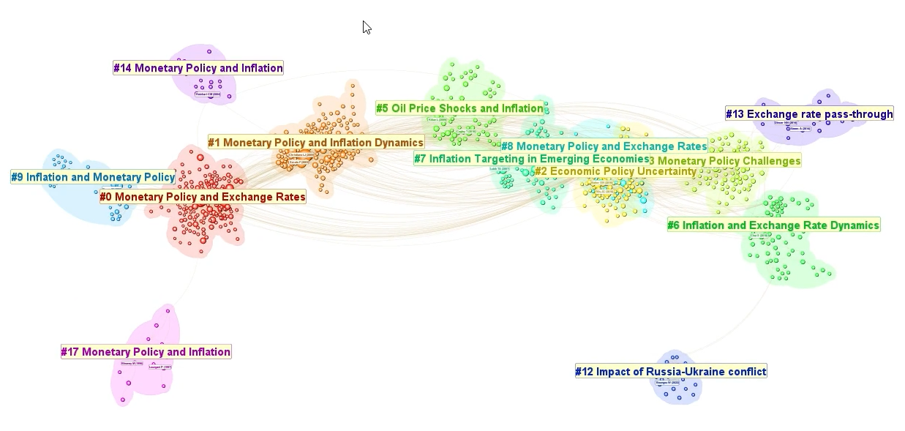
图7-1 CiteSpace知识图谱示例。该图以货币政策与通货膨胀研究为例，主干聚类涉及货币政策与汇率、油价冲击、经济政策不确定性和汇率传递，外围还出现俄乌冲突影响等较小聚类。不同大小和颜色的节点由连线组成多个主题群。阅读时应先确认节点类型、颜色所代表的时间切片、连线关系和聚类标签，再判断主干与边缘主题；不能仅凭节点大或位置居中就称其为“最重要研究”。


图7-2 VOSviewer网络图示例。该图呈现生物学与科学教育研究的关键词关系，“evolution（进化）”位于网络中心，并连接“nature of science（科学本质）”“teacher education（教师教育）”“science education（科学教育）”“bioinformatics（生物信息学）”等主题。不同颜色表示算法识别的群组，节点大小显示所选权重，连线和空间距离表达当前设置下的关联强弱。跨色连线说明主题并非互不相干，聚类名称仍需结合代表文献人工概括。

### 第六步：回读代表文献并验证标签

每个聚类至少选择若干代表文献，核对它们的研究对象、理论、方法和发现。代表文献可以综合考虑聚类内连接、被引量、时间位置和内容典型性，而不应只取最高被引的一篇。自动生成的聚类标签若过宽、过窄或偏离内容，可以在保留原标签记录的同时，用人工概括的名称报告。

### 第七步：把结果写成“证据—解释—边界”

结果段落应先说明观察到什么，再解释可能意味着什么，最后限定结论。例如：“2019—2022年聚类A以技术接受和使用意愿为主，2023年后聚类B中的评价素养与伦理治理词频上升。代表论文显示，研究问题正从采纳意愿扩展到教学整合与风险治理。由于数据仅覆盖所选数据库和检索式，该变化不能代表全部教师教育研究。”这比“图谱显示该领域蓬勃发展”更可核验。

## 7.6 常用分析工具怎样选择

### CiteSpace：时间切片、突现与知识演化

CiteSpace常用于共被引、关键词共现、突现检测、聚类和时间线分析，适合观察一个知识结构怎样在时间中形成。[CiteSpace官方网站](https://citespace.podia.com/)持续提供软件与学习材料，具体版本和菜单会更新，教材更应掌握时间切片、节点类型、突现和聚类解释的原理。

使用CiteSpace时，数据字段必须与分析类型匹配。若某中文数据库导出记录不含参考文献，便不能仅凭题名和关键词完成严格的共被引分析。混合不同来源时，还要检查作者、机构、来源缩写和参考文献格式是否能够统一。

### VOSviewer：关系网络与清晰可视化

[VOSviewer官方网站](https://www.vosviewer.com/)将其定位为构建和可视化文献计量网络的工具，可处理引用、文献耦合、共被引、合作和术语共现等关系。它的网络视图、叠加视图和密度视图适合分别观察结构、时间或其他得分、以及局部聚集程度。导入来源与功能会随版本更新，使用时应查看官方手册，而不是沿用旧版界面或固定清单。

VOSviewer看似容易上手，但计数方式、最低出现次数、同义词表和布局设置都会改变结果。截图之外还应保存映射文件、网络文件、同义词表和参数记录，使他人能够重新生成图谱。

### bibliometrix与Biblioshiny：从界面探索到脚本复现

[bibliometrix](https://www.bibliometrix.org/)是R环境中的开源科学计量分析工具，Biblioshiny则提供图形化界面。初学者可以用Biblioshiny了解描述统计、来源、作者、概念结构和主题演化，再逐步把关键步骤转为R脚本。安装入口可以很简单：
```r
install.packages("bibliometrix")
```

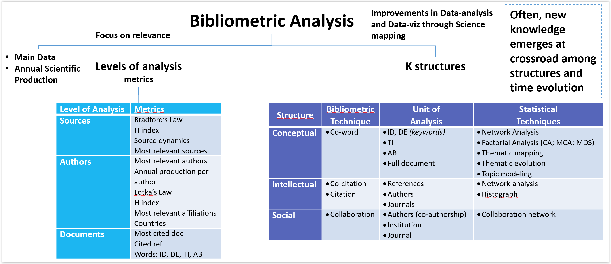
图7-3 bibliometrix与Biblioshiny的分析框架示例。图中以数据导入为起点，将描述性分析、知识结构分析和网络分析组织成多个模块，并列出可生成的表格和图形。它说明一次分析不是单张网络图，而是由数据转换、统计描述、关系建模和结果输出组成的流程。

脚本路径的优势是能保存数据转换、筛选条件、函数参数和图形代码。可复现并不意味着结果一定正确，但它使错误更容易被发现，也使修改检索范围后能够重新运行，而不是手工重复所有界面操作。

### ITGinsight：多类科技文本的可视化挖掘

ITGinsight案例说明，信息计量可以扩展到论文、专利、报告和网络文本。此类工具可以构建合作、共现、耦合、引用与演化关系，并输出网络、热力、密度、地图和矩阵等图形。其价值不在于把所有文本“装进同一软件”，而在于针对不同对象定义可比较的字段和关系。

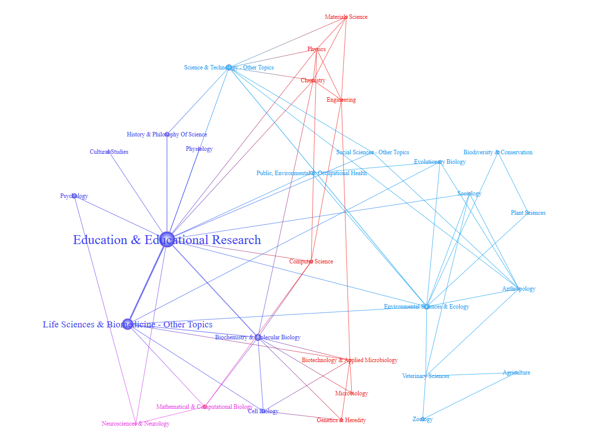
图7-4 ITGinsight网络图示例。图中“Education & Educational Research（教育与教育研究）”和“Life Sciences & Biomedicine（生命科学与生物医学）”是较大的节点，并与心理学、计算机科学、公共卫生、环境科学、材料科学等学科形成跨域连线。图像可用于发现学科枢纽和局部群组，但必须说明节点、颜色、连线和边权的计算方式。

论文引用、专利引用和社交媒体转发的产生机制不同，即使都能画成连线，也不能直接放进同一网络比较。多源分析宜采用分层呈现：先分别构建各类网络，再通过共同标识符、机构或主题建立有限连接。

表7-6 常用分析工具的任务导向比较

| 工具 | 较适合的任务 | 可复现资产 | 学习重点 | 主要风险 |
| --- | --- | --- | --- | --- |
| CiteSpace | 突现、时间线、共被引聚类、知识演化 | 项目文件、参数、原始与清洗数据、图表 | 时间切片、节点类型、聚类质量和突现解释 | 只看自动标签，忽略字段兼容性 |
| VOSviewer | 合作、共词、耦合、共被引的网络与密度展示 | map/network文件、词表、参数、图表 | 计数方式、阈值、距离与聚类含义 | 为追求清晰任意删节点 |
| bibliometrix/Biblioshiny | 描述统计、科学知识结构、主题演化与可复现分析 | R脚本、会话信息、数据和输出 | 数据转换、函数参数、统计与图谱衔接 | 只保存界面截图或代码不核验含义 |
| ITGinsight等多源工具 | 论文、专利、报告等科技文本的关系挖掘 | 数据字典、来源映射、分析规则 | 不同对象的字段与关系定义 | 把不同来源的行为痕迹当成同一种关系 |

没有“对所有任务最好的软件”。课程作业可用一款工具完成清晰的小问题；论文研究则可组合使用，例如用bibliometrix完成描述统计和可复现清洗，用VOSviewer呈现网络，再回到文献管理软件精读代表论文。组合工具时要保证同一数据版本、同一清洗规则和可追踪的中间文件。

## 7.7 平台型工具怎样辅助前沿观察

本地软件通常由研究者准备数据和参数，平台型工具则把数据库、分类体系、指标和可视化预先整合。平台能快速提供宏观线索，但用户对底层语料和算法的控制更少，因此更需要阅读方法说明。

### ESI：从高被引论文观察宏观表现与研究前沿

Essential Science Indicators（ESI）基于Web of Science核心合集中的特定文献类型和引文数据，按较宽的研究领域提供高被引论文、热点论文、机构和国家等分析。[ESI官方帮助](https://esi.help.clarivate.com/Content/overview.htm)说明其使用滚动时间窗并定期更新，具体纳入年限和更新时间应以当期页面为准。

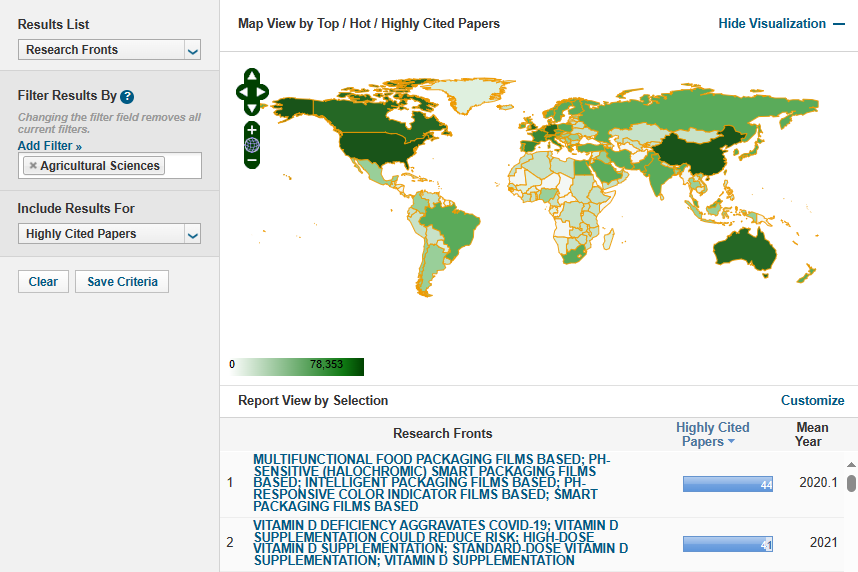
图7-5 ESI相关界面示例。页面同时呈现世界地图、国家或机构列表、论文指标和高被引记录，用于从宏观层面定位活跃区域与代表成果。地图深浅和排名反映的是平台规定口径下的数量或影响痕迹，不能脱离学科覆盖、时间窗和文献类型解释。

ESI研究前沿通常以高被引论文之间的共被引关系形成聚类，再根据聚类论文概括主题。高被引论文筛选使它适合观察受到显著引用关注的方向，却可能弱化尚未积累引用的新研究、小语种研究和地方性议题。前沿名称只是进入聚类的入口，仍应阅读核心论文并核对研究内容。

### SciVal：Topic、Topic Cluster与Prominence

SciVal基于Scopus数据提供研究表现、合作和趋势分析。[SciVal Topics官方说明](https://www.elsevier.com/products/scival/overview/topics)指出，Topics通过直接引用关系把论文组织为主题，并进一步汇集为更宽的Topic Clusters；在这套分类中，一篇论文归入一个Topic，一个Topic归入一个Topic Cluster。这种“唯一归类”便于统计，但现实论文可能横跨多个问题，因此平台分类不应被当成唯一学科身份。

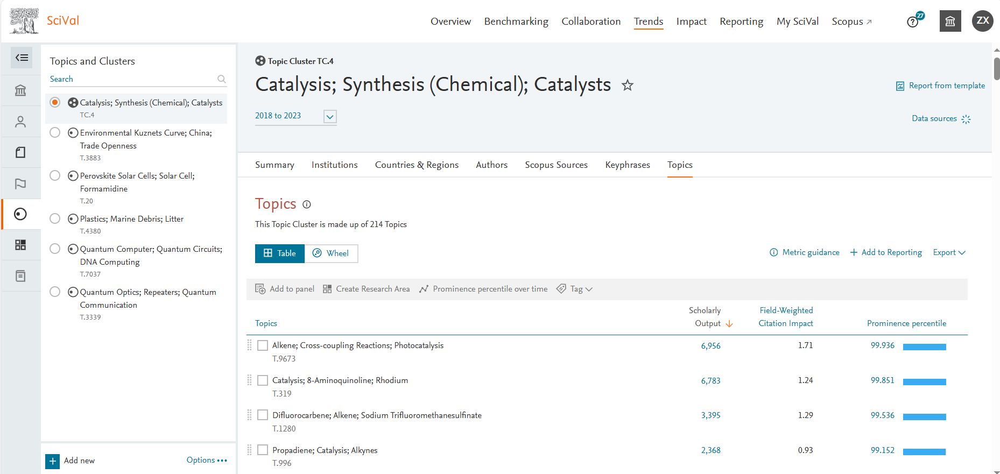
图7-6 SciVal主题列表示例。界面正在查看“催化、化学合成与催化剂”Topic Cluster，左侧列出其他主题群，右侧表格显示其下属Topics，并列出学术产出、领域加权引用影响和Prominence百分位等指标。读者应先查看主题的构成论文和指标定义，再判断某个高排名主题是否与自己的问题相关。

Topic Prominence用于描述主题近期的发展势头与可见度，综合近期引文、浏览和来源平均CiteScore等信号。它回答的是“哪些主题当前更受关注”，不是“哪些主题在理论上最重要”。平台还可标记近期快速形成的新主题，但新出现也可能来自数据库更新、术语替换或短期事件，需要连续观察和内容验证。

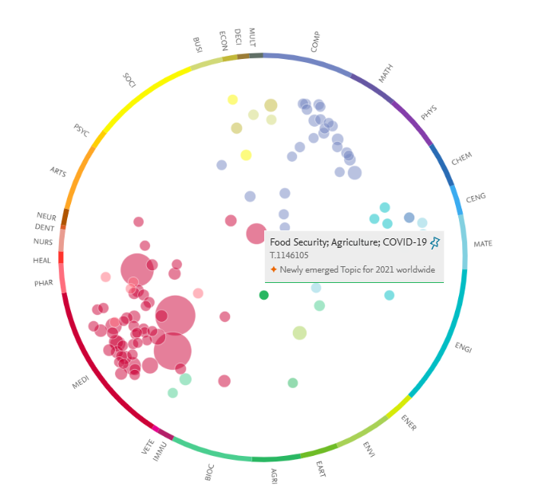
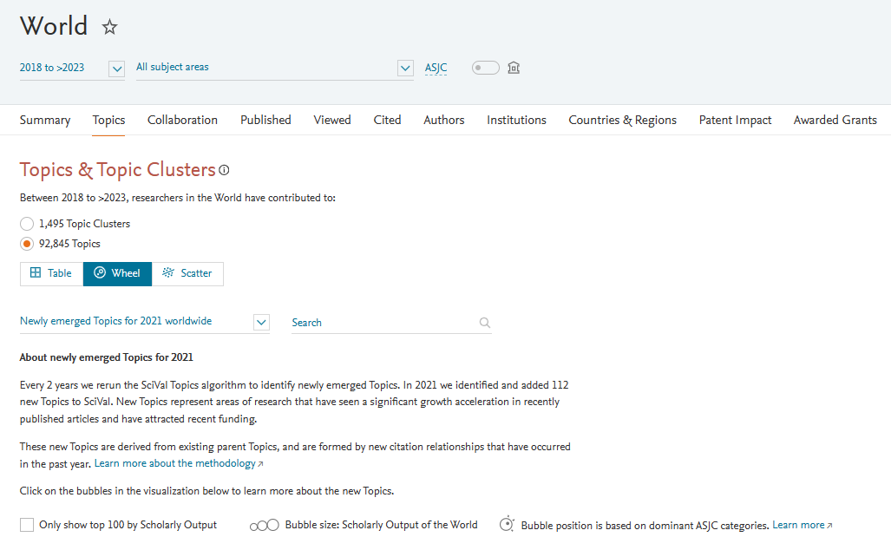
图7-7 SciVal新兴主题的图形与文字说明。第一幅圆形图把大量主题放入学科全景，其中“粮食安全—农业—COVID-19”被标为新出现主题；圆周缩写表示学科区域，气泡位置和大小承担相应的分类与产出含义。第二幅页面说明世界范围新兴主题的识别与图形读取方式。正确流程是先理解平台口径，再进入主题核查构成论文，而不是直接依据圆点大小命名研究前沿。

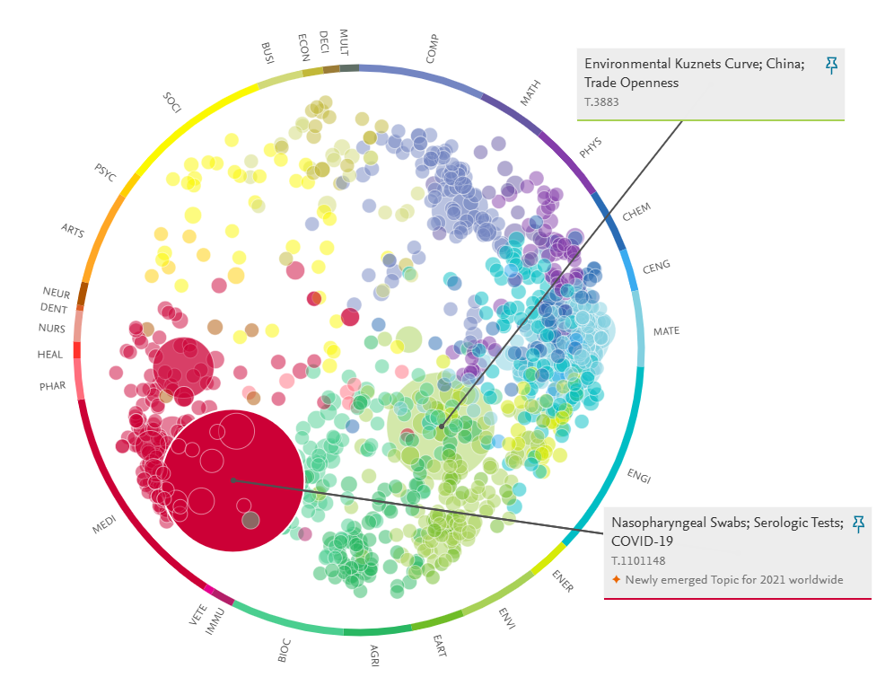
图7-8 本地文献集合的主题映射示例。圆形图把主题按学科区域排列，标注框分别指向“环境库兹涅茨曲线—中国—贸易开放”和“鼻咽拭子—血清学检测—COVID-19”等主题，直观显示同一批数据可能横跨环境、医学和其他方向。映射结果同时受本地检索范围和平台分类影响，未被映射的论文也应检查原因。

### Research Horizon Navigator：新兴主题的早期信号

[Research Horizon Navigator](https://clarivate.com/academia-government/scientific-and-academic-research/research-funding-analytics/incites-benchmarking-analytics/research-horizon-navigator/)是InCites中的研究前沿分析模块，利用近期引用活动和跨学科关系发现新兴主题，并通过自动化方法生成主题名称；平台可把主题进一步带入Web of Science或InCites分析。自动命名提高了浏览效率，但标签可能概括不准，尤其是方法术语相近而研究对象不同的主题。


图7-9 Research Horizon Navigator主题入口示例。表格列出“提升系统综述的方法质量与报告规范”“文献计量与可持续研究的跨学科趋势”等新兴主题，并同时给出主学科、论文数、平均共引年份、跨学科程度、核心论文和共引论文。列表用于多条件筛选和排序，不是对未来突破的确定预测。

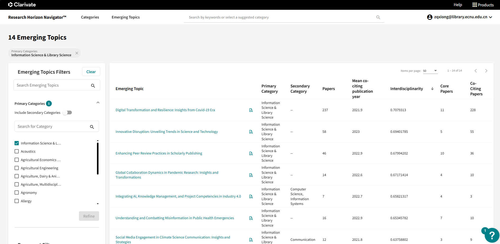
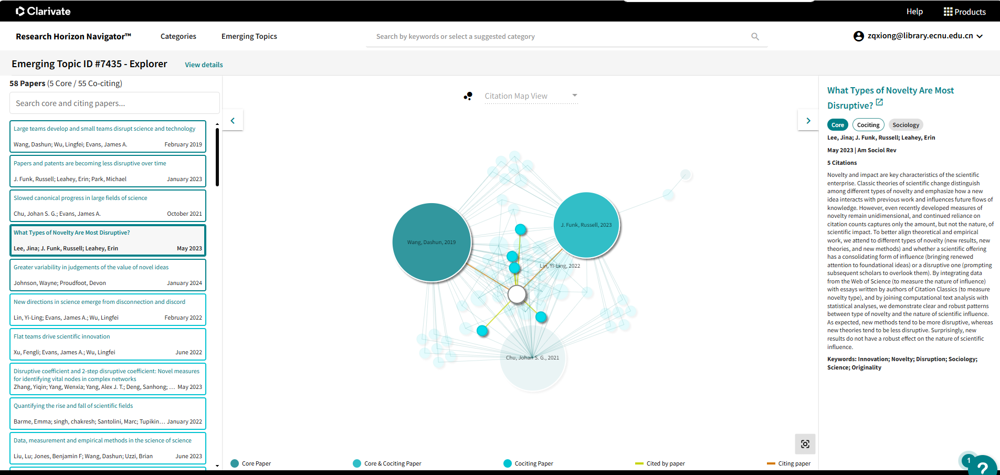
图7-10 从新兴主题列表到主题详情。第一幅图在“信息科学与图书馆学”类别下列出数字化转型、同行评议、错误信息和人工智能知识管理等14个新兴主题；第二幅图进入“创新颠覆”主题，用引文网络连接核心论文与共引论文，并在右侧展示所选论文摘要。分析时应核查核心论文、主题年龄、学科构成和引用增长来源，并把平台结果表述为“早期信号”或“候选方向”。

表7-7 三类平台的适用层级与边界

| 平台 | 数据与组织方式 | 适合用途 | 使用边界 |
| --- | --- | --- | --- |
| ESI | Web of Science引文数据、宽学科与高被引论文聚类 | 宏观表现、高被引成果和研究前沿入口 | 高被引筛选、宽学科分类和时间窗会影响结果 |
| SciVal | Scopus数据、直接引用形成Topic与Topic Cluster | 主题定位、发展势头、机构和合作分析 | Prominence不是质量或重要性的同义词 |
| Research Horizon Navigator | Web of Science/InCites体系中的近期引文与跨学科信号 | 新兴主题监测、从主题进入论文和机构 | 自动命名与早期信号需要人工校验，不能保证未来突破 |

平台指标会更新，访问权限也依赖机构订阅。书稿不应固定记录某一天的主题总数或界面按钮，而应要求读者在使用时保存查询日期、平台版本说明、筛选条件和导出结果。

## 7.8 Connected Papers与ResearchRabbit：从种子论文扩展阅读

Connected Papers和ResearchRabbit不主要用于对完整语料做规范的文献计量报告，而更适合从一篇或一组种子论文开始探索相近研究。它们把复杂的引用关系转化为可交互的阅读路径，连接了第五章的前沿探索、第六章的文献管理与本章的关系网络。

### Connected Papers：相似性图不是引用树

[Connected Papers官方介绍](https://www.connectedpapers.com/about)说明，其图谱相似度主要结合共被引和文献耦合信息，并不是简单把“谁引用谁”画成一棵树。两篇论文即使没有直接互引，只要共享许多参考文献或经常被共同引用，也可能彼此接近。

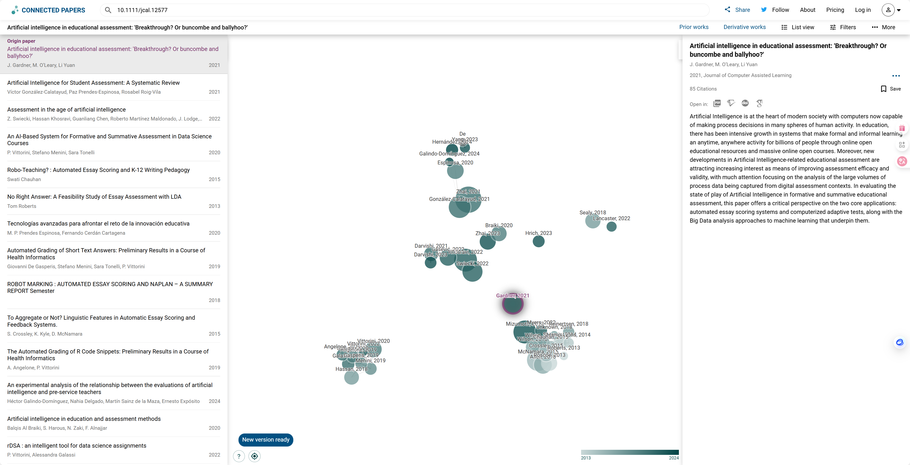
图7-11 Connected Papers界面示例。图谱以“教育评价中的人工智能”为种子论文，左侧列出自动评分、形成性评价等相近研究，中间把文献组织为若干相似性群组，右侧显示种子论文摘要与来源。该图适合补充同义术语和相邻研究，但仍要逐篇判断是否满足纳入标准。

### ResearchRabbit：把一次搜索变成持续发现

[ResearchRabbit](https://www.researchrabbit.ai/features)允许用户建立论文集合，并沿作者、概念、引用和参考文献关系继续探索。当集合加入一篇新论文后，推荐网络会随之改变，适合长期追踪一个正在发展的课题。

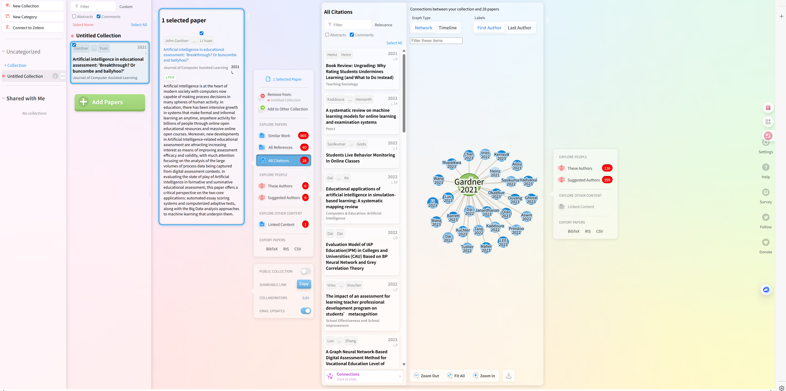
图7-12 ResearchRabbit界面示例。图中同样选择“教育评价中的人工智能”作为种子论文，左侧建立集合并显示论文详情，中部列出其引用文献，右侧网络以Gardner（2021）为中心连接后续引用者，还可切换网络与时间线。它适合发现遗漏线索和建立阅读队列，但推荐结果受种子集合与平台覆盖影响。

二者都不能单独证明系统综述的检索完整性。系统性检索需要预先设计数据库、检索式、日期、筛选与去重流程；推荐工具可以作为补充检索，并记录“由哪篇种子论文、在哪一天、通过哪种关系发现”。

## 7.9 贯穿案例：生成式人工智能与教师教育

下面把前述原则组织成一项可执行的小型研究。案例目标不是预先制造一幅“漂亮图谱”，而是回答三个相互关联的问题：该领域的主题怎样变化，近期研究形成哪些分支，主要合作网络具有怎样的结构。

表7-8 案例的“问题—数据—方法—验证”设计

| 子问题 | 必要字段 | 方法 | 主要输出 | 原文验证重点 |
| --- | --- | --- | --- | --- |
| 主题怎样演化 | 题名、摘要、关键词、年份 | 共词网络、时间分段、突现 | 高频词、聚类、时间线 | 同义词是否合并，主题标签是否符合代表论文 |
| 近期研究形成哪些分支 | 参考文献、年份、DOI | 近三年文献耦合 | 分支网络、核心论文、共享知识基础 | 同一分支中的问题与方法是否真的相近 |
| 主要合作结构是什么 | 作者、机构、国家、年份 | 合著与机构合作网络 | 团队、桥接机构、跨国连线 | 名称消歧，超大团队和单篇合作的影响 |

具体操作可分为十步。

1. 写出主题边界，区分生成式人工智能、一般人工智能、智能辅导系统与学习分析。
2. 设计中英文检索词，在选定数据库中试检，阅读样本文献后修订词表。
3. 固定检索日期、时间范围、文献类型和数据库，保存完整检索式与结果数量。
4. 导出题名、摘要、关键词、作者、机构、年份、来源、DOI和参考文献；若字段缺失，调整分析计划。
5. 保留原始导出，建立跨库去重规则和中英文术语表，记录所有合并与删除。
6. 先做年份、来源、缺失值和文献类型统计，确认语料没有明显断层。
7. 分别构建共词、耦合和合作网络，选择计数、阈值与时间窗，并做至少一次参数敏感性比较。
8. 每个主要聚类选择代表文献，回读题名、摘要和全文，修订自动标签。
9. 用“观察—解释—限制”写每个结果段，避免把相关网络写成因果关系。
10. 归档检索式、原始数据、清洗表、同义词表、参数、软件版本、网络文件、图表和代表文献清单。

结果报告可以使用如下句式框架：“在数据库A、时间段B和检索式C形成的N条记录中，采用分数计数与最低出现次数T构建关键词网络，共保留M个词并形成K个聚类。聚类1由词项X、Y、Z及代表文献P、Q支持，主要讨论……。改变阈值后主干结构保持/发生变化，说明……。由于语料未覆盖……，本结果只描述……。”这个框架把数据口径、方法参数、结果证据和解释边界放在同一段中。

## 7.10 负责任地解释和使用指标

### 让定量评价支持而不是替代专业判断

[《莱顿宣言》](https://www.nature.com/articles/520429a)提出的核心方向是让定量评价支持质性与专家判断，结合机构使命，考虑学科差异，保持数据与计算透明，允许被评价者核验，并定期检查指标体系。这些原则不仅适用于机构排名，也适用于课程论文中的图谱解释。

负责任使用指标可以转化为六项实践：用多个指标观察同一问题；把原始数量与归一化结果并列；公开数据库、检索式和时间窗；允许名称与记录错误被修正；用代表文献验证自动标签；对可能诱发“追指标”行为的评价方案进行反思。一个指标一旦成为奖惩目标，研究者就可能调整署名、引用和发表策略来适应指标，指标与原始目标之间的关系也会改变。

### 十类常见错误

1. **问题与方法错位**：想解释政策因果，却只画发文量曲线。
2. **把数据库当作全部文献**：忽略语种、地区、文献类型和收录政策。
3. **字段不支持方法**：没有参考文献字段仍进行共被引或耦合分析。
4. **实体未经清洗**：作者、机构和关键词变体被当成多个节点。
5. **混合来源不校准**：把不同数据库的字段结构和覆盖范围直接拼接。
6. **参数只为美观服务**：不断改变阈值，直到出现预想中的聚类。
7. **把颜色当结论**：自动聚类名称未经代表文献验证。
8. **把相关写成因果**：网络接近、同时增长或共同出现被描述为相互导致。
9. **把关注度当质量**：高被引、高下载、Prominence或新兴主题被当作价值裁决。
10. **无法复现**：只保存一张图片，没有原始数据、清洗规则、参数和软件信息。

表7-9 文献计量结果的最小报告清单

| 模块 | 最少报告内容 |
| --- | --- |
| 问题 | 研究对象、分析单位、概念边界和预期回答 |
| 数据 | 数据库、检索式、日期、时间范围、类型、语言、原始与去重数量 |
| 清洗 | 去重、作者/机构消歧、同义词、停用词、缺失字段处理 |
| 方法 | 关系类型、计数、阈值、时间切片、归一化、聚类和软件版本 |
| 结果 | 网络规模、主要聚类、代表节点、统计表与图例说明 |
| 验证 | 代表文献回读、标签修订、参数敏感性或跨方法核对 |
| 边界 | 数据库覆盖、引用时滞、学科差异、算法限制和不可作出的推断 |
| 归档 | 原始数据、清洗数据、词表、代码/参数、输出文件与查询日期 |

## 本章小结

信息计量把文献、作者、机构、关键词和参考文献转化为可分析的分布与关系。文献增长、老化、长尾分布和累积优势说明指标并不是均匀、即时和纯粹的质量信号；直接引用、共被引、文献耦合、共词和合作网络则从不同角度回答知识基础、近期分支、主题结构和社会协作问题。

CiteSpace、VOSviewer、bibliometrix/Biblioshiny和ITGinsight等工具各有侧重，ESI、SciVal和Research Horizon Navigator提供平台化的宏观线索，Connected Papers与ResearchRabbit适合从种子文献扩展阅读。无论使用哪种工具，可靠分析都遵循同一主线：问题先于软件，字段先于算法，清洗先于制图，代表文献先于标签，证据边界先于结论。图谱的价值不是替代阅读，而是帮助研究者更有依据地决定读什么、比较什么和继续追问什么。

## 思考与练习

1. 选择“被引次数”“下载次数”和“政策文件引用”三个指标，分别说明它们记录的行为、适合解释的影响维度和最容易产生的误读。
2. 用三篇假想论文画出直接引用、共被引和文献耦合关系，并说明为什么共被引更偏向知识基础、耦合更适合近期研究分支。
3. 从一个数据库导出不少于50条主题文献，检查题名、关键词、作者、机构、年份和参考文献字段，列出哪些分析可做、哪些分析因字段不足暂时不能做。
4. 为同一批关键词分别设置两个合理的最低出现次数阈值，比较网络规模、聚类和代表词是否改变，并说明最终阈值的依据。
5. 用VOSviewer或CiteSpace制作一张图谱，为图中节点、连线、大小、颜色、距离和阈值写完整图注；再选择一个聚类回读至少三篇代表文献，修订自动标签。
6. 使用Biblioshiny完成一次描述统计，再尝试保存相应的R脚本或完整操作记录，说明“可重复点击”和“可复现分析”的差别。
7. 在ESI、SciVal或Research Horizon Navigator中任选一个平台，记录查询日期、数据口径、主题定义和指标含义，判断平台给出的一个方向应称为“热点”“前沿候选”还是“确定趋势”。
8. 以同一篇种子论文分别使用Connected Papers和ResearchRabbit扩展阅读，记录新增论文从何种关系被发现，并与数据库主题检索结果比较遗漏与偏差。
9. 设计一项评价“某教师发展计划是否促进跨机构合作”的研究，列出描述性计量能够提供的证据、因果判断还缺少的设计以及可能的混杂因素。
10. 按表7-9审查一篇公开发表的文献计量论文，判断其数据、清洗、参数、验证和局限信息是否足以让他人复核。
