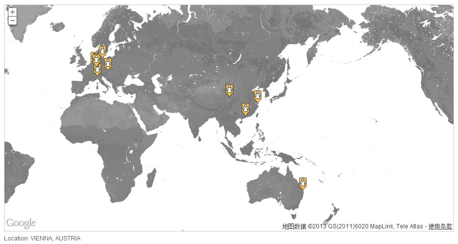
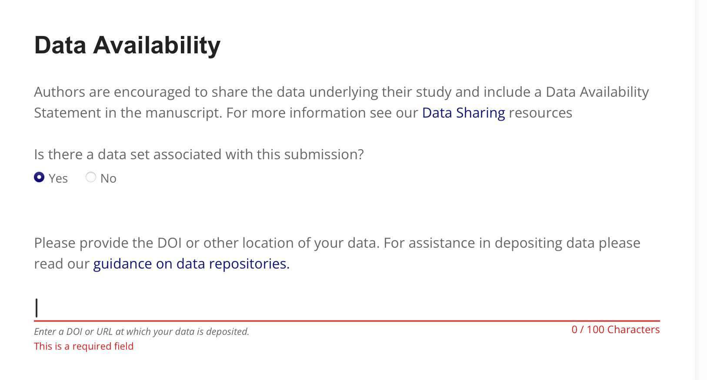

# 第八章 数据素养基础

数据素养不是数据科学专业学生的专属能力。任何学科只要需要观察、比较、解释和决策，就会遇到数据。教育研究者要理解学生学习、教师发展、课程改革和教育政策，既要会阅读文献，也要会理解数据从哪里来、代表什么、能说明什么、不能说明什么。本章的目标，是帮助读者建立数据意识，而不是一开始就陷入复杂模型。

## 为什么每个学科都需要数据素养

数据能为传统问题提供新的视角。文学研究可以通过词频、句法和风格特征讨论作者归属；语言学可以利用语料库分析语言使用规律；新闻传播可以用数据讲述公共议题；教育学可以通过问卷、课堂观察、平台日志和学习结果理解学习过程。数据素养的价值不在于把所有问题都变成数字，而在于让证据更加可检查。



图8-1 科学论文下载时间和地点可以被转化为研究数据。读者应注意，许多日常行为记录只要经过合理组织，就可能成为分析科学活动或学习行为的证据。

以高中生物课中的植物光合作用实验为例，学生不仅要观察植物生长，还要设计实验、控制变量、记录光照强度、生长速度、叶绿素含量和二氧化碳吸收量，再通过统计和图表解释结果。这个过程包含实验设计、数据收集、数据处理、数据分析、数据可视化、数据解释和科学沟通。数据素养正是贯穿其中的一组能力。

## 什么是数据

数据是事实或观察的记录。它可以是数字，也可以是文本、图像、音频、视频、地理位置、点击日志和实验记录。数据本身不等于信息，更不等于结论。只有当数据被放入特定问题、经过整理和解释之后，才可能转化为信息和知识。

常见数据文件格式包括Excel文件（`.xls`、`.xlsx`）、文本文件（`.txt`、`.csv`、`.tsv`、`.dat`）、统计软件文件（如SPSS的`.sav`、Stata的`.dta`）以及JSON、XML等半结构化格式。文件后缀能够提示我们数据可能使用什么软件打开，但不能保证数据质量。真正重要的是字段含义、采集方式、变量类型和缺失规则。

## 数据集、变量与观测

数据集是一组按规则组织的数据，可以是结构化表格、半结构化文件，也可以是文本、图像和音频集合。教育研究中最常见的是数据框：每一列对应一个变量，每一行对应一个观测样本，每一个单元格是某个样本在某个变量上的观测值。

变量是可被测度的属性或特征。数值型变量可以连续或离散，如成绩、年龄、学习时长；类别型变量用于分组，如性别、年级、学校类型；二元变量只有两个取值，如是否通过、是否使用某平台。理解变量类型，是选择统计方法和图表类型的前提。


图8-2 数据框把研究对象、变量和观测值组织在同一张表中。分析前应确认每一列的含义和类型。

## 分析之前先理解数据

数据分析之前，应先回答几个问题：数据由谁采集，何时采集，在何地采集，采集对象是谁，采集目的是什么，变量如何定义，是否存在缺失、重复和异常，样本能否代表总体。这些问题看似基础，却决定后续结论是否可信。

辛普森悖论提醒我们，整体趋势可能与分组趋势相反。如果忽略年龄、性别、地区、学科和时间等关键分层变量，就可能得出错误结论。幸存者偏差则提醒我们，只分析“被观察到的成功案例”会遗漏失败样本。教育研究中，若只调查愿意填写问卷的学生、只分析留存平台的用户、只研究发表论文的成功者，都可能产生偏差。

## 数据获取途径

数据来源可以分为自有数据、论文数据、商业数据库、政府数据库、国际组织数据库、开放数据仓储和软件自带数据集。自有数据包括问卷、访谈、观察和爬取数据；论文数据包括数据论文、论文附带数据和补充材料；政府和国际组织数据适合宏观比较；开放数据仓储适合寻找可复用数据；软件自带数据集适合练习分析方法。



图8-3 数据获取途径多样，但每一种数据都有产生机制和使用限制。选择数据源时应同时考虑权威性、适配性和可解释性。

对教育研究而言，数据获取不能只追求数量。问卷数据要考虑样本来源和量表质量；平台日志要考虑记录规则和隐私；政府统计数据要考虑口径变化；开放数据要阅读许可协议；爬取数据要遵守网站规则和伦理边界。

## R作为数据分析入口

R是一种常用于统计分析和可视化的开源语言。学习R的意义不只是掌握代码，而是建立可复现的数据分析习惯。安装包、加载包、设置路径、读取数据、清洗变量、拟合模型和绘图，都可以保存在脚本中。脚本让分析过程可以被重新运行，也能让别人检查每一步。
```r
install.packages("ggplot2")
library(ggplot2)
data("mtcars")
plot(mtcars$wt, mtcars$mpg)
```

这段代码本身并不复杂，但它体现了一种思维：数据、代码和图形之间存在可追踪关系。与手工操作相比，代码更适合保存、修改和复现。

## 从描述统计到机器学习

数据分析可以从描述性统计开始。均值、中位数和众数描述集中趋势，全距、方差、标准差和四分位数描述离散程度，偏度和峰度帮助观察分布形态。进一步的回归分析用于预测或解释变量关系，可视化用于揭示趋势和模式，机器学习则可以完成分类、回归和预测任务。

初学者不必畏惧代码和模型。更重要的是理解完整流程：获得数据、探索性分析、数据预处理、训练与验证、模型建立、性能评价和结果解释。任何模型都不能脱离数据质量和研究问题。

## 数据素养与教育研究问题

教育研究中的数据素养还体现在问题转化能力上。一个自然语言问题通常需要转化为数据问题，才能进入分析。例如，“学生是否喜欢在线学习”需要进一步转化为学习满意度、学习投入、平台使用频率、学习效果和继续使用意愿等可观测变量；“某项政策是否有效”需要明确政策实施时间、受影响对象、比较对象和结果指标。

这种转化并不只是技术问题，而是理论问题。变量选择会决定研究者看到什么，也会决定看不到什么。若只用考试成绩衡量学习效果，可能忽略学习兴趣、合作能力和长期发展；若只用平台登录次数衡量学习投入，可能误把被动刷课当成主动学习。因此，数据素养要求研究者在编码和建模之前，先反思数据能否代表研究对象。

## 常见误区

第一，把数据等同于数字，忽视文本、图像和行为日志。第二，在不了解变量口径时直接建模。第三，只看总体结果，不看分组差异。第四，把相关关系解释为因果关系。第五，只保存结果，不保存代码和数据说明。第六，认为AI生成代码后就不需要理解分析逻辑。

## 本章小结

数据素养是一种从问题出发理解、获取、管理、分析、解释和沟通数据的能力。它要求研究者既能看到数据的价值，也能看到数据的边界。对于教育研究而言，良好的数据素养意味着在分析之前理解数据，在分析之中保持可复现，在分析之后谨慎解释结论。

## 思考与练习

1. 选择一个教育问题，说明可以收集哪些类型的数据。
2. 找一个开放数据集，识别其中的数值型变量、类别型变量和二元变量。
3. 用一个例子说明辛普森悖论或幸存者偏差如何影响教育研究。
