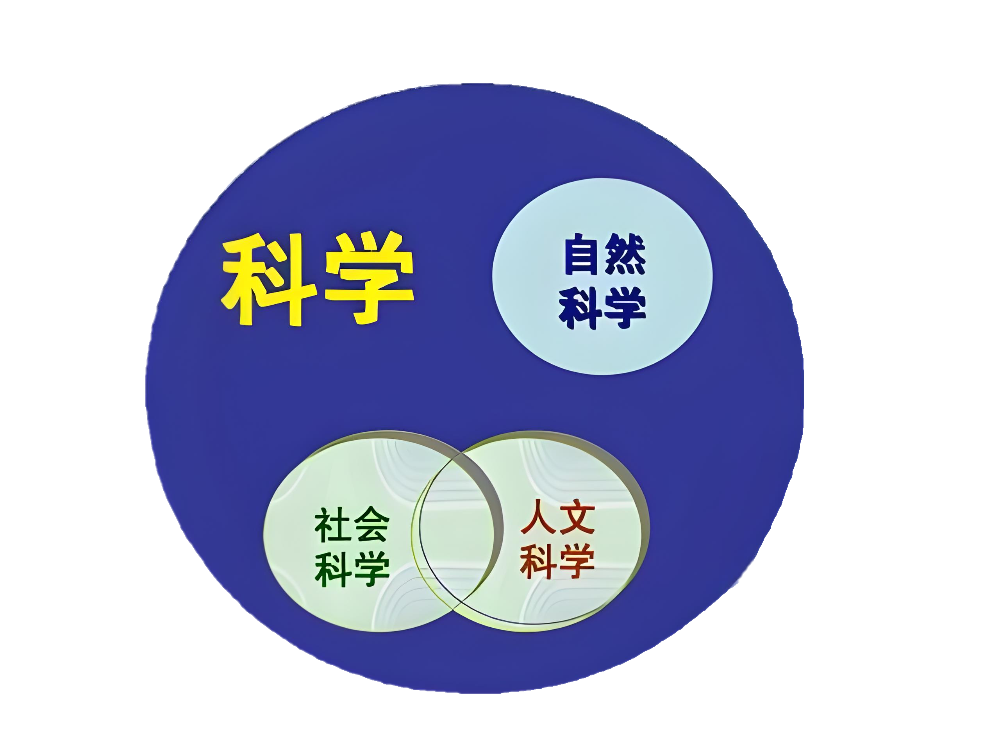
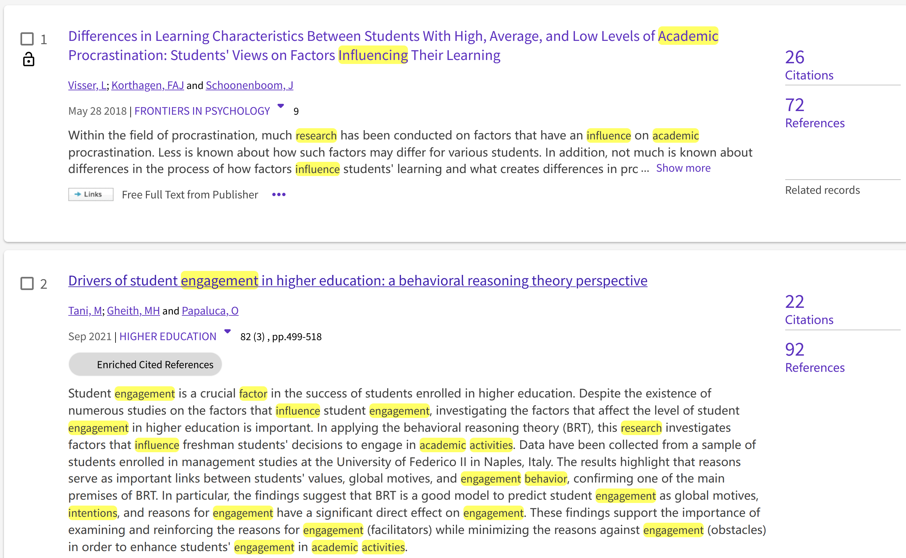

# 第九章 数据检索与获取

数据获取是数据分析的起点。没有合适的数据，再复杂的模型也无法产生可靠结论。本章把数据获取放在教育研究的典型场景中展开：一方面介绍论文数据、政府数据、开放数据和软件自带数据集等二手数据来源；另一方面重点说明问卷调查这一常见一手数据获取方式。教育研究常常以人、课堂、学校和社会问题为对象，因此数据获取必须同时考虑研究问题、测量质量、样本代表性和伦理边界。

## 从研究问题出发获取数据

数据不是越多越好，而是越适配越好。研究“大学生科研参与行为”时，首先要界定研究对象，是所有大学生，还是本科高年级学生、研究生、师范生或特定高校学生；其次要界定核心概念，科研参与是参加项目、主持项目、发表论文、进入实验室，还是具有科研意愿；再次要判断研究目的，是描述现状，解释影响因素，还是预测行为倾向。只有这些问题清楚，才知道需要什么数据。

图9-1 问卷研究不是从设计题目开始，而是从研究问题、研究对象和核心概念开始。

## 二手数据来源

二手数据包括论文附带数据、数据论文、商业数据库、政府数据库、国际组织数据库、开放数据仓储和软件自带数据集。论文数据可以来自Scientific Data、Data in Brief、中国科学数据等数据期刊，也可能以补充材料形式附在普通论文之后。政府数据如国家统计局、地方公共数据开放平台和国家知识产权局数据，适合宏观教育政策、人口、经济和创新环境研究。国际组织数据库如OECD、UN、IMF等适合跨国比较。

开放数据仓储如Mendeley Data、Figshare、Zenodo、Kaggle以及期刊推荐仓储，常常提供数据文件、说明文档和引用信息。使用时必须阅读变量说明、采集过程、许可协议和版本信息。软件自带数据集适合训练方法，例如R包中的示例数据可用于学习数据读取、描述统计、可视化和模型建立。

## 问卷调查法的定位

问卷调查法是调查者通过问卷向对象询问其社会生活状况、行为、态度、看法和意愿，并进行记录和分析的方法。它广泛用于学术研究、市场调查和民意调查。问卷可用于描述“是什么、怎么样”，也可用于解释“为什么”，还可在一定条件下用于预测行为倾向。

问卷并非万能。它适合收集标准化信息，不适合深入理解复杂情境中的细微互动；它能描述自我报告的态度和行为，但不一定等同于真实行为。若研究问题需要过程性材料、深度叙事或课堂互动细节，访谈、观察和文本分析可能更合适。

## 问卷设计流程

问卷设计可以分为八个步骤：提出研究问题，确定调查对象，完成概念化和操作化，设计问卷初稿，征求他人意见，开展预调查，根据预调查结果修改定稿，编制调查手册。每一步都服务于测量质量。

概念化是说明研究中的核心概念是什么，操作化则是把抽象概念转化为可测量指标。例如“科研参与行为”可以操作化为参与科研项目、主持项目、发表论文、参加学术会议、阅读学术文献等维度；“自主学习能力”可以通过目标设定、时间管理、资源利用、监控反思等题项测量。

图9-2 问卷设计需要经历问题界定、操作化、试测和修订。跳过预调查往往会导致题项歧义和数据质量问题。

## 量表与题项设计

主观性问题常用量表测量，如认知程度、满意度、认同程度和行为意愿。李克特量表常用5级或7级选项。若研究影响关系，通常每个潜变量至少设置多个题项，以便后续检验信度、效度或建立结构方程模型。

题项设计应扣题、简明、单一、避免诱导。一个题项只问一个问题，避免“双重问题”；选项应互斥且尽量穷尽；敏感问题应谨慎措辞；反向题可用于筛查一致性，但过多反向题可能增加理解负担。借鉴成熟量表时，应注明来源，并根据研究对象进行语言和情境调整。

## 抽样与样本量

抽样是从总体中按一定方式选择样本的过程。常见方法包括简单随机抽样、分层抽样、系统抽样和方便抽样。教育研究中由于现实限制，方便抽样很常见，但必须说明其局限。若研究结论要推广到更大总体，就需要更严格的抽样设计。

样本量可参考量表题数量、模型复杂度和已有研究。课程中常用的经验规则是样本量应大于量表题数量的若干倍；若使用结构方程模型，还要考虑潜变量数量、路径数量和模型稳定性。样本量不是越大越好，低质量大样本仍可能产生错误结论。

## 数据质量控制

问卷数据获取后，应先筛选有效数据。常见规则包括回答时间过短、答案高度一致、逻辑题不一致、关键题缺失和重复提交。反向题、条件筛选题和注意力检测题可以帮助识别低质量回答，但规则必须事先设定并在报告中说明。

问卷平台如问卷星等便于分发、回收和导出数据，可导出Word、Excel和SPSS等格式。但平台便利并不等于研究质量。研究者仍需控制样本来源、发放渠道、重复填写和数据安全。

## 问卷数据分析方向

问卷数据分析可分为描述统计、差异分析、相关与回归、结构方程模型、中介调节分析、权重研究和文本分析等方向。若只是了解现状，可使用频数、均值和交叉表；若比较不同群体，可使用差异检验；若研究影响关系，可使用回归或结构方程模型；若构建指标体系，可考虑AHP等方法。

图9-3 不同问卷研究目的对应不同分析方法。方法选择应由问题和数据类型决定，而不是由软件菜单决定。

## 数据获取记录表

无论使用二手数据还是问卷数据，都应建立数据获取记录表。记录表至少包括数据名称、数据来源、获取时间、采集对象、时间范围、变量清单、格式、许可条件、清洗需求和潜在偏差。对于问卷数据，还应记录发放渠道、回收数量、有效样本规则、伦理说明和是否包含敏感信息。

记录表看似繁琐，却能在写作方法部分时节省大量时间。很多论文的方法描述不清，并不是因为作者不知道自己做了什么，而是因为数据获取过程中没有及时记录。数据来源、时间范围和筛选规则一旦遗忘，后续分析就难以复核。

## 常见误区

第一，研究问题未界定清楚就开始写题项。第二，直接拼接多个量表，却不考虑对象和情境。第三，样本来源单一，却写出过度推广结论。第四，只关注样本量，不关注填写质量。第五，把平台自动图表当成研究结果。第六，在未获得同意和保护隐私的情况下收集敏感数据。

## 本章小结

数据获取是一项研究设计工作。无论使用开放数据、政府数据、论文数据，还是自行开展问卷调查，都必须从研究问题出发，理解数据产生机制，记录来源和采集过程，并处理伦理与质量控制问题。好的数据获取不是把数据拿到手，而是让数据能够真实、清楚、可解释地回答研究问题。

## 思考与练习

1. 为一个教育研究问题判断应使用二手数据、问卷、访谈还是混合数据。
2. 把一个抽象概念操作化为3个维度和9个题项。
3. 为问卷数据设计有效样本筛选规则。
