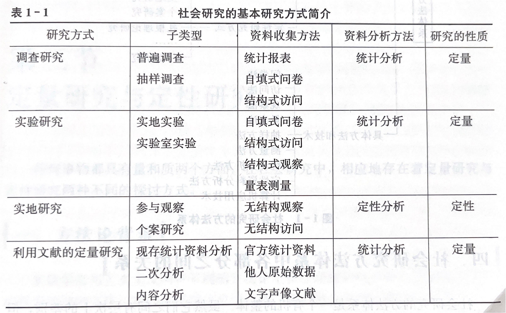
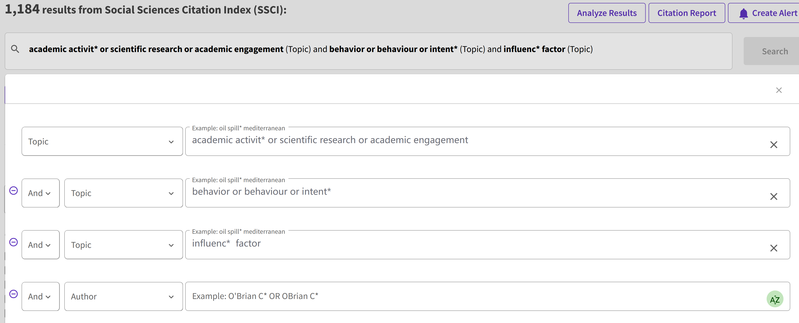
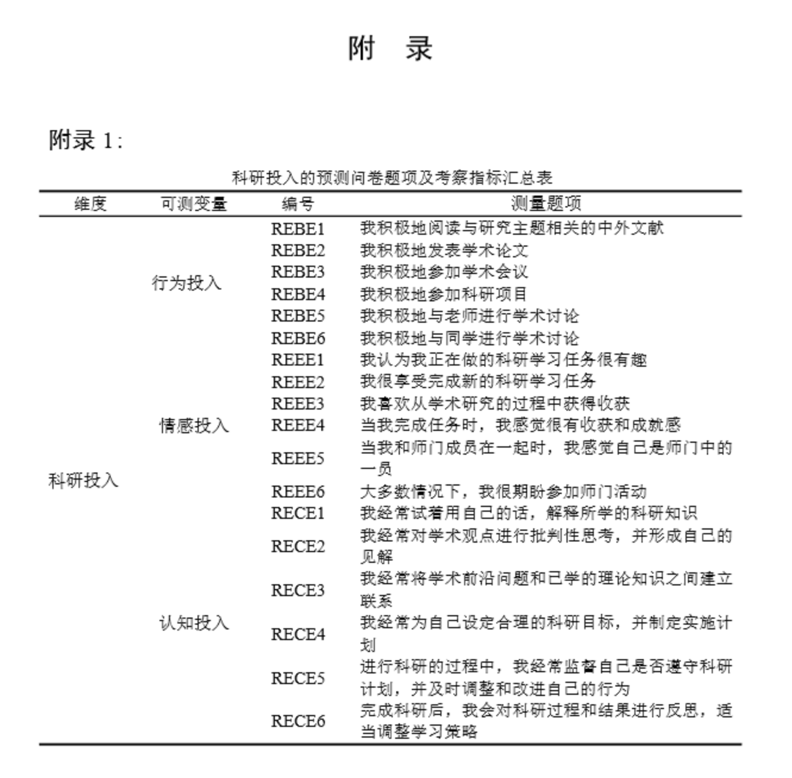
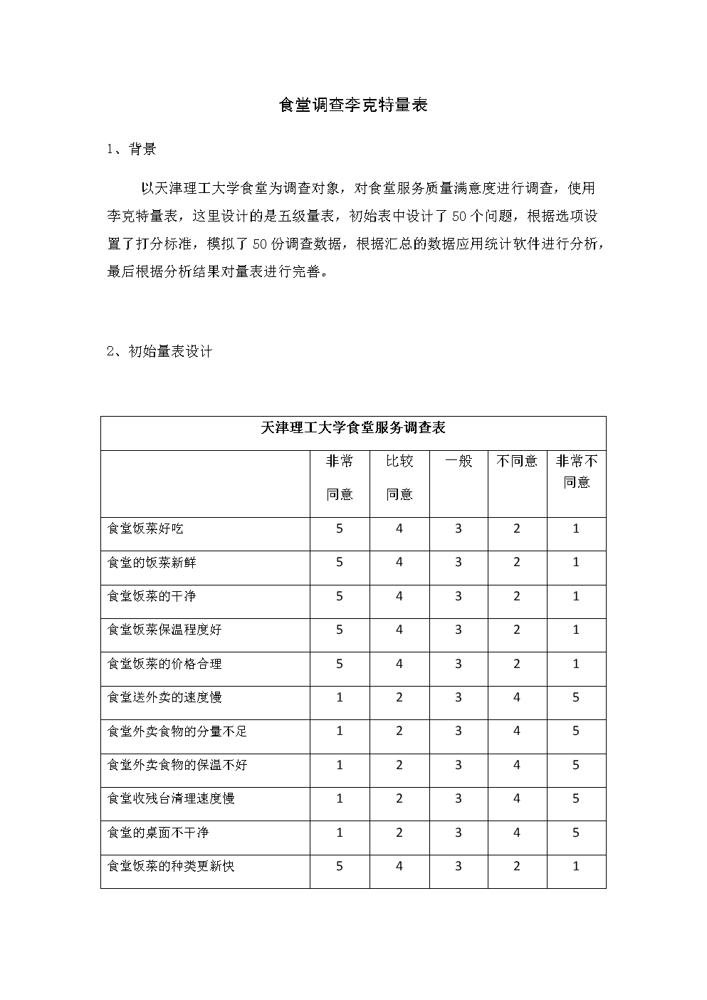
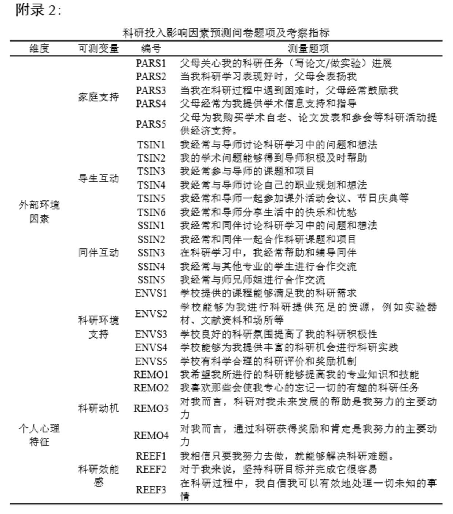
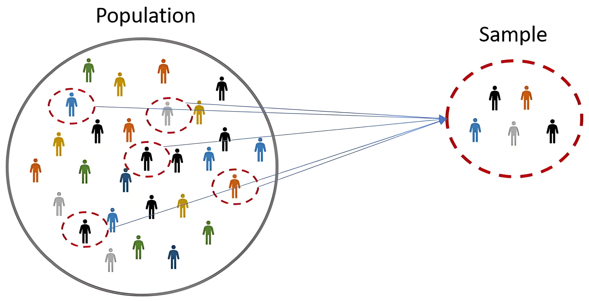
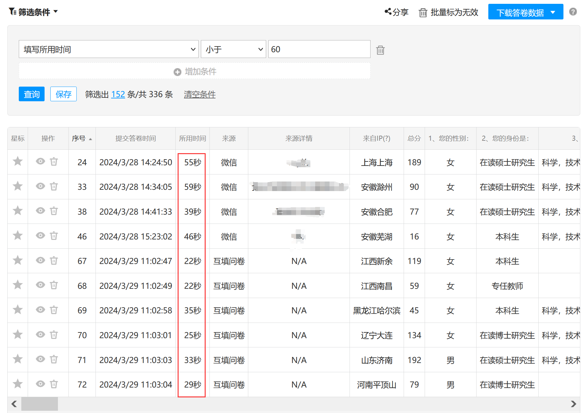
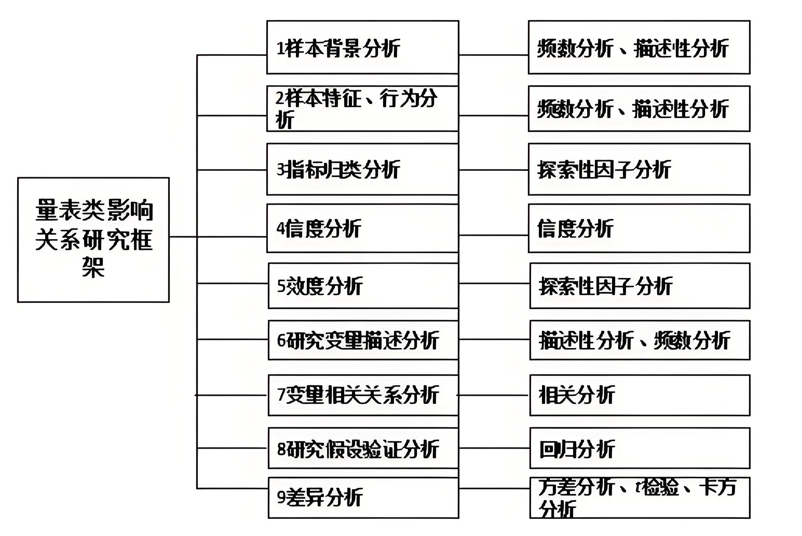
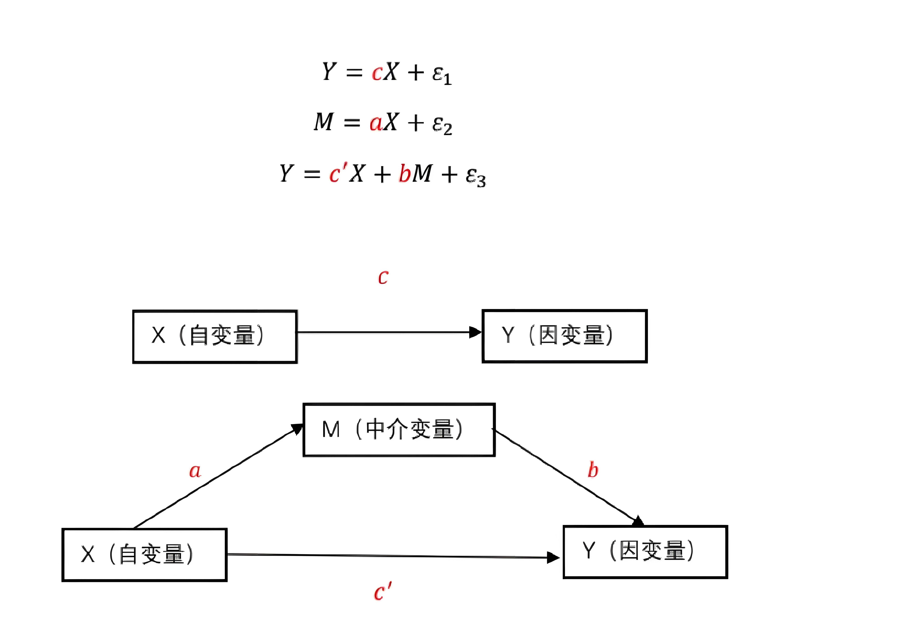
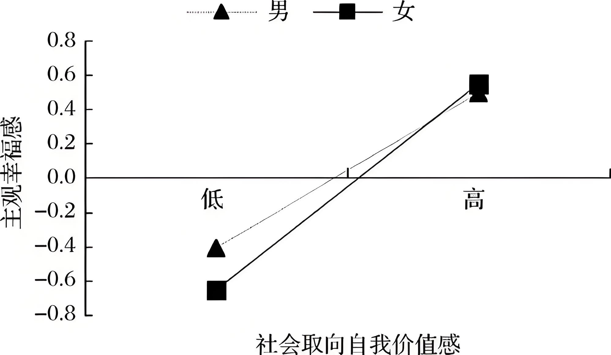

# 第九章 数据检索与获取

数据获取不是把一份 Excel 表“拿到手”那么简单，而是把研究问题转化为能够被观察、记录和检验的证据。研究者一旦没有界定对象、概念、时间范围与数据来源，后续再精细的清洗、统计或可视化，也无法弥补起点上的偏差。本章从社会科学研究的对象出发，说明如何选择二手数据或自行开展问卷调查，并把问卷设计、抽样、回收、质量控制与后续分析连成一条完整路径。

## 9.1 从社会问题到可获取的证据

教育研究面对的不是抽象的数字，而是学生、教师、课程、学校和政策情境中的行为、态度、关系与结果。社会科学主题词云把 *social sciences*、*humanities*、*behaviour*、*family*、*health*、*inequality* 等词置于同一画面，提示研究问题既可能来自个体经验，也可能来自组织、制度与文化。数据获取的首要任务，就是把这样一个宽泛主题收束为可回答的问题。

图9-1 词云以较大的字体突出社会科学与人文研究，周围分布行为、群体、不平等、家庭、健康等主题。它说明研究对象具有多层次性；研究者必须进一步说明考察的是谁、在何种情境中、发生了什么，以及用什么证据回答问题。

同一主题常有不止一种证据路径。图9-2的研究方式表把调查研究、实验研究、实地研究和文献的定量研究并列，并对应不同的资料收集与分析方法。若要了解某校学生对课程资源的满意度，问卷适合获得可比较的自我报告；若要理解学生在小组讨论中如何协作，观察或访谈更贴近过程；若要比较地区教育投入的长期变化，统计年鉴或开放政府数据往往优于重新发放问卷。方法不是研究问题的装饰，而是证据质量的一部分。

图9-2 表格按研究方式列出常见子类型、资料收集方法、分析方法和研究性质。调查与实验通常产生可进行统计处理的定量资料，实地研究常以观察与开放式访谈获得定性材料；“定量”并不意味着自动更严谨，关键在于资料是否适合问题。

在检索或收集前，至少应回答四个问题：研究对象是谁；核心概念是什么；分析单位是什么；结论准备推广到哪里。分析单位尤其容易被忽略。研究“学生”时，一行数据通常代表一名学生；研究“课程”时，一行可能代表一门课程；研究“学校年度投入”时，一行则可能代表一所学校在某一年。若把不同单位混在同一张表里，后续均值、比例和模型都会失去明确含义。

表9-1 从问题到数据源的基本判断

| 需要先界定的事项 | 示例 | 对数据获取的影响 |
| --- | --- | --- |
| 研究目的 | 描述使用现状、比较群体差异，还是检验预测关系 | 决定需要频数、分组信息、重复测量或多个变量 |
| 研究对象与总体 | 某校本科生、全国高职学生、近十年学校 | 决定抽样框、招募渠道与结论的推广范围 |
| 核心概念 | “学习投入”“科研参与”“数字素养” | 决定沿用何种定义、量表或可观察指标 |
| 分析单位与时间 | 每名学生一次填写；每所学校每年一条记录 | 决定一行代表什么，以及是否能够合并数据 |
| 伦理与可得性 | 是否含未成年人、成绩、联系方式或平台日志 | 决定是否需要知情同意、脱敏、受控访问或改用二手数据 |

## 9.2 先检索已有数据，再决定是否自行调查

自行发放问卷并不天然优于二手数据。若已有数据的对象、变量、时期和许可条件与研究问题相符，复用数据可以减少受访者负担，也能使研究更容易复核。可优先检索以下来源：论文的补充材料与数据可得性声明、数据论文、政府与国际组织统计库、机构开放数据平台、学科或通用数据仓储，以及软件随附的教学数据集。上一章介绍的数据字典、版本、许可协议与采集说明，在本章同样是判断数据能否使用的前提。

二手数据的“可下载”不等于“可回答问题”。使用前应逐项核对：变量定义是否相同，采集对象是否覆盖目标人群，时间与地理层级能否比较，缺失值表示什么，是否允许再利用和发表。比如“学生参与”可以指问卷中的自我报告、课程平台的登录记录，或参与项目的行政登记；它们不是可以不加说明地互相替代的同一个变量。

表9-2 常见数据来源及适用边界

| 数据来源 | 适合回答的问题 | 获取后必须检查 |
| --- | --- | --- |
| 论文附带数据、数据论文 | 复现、再分析或扩展既有研究 | 数据字典、论文方法、版本、许可证、引用方式 |
| 政府和国际组织数据 | 区域比较、长期趋势、政策背景 | 指标口径、统计制度变化、行政边界、发布日期 |
| 开放数据仓储 | 某学科可复用数据、代码与材料 | 领域匹配、持久标识、访问限制、文件是否完整 |
| 商业或平台数据 | 行业或平台行为的描述与比较 | 覆盖人群、抽样规则、授权、导出限制与算法口径 |
| 自行调查、观察或实验 | 特定人群的态度、行为、经历和干预反应 | 抽样、测量、知情同意、隐私与现场执行质量 |

已有数据的检索可以按六步执行。第一，把研究问题拆成对象、指标、时间、空间和分析单位，例如“2015—2025年省级普通高校生均教育经费”。第二，按“发布机构官网—政府或国际组织数据库—学科仓储—论文补充材料—通用搜索”的顺序寻找来源，并记录检索词与访问日期。第三，在下载前阅读元数据、指标解释、调查或统计方法、更新频率和许可，不要只凭文件名判断。第四，用少量记录试读字段、单位、缺失码和时间范围，确认一行代表什么。第五，将候选数据与研究问题逐项对照，记录覆盖不足、口径变化、受控访问和伦理限制。第六，为决定使用的数据保存原始文件、稳定链接或标识符、数据字典、许可、版本和校验信息；任何格式转换都另存为工作副本。

这一流程的最低产出不是一个孤立的Excel文件，而是一组能够回答“从哪里来、为何适用、怎样处理、能否复用”的材料。若多个来源都可用，应优先选择定义透明、更新与版本可追踪、分析单位匹配、许可清楚且缺失说明完整的数据。若关键变量不存在、目标人群覆盖不足或访问条件与研究计划冲突，才进入自行调查；“网上没搜到”并不是充分理由。

二手资料不足时，文献检索仍是设计问卷的第一步。不要只搜索“有没有人做过这个题目”，还要查找概念定义、已有量表、变量之间的理论关系、不同人群中的测量做法以及已报告的局限。图9-3展示中文数据库的高级检索：研究者把“学术或科研”与“参与、行为、活动、意愿”等同义词分别放入主题字段，再用 `AND` 连接。分字段、列同义词、再逐步收窄的做法，能使“寻找题项”从随意浏览变为可追溯的证据搜索。

图9-3 高级检索界面将两个概念组放在不同主题字段，并以逻辑关系组合。检索式中的同义词扩大召回范围，字段限制减少无关结果；保存检索式和筛选条件，才能在日后说明量表或题项的来源。

英文文献检索也应服务于概念和测量，而不是只追求检索数量。图9-4把 *academic activity*、*scientific research*、*academic engagement* 等概念组，与 *behavior*、*intention*、*influenc\** 等概念组相连。星号表示词干截断，用于覆盖同一词根的不同形式。读者应特别注意：英文概念之间未必完全等值；翻译、研究对象和教育情境都可能改变题项含义，因此不能机械地把国外量表逐句搬入本土问卷。

图9-4 检索界面分别输入研究活动、行为或意愿、影响因素三个概念组，并使用同义词和词干截断扩展检索。它支持寻找理论、量表和先例，但不能替代阅读原文对样本、量表来源和分析边界的说明。

## 9.3 问卷调查适合回答什么问题

问卷调查是以统一的问题和回答规则，向一组调查对象收集其背景、经验、行为、态度、看法或意愿，并将回答整理为可比较数据的方法。它特别适合回答“是什么”“怎样分布”“不同群体是否不同”“变量之间是否存在预测关系”等问题。问卷能够记录的是受访者在特定情境下的自我报告；它不自动等同于真实行为，更不能仅凭一次横断面填写证明因果关系。

一张有人勾选满意度选项的问卷照片，强调了问卷的“标准化”优势：每个人面对同一套题项，回答可以编码、汇总和比较。但标准化也带来限制。对于“学生为什么在讨论中沉默”“教师如何调整课堂策略”这样需要过程和细节的问题，开放式访谈、观察或学习过程材料可能更合适。混合方法不是为了增加方法数量，而是让不同证据各自承担适合的解释任务。

图9-5 图片中的填写者面对一列固定选项逐项作答，体现问卷把主观判断转为可比较编码的机制。图中看不到的是题项是否清楚、样本是否合适和填写是否认真；这些决定了数字能否被解释。

问卷可以是结构式、半结构式或开放式的。结构式题目预设选项，便于统计和比较；半结构式题目在选项之外留出“其他，请说明”；开放式题目由受访者自由作答，能保留意外信息，但需要后续编码、文本分析或人工判读。三者并非高低之分，应由研究目的和受访者负担决定。

表9-3 常见题目形式及其用途

| 题目形式 | 例子 | 优点 | 主要风险 |
| --- | --- | --- | --- |
| 单选题 | “您是否使用过学校电子教材系统？” | 编码清晰，适合互斥类别 | 选项不全会迫使受访者作错误选择 |
| 多选题 | “您通过哪些渠道获取课程资料？” | 可记录多种并存行为 | 不应把各选项比例简单相加当作总体比例 |
| 排序题 | “请选出最重要的三项原因并排序” | 可比较相对优先级 | 选项过多会增加认知负担 |
| 量表题 | “我能及时调整学习计划：非常不同意—非常同意” | 适合测量态度、认同、感知与意愿 | 必须说明方向、级数和缺失处理，不能默认等级间距相同 |
| 开放题 | “请说明您最希望改进的服务” | 能发现预设选项之外的内容 | 编码规则和分析过程必须透明 |

## 9.4 从概念到题项：操作化而非凑题

一份好的问卷不是从“写几个问题”开始，而是从概念化和操作化开始。概念化是明确研究中某个词究竟指什么；操作化是把这个概念转化为可观察、可回答的指标和题项。以“大学生科研参与”为例，研究者要先决定它是已经发生的行为、参与意愿，还是由行为、情感和认知投入共同构成的多维概念。不同定义会得到不同题项，也会导向不同结论。

表9-4 “大学生科研参与”从概念到测量的示例

| 层次 | 需要明确的内容 | 示例 |
| --- | --- | --- |
| 研究问题 | 想描述、比较还是解释什么 | 哪些因素与本科生科研参与意愿相关？ |
| 构念 | 抽象概念的工作定义 | 科研参与意愿：愿意在未来投入时间参与科研活动的倾向 |
| 维度 | 构念由哪些方面组成 | 行为经验、兴趣与价值、资源支持、导师互动 |
| 指标 | 能够直接回答的观察点 | 是否参加项目；是否能获得导师指导；是否认为科研有价值 |
| 题项 | 具体的文字、时间范围和选项 | “在未来一学年，我愿意申请或参与科研项目。”五级同意量表 |

这份科研投入问卷的题项清单先按行为、情感、认知等维度分组，再为每个维度配置多条具体陈述和编号。这样的版式传达了一个重要原则：一个多维构念不能由一句笼统提问独自承担。多个题项不是为了堆高样本量，而是为了覆盖概念的不同侧面，并在后续检查它们是否确实在测量同一构念。

图9-6 表格将科研投入分为行为、情感和认知等维度，每个维度下列出若干可回答陈述。读者应观察“维度—题项—编号”的层级：编号便于数据管理，题项服务于维度，而维度必须回到清楚的理论定义。

量表题最常见的形式是李克特式同意度量表。图9-7以食堂服务为例，将“非常同意”到“非常不同意”编码为 5 至 1；其中若干负向陈述采用相反编码方向。它提示两个常见错误：第一，把“正向”和“负向”题项混在一起后忘记统一编码方向；第二，认为只要有多个题项就可以直接求总分。负向题可以帮助检查机械作答，但若措辞过于绕，反而可能测量的是阅读困难。是否保留、怎样反向计分，都应在数据字典和分析脚本中明确记录。

图9-7 表格用五级同意选项测量对食堂菜品、价格、卫生和服务的评价，正向题与负向题的分值方向相反。它说明编码规则必须与题意一致；分析前应复核反向题，而不能把数字大小直接当作态度高低。

题项文字应具体、简短、只问一个概念，并使用目标人群能稳定理解的语言。国际调查研究协会 AAPOR 的[问卷设计建议](https://aapor.org/standards-and-ethics/best-practices/)同样强调单一概念、避免诱导性措辞、让封闭题选项互斥且尽量穷尽，并根据情境考虑“不知道”“不适用”或中立选项。下列改写展示了这一原则。

表9-5 问卷题项常见问题及改写

| 容易出问题的问法 | 问题所在 | 较好的改写 |
| --- | --- | --- |
| “您是否认为教师讲得生动而且作业合理？” | 一题询问两个概念，无法知道受访者在回答哪一个 | 分为“教师讲解是否有助于理解”和“作业量是否合理” |
| “您是否支持学校尽快改进落后的平台？” | “落后”预设了负面立场 | “您认为现有平台在哪些方面需要改进？” |
| “您经常使用平台吗？” | “经常”没有时间范围 | “过去四周，您平均每周登录该平台几天？” |
| “您的收入是多少？” | 可能敏感且缺少拒答路径 | 说明用途与保密方式，使用合理区间并提供“不愿回答” |

## 9.5 用文献和预调查校正测量

借鉴成熟量表并不意味着复制粘贴。先查中文研究以理解本土术语与情境，再查外文研究以追溯原始定义、量表开发过程和跨群体使用情况；随后记录每个题项的来源、原文、翻译、删改理由和授权要求。若调整了对象、语境、时间范围或回答选项，就应把它视为一次新的测量设计，而不是宣称原量表的所有性质自动成立。

该问卷附录把“科研投入”的题项与“家庭支持、导师互动、同伴互动、科研环境支持、科研动机和科研效能感”等影响因素分栏列出。它不仅是题库，更是一张研究设计图：每一组题项对应一个构念，构念之间的预期关系决定日后需要比较、回归还是结构模型。因而，先想清楚拟回答的问题，再决定题项和变量；不要在数据回收后才从大量问题中临时拼出假设。

图9-8 左侧为科研投入的多个维度，右侧列出家庭、导师、同伴、环境、动机和效能感等潜在影响因素。图中每个构念由多条陈述共同反映，提示研究者在发放前就要明确哪些题项是结果、哪些是解释因素、哪些仅用于描述样本。

**预调查**是让目标人群实际完成初稿，并据此修订问卷的过程。它至少要检查四件事：受访者是否把题目理解为研究者想问的含义；选项是否缺失、重叠或顺序不合理；完成时长和跳转逻辑是否可接受；题项回答是否高度集中、频繁缺失或引起不适。可以在填写后追问“你如何理解这道题”“你为什么选择这个选项”，以区分题项本身的问题与真实分布。预调查样本并不承担正式推断任务，不能因为数字“好看”就直接并入正式样本。

## 9.6 抽样、样本量与推广边界

总体是研究者希望描述或推断的完整对象集合，样本是从中实际获得资料的一部分。图9-9用大圆表示包含不同特征个体的总体，再以虚线小圈和箭头表示抽取到样本。它的教学重点不是把小圆画得多么“漂亮”，而是提醒研究者：样本是否能代表总体，取决于进入样本的规则，而不是只取决于人数。

图9-9 左侧总体包含颜色和特征不同的个体，箭头指向右侧样本。若抽取过程系统性遗漏某些群体，右侧即使人数很多也不能自动代表左侧总体；抽样框、招募渠道和未回应者同样需要报告。

常见的概率抽样包括简单随机抽样、系统抽样和分层抽样。它们的共同点是总体中每个单位被抽中的机会可定义，因而较适合对总体作统计推断。教育研究中受条件限制，方便抽样、滚雪球招募和网络链接扩散也很常见；这些方法可以用于探索特定群体或检验理论关系，但应如实写明样本来自何处，避免将“本校愿意作答的学生”表述为“所有大学生”。

样本量没有脱离设计的万能门槛。量表题目数的若干倍、结构模型的经验规则都只能作为粗略起点，不能替代研究前的效应大小、模型复杂度、预期缺失与统计功效判断。小样本可能使估计不稳定，样本过于同质也会削弱比较；大样本则不能修复错误题项、选择偏差或低质量作答。可行的做法是：说明总体规模和抽样方式；预先设定最低有效样本要求；根据计划分析的模型、分组数量和可获得资源评估样本量；在报告中同时呈现样本构成与局限。

## 9.7 发放、回收与数据质量控制

在线问卷平台可以处理题型、跳转、随机呈现、进度控制、回收和导出，降低了执行门槛，却不会自动保证研究质量。选择平台前，应确认是否支持匿名或分离保存联系方式、是否能设置筛选和跳转逻辑、是否允许以通用格式导出、数据存放在哪里、是否会收集不必要的设备或定位信息。涉及未成年人、成绩、健康、身份或其他敏感信息时，应先取得必要的伦理审批或机构许可，向参与者清楚说明研究目的、可能风险、退出方式、保存期限和联系方式。

开始页的知情说明应让参与者在作答前知道：谁在进行研究；为什么收集这些信息；预计用时；哪些问题可跳过；资料如何去标识化、保存和使用；是否有补偿；如何撤回或咨询。不要把“提交即同意”当作对所有情形都足够的伦理安排。对于无法公开的受限数据，也应保存数据字典、版本和访问条件，以便在合规范围内复核。

回收后台按“填写所用时间小于60秒”筛选记录，并在表中显示提交时间、时长、来源和部分作答字段。这种筛选能帮助发现异常快答，却不能单独证明一份问卷无效：不同设备、跳题和题目数量都会影响时长。更稳妥的做法是把时间、注意力题、逻辑一致性、关键题缺失、重复提交和开放题质量等线索结合起来，并在正式分析前预先写明规则。

图9-10 后台界面以“填写所用时间”作为筛选条件，并列出每条记录的提交时间、来源、地区和回答字段。图中可见的识别信息提示研究者必须控制访问权限并在导出后及时脱敏；填写时长只是质量判断的一项证据，而非自动删除规则。

表9-6 有效样本筛选的可解释规则

| 检查线索 | 可采用的规则示例 | 处理时的注意事项 |
| --- | --- | --- |
| 完成时长 | 低于预调查所观察到的合理下限时标记复核 | 不要把任意整数当作普遍标准；跳转题会缩短时长 |
| 筛选题与逻辑题 | 不符合纳入条件，或前后回答互相矛盾 | 应区分真实变化、理解困难与无效作答 |
| 关键题缺失 | 核心变量缺失超过预先规定比例 | 区分“拒答”“不适用”“系统漏答”和空白 |
| 规律性作答 | 长量表全选同一选项、反向题完全矛盾 | 结合题项内容与完成时长，不要只因同分就删除 |
| 重复记录 | 同一匿名标识、邀请链接或设备信息出现异常重复 | 不应以 IP 地址单独识别个人；需尊重隐私与共享设备情形 |
| 开放题质量 | 与题目无关、重复粘贴或明显机器生成文本 | 要保存判定规则和删改数量，避免按立场筛选回答 |

数据获取记录应与回收同步建立。记录数据名称、版本、来源、访问日期、总体与纳入条件、发放渠道、问卷版本、回收数量、有效规则、清洗责任人、变量说明、许可和伦理限制。AAPOR 的[报告与透明度建议](https://aapor.org/standards-and-ethics/standard-definitions/)也提醒研究者：回应率或参与率本身不足以判断是否存在未回应偏差，但规范记录样本处置是理解这一风险的起点。

## 9.8 让数据结构服务于分析问题

数据获取阶段就应预想“这份数据能回答什么”。图9-11把量表研究拆成样本背景、样本特征、指标归类、信度、效度、变量描述、相关、假设与差异等环节，并分别连接频数、描述统计、因子分析、相关、回归、方差分析、卡方检验等方法。图的价值不在于提供一张固定菜单，而在于强调：研究问题、变量类型、测量质量与分析方法必须相互匹配。

图9-11 流程图从样本背景和描述性分析开始，延伸到信效度、变量关系、假设验证和群体差异。它表明分析不是在软件菜单中随机选择，而是顺着“数据是否可信—变量是什么—问题想比较或解释什么”的顺序推进。

表9-7 问卷研究问题与常见分析路线

| 想回答的问题 | 数据与设计前提 | 常见的起点 | 结论边界 |
| --- | --- | --- | --- |
| 样本是谁、现状如何 | 分类变量、计数或量表得分；样本来源清楚 | 频数、比例、均值、分布图 | 描述的是获得样本，不自动代表更大总体 |
| 不同群体是否不同 | 明确分组变量与结果变量；比较条件适当 | 交叉表、卡方检验、均值差异检验 | 显著差异不等于群体本质不同，也可能受混杂影响 |
| 哪些因素与结果相关 | 有理论支持的变量、足够样本与适当测量 | 相关、线性回归或 Logistic 回归 | 预测关系不等于因果效应 |
| 多个题项能否反映一个构念 | 题项有共同理论定义，编码方向一致 | 信度分析、探索或验证性因子分析 | 指标达标不能替代内容效度与理论判断 |
| 一组构念之间的路径是否符合理论 | 先有理论模型和合适的测量模型 | 结构方程模型、路径分析 | 箭头表示假设关系；横断面问卷通常不能单独确证因果 |
| 机制或条件是否不同 | 事前提出中介或调节理论，变量测量可靠 | 间接效应、交互项、分组或多组模型 | 不应因为变量“处在中间”就声称存在中介 |

### 描述、差异与分类结果

描述性分析首先回答样本“由谁构成、发生了什么”。应报告有意义的背景变量、缺失情况和关键行为的分布，而不是把所有平台自动生成的图表逐一粘贴。比较两个分类变量时，交叉表与卡方检验常用；例如比较不同性别学生是否选择某类理财产品，得到较大的 *p* 值只表示在该样本和模型条件下没有足够证据拒绝“无关联”的假设，不能证明两个群体完全相同。

当因变量是类别时，模型也必须与类别结构相符。二元结果如“愿意／不愿意继续使用”可考虑二元 Logistic 回归；无大小顺序的多类别结果与有序等级结果，需要不同的模型设定。无论使用哪种模型，都要写清参考类别、变量编码、样本量、置信区间和模型诊断。不要只根据一列显著性数字断言某个因素“有影响”。

### 信度、效度与构念测量

信度关注同一组题项在当前研究中的一致性或稳定性；效度关注题项和证据是否支持研究者对构念的解释。二者相关但不能互相替代。Cronbach's α 常用于评估内部一致性，但不是量表“质量合格证”：它会受到题目数、题项冗余、样本和构念维度的影响。因子载荷、KMO、Bartlett 检验、组合信度、平均方差提取等数字也都需要与测量模型、样本和理论共同解释。

多元回归示意图以多个自变量指向一个连续因变量，直观说明“在其他变量一并进入模型后”的预测思想。问卷设计因此应预先为关键解释变量、结果变量与必要控制变量保留合适题项；事后从一长串问题中筛选出“显著”的变量，容易夸大偶然发现。回归与聚类的具体建模和诊断将在第十一章展开。

图9-12 散点与拟合线表示多个自变量共同解释一个结果变量的变化，公式中的每个系数都依赖于其余变量、样本与模型假设。图中的箭头和回归线表达的是统计建模关系，不能单凭其形状推出真实世界的因果机制。

### 从题项到理论模型

结构方程模型适合处理“看不见但可由题项反映的构念”及其理论关系。图9-13用方框与箭头连接退货政策、感知质量、感知风险和购买意愿，虚线箭头表示调节假设。迁移到教育研究时，可以把方框理解为“教师支持”“学习投入”“使用意愿”等理论构念；每个构念仍需由明确题项测量。模型越复杂，对理论、样本、测量质量与报告透明度的要求越高。

图9-13 模型用实线表示预设的直接关系，用虚线表示某一条件可能改变关系强度的调节假设。箭头首先是理论陈述，随后才是统计检验对象；不能因为软件能够画出路径，就反向把路径当成理论。

PLS-SEM 是结构方程模型的一种估计路径，可在 SmartPLS 等软件中实现。软件界面把变量、题项和连线组织为模型图，并可输出估计与重抽样结果；但便捷的界面不减轻研究设计责任。SmartPLS 的[算法说明](https://smartpls.com/documentation/algorithms-and-techniques/pls/)指出，PLS 路径建模通过迭代估计指标权重与构念关系；这并不表示它可以绕过缺失处理、量表质量、模型设定或因果识别问题。软件选择应服务于方法与理论，而不是反过来决定研究问题。

中介效应讨论的是理论上自变量如何经由中介变量与结果变量相连。图9-14把 X 到 Y 的总关系拆分为 X 到 M、M 到 Y 以及控制 M 后 X 到 Y 的直接关系。只有在理论、研究时序、测量和统计证据共同支持时，M 才可被解释为可能机制；一次同时测量的横断面问卷通常难以单独排除反向关系和共同原因。

图9-14 图中 X 通过 M 指向 Y，同时保留 X 到 Y 的直接路径；上方公式把总关系、X 到 M 的关系和包含 M 的结果方程并列。它帮助区分“变量位于两者之间”与“有证据支持的中介机制”，后者需要更强的理论和设计。

调节效应回答的是“在什么条件下，X 与 Y 的关系会改变”。图9-15以两条代表不同性别的线展示：随着社会取向自我价值感从低到高，主观幸福感的变化趋势可能不同。阅读这类图时，应看两条线是否平行、差异出现在什么范围，并结合交互项和不确定性判断；不能仅凭两条线相交就断定存在稳定的调节作用。

图9-15 横轴为社会取向自我价值感，纵轴为主观幸福感，两条线代表不同性别群体。线条斜率不同用于说明交互或调节的直观含义；图形本身不能替代模型检验、样本量说明与理论解释。

## 9.9 获取完成后的交接清单

问卷回收并不是数据工作的终点，而是数据管理与清洗的起点。将原始导出文件只读保存，另存一份工作副本；单独保存题项文本、变量名、编码、反向计分、跳转逻辑、有效样本规则和版本变动；不要在原始表中直接覆盖修改。第十章将处理重复、缺失、错误和不一致记录；第十一章将进一步讨论回归与聚类；第十二章则把可靠的数据与结果转化为清楚的图表。

表9-8 数据获取阶段应交付的最小材料

| 材料 | 应包含的内容 | 后续用途 |
| --- | --- | --- |
| 原始数据 | 原始导出文件、获取日期、只读备份 | 核对清洗是否改变了记录 |
| 数据字典 | 变量名、题项全文、类型、取值、缺失码、反向计分 | 清洗、分析、复现与写作 |
| 样本与回收记录 | 总体、纳入条件、渠道、发放日期、回收与有效规则 | 报告样本来源和推广边界 |
| 问卷版本与逻辑 | 知情说明、筛选题、跳转、随机化、修订记录 | 解释不同受访者为何看到不同题目 |
| 合规说明 | 同意方式、脱敏措施、访问权限、保存期限、许可限制 | 保护参与者并决定数据能否共享 |
| 分析计划 | 研究问题、主要变量、预定比较或模型、例外处理 | 减少事后选择性分析 |

## 常见误区

第一，先建一个问卷页面，再倒推研究问题。第二，把文献中的题项拼接在一起，却没有统一构念、对象、时间范围和编码方向。第三，以“样本很多”代替抽样说明。第四，用方便样本得出面向全国或所有学生的结论。第五，把快速作答或同分回答一律删除，却没有预先规则和记录。第六，把横断面问卷中的相关、回归或路径系数直接写成因果。第七，只保存清洗后的表格，丢失原始数据、问卷版本和数据字典。

## 本章小结

可靠的数据获取始于研究问题，落实于清楚的概念、合适的来源、可解释的抽样与透明的记录。对于问卷研究，题项质量、样本进入机制、回收过程、伦理保护和预想的分析路线共同决定数据能说什么。问卷平台、统计软件和结构模型都只是工具；真正使研究可相信的，是研究者能够说明数据从哪里来、每一个变量是什么意思、谁被纳入或遗漏，以及结论在哪些边界内成立。

## 思考与练习

1. 选择一个教育问题，分别说明使用公开统计数据、问卷、访谈或混合方法时，能够回答什么、不能回答什么。
2. 将“学生数字素养”操作化为至少三个维度；为每个维度写两条题项，并标注回答选项和编码方向。
3. 为一项线上问卷拟定总体、抽样框、招募渠道和有效样本规则，说明其中最可能出现的选择偏差。
4. 找到一份已发表研究的问卷或量表，记录其原始来源、调查对象、题项改写、样本构成和报告中未说明的信息。
5. 将一个“X 影响 Y”的问题改写为描述、差异、预测、中介和调节五种不同研究问题，并指出每种问题需要在数据获取阶段额外准备什么。

## 延伸阅读与工具

- [AAPOR：Best Practices for Survey Research](https://aapor.org/standards-and-ethics/best-practices/)
- [AAPOR：Standard Definitions and Disposition Codes](https://aapor.org/standards-and-ethics/standard-definitions/)
- [SmartPLS：PLS-SEM Algorithm](https://smartpls.com/documentation/algorithms-and-techniques/pls/)
