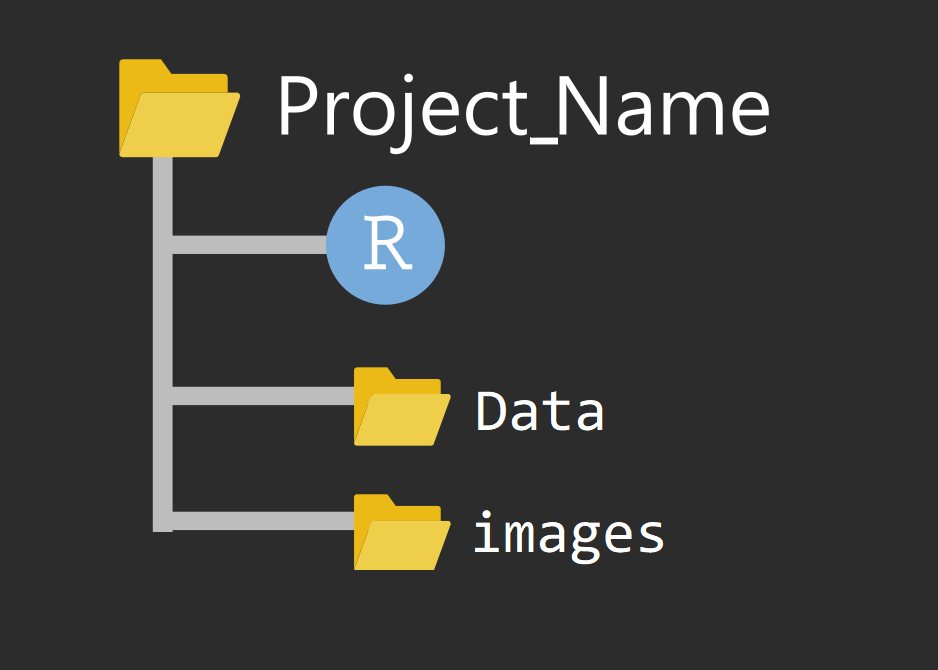
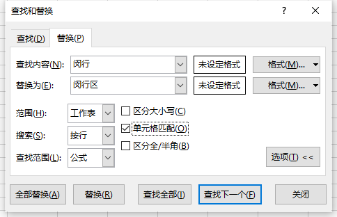
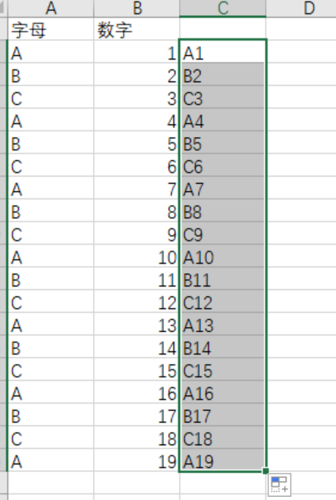

# 第十章 数据管理与清洗

数据清洗常被初学者误解为“分析之前的杂活”。事实上，数据清洗决定了后续分析是否可信。未经清洗的数据可能包含重复、缺失、错误、不一致和不可用记录；如果直接建模或制图，软件仍会给出结果，但这些结果很可能建立在错误基础上。本章以Excel与R为主要工具，说明数据管理和清洗的基本原则。

## 数据管理先于数据清洗

良好的数据管理从文件和字段开始。数据文件命名应易懂、易用、易导入，尽量避免过长、含特殊符号或含混不清的名称。字段名应简短、明确、无空格，并具有唯一识别符。字段属性应与数据含义一致，如文本、数值、日期或因子。数值规范应提前确定，例如缺失值如何表示，是否允许“无”“不适用”“不知道”与空白混用。

图10-1 数据管理关注文件、字段、属性和数值规范。清洗不是临时补救，而是研究流程的一部分。

建议保存三类文件：原始数据、清洗后数据和清洗记录。原始数据只读保存，清洗后数据用于分析，清洗记录说明每一步如何处理、影响多少记录、为何这样处理。这样既方便复核，也能在结果异常时追溯问题。

## 什么是脏数据

脏数据包括缺失数据、重复数据、错误数据、不一致数据和不可用数据。缺失值不等于0，尤其在问卷中，空白可能意味着未回答，而0可能是有意义的取值。重复记录可能完全相同，也可能只是部分字段重复。错误数据包括拼写错误、日期格式错误、逻辑矛盾和超出合理范围的数值。不一致数据包括同一机构被写成不同名称，同一类别被多种符号表示。

数据清洗的目的，是提高数据的准确性、一致性和可用性，为后续分析、建模和决策提供可靠基础。清洗不是为了让结果“好看”，更不能为了显著性随意删改数据。

## 去除重复记录

完全重复记录可以直接删除，但部分重复需要判断。例如同一学生可能重复提交问卷，也可能是同名不同人；同一机构可能写作“华东师范大学”“华东师大”“ECNU”；同一概念可能写作“gamma-ray”和“γ-ray”。去重前应明确唯一识别符，如学号、问卷提交ID、DOI或专利号。

在Excel中，可以使用“删除重复项”处理完全重复，也可以用`COUNTIF()`配合排序发现重复。对于需要人工判断的重复，应在清洗记录中说明规则，而不是静默删除。

## 处理缺失值

缺失值处理方式包括删除样本、删除变量、替换缺失值、保留缺失并在模型中处理。均值替换虽然简单，但可能低估方差，也可能扭曲变量关系。问卷研究中，如果某份问卷关键题缺失过多，通常需要删除；若少量题项缺失，可根据量表规则决定是否计算均值。

处理缺失值时，应先区分“真正缺失”“不适用”“拒答”和“系统未记录”。这些情况含义不同，不能全部用0替代。

## 纠正错误和不一致

Excel中的查找替换、筛选、排序和条件格式可以帮助发现错误。文本函数也常用于清洗：`LEN()`计算字符串长度，`LEFT()`和`RIGHT()`截取左右字符，`MID()`从指定位置截取，`FIND()`查找字符串位置，`SUBSTITUTE()`替换字符，`CONCATENATE()`合并文本，`TRIM()`删除首尾空格。

图10-2 文本函数适合处理姓名、机构、编码、日期和混合字段。清洗时应保留原字段，在新字段中生成处理结果。

日期函数如`YEAR()`、`MONTH()`、`DAY()`和`WEEKDAY()`可提取日期信息。处理日期时要特别注意文本日期与真正日期格式的差异，否则排序和计算会出错。

## 识别异常值

异常值可能是录入错误，也可能是真实极端情况。识别异常值可使用排序、条件格式、箱线图、色阶和统计规则。发现异常后，不应立即删除，而要判断其产生原因。若是录入错误，应回到原始记录修正；若是真实值，应根据研究问题决定保留、单独分析或使用稳健方法。

在教育数据中，考试成绩超过满分、年龄不符合对象范围、答题时间极短、所有量表题选项完全一致，都可能提示异常。但处理规则必须清楚说明。

## 列操作、IF与VLOOKUP

列合并与分列用于处理一个字段存储多个值的问题。例如“学院-专业-班级”写在同一列时，分析前可能需要拆分。`IF()`函数可根据条件生成新变量，例如把成绩大于等于90标记为“优秀”。`VLOOKUP()`可根据关键字段合并另一张表的信息，如根据学号补充班级或根据机构编码补充地区。

图10-3 跨表匹配前必须确认关键字段唯一且格式一致。空格、文本数字和编码前导零都会导致匹配失败。

## 数据透视表与探索检查

数据透视表适合快速汇总和检查数据，例如各班人数、不同年级均值、类别频数和交叉分布。它可以帮助发现异常类别、缺失集中位置和录入错误。但数据透视表不是最终模型，更多承担探索和核查功能。

在使用数据透视表前，应确保数据为整洁表格：第一行是字段名，每一行是一个观测，每一列是一个变量，不含合并单元格和无意义总计行。

## R中的可复现清洗

当清洗步骤较多或数据会反复更新时，应使用R或Python保存脚本。脚本能够记录每一步转换，避免手工操作不可追踪。课程中的`Clean.R`示例体现了这个原则：读取数据、统一字段、处理缺失、生成新变量、输出清洗后文件，都应写成可重复运行的流程。

## 清洗决策的可解释性

每一个清洗动作都应能解释。删除重复记录，需要说明重复的判定字段；删除异常值，需要说明异常的判定标准；合并类别，需要说明同义关系；替换缺失，需要说明替换依据。若这些决策无法解释，就可能变成主观操控数据。

建议在清洗记录中使用“问题—规则—影响—理由”的格式。例如：“问题：年级字段存在‘大一、一年级、2023级’三种写法；规则：统一编码为入学年级；影响：修改86条记录；理由：后续按年级进行组间比较。”这样的记录既能保护研究者，也能提高结果可信度。

## 常见误区

第一，不保存原始数据，清洗后无法回溯。第二，把缺失值全部替换为0。第三，随意删除异常值，却不说明依据。第四，字段名混乱，导致后续代码和图表难以维护。第五，只在Excel中手工操作，不记录步骤。第六，为了得到理想结果而“清洗”数据，这是学术不端风险。

## 本章小结

数据清洗是研究方法的一部分。清洗的目标是让数据准确、一致、可解释、可复核。研究者应从文件命名、字段规范、缺失规则、重复识别、异常处理和清洗记录做起，使后续分析建立在可靠数据基础上。

## 思考与练习

1. 为一份问卷数据设计字段命名规则和缺失值编码规则。
2. 使用Excel函数清洗一列混合格式文本。
3. 写一段清洗记录，说明你删除或保留异常值的依据。
