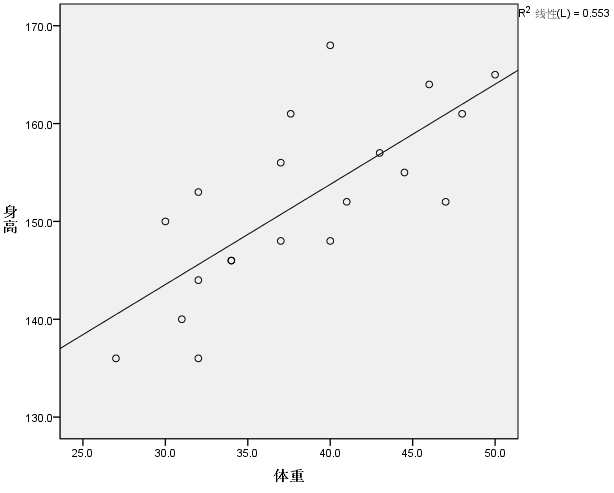
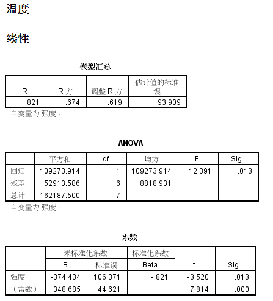

# 第十一章 回归与聚类

回归和聚类是教育数据分析中非常常见的两类方法。回归关注变量之间的预测关系，聚类关注对象或变量之间的相似性结构。二者都能帮助研究者从数据中发现模式，但也都不能脱离研究问题、数据类型和理论解释。软件可以完成计算，不能替代研究者判断。

## 从相关分析到回归分析

相关分析描述两个变量共同变化的方向和强度。Pearson相关适合近似连续且线性关系的变量，Spearman和Kendall更适合等级变量、非正态分布或非线性单调关系。偏相关则在控制第三个变量后观察两个变量之间的关系。

相关不区分自变量和因变量，也不自动说明因果。学习投入与成绩相关，可能是投入影响成绩，也可能是成绩较好的学生更愿意投入，还可能受到家庭背景、教师支持和原有能力共同影响。回归分析进一步建立因变量与一个或多个自变量之间的预测关系，但仍需要谨慎解释。

## 一元线性回归

一元线性回归用于分析一个自变量对一个连续因变量的预测关系。例如，用体重预测身高、用学习时间预测测验成绩。建模前应先画散点图，观察关系是否近似线性，是否存在异常点，变量范围是否合理。

图11-1 回归输出不仅要看显著性，还要关注回归方程、解释率、残差和共线性诊断。

报告回归结果时，应说明方程、系数方向、显著性、解释率和诊断信息。例如，若模型为“身高 = 112.833 + 1.024 × 体重”，表达时应说明这是样本中的预测关系，而不是一般生理规律。对于教育数据，同样不能把回归系数直接解释为因果效应。

## 曲线参数估计

变量关系不总是线性的。细菌繁殖、学习增长、技术扩散和遗忘过程都可能呈现非线性形态。曲线参数估计通过变量变换或不同模型比较，寻找更合适的拟合方式。常见模型包括线性、二次、三次、指数等。

选择模型不能只看调整后的R平方。模型还要符合实际生活和科学常识。一个高阶曲线可能在样本内拟合很好，却没有可解释性，也可能在样本外表现很差。因此，曲线拟合应先由散点图和理论判断引导，再用统计指标辅助选择。

## 多元回归与逐步回归

多元回归允许多个自变量同时进入模型，适合在控制其他因素后考察某一变量的预测作用。例如，研究学习投入对成绩的影响时，可同时控制年级、原有成绩、家庭背景和平台使用情况。多元回归的价值在于减少遗漏变量影响，但它仍不能自动证明因果。

逐步回归可以根据统计规则选择变量，但不能替代理论建模。完全依赖逐步法，可能得到样本依赖性很强、理论意义不足的模型。研究者应先根据理论和文献提出候选变量，再用模型比较检验。

## 泊松回归

泊松回归适合单位时间、单位面积或单位空间内事件发生次数的计数数据，如缺勤次数、平台登录次数、错误次数、某时段内发帖数等。它要求事件发生具有一定平稳性和独立性，且通常用于低概率事件或计数结果。

课程案例中，研究者分析39名有胸闷症状的非器质性心脏病男性患者24小时早搏数，并考察喝浓茶和吸烟的影响。此类案例说明，模型选择首先取决于因变量类型。若因变量是次数，直接套用线性回归可能并不合适。

图11-2 泊松回归结果常以发生风险倍数解释。解释时应同时说明模型前提、置信区间和拟合情况。

## 聚类分析的基本思想

聚类分析根据对象之间的相似性自动分类。分类的意义在于更清楚地展现事物特征，从复杂数据中发现结构。经验分类依赖研究者判断，统计分类则依据变量和距离度量自动形成类别。

Q型聚类主要对样本或个案分类，如把学生分成不同学习类型；R型聚类主要对变量分类，如把多个测量指标归并为若干维度。层次聚类根据亲疏程度形成树状结构，K-means适合较大样本并需要预先设定类数。

图11-3 树状图展示对象之间的相似性层级。类别命名必须回到变量含义，不能只接受软件输出。

## 聚类结果的解释

聚类完成后，最重要的是解释类别。不能只写“分为三类”，而应比较各类在关键变量上的均值、分布和特征。例如，在线学习数据可以把学习者分为“高投入高表现型”“低投入稳定型”“高浏览低完成型”。这些名称不是软件给出的，而是研究者依据变量特征进行理论命名。

还应检验聚类稳定性。改变变量、标准化方法、距离度量或类数，结果可能不同。若聚类结果对设定高度敏感，说明分类结论需要谨慎。

## AI辅助统计解释

AI可以帮助解释输出表中的术语，提示报告结构，检查表达是否过度。但如果不提供变量定义、样本背景和研究问题，AI很容易给出空泛甚至错误的解释。统计输出不能直接交给AI“翻译”为结论，研究者必须判断模型前提、效应大小和教育意义。

## 结果写作的边界语言

统计结果写作要学会使用边界语言。相关分析可以写“二者呈正相关”，不宜写“二者相互促进”；回归分析可以写“在控制若干变量后，某变量对结果具有正向预测作用”，不宜直接写“某变量导致结果提高”；聚类分析可以写“样本在所选变量上可分为若干类型”，不宜写“学生天然分为若干类型”。

边界语言不是削弱结论，而是让结论与方法能力相匹配。教育研究面对复杂人群和复杂情境，任何模型都只是对现实的简化。越能清楚说明模型做了什么、没有做什么，研究越可信。

## 常见误区

第一，把相关或回归直接写成因果。第二，只报告显著性，不报告效应大小和模型诊断。第三，忽略散点图和残差检查。第四，用线性回归处理明显不适合的计数数据。第五，聚类后不解释类别特征。第六，把AI生成的统计解释当作最终结论。

## 本章小结

回归用于解释和预测变量关系，聚类用于发现相似性结构。二者都需要从研究问题出发，经过数据检查、模型选择、结果诊断和理论解释。软件输出只是中间结果，研究结论来自统计证据与教育情境之间的合理连接。

## 思考与练习

1. 判断三个研究问题分别适合相关、线性回归、泊松回归还是聚类。
2. 解释为什么回归显著不等于因果成立。
3. 为一个学习者聚类结果设计类别名称和教育解释。
