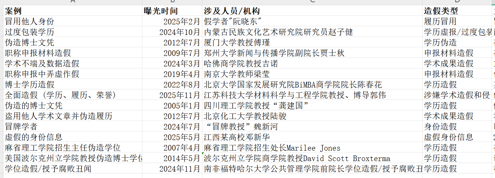
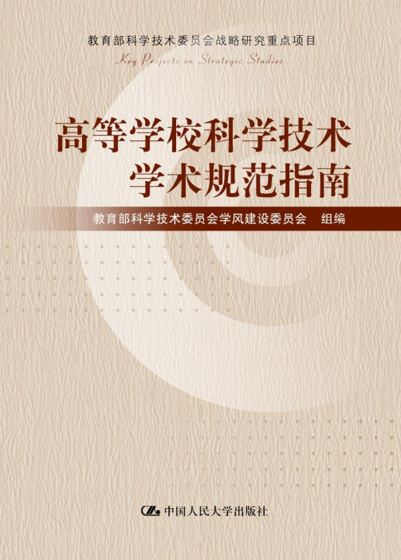
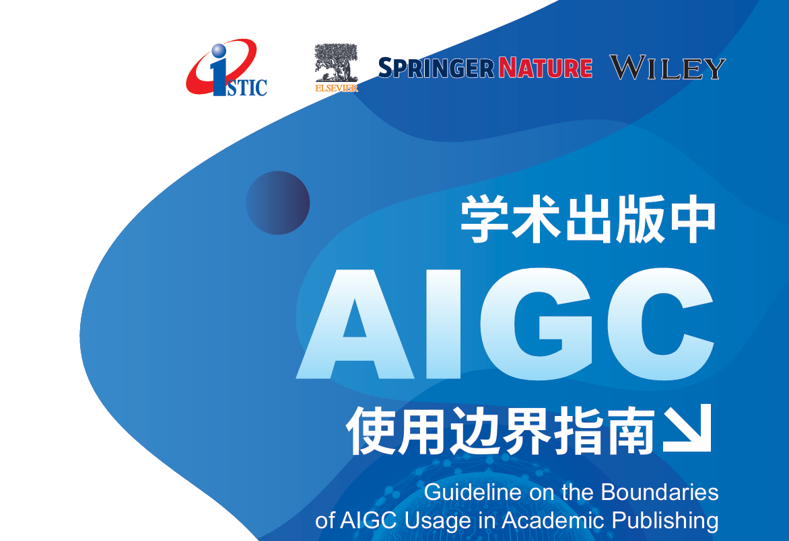

# 第十三章 学术规范与伦理

学术规范与伦理是信息素养和数据素养的底线。无论是检索文献、撰写综述、采集数据、开展统计分析，还是使用生成式人工智能辅助研究，都必须遵守诚信、公正、透明和保护研究对象的基本原则。规范不是论文提交前的格式检查，而是贯穿研究全过程的可信度保障。

## 为什么要重视学术规范

近年来，全球论文撤稿数量持续增加，撤稿原因涉及伪造同行评议、数据造假、论文工厂、剽窃等。撤稿事件提醒我们，学术不端不仅影响个人声誉，也会破坏学术共同体对知识的信任。对于学生而言，规范训练应从课程作业、文献引用、数据记录、图表制作和AI使用开始。

图14-1 科研诚信建设的现实压力说明，规范教育不是形式要求，而是维护知识可靠性的基本制度。

## 学术规范与学术不端

学术规范是学术活动中应遵循的行为准则和道德标准，旨在确保研究诚信、公正和透明。它包括学术研究规范、学术评审规范、学术批评规范和学术管理规范。文献利用规范只是其中一部分，但贯穿研究全过程。

学术不端是科学研究和学术活动中的造假、篡改、剽窃以及其他违背学术共同体道德惯例的行为。我国《学术出版规范——期刊学术不端行为界定（CY/T 174—2019）》将期刊学术不端行为划分为剽窃、伪造、篡改、不当署名、一稿多投、重复发表、违背研究伦理和其他学术不端行为等类别。

## 剽窃、伪造与篡改

剽窃不仅包括文字剽窃，还包括观点剽窃、数据剽窃、图片和音视频剽窃、研究方法剽窃、整体剽窃以及他人未发表成果剽窃。即使改变少量词语，如果核心观点和表达来自他人而未注明来源，也可能构成剽窃。

伪造是编造未通过实际调查或实验获得的数据、图片、样本、研究方法、结论、资助来源、审稿人信息和参考文献。篡改是擅自修改、挑选、删减或增加原始记录、实验数据和图像，使其偏离真实含义。在数据分析中，只报告显著结果、随意删除不利异常值、修改图像比例或拼接图片，都可能触及诚信风险。

图14-2 学术不端类型多样，不能只把“抄袭文字”视为问题。数据、图片、署名和研究伦理同样重要。

## 不当署名、一稿多投与重复发表

不当署名包括将有实质贡献者排除在作者名单外，将无实质贡献者列为作者，未经同意署名，作者排序与贡献不符，或提供虚假职称、单位和经历。署名体现责任和贡献，不能作为人情或资源交换。

一稿多投是将同一篇论文同时投给多个期刊，或在未完成撤稿程序前再次投稿。重复发表包括不加说明地使用自己已发表内容，拼接自己多篇已发表论文，重复使用同一调查或实验数据，或把实质相同研究拆分为多篇论文。学生论文中也要避免自我抄袭和重复提交。

## 研究伦理与数据安全

教育研究常涉及学生、教师、课堂和学校。采集学生成绩、学习行为、家庭背景、访谈文本、课堂录像和平台日志时，必须遵循最小必要原则、知情同意、匿名化处理、访问权限控制和保存期限管理。未成年人和弱势群体数据应采用更高保护标准。

违背研究伦理包括未按规定获得伦理审批，研究超出审批范围，不当伤害研究参与者，违背知情同意原则，泄露隐私，或未说明利益冲突。即使是课程作业，也应避免收集与研究无关的敏感信息。

## 引用、注释与参考文献

引用的作品应已经发表，引用比例应适当，并注明出处。直接引用要加引号或块引，必要时标注页码；转述观点也要注明来源；使用数据、图表、量表、代码和图片同样需要说明来源和许可。注释用于补充解释，不应代替引用。

参考文献选择应遵循原创性、必要性和重要性原则。不应引用与论著无关的文献，不应故意隐匿重要文献，也不应为了提高引用数而故意引用自己或特定刊物。文献管理软件可以提高格式一致性，但不能替代人工核对。

## AIGC使用中的诚信问题

生成式人工智能可以辅助构思、语言润色、检索词扩展、代码生成和图表说明，但它也带来新的伦理风险。资料搜集阶段，AI可能提供虚构或过时文献，使用者必须阅读并验证其真实性。概念解答阶段，AI可能把相近理论混合在一起，研究者要判断适用性。分析撰写阶段，AI可以辅助描述统计结果，但不能代替研究者解释数据。

图14-3 AIGC可作为辅助工具，但不能承担作者责任，也不能替代真实数据、真实阅读和真实判断。

论文投稿和课程提交中，应按照学校、期刊或课程要求披露AI使用。披露内容可包括工具名称、版本、使用时间、使用目的、提示词类型和人工核验方式。根据出版伦理相关立场，AI工具不能作为作者，因为它不能对研究设计、数据和结论承担责任。

## 学术诚信检查清单

提交作业或论文前，可逐项检查：所有非原创观点是否标注来源；直接引用是否加引号并保留页码；参考文献是否真实存在；数据是否可追溯；图表是否真实呈现比例；异常值处理是否有记录；研究对象是否知情同意；隐私数据是否脱敏；AI使用是否按要求披露；作者贡献和致谢是否准确。

## 课程作业中的规范实践

学术规范并不只适用于正式论文。课程作业同样应遵守基本规范：引用教材、论文、网页和AI输出时要说明来源；使用同学或教师提供的数据时要确认使用范围；小组作业要明确分工；不能把往年作业直接提交为新作业；不能让AI代写整篇作业后署名为自己完成。

学生阶段的规范训练有一个重要作用：让研究者在低风险场景中形成习惯。等到毕业论文、课题申报或期刊投稿时，规范要求会更严格。如果平时没有保存来源、记录数据处理和区分摘录与转述，后期很难补救。

## 常见误区

第一，以为只要不逐字复制就不算剽窃。第二，把网络图片、量表和代码视为可随意使用。第三，数据清洗中删除不利结果却不记录。第四，重复提交自己过去的作业。第五，使用AI生成参考文献且不核验。第六，把查重率当作唯一规范标准。查重系统只能发现部分文本相似，不能替代学术诚信判断。

## 本章小结

学术规范与伦理贯穿研究全过程。规范引用保护知识来源，数据伦理保护研究对象，诚信写作保护学术共同体。真正可靠的研究不仅要有新意和方法，也要经得起来源、数据、过程和伦理的检查。

## 思考与练习

1. 判断三个案例分别属于剽窃、伪造、篡改、不当署名还是伦理违规。
2. 为一份学生问卷研究写一段知情同意说明。
3. 写一段论文中的AI使用披露声明。
